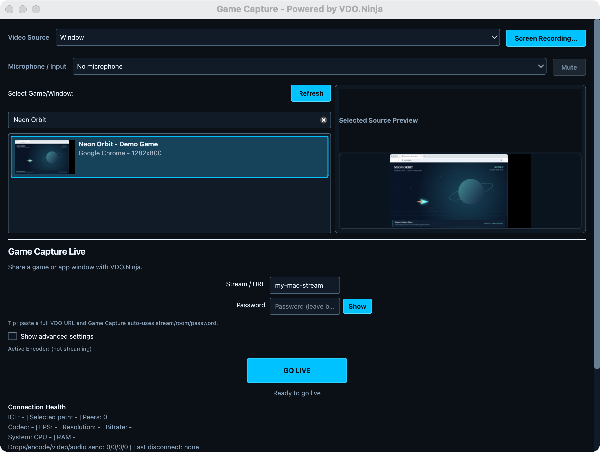

# Game Capture

A free, open-source app for streaming games, app windows, and webcams to **VDO.Ninja and OBS**. Native Qt, hardware encoding, window audio capture, and shareable viewer links.

**Windows is stable. macOS is available as an experimental Apple Silicon beta.**

## Downloads

| Platform | Download | Status |
| --- | --- | --- |
| **Windows 64-bit** | [Installer](https://github.com/steveseguin/game-capture/releases/latest/download/game-capture-setup.exe) · [Portable](https://github.com/steveseguin/game-capture/releases/latest/download/game-capture-portable.exe) · [ZIP](https://github.com/steveseguin/game-capture/releases/latest/download/game-capture-win64.zip) | Stable / production |
| **macOS — Apple Silicon** | [Download Mac ZIP](https://github.com/steveseguin/game-capture/releases/download/macos-v0.2.65-beta.3/game-capture-macos-arm64-0.2.65-beta.3.zip) | **0.2.65 Beta 3 — Experimental** |

[Windows release notes](https://github.com/steveseguin/game-capture/releases/latest) · [Mac release notes, source & checksums](https://github.com/steveseguin/game-capture/releases/tag/macos-v0.2.65-beta.3)

*macOS experimental beta shown.*

## Quick start

1. Download the version for your computer. On Mac, extract the ZIP and move **Game Capture.app** to Applications.
2. Open the app, select a window or camera, and choose audio if needed. Grant capture permissions when prompted.
3. Enter a stream ID or paste a VDO.Ninja URL, then click **Go Live**.
4. Share the generated viewer link or open it in OBS.

### Windows

The production version supports Windows hardware encoders, Spout2 sources, optional OBS transparency, and additional output destinations including WHIP, SRT, and RTMP. See the [Windows guide](docs/windows-guide.md) for audio, output settings, and troubleshooting.

### macOS beta

Apple Silicon (M-series) only, built for **macOS 14.2+**. Uses **Apple VideoToolbox** hardware H.264 or **x264** software H.264. The app is Developer ID signed and notarized. See the [Mac setup guide](https://steveseguin.github.io/game-capture/macos-guide.html) for installation, permissions, audio, and troubleshooting.

The Mac port remains experimental. Packaged workflows passed on an M1 running macOS 26.4.1, with bounded startup coverage on a fresh macOS 14.8.9 ARM64 VM. Physical minimum-OS, privacy/device transitions and broader production qualification remain open. See the [testing results and known limits](docs/macos-0265-beta3-validation-2026-10-18.md).

### Linux development

The Linux port targets Ubuntu 24.04 on x86-64 and is still under development. It uses the shared application core with Linux window, camera, audio and encoder backends. Local development DEBs and their exact workflow evidence are tracked in the [Linux parity ledger](native-qt/qa/linux-parity.json); there is no qualified Linux release yet. H.264 NVENC has bounded coverage on the GTX 750 Ti. Broader hardware encoding, full output/recovery coverage, clean installation and Windows/macOS regression qualification remain open.

Experimental **ARM64 Linux** support is integrated into `linux-parity` and reuses these backends. See the [native ARM64 build/package instructions and workflow scope](docs/linux-arm64.md) and the separate [ARM evidence ledger](native-qt/qa/linux-arm64.json). Raspberry Pi, ARM hardware encoding and full ARM parity remain unqualified.

An additional [portable Linux archive](docs/linux-portable.md) builds against Ubuntu 22.04 and bundles Qt/FFmpeg to reduce distribution dependencies. Extract the archive and run `AppRun`; it requires no installation or FUSE. It retains host desktop/audio services and GPU drivers. This does not change the Ubuntu 24.04 DEB's requirements.

When your desktop provides a system tray, closing the window keeps streaming. Use the tray’s **Show** action to reopen it, or **Quit** to stop and exit. On Wayland, the tray’s **Copy Share Link** action brings the window forward and completes the copy once it gains focus.

On Wayland, select **Preview window** and choose a window in the desktop permission dialog for a local video preview. Preview does not start audio capture or publishing. **Go live** uses that same capture session to start streaming; **Stop preview** releases it without going live. You can also select **Go live** directly and choose a window when prompted. The preview clears when streaming stops. Window capture excludes the mouse pointer, matching Windows and macOS. X11 also shows a selected-window thumbnail before streaming.

Keep a captured browser window visible while using the experimental Wayland port. In the owned GNOME workflow, fully covering Chrome 143 or Chromium 145 freezes the captured picture; uncovering restores it. Foreground capture passes motion, resize and restart checks, but covered-window capture remains an open parity gap.

For a VDO.Ninja room, show advanced settings and enter **Room** and **Stream password**. Use the same password in the room's director and scene pages. With H.264, **Use 640x360 for room guests/directors/viewers** keeps their previews smaller while scenes receive your configured resolution. Check **Enable director control via data channel** to allow remote changes; **Control Token** accepts an explicit token for authorized control clients. Uncheck the 640x360 option to send your configured resolution to every room role. Room settings, including this preference, persist across a clean app relaunch; capture starts only when you select a source and press **Go live**. Wayland asks you to choose the capture window again after Stop/restart or relaunch.

While live, **Copy Link** copies the displayed viewer URL and **Open Link** opens it in your default browser. The URL includes the stream password. For a room, this link opens a solo scene at your configured resolution, matching the Windows app.

If the signaling connection drops, the app shows a reconnecting notice and retries automatically. Existing peer connections may continue carrying audio and video; new viewers must wait for signaling to reconnect. **Stop streaming** and **Quit** remain available, including while a reconnect is waiting for a server response.

For application audio, choose **Selected window/app audio**. X11 can use the selected window's process automatically; on Wayland, choose a running **Audio app** explicitly. **Refresh audio apps** updates the list after an app starts playing sound. The selection covers that process and its children, and is cleared when Game Capture is relaunched. If the app closes, select its new instance before restarting the stream. The CLI equivalent is `--audio-source=selected-window --audio-process=<PID>`; omit `--audio-process` for automatic X11 selection. System audio and microphone/input selection remain separate choices.

Application discovery includes native PipeWire playback clients as well as PulseAudio clients. Audio still requires the desktop's PulseAudio service or PipeWire's PulseAudio compatibility service. JACK DSP clients are not yet available for individual application capture; their output can be captured with **System audio (all apps)** when routed through PipeWire to that output. Intermittent native-client output-move silence remains under investigation; see the parity ledger for the exact passing and failing workflows.

**Camera / Webcam** accepts supported V4L2 raw YUV/RGB and MJPEG devices, including virtual V4L2 cameras. The Facecam's MJPEG path, Cam Link's NV12 path and an owned `v4l2loopback` input have bounded packaged workflow coverage. This does not qualify every camera format, physical hot-plug, OBS itself or camera motion fidelity. Camera mode uses **Camera Resolution** for the encoded output as well as the requested capture size.

For voice-chat output, choose **Communications output (selected device)** and select the output used by your voice-chat app. Configure that app to play through the same output; Game Capture shares all sound on that output. The choice is saved. If the output disappears, its capture stops without switching devices; refresh the output list and restart streaming to capture it again. The CLI equivalent is `--audio-source=communications-output --communications-output-device=pulse-output:<sink-name>`; `pactl list short sinks` lists output names. This explicit Linux selection replaces the Windows communications-device role.

Audio capture failures remain visible above the settings while video continues. Check the affected app or device, stop streaming, then restart after reconnecting it or choosing a replacement. Primary audio and microphone failures are reported separately; stopping clears the notice, and a new attempt reports any remaining problem.

For software video, leave **FFmpeg Path** and **FFmpeg Options** empty to use the native Linux encoder. VP9 and AV1 also support an external FFmpeg helper: enter a path, custom options, or both. Options alone use the distribution FFmpeg (`/usr/bin/ffmpeg` when installed). Explicit paths and environment overrides take precedence over that default. The CLI equivalents are `--ffmpeg-path=/path/to/ffmpeg` and `--ffmpeg-options="-threads 2"`. H.264 and HEVC use the native encoder; HEVC receiver compatibility is still unqualified.

Saved output destinations use your desktop's Secret Service password store, such as GNOME Keyring. Keep its default collection unlocked while editing destinations. URLs and credentials are stored together there; the settings file holds only a reference. If storage fails, a message appears beside the output settings and those changes remain session-only. Repair or unlock the store and restart Game Capture to restore saved profiles. **File → Reset to Defaults** also removes the saved destination entry. Linux builds require `libsecret-1-dev` and `libxcb-damage0-dev` in addition to the media dependencies.

## Help and development

- [Website](https://steveseguin.github.io/game-capture/gamecapture.html) · [Screenshots & demos](media-assets/README.md) · [Setup guide](https://docs.vdo.ninja/guides/using-game-capture-with-vdo.ninja)
- [Report an issue](https://github.com/steveseguin/game-capture/issues) — include your OS, source, encoder, and logs from **Help → Open Log Folder**. Remove credentials before sharing logs.
- [Local control API](docs/local-control-api.md) · [AI / MCP automation](docs/ai-control.md)
- [Build & validation guide](docs/developer-guide.md) · [Release playbook](docs/RELEASES.md) · [Local security guards](docs/development-security.md)
- [Contributing](CONTRIBUTING.md) — includes contributor license terms.

Free and open source under [AGPL-3.0](LICENSE).

Encoding: **[Illustrated settings guide: resolution, bitrate, WHIP and CPU/GPU costs](https://steveseguin.github.io/game-capture/encoder-guide/)** · [Default policy](docs/streaming-defaults.md).
