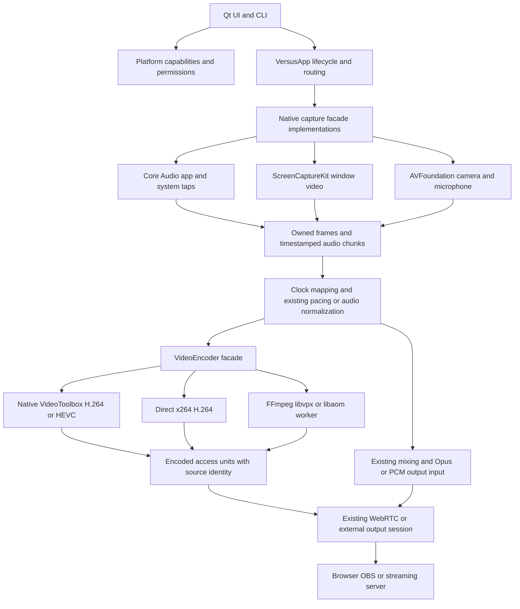
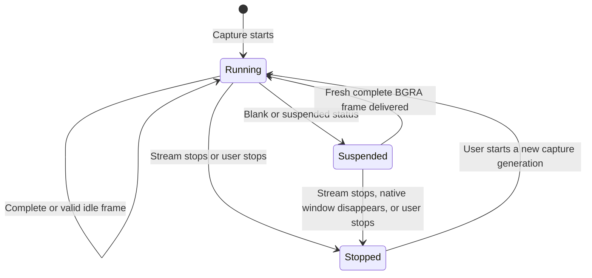

# macOS Apple Silicon architecture and implementation plan

Current checkpoint (October 18, 2026 UTC): [draft PR #7](https://github.com/steveseguin/game-capture/pull/7) incorporates runtime `c459d7a` plus Mac-only overload wording in `b565e51` and QA/documentation updates. The exact Developer ID executable `ca2ecda2…` is notarized and stapled in unpublished experimental draft `macos-v0.2.64-defaults-candidate.1`. It passes packaged GUI defaults/migration, VT/x264 720p60 and 1080p60 picture/audio workflows, AV1 functional playback, local WHIP and UDP/AAC workflows, browser quarantine/replacement/relaunch and fresh macOS 14.8.9 VM startup/x264 playback. [Media report](macos-defaults-integration-2026-10-18.md) · [delivery report](macos-defaults-delivery-2026-10-18.md). Windows packaged run `39085997354` passes 70 GUI assertions and software capture/media workflows. VM moving phases deliver 19.19–26.59 distinct images/s, not sustained 30 fps. Public Mac [Beta 2 — Experimental](https://github.com/steveseguin/game-capture/releases/tag/macos-v0.2.64-beta.2) and Windows stable v0.2.64 remain unchanged. Earlier thirty-minute and broader feature results retain their original artifact boundaries; full production qualification remains open.

The [load/recovery investigation](macos-load-recovery-2026-10-18.md) found severe x264 picture distortion at 4K/4 Mbps, confirmed by independent decoding. All complete VT/x264 runs recovered approximately 60 fps at 720p with continuous stereo. The frame reader now rejects complete barcode loss; partial row disagreements still need full-picture validation. The `b565e51` warning-only candidate is locally Developer ID signed and exercised, but is not notarized or published and does not replace the defaults draft.

The earlier timer-candidate archive passed packaged startup and x264 media workflows on two fresh macOS 14.8.9 VMs ([first run](https://github.com/steveseguin/game-capture/actions/runs/39069427973), [repeat](https://github.com/steveseguin/game-capture/actions/runs/39069610055)). These functional workflows do not qualify sustained VM frame rate, hardware VT on that OS, physical devices, new permission transitions or the exact 14.2 minimum.

Protocol boundary: follow the [VDO.Ninja source compatibility review](vdoninja-protocol-compatibility.md) for existing messages, authorization and BYE transport. Native lifecycle fixes must not invent VDO.Ninja commands or acknowledgements.

Game Capture should keep its Qt interface, publishing protocols, and media routing in one codebase, with separate Windows and macOS implementations for capture, encoding, permissions, and operating-system services. The Mac implementation uses native VideoToolbox H.264/HEVC, directly linked x264 H.264, and a separate software VP9/AV1 worker using the bundled FFmpeg/libvpx/libaom helper. This limits Windows changes while giving Mac encoders direct control over keyframes and bitrate.

Status: implementation began on `macos-arm64`; current integration and qualification are linked above. The parity ledger below records capabilities and remaining work; evidence sections bind each workflow to its actual development artifact. The initial architecture review used source revision `ad5217b8d2600c08b5a3307727ab5a7fd005a57b` on 2026-10-14. Historical artifact results do not certify later builds or release readiness.

The preceding local development package was source candidate 10 / download candidate 6. Its [resumed extracted GUI and x264 endurance qualification](#extracted-gui-and-foreground-source-cadence-2026-10-16) passed, including thirty minutes of 720p60 video and the subsequent live controls. Windows packaged regression testing and the remaining release requirements are still open.

The [Developer ID signed and notarized candidate](#developer-id-signing-candidate-2026-10-16), source candidate 11 / download candidate 7, is published as [macOS 0.2.62 Beta 1 — Experimental](https://github.com/steveseguin/game-capture/releases/tag/macos-v0.2.62-beta.1). Delivered GUI, window/application-audio and camera/input WHIP workflows pass. The earlier RTMP audio failure is now [isolated to the older RTSP recording tool](#rtmp-receiver-correction-and-signed-output-qualification-2026-10-16); the unchanged signed app passes the corrected output workflows. This is not a fully qualified production release.

For the architectural breakdown, start with [source boundaries](#source-boundaries-and-initial-audit), the [component diagram and build isolation](#component-boundaries), and [clock/encoder/recovery contracts](#time-encoder-output-and-recovery-contracts). The [parity ledger](#parity-goal-and-remaining-work) distinguishes implemented behavior from remaining verification. [Licensing and dependency policy](#licensing-and-dependency-policy) covers the AGPL app and bundled components. The evidence sections retain earlier failures and identify the exact package used by each later workflow.

Recent packaged increments fix [viewer-image continuity during capture suspension](#holding-the-viewer-image-during-capture-suspension-2026-10-15) and [Syphon readback consistency](#verified-syphon-readback), followed by [1080p source alpha-conversion qualification](#1080p-syphon-source-qualification-and-alpha-conversion-cost). Windows runtime regression qualification remains open.

The latest [full source rebuild](#full-source-rebuild-and-packaged-media-qualification) compiles the app and its dependencies from exported source materials. Its separate preserved bundle passes selected VT/x264/AV1, Syphon alpha and RTMP/SRT application workflows. This closes the dependency-rebuild gap while keeping distribution and platform qualification explicit in the ledger.

The [alpha aspect-change investigation](#transparent-source-aspect-changes-and-the-original-syphonvp9-mismatch) exposed intermittent mixed Syphon frames before encoding. The following readback fix and its new packaged evidence are recorded separately from those retained failures.

Implementation began on branch `macos-arm64`, after pulling `1c579f6` from `origin/main`. The new baseline adds RTSP/UDP/RIST destinations, defaults to 720p60 at 4 Mbps, enables RED by default for ordinary VDO.Ninja Opus publishing, and keeps camera microphone audio off until explicitly selected. Preserve those newer behaviors; the original source inventory below records the architecture review, not an instruction to restore older defaults.

## Building the development foundation

The current development implementation supplies an arm64 `.app`, ScreenCaptureKit window enumeration/preview/capture, native hardware VideoToolbox H.264/HEVC, directly linked x264 H.264, platform capability/permission reporting, and Mac data/log paths. Application/system audio now has a Core Audio process-tap backend feeding the shared Opus pipeline; packaged audio evidence is recorded separately below. Windows continues to use its existing media backends; window matching and frame-pacing helpers were moved without changing their implementation into `window_capture_common.cpp`.

On Apple Silicon with Xcode/Command Line Tools, CMake 3.24+, Ninja, and Python 3.9+, run from the repository root. The isolated Qt recipe supplies Widgets/Network/Concurrent/Test without changing any installed Qt or Windows dependency. The FFmpeg recipe additionally needs `pkg-config` and Meson; the commands below install Meson into a local build-only virtual environment:

```sh
cmake -DQT_SDK=/Library/Developer/CommandLineTools/SDKs/MacOSX15.4.sdk \
  -P native-qt/cmake/build-qt-macos.cmake
python3 -m venv native-qt/build-macos-deps/build-tools
native-qt/build-macos-deps/build-tools/bin/pip install meson==1.9.0
cmake -DFFMPEG_SDK=/Library/Developer/CommandLineTools/SDKs/MacOSX15.4.sdk \
  -P native-qt/cmake/build-ffmpeg-macos.cmake
# Requires full Xcode and its Metal compiler. If absent: xcodebuild -downloadComponent MetalToolchain
cmake -P native-qt/cmake/build-syphon-macos.cmake
cmake -S native-qt -B native-qt/build-macos-arm64 -G Ninja \
  -U 'Qt6*' -U VERSUS_MACDEPLOYQT \
  -DCMAKE_BUILD_TYPE=Release \
  -DCMAKE_PREFIX_PATH="$PWD/native-qt/build-macos-deps/qt-6.9.3" \
  -DCMAKE_OSX_SYSROOT=/Library/Developer/CommandLineTools/SDKs/MacOSX15.4.sdk \
  -DVERSUS_BUILD_TESTS=ON
cmake --build native-qt/build-macos-arm64 \
  --target game-capture macos_ui_control test_platform_capabilities test_window_capture \
    test_macos_encoder test_macos_capture test_macos_audio test_macos_camera \
    test_macos_output_profiles test_macos_ffmpeg test_macos_syphon -j 4
ctest --test-dir native-qt/build-macos-arm64 \
  -R '^(PlatformCapabilitiesGate|WindowCaptureTest|MacEncoderGate|MacCaptureGate|MacAudioGate|MacCameraGate|MacOutputProfileGate|MacFfmpegGate|MacSyphonGate)$' --output-on-failure
cmake --build native-qt/build-macos-arm64 --target macos-dev-bundle
open 'native-qt/build-macos-arm64/package/Game Capture.app'
```

The Mac build now requires Qt 6.9.3 or newer. The initial Homebrew Qt 6.9.0 build crashed in Cocoa accessibility object cleanup during real source-list interaction. The pinned Qt 6.9.3 source contains later ownership fixes; the recipe also backports upstream [QTBUG-145239](https://github.com/qt/qtbase/commit/a76004f16fdc43e1b7af83bfdf3f1a613491b234) for AppleClang 21, with original/patched file hashes checked. It builds shared Qt and bundled third-party libraries for arm64/macOS 14.2, with Secure Transport and without Homebrew runtime dependencies. The selected macOS 15.4 SDK is installed on this machine; adjust that path for your toolchain. Qt 6.9 still links AGL, absent from the default 26.5 SDK; choose a compatible Qt/SDK pair rather than removing framework dependencies. Dependencies are fetched during the initial configure. macOS defaults to arm64 and a 14.2 deployment target; Intel/universal builds and older deployment targets are rejected. `macdeployqt` must be available from the selected Qt installation or PATH to create the deployment target.

The package target copies the build product and deploys Qt into the copy. It then runs `qa/audit-macos-bundle.py`, a deployment gate checking every Mach-O file for arm64, minimum-OS metadata, relative install/search paths, resolved bundled dependencies, and a valid deep signature. The JSON audit is saved alongside the staged bundle. This does not establish clean-machine or minimum-OS runtime compatibility. It normalizes Homebrew Qt framework paths in the staged executable and fails on dependency errors reported by `macdeployqt`, even when that tool returns zero. It applies and verifies an ad-hoc signature so the modified arm64 binaries can execute locally. It is a development artifact with a bundled FFmpeg helper, without distribution signing or notarization. It includes statically linked x264 and its license/revision notice; a release still needs the full corresponding-source and dependency-notice distribution. The deployment target is a build setting, not proof that the installed Qt/dependencies work on macOS 14; that requires a separate minimum-OS qualification.

Mac logs use `~/Library/Logs/GameCapture`. Default control discovery and issue reports use `~/Library/Application Support/GameCapture`. `--local-control` enables the existing loopback API; `platform_capabilities` in diagnostics distinguishes an unavailable backend from an empty source list. `platform_permissions.screen_recording` reports permission without requesting it. The **Screen Recording…** button is the explicit permission action; diagnostics and periodic window refresh do not prompt.

Mac-only compatibility settings select spdlog's C++20 standard formatter, configure Opus 1.4 for mandatory NEON, and connect libdatachannel's Mbed TLS imported targets to the actual bundled libraries. The external-output owner uses standard shared-pointer atomic operations when the C++20 `atomic<shared_ptr>` specialization is missing; Windows keeps that specialization where supported. These changes do not update Windows dependency versions.

Compilation and the CTest command above are gates. Full Mac media workflows and packaged Windows regression testing are still required before release.

### Pinned Qt deployment gate, 2026-10-14

The isolated Qt 6.9.3 recipe completed with the checked AppleClang patch and rebuilt the application. The new package passed the static deployment audit: **14 bundled Mach-O files, all arm64 and all declaring macOS 14.2**, with no absolute install/search paths and no unresolved/external non-system load dependencies. Deep/strict ad-hoc signature verification passed. Its Qt source archive hash, local patch, build recipe and source license inventory are copied into `Contents/Resources/licenses/Qt`. This removes the earlier Homebrew dependency blocker; it does not establish runtime behavior on macOS 14.2 or a clean machine.

Twelve relevant gates passed against this Qt build: platform capabilities, native encoder/audio/capture, window matching/list, audio conversion/Opus, signaling/lifecycle, ICE and local control. `MacAudioGate` actually ran its BlackHole input generations; the physical-input stress case remains opt-in and was skipped. Gates are distinct from the packaged workflows below.

### Earlier foundation evidence, 2026-10-14

The working branch based on `1c579f6` built on arm64 macOS 26.4.1 with AppleClang 21, the macOS 15.4 SDK, and Homebrew Qt 6.9.0. Seven selected gates passed: `PlatformCapabilitiesGate`, `UpdateCheckerTest`, `AudioFormatConverterTest`, `OpusEncoderTest`, `VdoSignalingTest`, `IceConfigTest`, and `LocalControlServerTest`. The source-list comparison retained every existing Windows translation unit and added only capability reporting; the existing native media implementation files are unchanged. No Windows build or application testing was performed here.

The deployed, ad-hoc-signed application passed its actual local diagnostics workflow: Cocoa GUI process launch, authentication rejection, capability reporting, diagnostics export without the control token, log placement, graceful quit/discovery cleanup, and headless failure with diagnostics and exit code 3. The workflow launched the bundle executable directly; Finder/Gatekeeper installation behavior was not tested. Reproduce using a fresh report directory:

```sh
python3 native-qt/e2e/macos-foundation-packaged.py \
  --app 'native-qt/build-macos-arm64/package/Game Capture.app' \
  --report-dir native-qt/qa/reports/macos-foundation-local
```

Local evidence is in `native-qt/qa/reports/macos-foundation-2026-10-14-signed/` (ignored generated artifacts), including `results.json`, exported diagnostics, logs, and `bundle-audit.json`. The packaged executable SHA-256 was `378c01de9b6dba296481c5ab98f9e1445f0621656ee375148e4ab934508076c0`. Deep/strict signature verification passed. All 69 embedded Mach-O binaries were arm64; inspected non-system load dependencies resolved inside the bundle.

**That earlier Homebrew development bundle requires macOS 26 dependencies.** Homebrew's Brotli libraries declare macOS 26.0, and several other libraries declare 15.0, despite the application's 14.0 deployment setting. Three libraries also retain optional absolute Homebrew search paths, and some retain absolute install identities. The bundle has only been exercised on this development machine. Pin/rebuild the dependency set for the intended minimum OS, remove residual build-machine metadata, verify all dynamic/plugin loading on a clean machine, and align bundle minimum-OS metadata before distribution. Do not use this bundle to claim macOS 14 support.

At that foundation snapshot, Mac capture/encoding were not implemented. The following implementation adds them. Stage 1's Windows exit criteria still remain open; no Windows regression claim follows from Mac evidence.

## Window-video implementation

- `src/platform/macos/window_capture.mm` owns ScreenCaptureKit objects and callback generations. ScreenCaptureKit uses its native compositor cadence (`minimumFrameInterval = 0`); the existing admission pacer applies the requested frame rate before pixel readback, and the shared encode worker paces transmitted frames. Live FPS changes update the admission policy without restarting the native stream. Applying the requested FPS limit in ScreenCaptureKit as well had reduced capture cadence on this Mac; the before/after measurements below track this separately from encoding and browser presentation. It copies BGRA rows before releasing native buffers, maps the host clock into the shared 100-ns media clock, and bounds enumeration/start/stop waits. Old generations cannot call the app after stop. A start that completes after cancellation is stopped again. Idle frames retain static content; blank/suspended/stopped output marks the source unavailable. Thumbnail requests are asynchronous, cached separately by window and requested size, and bounded to eight small requests plus one selected-preview request. A 64-entry cache and freshness limits bound retention and prevent a window-list thumbnail from replacing a larger preview.
- `src/platform/macos/video_encoder.cpp` backs the existing `VideoEncoder` facade. VideoToolbox requires hardware acceleration and verifies the actual hardware property. It accepts one in-flight frame, waits at most 500 ms for its callback, and quarantines a timed-out session until reinitialization. AVCC output becomes Annex B, with SPS/PPS on keyframes and checked frame identity. This conservative implementation deliberately avoids changing Windows encode timing semantics.
- x264 is built as static, 8-bit arm64 code from revision `b35605ace3ddf7c1a5d67a2eb553f034aef41d55` using `cmake/x264-macos.cmake`. Compiler and assembler flags use the selected SDK/deployment target. The zero-latency preset disables delayed output; an internal frame counter is mapped back to the caller's timestamps. Both backends use the same aspect-fit BGRA-to-limited-range SDR conversion and support explicit keyframes and bitrate updates. The initial implementation used BT.709; the current BT.601 matrix/sRGB contract and its interoperability evidence are described in the transparent-capture section below.
- Explicit VideoToolbox/x264 selections cannot silently change encoder category. Auto prefers hardware and can fall back to x264. Mac recovery candidates contain only VideoToolbox and software; Windows retains its previous order. The initial UI exposed H.264; the later HEVC and VP9 sections below record the additional codecs and their qualification.
- `src/platform/macos/network.mm` supplies system CA roots to libdatachannel's Mbed TLS WebSocket transport and fetches the TURN registry through a bounded native HTTPS request. TLS verification remains enabled. Windows network code is unchanged.
- The current UI offers window capture, selected-app audio, system output mix, selected microphone/mixing and live mute, and VDO.Ninja. Mac CLI defaults to selected-app audio, matching Windows; `--audio-source=none` explicitly disables audio. AVFoundation camera capture is also implemented, with evidence below. WHIP and FFmpeg-based destinations are also implemented; their qualification is recorded separately below. Communications-device equivalents, minimum-OS runtime, signing/notarization, and full performance/Windows qualification remain subsequent work.

Example development invocation (use a unique private stream ID and your intended window title):

```sh
'native-qt/build-macos-arm64/package/Game Capture.app/Contents/MacOS/game-capture' \
  --headless --window='Your window title' --stream=YOUR_UNIQUE_STREAM_ID \
  --video-encoder=videotoolbox --video-codec=h264 --audio-source=none \
  --width=1280 --height=720 --fps=30 --bitrate-kbps=4000
```

Use `--video-encoder=x264` for software or `auto` for hardware with software fallback. Explicit hardware requests are checked against actual backend identity.

`MacEncoderGate` independently decodes both native encoders' output with FFmpeg and checks per-frame color identity, packet identity/timestamps, requested keyframes, bitrate updates, and restart. It is a gate, not packaged application testing. The packaged workflow is `e2e/macos-window-publish.js`: it creates its own animated window, launches the deployed publisher, and measures decoded fixture identities in a real VDO.Ninja browser receiver, including static content, resizing, late viewer join, shutdown, and source closure. It never chooses an arbitrary desktop window.

```sh
cd native-qt
npm ci --ignore-scripts
npx playwright install chromium
node e2e/macos-window-publish.js \
  '--app=build-macos-arm64/package/Game Capture.app' \
  --reports=qa/reports/macos-window-publish
```

### Packaged window-video evidence, 2026-10-14

The final development bundle passed the controlled window-to-browser workflow independently with both encoders at a requested **640×360, 30 fps, 1.5 Mbps**, with no audio. The receiver decoded real H.264 fixture identities: VideoToolbox delivered 171 distinct identities during the six-second moving observation, and x264 delivered 170. Identities remained ordered, with maximum observed steps of two and three source frames respectively. These short runs establish functioning media, not the proposed full-rate/performance release criteria below.

Both encoders also passed static-image pacing (74 observed frames over 2.5 seconds with one fixture identity), source-window resize, and late-viewer join. VideoToolbox quit normally through local control. Closing the x264 source window produced a capture-failure exit and cleaned up local-control discovery. Live diagnostics confirmed hardware VideoToolbox versus software x264 and recorded zero encode failures/timeouts during the initial moving observations. Trusted WSS signaling and native TURN-registry HTTPS succeeded. The selected peer connections used STUN; TURN retrieval success is not proof of relayed media.

The same artifact passed the GUI-process diagnostics/export/log-placement/shutdown workflow and an explicitly missing-source failure. A separate capture gate verified thumbnail colors/orientation, owned BGRA pixels, steady-clock timestamps, admission before readback, and three start/stop generations without post-stop delivery. Relevant gates passed: `PlatformCapabilitiesGate`, `MacEncoderGate`, `MacCaptureGate`, `WindowCaptureTest`, `VdoSignalingTest`, `VdoSignalingLifecycleGate`, and `IceConfigTest`. These gates remain separately classified from the packaged browser workflows.

Local generated evidence:

- `native-qt/qa/reports/macos-window-publish/da22d5cc-2400-4253-a91f-c1abf6533a00/`: receiver observations, fixture/receiver screenshots, live/final diagnostics, logs, and bundle audit.
- `native-qt/qa/reports/macos-video-final-diagnostics-2026-10-14/`: packaged GUI-process diagnostics workflow.
- Packaged executable SHA-256: `a87e6961b0618306496b0f1319dc100f04a06d02414191b9765563fbb2903a65`.

Deep/strict ad-hoc signature verification passed. All 69 embedded Mach-O files are arm64, and inspected non-system load dependencies resolve within the bundle. The x264 archive's object deployment metadata is now 14.0. At that snapshot the Homebrew bundle still included macOS 15/26 libraries and residual install/search metadata, so it was not a macOS 14 release artifact. The pinned-Qt audit recorded above replaces that dependency set.

At that video-only snapshot, remaining work included Finder/Gatekeeper installation, permission denial/revocation/relaunch, sustained gameplay, calibrated color/A-V/latency, minimum-OS/clean-machine execution, relay media, room HQ/LQ, microphone/camera support, additional outputs, and **Windows build/application regression testing**. Later microphone evidence follows below. Windows capture's extracted common helpers are unchanged, but source inspection cannot certify Windows behavior.

### Window cadence measurement

`e2e/macos-window-publish.js --performance-seconds=60` defaults to a controlled 1280×720/60 fps/4 Mbps window workflow. It records source drawing cadence, decoded fixture identities through a cloned received track, the visible player's presentation callbacks, native capture/encode counters, RSS and system load in ten-second intervals. The [MediaStreamTrackProcessor API](https://www.w3.org/TR/mediacapture-transform/) exposes decoded `VideoFrame` objects; each is closed promptly and the clone is stopped after observation. The visible player remains active. Both observers read only the identity scanline, limiting their own rendering work. Frame IDs advance once per actual source draw, avoiding time-bucket aliasing that can assign duplicate IDs to distinct draws. A slow source cannot qualify a target frame rate.

The workflow also changes FPS live to 30 (15 when starting at 30) and back, verifying decoded content and the readback admission limit. Existing static pacing, source resize, late viewer and shutdown/source-loss checks remain. `--width`, `--height`, `--fps` and `--bitrate-kbps` select other configurations; `--encoder=videotoolbox` or `--encoder=x264` narrows the run. Generated reports preserve the exact harness sources and executable hash. This is a functional/performance measurement of the packaged app, distinct from capture/deployment gates. A one-minute observation does not satisfy the thirty-minute release qualification below.

Apple describes [minimumFrameInterval](https://developer.apple.com/documentation/screencapturekit/scstreamconfiguration/minimumframeinterval) as an update throttle, with zero using the maximum supported rate. Native-rate delivery avoids applying the target-rate limit twice; the app still discards excess callbacks before copying pixels. On high-refresh displays the OS may produce more callbacks/surfaces than the configured output rate, so power use on those displays remains to measure. Windows capture and its timing policy are unchanged.

The controlled before/after comparison ran on an Apple M1 with 8 GiB RAM and macOS 26.4.1. Both artifacts used exactly the same harness and receiver hashes (`6525008f...` / `c59dfffa...`), the same 720p60/4 Mbps configuration, and a real VDO.Ninja receiver on this Mac. The old bundle (`03636f...`) observed 30 seconds per encoder; the revised bundle (`4b741146ef242aca04859c43c8f0f747787b942cfaef325c5b60d5ee5a64608c`) observed 60 seconds per encoder. Ten-second interval ranges were:

| Encoder / bundle | Distinct decoded fps | Distinct presented fps | Worst interval p95 media gap |
| --- | --- | --- | --- |
| VideoToolbox before | 56.89–57.30 | 52.39–52.80 | 20 ms |
| VideoToolbox after | 59.98–60.00 | 58.78–59.69 | 17 ms |
| x264 before | 56.40–56.80 | 52.00–52.89 | 19 ms |
| x264 after | 59.80–60.00 | 58.30–59.68 | 17 ms |

All twelve revised intervals met the decoded-cadence target, with no increase in encode failures/timeouts; the largest observed decoded media gap was 18 ms. Both encoders delivered 150 distinct frames during the five-second live switch to 30 fps and 300 after restoring 60 fps. Capture readback stayed bounded at 151 and 302 frames respectively, including control-query time. Static pacing, window resize, late join and normal quit/source-loss workflows passed. Publisher RSS during the one-minute measurements ranged from about 124 MiB (VT) and 114–134 MiB (x264); this short observation does not prove a long-run memory plateau.

Reports: `native-qt/qa/reports/macos-720p60-comparison-before/10dea5ef-a044-4117-8f39-198884b86c73/` and `native-qt/qa/reports/macos-720p60-comparison-after/ab83c378-bf4a-4448-95f4-f5150b2f65fb/`. Earlier `macos-720p60-baseline`, `macos-720p60-decoded` and `macos-720p60-native-cadence` runs retain investigative evidence, including the rejected time-bucket-ID fixture. They are not substituted for the corrected comparison. The Mac capture/window gates and all 15 bundled Mach-O deployment checks passed separately.

The same revised bundle then passed both encoders at 720p60 with selected-application audio in `native-qt/qa/reports/macos-720p60-audio/5891e5ea-511e-426a-8028-d044de462dac/`. Thirty-second measurements delivered 59.89–60.00 decoded fps (VT) and 59.69–60.00 (x264), with stereo 440/880 Hz source tones, exclusion of a separate live 2 kHz `afplay` source, source silence, late-viewer audio, live FPS changes and lifecycle checks. The source and receiver used Chromium 145.0.7632.6. No microphone or physical camera was opened. These observations do not establish calibrated A/V offset or long-run drift.

For a longer run, use `--performance-seconds=1800 --encoder=videotoolbox --audio=selected-window` (and separately `--encoder=x264`). The interfering source now loops a small owned 30-second clip; premature/failed playback is an error and cleanup disables further launches. This avoids a fixed-duration clip expiring silently during a long run. Long-run results must be recorded after completion, not inferred from the short runs above.

The revised `4b741146…` bundle completed that thirty-minute VideoToolbox workflow on the M1/8 GiB machine: **all 180 ten-second intervals passed**, spanning 1800.29 seconds of observation. Decoded cadence ranged from 59.38 to 60.10 fps, with minimum delivery ratio 98.97%, maximum interval p95 media gap 17 ms and maximum individual gap 36 ms. Native encode failures/timeouts stayed at zero. Publisher RSS ranged from 77.3 to 114.6 MiB; the first/last minute medians were 106.3/82.7 MiB, with no sustained growth observed in this run. These are resident-memory observations, not a leak proof. Median whole-system CPU use was 28.8%, including source and receiver browsers.

The subsequent stereo/app-isolation, silence/resume, 30→60 fps control, static image, source resize, late-viewer audio/video and normal shutdown checks also passed. The independent interfering audio process restarted 62 times and was verified alive during audio observations. Report: `native-qt/qa/reports/macos-720p60-soak-vt/61a7c956-9684-4e98-881d-92a38c39780b/`. This establishes one controlled VT window workflow; it does not establish calibrated A/V offset/drift, uninterrupted audio throughout every interval, x264/room long-run behavior, Windows compatibility or distribution readiness. The later native-resize changes below are not part of this measured artifact.

A separate capture issue in the measured bundle is upward resolution changes: its native stream retains the dimensions selected at capture startup, while shared controls resize the encoder. The recorded downsize workflows prove requested output dimensions and continuing playback; they do not prove that raising the output resolution acquires additional native source detail.

The current implementation connects Mac-only `WindowCapture::ensureFrameSize` calls to runtime resolution changes and independent LQ initialization. It grows the ScreenCaptureKit surface to accommodate the largest requested width and height during a capture generation. Decreasing output size leaves that surface intact, so returning to a larger output does not lose detail. Capture restart resets the budget. A native update must complete within one second; failure or an indeterminate timeout stops that generation, since a late OS update cannot safely be treated as unchanged. Shared video settings are committed only after the native update succeeds.

The captured surface and visible window can have different aspect ratios after a source resize. The Mac adapter therefore reads ScreenCaptureKit's content rectangle and surface scale, bounds them against the pixel buffer, and copies only visible BGRA rows. The shared encoder then applies its normal aspect fit once. Invalid or missing rectangle metadata conservatively retains the full surface; it must not cause an out-of-bounds copy. See Apple's [frame metadata](https://developer.apple.com/documentation/screencapturekit/scstreamframeinfo) and [capture sample](https://developer.apple.com/documentation/screencapturekit/capturing-screen-content-in-macos).

`e2e/macos-window-resize.js` starts at 320×180, raises output to 960×540, downsizes/restores it, and changes the source/output between landscape and portrait. Its receiver checks a deterministic fine-detail pattern, circle geometry, framing against actual window bounds, decoded motion and native capture dimensions. With `--room=true`, real director/scene receivers additionally check that small HQ does not constrain the independent 640×360 x264 preview's native detail, and that LQ keeps playing through HQ/source resizing. The native capture gate additionally checks crop dimensions, orientation and stopped-generation behavior; that gate alone cannot establish application parity. All new native-size hooks are Apple-only; Windows still requires its own packaged regression qualification.

The old `4b741146…` bundle failed the direct-viewer negative control: its 960×540 output still came from a 320×180 native capture, with only 75.35% agreement on the fine-detail pattern and 91.5 luma-level contrast. The revised executable, SHA-256 `11e247efc3a475f872251b26ec84a07335f39e2be2abde8d35f09567a6c5a618`, passed all four resize phases with **both explicit VT and x264 encoders**. Landscape and portrait detail agreement reached 100%; returning from portrait to landscape reached 93.66%, above the unchanged 90% criterion. Contrast stayed above 200, circle width/height ratios were 1.00, and measured framing stayed within 0.4% of the expected window scale. Native capture dimensions changed from 838×540 to 560×960 and 960×619 as the source/canvas changed, rather than remaining at startup resolution.

Direct-viewer reports: `native-qt/qa/reports/macos-resize-before/98438bfc-d72c-4a60-aa14-3edd6d393c62/` and `native-qt/qa/reports/macos-resize-after/6f9efc40-bfe7-48aa-bfe5-04af25f487be/`. Both retain the same harness snapshot/hash for this comparison. Build/native capture gates and the 15-binary deployment audit passed separately.

The same revised bundle passed both encoders with real director/scene receivers in `native-qt/qa/reports/macos-resize-room/9d4ede59-093e-4c77-8cba-128a99406532/`. Before an HQ viewer joined, the independent x264 preview had already grown native capture to 559×360 while HQ remained configured at 320×180. Its 640×360 decoded output achieved 100% agreement and 221.9 contrast on the four-CSS-pixel detail pattern. Both room cases then passed all HQ/source resize phases and retained moving 640×360 LQ output through completion.

The corrected room harness also rejected the old bundle in `native-qt/qa/reports/macos-resize-room-before/e049e7d2-1509-417a-ad61-56dee3f2f17d/`: native capture remained 320×180, and the LQ image had 92.86% detail agreement and 166.4 contrast. This comparison uses the same harness hash on both bundles; its explicit native-dimension assertion catches the old limitation even where the coarser LQ pattern still clears the image thresholds.

Two retained investigative room reports exposed harness assumptions, not accepted application results: `2a0df0f6-fe86-4890-b50b-5ec9c70733a4` read an HQ-only dimension counter before HQ was active, and `48f25a62-8e74-4509-9543-5162f916e441` could address the director instead of the publisher. The corrected harness uses delivered-source dimensions and matches the destination's stream ID.

The revised artifact also passed a sixty-second 720p60 selected-app-audio measurement and the subsequent full window workflow with both encoders in `native-qt/qa/reports/macos-resize-720p60-audio/b467aebe-b660-4322-9501-3b8ed0dc8ccd/`. All twelve intervals passed: VT delivered 59.69–60.10 decoded fps and x264 delivered 59.78–59.99, with p95 media gaps of 17 ms and maximum individual gaps of 37/34 ms respectively. Stereo isolation, silence/resume, live FPS control, static image, source resize, late-viewer audio/video and quit/source-loss cleanup passed. The source/build manifest, deployment gate and compact workflow summaries are in `native-qt/qa/reports/macos-resize-artifact-2026-10-14/`. The subsequent thirty-minute x264 run on this resize artifact completed successfully in `native-qt/qa/reports/macos-resize-soak-x264/f9d88c57-02b8-4a4d-9a8d-1019576979d1/`. All 180 ten-second intervals passed (1800.279 seconds measured), delivering 59.69–60.10 decoded fps with a minimum delivery ratio of 99.5%, worst interval p95 gap of 17 ms and maximum individual gap of 35 ms. Encode failures/timeouts remained zero. Publisher RSS ranged from 95,040 to 118,720 KiB; first/last-minute medians were 118,608/95,728 KiB. Stereo isolation, silence/resume, live FPS control, static image, resize, late joining and normal source-loss/shutdown checks passed afterward. This does not measure calibrated A/V offset/drift or continuously verify audio in every interval. Room long runs and VT on this resize artifact remain necessary; the earlier thirty-minute VT result belongs to the earlier bundle.

The subsequent resize harness extension accepts `--cycles=10` to perform ten iterations per encoder (twenty packaged launches with the default two encoders). Each iteration decodes all resize phases, requests stop, checks that capture/send counters remain unchanged after stop, and then quits; each normal stop/quit must complete within five seconds. Every iteration keeps separate logs, screenshots and diagnostics. The twenty-launch repeat run completed successfully on the update/notice bundle (`c9b32867917810a717ddefb5dd7fbb88b2fc50e0c05d909a415fe9a85ed77e14`) in `native-qt/qa/reports/macos-lifecycle/5d5039ae-83ea-42eb-8abd-b72148e81784/`. All twenty launches (ten per encoder) passed the eighty decoded resize phases, post-stop counter checks and normal shutdown. Stops took 69–217 ms; quits took 200–205 ms. It covers separate process lifecycles and does not replace same-process GUI stop/start or physical-device recovery coverage.

The separate `e2e/macos-gui-lifecycle.js` workflow passed ten same-process GUI cycles per encoder on the same bundle in `native-qt/qa/reports/macos-gui-lifecycle/6bccea69-6827-46a9-a6b5-233c68c8b40f/`. Each encoder used one process with isolated preferences and no audio/input device. The actual Go Live/Stop button started and stopped each 960×540/30 fps stream; every restart delivered fresh decoded H.264 with the selected hardware/software category, and every stop re-enabled Go Live and settled capture/send counters. VT starts took 496–1695 ms and stops 354–382 ms; x264 starts took 503–1234 ms and stops 355–375 ms. Final quits took 206/202 ms respectively. These start timings end at publisher readiness, not first receiver output. Post-run inspection of every stopped diagnostic found zero peers, no pending candidate queues and no queued/in-flight peer operations.

Stopped RSS settled over the last cycles near 188,464 KiB (184.0 MiB) for VT and 212,416 KiB (207.4 MiB) for x264; x264 warmed up across approximately six cycles. This short observation does not establish long-run memory behavior. The retained first attempt, `macos-gui-lifecycle/fa60ac6e-729d-484c-9dab-d0f86777fc9f/`, failed because the new harness seeded unsupported 640×360 preferences; the UI correctly fell back to 1280×720. The corrected harness uses the offered 960×540 resolution. Normal restart is now covered; source-loss recovery, interrupted startup, permission/device transitions and audio restarts remain separate work.

## Parity goal and remaining work

The active user goal is functional parity with the Windows application, replacing Intel/NVIDIA/AMD hardware encoders with Apple VideoToolbox. The milestone table below is an implementation order, not approval to permanently drop Windows features. Track each existing workflow against a Mac equivalent and real packaged evidence. Implemented coverage in this table includes historical artifacts; the linked current-candidate record, not the union of old passes, defines the release qualification. Windows-only integrations such as Spout require an explicit Mac equivalent/design decision; unavailable implementations must remain visible in this ledger.

| Area | Implemented Mac behavior (artifact-specific evidence) | Remaining parity/qualification |
| --- | --- | --- |
| Window video | ScreenCaptureKit, previews, pacing, window loss; packaged upward resize/detail and portrait/landscape framing; temporary minimize/hide suspension with automatic restoration and explicit recovery from native window destruction or owner exit; controlled capture while fully covered, including starting covered | Permission denial/revocation, sleep/wake/display blanking, sustained defaults on the latest artifact |
| H.264 encoders | Hardware VT and direct x264; the current signed timer candidate passes separate thirty-minute 1080p60 VT/x264 workflows, 180/180 intervals per encoder, continuous received PCM and subsequent live controls; independent hosted Linux receivers pass six ten-second picture/stereo-audio intervals per encoder plus late joining | Sustained gameplay/thermal and longer/broader independent-receiver qualification; each independent run has one presentation interval below 57 fps and two final send-failure counts after viewer closure, retained as a failed zero-counter review gate; overload/recovery and combined physical audio/device load |
| Application/system audio | Core Audio process taps; packaged app isolation, system mix, stereo, silence, late helper and late viewer passed | Long-run clocks/device changes, permission loss |
| Audio encoding | Shared Opus, experimental PCM and experimental RED; mono/stereo CLI and GUI playback with VT/x264; simultaneous PCM/RED and Opus-fallback viewers; Opus bitrate override/restoration; GUI codec/channel state and persistence; correct Mac native spin increments and numeric UI limits; controlled 10%/30% loss, outage and recovery with all three audio modes on VT/x264 | Broader network/receiver coverage, longer playback and calibrated synchronization; extremely low-rate stereo quality remains a shared codec limitation |
| Microphone/mixing | AVFoundation capture; packaged input-only and app/input mixing with VT/x264; GUI live mute/unmute; owned virtual-input removal preserves video, explicit missing input stays off, stereo returns after recreation and relaunch; same-process GUI Stop/reselection/Go Live recovery, visible loss notification and meter cleanup, independent system audio continues after input loss | Physical hotplug, permission transitions, long-run and calibrated A/V coverage |
| Camera | AVFoundation discovery/format negotiation, owned BGRA, bounded startup/stop; packaged virtual-camera/input publishing with VT/x264, GUI preview/mute/restart and stalled-frame failure passed | Physical devices, permission transitions, hotplug/busy recovery, calibrated timing/color and sustained performance |
| Publishing | VDO.Ninja media workflows; WHIP with VT/x264, stereo Opus, authenticated GUI profiles and recovery; public trusted HTTPS signaling and decoded browser media over direct and required public TURN routes, owned receiver reload/re-registration with same-process relayed recovery, bounded slow-STUN gathering, Stop during gathering, and local TURN-only OPTIONS/POST discovery with recovery; bundled FFmpeg destinations; controlled RTMP/SRT window minimize/restore with existing and late receivers, including virtual stereo input; dual-tier room playback and director controls; five-minute simultaneous HQ/preview room observations and subsequent controls passed with VT/x264 on the relocated app; password/plain signaling outage recovery, existing/late viewers, surviving controls and bounded Stop/Quit during a pending handshake; hosted guest camera join, natural LQ routing, explicit Hang up and fresh guest rejoin with VT/x264; password/plain room signaling recovery with existing director/scene peers, late guests, unannounced tab closure and timed peer cleanup while surviving media continues; public VDO TURN publishing with initial/late viewers, decoded cadence, stereo and authorized bitrate controls on VT/x264 | Earlier four-viewer fifteen-minute room evidence exists; current-candidate sustained room/load and broader departure/network/control coverage remain. Current candidate passes 12 local mux cases, both eight-action room fuzz workflows, mouse-driven hardware-VT RTMP/encrypted-SRT workflows and saved-WHIP migration with both encoders. Further relay transports/servers, broader WHIP public-relay interruption/recovery and trusted RTMPS remain; TURN TCP/TLS allocation is unsupported by the shared default ICE backend |
| Other codecs/features | H.264, native VideoToolbox HEVC, software VP9 and experimental software AV1; AV1 CLI window/audio/browser playback and controlled native GUI source recovery pass; transparent H.264/VP9 window capture, paired VP9-mask reception and real OBS scene composition pass in controlled CLI/GUI workflows | AV1 sustained qualification and broader GUI coverage; remaining Windows equivalents and broader codec interoperability |
| Transparency/backgrounds | ScreenCaptureKit straight BGRA, paired VP9 masks, native OBS decoding/composition, GUI alpha controls; existing native OBS viewer continuity through controlled window suspension/restore, source/output resize, CLI publisher relaunch and same-process GUI source replacement; selected portrait/wide source changes with a fixed 16:9 output; late native viewers receive the held alpha image; window chroma/solid backgrounds through the shared compositor, with decoded browser pixels qualified on VT/x264/HEVC/VP9 and controlled AV1 CLI workflows | External-sender qualification of the Syphon readback fix; higher-resolution AV1 background performance and complete VoiceOver coverage, broader external-output background modes (opaque black RTMP/SRT now qualified); combined source/output aspect changes, long pauses and sustained runs |
| Texture sharing | Syphon Metal backend with bounded verification of owned readback copies, Mac GUI/CLI selection, authenticated discovery, straight/premultiplied input normalization; packaged VT/x264 backgrounds and source lifecycle (including a controlled 1080p source downscaled to 360p30 and full 1080p30/60 output with controlled stereo input and two-application system-audio mixing), paused-image delivery with stereo silence/resume for existing/late viewers, native OBS H.264/VP9 paired-alpha output, explicit selection/refusal; GUI combined system/virtual-input routing with gain/mute isolation, restart and saved preferences; upstream Simple Server OpenGL grayscale → Metal capture → VT/x264 browser playback, late viewers and orderly sender loss | Broader external sender interoperability (color/alpha/orientation, resize and sustained load), independently sourced physical system/input mixing and device changes, calibrated A/V timing, broader advanced-control and VoiceOver coverage, isolated readback cost and longer sustained performance |
| Platform integrations | Native bundle icon, Mac logs/data, screen permission button, Keychain output profiles, native system-resource sampling, source-list and source-dependent audio-menu accessibility adapters, plus owned rows for all 16 Mac dropdowns; native close-to-menu-bar and Launch Services reopen, including live publishing; focused keyboard editing/navigation, Command-Q, About and private-settings Reset workflows; current timer candidate passes 14 keyboard/relaunch/reset steps and six expanded forward/reverse Tab layouts for settings controls; Space-driven VT/x264 Go Live/Stop; scoped capture activity prevents App Nap while allowing idle sleep | Complete tab-order/VoiceOver and remaining menu/shortcut UX, compatible-release download/install qualification, equivalents for Windows-only integrations |
| Delivery | Published experimental Developer ID signed, hardened-runtime arm64 beta; Apple notarization accepted, ticket stapled, extracted-copy Gatekeeper accepted; matching source/build archive; delivered GUI and selected VT/x264 media workflows passed; development bundle preserved | Current timer-candidate Beta 2 replacement and saved-WHIP credential migration passed; browser-download/quarantine remains pending while the candidate is unpublished. Exact minimum-OS and fresh physical-host media/privacy qualification remain. Two fresh macOS 14.8.9 VMs passed startup and bounded x264 media workflows; hardware VT on that OS is unqualified. Earlier Beta 1/2 browser downloads and upgrades retain their artifact-specific results; prior RTMP recorder failure is resolved below |
| Windows preservation | Windows backends retained; runtime `c459d7a` passes packaged software-H.264 capture/reception and 70 GUI shutdown/snapshot assertions in run `39085997354`: ten ordinary replacements, ten locked-snapshot preservations, 140,201 concurrent complete JSON reads; production packaging defaults and public release remain unchanged | The intermittent snapshot failure was reproduced and fixed with bounded atomic-commit retries; earlier failures remain recorded. Physical NVIDIA/Intel/AMD, audio/devices, GUI publishing, external outputs/recovery, sustained workloads, installer/portable and representative Windows 10/11 coverage remain required |

### Native HEVC implementation

The development implementation adds Apple VideoToolbox HEVC Main (8-bit, BT.709 limited range) to the existing synchronous encoder facade. Hardware acceleration remains required; B-frame reordering remains disabled. Codec-specific format-description access uses [Apple’s HEVC parameter-set API](https://developer.apple.com/documentation/coremedia/cmvideoformatdescriptiongethevcparametersetatindex(_:parametersetindex:parametersetpointerout:parametersetsizeout:parametersetcountout:nalunitheaderlengthout:)) to carry VPS/SPS/PPS on keyframes and convert length-prefixed output to Annex B for the existing H.265 RTP packetizer. x264 remains H.264-only; explicit HEVC/software selection is rejected. Auto codec fallback remains the shared application policy, and Mac’s non-H.264 candidate list now names VideoToolbox instead of Windows hardware backends.

The encoder gate passed independent decode/content, keyframe/parameter-set, bitrate-change and reinitialization checks for HEVC and retained both H.264 paths. The initial HEVC bundle (`368f417aa3102ba9caba16dc59fcde820d8f76f05a80ea9abea7a83a765c3d72`) passed the full sixty-second 720p60 selected-app-audio browser workflow in `native-qt/qa/reports/macos-hevc/99376444-ff88-41b0-9b3f-fb119f20fbca/`: all six intervals passed at 59.77–60.00 decoded fps, with worst p95 gap 17 ms, maximum individual gap 36 ms and zero encode failures. Stereo isolation, silence/resume, live FPS changes, static content, source resize, late joining and quit passed. Its HEVC detail/portrait/landscape workflow also passed in `macos-hevc-resize/275e1b1a-efcd-400f-82b7-4f296afac931`; detail agreement was 100% for the first three phases and 98.59% after restoring landscape. A subsequent Qt accessibility fix changed the deployed bundle. The final bundle passed the repeated HEVC 720p60/audio workflow in `macos-hevc-final-h265/2e0db71d-51a3-413e-81b8-89c1e065d3e2`: 59.66–59.99 decoded fps across all six intervals, worst p95 gap 17 ms, maximum individual gap 33 ms, zero encode failures/timeouts, and the complete audio/control/static/resize/late-viewer/quit workflow. Its native-detail resize repeat passed in `macos-hevc-final-resize/cc3a262a-7791-42a5-bcda-a7271eac6425`, with 100% detail agreement in the first three phases, 98.59% after restoring landscape, and normal stop/quit in 156/204 ms. The installed Google Chrome 155.0.8059.41 reports HEVC WebRTC receive support, while the pinned Chromium 145 receiver does not. HEVC workflows therefore record and use that explicit browser executable. Receiver support must not be inferred for other browsers from this machine. External muxed outputs retain the existing H.264 contract.

The same final bundle retained both H.264 paths in `native-qt/qa/reports/macos-hevc-final-h264/78bb9de7-1ff1-45e9-8c3a-299d28f58ba4/`: VT delivered 59.69–60.00 decoded fps and x264 59.69–60.00; all twelve intervals and both full functional workflows passed with zero encode failures/timeouts. These sixty-second observations do not replace longer HEVC/room qualification, wider receiver interoperability, camera-specific HEVC coverage, minimum-OS validation or Windows regression testing. Exact artifact, source, dependency, gate and workflow records are in `native-qt/qa/reports/macos-hevc-accessibility-artifact-2026-10-14/`.

### Mac source-list accessibility

Qt Base 6.9.3 advertises `AXPress` for `QAccessible::ListItem` through its toggle action, but maps the incoming request back to `pressAction`, which the list cell does not implement. `cmake/qt-macos-accessibility.patch` preserves the toggle mapping specifically for list items in the Cocoa bridge. The isolated Mac Qt recipe checks exact original/patched file hashes, builds the patched plugin, and copies the patch and recipe into bundle provenance before signing. Windows dependencies are unchanged.

The PID-scoped helper now has a `select-source` action that finds the actual actionable cell rather than its custom text label. With the same helper and lifecycle harness, the old Qt bundle failed selection verification in `macos-hevc-gui-hevc-vt/8f95becd-37a8-40c8-9211-27d4d644e886`, and the patched bundle passed in `macos-hevc-gui-hevc-vt/357f5f8b-40f6-4a57-8ddf-71e9af6e4866`. This verifies the exposed accessibility action, not a complete VoiceOver workflow.

The patched bundle’s executable SHA-256 is `33002412de520d79794ab70786858eee26bfb10fd07e5ac943627904e2f8e11e`, and its Cocoa plugin SHA-256 is `2df86c68276e7ae70bb67996a665ce71f5dd876b23685c7e3d48dc17c04a295e`. Actual GUI workflows passed two same-process restart cycles each for explicit VT HEVC and Auto HEVC, plus two each for VT/x264 H.264. HEVC with explicit software selection displayed the explanatory error without starting capture. Reports are recorded in `native-qt/qa/reports/macos-hevc-accessibility-artifact-2026-10-14/validation-summary.json`.

Earlier GUI attempts are retained: `65a9d5ea-a251-4b4b-942e-5d0ab8fd9686` missed source-list readiness; `f2c172fa-ecfa-4163-a071-dd267a1c0959` and `d6640c7e-dc47-46cc-bbce-13b60c3f12b6` failed foreground activation; `b5660591-b698-4ad7-8ab3-b2f23810190a` pressed the label rather than the actionable cell. Foreground activation also failed with the preserved pre-HEVC bundle (`mac-baseline-focus-q_sl_g35/observation.json`), separating that desktop condition from this code change. The successful GUI runs explicitly record accessibility source selection; they do not count as renewed mouse-focus qualification.

### Mac update availability

The update-check change is built and passed packaged GUI validation. Windows retains its existing stable-version comparison. Mac additionally requires an uploaded, nonempty Apple Silicon asset from the same release before showing either an update offer or an up-to-date claim. The distribution naming contract is `game-capture-macos-arm64-<version>.zip` or `.dmg`, with no leading `v` in the filename. The asset URL must identify that repository, tag and filename over HTTPS. This uses the release asset fields documented by [GitHub's Releases API](https://docs.github.com/en/rest/releases/releases#get-the-latest-release).

A valid latest release with no matching asset displays “Latest release has no Apple Silicon download”; a failed request still displays “Update check unavailable.” Source archives, Intel builds, Windows installers, incomplete uploads and mismatched URLs cannot advertise a Mac update. The existing policy still checks GitHub's single latest stable release, so Mac assets should accompany the shared release; this does not introduce separate release channels or an installer. The Releases link continues to open the fixed project page, not a response-provided URL.

The bounded daily cache retains only the selected asset's eligibility fields and original tag spelling. Existing version-only caches are re-evaluated against the Mac policy. `--temporary-settings` does not read or write the normal update cache, and `--settings-dir` stores the cache inside that isolated directory. `e2e/macos-update-publish.py` prepares owned caches, launches the packaged GUI, reveals its footer through the PID-scoped accessibility helper, checks the actual status/link, relaunches an eligible update, and quits normally. All eight cached-launch cases passed, including a second eligible-update launch, in `native-qt/qa/reports/macos-updates/06c7ec72-740c-471c-a2cd-87a330e045a6/`. Actual footer text and Releases-link visibility, idle capture, normal quit, discovery cleanup and unchanged warm-cache bytes were verified. The update-checker gate passed separately, retaining explicit Windows version-policy cases. Synthetic metadata checks cached launch behavior; live HTTPS and installing a distributed release remain separate qualifications.

### Room quality and director controls

Room policy, authorization, data-channel controls and runtime reconfiguration remain in the shared `VersusApp` implementation. The Mac facade supplies both encoders; no separate Mac signaling/room implementation is needed. The LQ encoder initializes lazily from the same captured BGRA frames and common clock.

| Route | Mac encoder | Format | Recipients with Room Quality enabled |
| --- | --- | --- | --- |
| HQ | Selected hardware VideoToolbox or software x264 | Configured size, frame rate and bitrate | Scenes |
| LQ | Separate x264 instance | 640×360, 30 fps, 2 Mbps H.264 | Director and guest previews |
| Audio | Shared Opus/RED pipeline | Configured input/mix | Each enabled peer, independently of video tier |

`e2e/macos-room-publish.js` opens the real hosted VDO.Ninja director and scene pages against the packaged app and controlled OBS/BlackHole fixtures. It imports browser-control helpers from `director-room-e2e.js`; the existing Windows runner, artifact requirements and assertions are retained. It verifies decoded frame identities on both tiers, stereo audio, static pacing, live HQ resizing through the director's settings UI, bitrate changes through its stats UI, preview-only audio/video mute and resume, scene churn, remote authorization, keyframe delivery and shutdown. The separate guest-role case uses the same explicit init message as the Windows suite over a real connected browser data channel; it does not claim to exercise the full guest camera-publishing UI. A solo-view URL announces a scene role, so the harness verifies its initial HQ playback before changing it to guest/LQ.

Director stereo is requested explicitly with `stereo=1`; the default browser preview downmixes to mono. The first observation caught that harness mismatch rather than a native routing failure. Director Low/High per-peer quality selection remains explicitly unsupported, as on Windows: it may show the existing explanatory VDO alert. The harness dismisses only that known alert and retains checks that the selected tier, shared encoder settings and actual received media behave correctly.

On executable `901e939f20b286d7efc9801a8c48f4e7207ac11a45020a14d3e6ec7fdf0bb557`, both VT and x264 passed the expanded workflow in `native-qt/qa/reports/macos-room-controls/1f1675ce-6044-461c-a49b-bf7c1fe1b28d/`. The director received 640×360 while the scene received 1280×720; live resize changed only HQ to 960×540. The director stats UI changed HQ from 4 Mbps to 2.5 Mbps while LQ stayed fixed. Both mute cases produced zero additional decoded director frames while the scene continued, and received director audio became silent while scene audio retained stereo tones. Long-run multi-viewer load, relay paths, actual guest publishing UI and Windows execution remain unqualified. Disabled-control coverage is recorded separately below.


The subsequent bundle, executable SHA-256 `03636f104feb2bd025e2a134278193abeac89d92517b17b8bfff7a247bc592dd`, passed both encoders with stronger authorization/keyframe assertions in `native-qt/qa/reports/macos-room-final/2c932e7a-b50b-4abf-bd7f-f45f9d7cc815/`. Missing and incorrect tokens were rejected; the correct token changed shared bitrate to 3 Mbps and restored 4 Mbps while both tiers continued decoding. Two requested keyframes arrived in 408 ms (VT HQ) and 407 ms (x264 HQ), measured immediately after a natural LQ keyframe so a periodic one-second IDR alone cannot satisfy the check. Director video counters stayed exactly unchanged during mute while the scene kept advancing; resumed audio/video and late scene stereo passed. The four-second simultaneous moving observations contained 117/107 distinct director/scene identities for VT and 103/102 for x264. These short functional observations do not establish a sustained 30/60 fps performance target.

```sh
cd native-qt
node e2e/macos-room-publish.js \
  '--app=build-macos-arm64/package/Game Capture.app' \
  --reports=qa/reports/macos-room \
  --camera-device=YOUR_OBS_DEVICE_ID \
  --camera-helper=build-macos-arm64/bin/macos-camera-fixture \
  --microphone-device=BlackHole2ch_UID \
  --tone-helper=build-macos-arm64/bin/macos-audio-tone
```

Add `--performance-seconds=300` (up to 1800, in ten-second increments) to
observe simultaneous 1280×720/30 HQ and 640×360/30 x264 director preview before
the control/rejoin workflow. Each interval independently reads both decoded
tracks, checks monotonic fixture identities, dimensions, at least 95% of the
requested cadence, and a p95 media gap no greater than two frame periods plus
2 ms. It also samples stereo audio for three seconds on both receivers, records
publisher RSS, and checks encoder/send errors, tier routing and capture activity.
The capture-duration deadline includes the requested observation time. This
measures a controlled two-receiver load; it does not establish continuous audio,
calibrated A/V timing, maximum viewer capacity or a memory-leak proof.

Add `--remote-control=disabled` to run the shared Windows director contract for
disabled camera changes, bitrate, resolution and hangup controls. This variant
also attempts a correctly tokened scene control and verifies unchanged decoded
dimensions/bitrate, continuing playback and stereo audio. It omits the enabling
flag from the actual publisher launch; the token alone must not enable control.

Both encoders passed this disabled-control variant on the same `03636f...` bundle in `native-qt/qa/reports/macos-room-disabled/ac3b5b6b-ac4b-4a94-909b-cb5655632111/`. Each passed all 19 shared director contract checks, plus the tokened scene rejection and independent decoded scene/audio checks. Camera-change, bitrate, resolution and hangup attempts returned unauthorized, and the publisher remained live at 1280×720/4 Mbps with a 640×360 director preview. This covers the disabled control contract without claiming strict negotiation or extended room-load qualification.

### Mac system resource reporting

`src/platform/macos/system_resources.cpp` replaces the previous unavailable CPU/memory placeholders through a Mac-only call in `populateSystemResourceUsage`. The Windows `GetSystemTimes`/`GlobalMemoryStatusEx` branch is unchanged. Mach CPU tick deltas report system-wide busy percentage after two samples, accounting for 32-bit counter wrap. `hw.memsize`, native page size and VM statistics provide physical-memory totals and an available-page estimate. Free and inactive pages count as available; speculative pages are already included in free pages. This is a physical-use estimate, not Activity Monitor's memory-pressure indicator or an exact duplicate of its Memory Used calculation.

The sampler caches results for 250 ms under a mutex, releases the Mach host send right, and keeps unavailable values explicit on API failure. The packaged diagnostics workflow checks that CPU becomes available, physical total matches the OS, and used bytes/percentage agree. This also feeds the existing shared health/stats display without a Mac-specific UI fork. The same `03636f...` deployed executable passed `macos-room-foundation-2026-10-14/results.json`: native CPU became available, physical memory matched the OS at 8 GiB, and export/authentication/quit paths remained functional. Both room workflows also reported valid native metrics during active publishing. The bundle deployment gate passed all 15 Mach-O files; the platform/local-control and QA-entrypoint checks passed separately as gates.

### Mac application/system audio boundary

`src/platform/macos/audio_capture.mm` replaces only the Mac build of `window_audio_capture_core.cpp`. Its private state preserves the current facade and sends owned, interleaved stereo float chunks into the existing normalization, mixer, gain/limiter, Opus, RED, and RTP pipeline. The original WASAPI implementation is unchanged. Core Audio's real-time callback copies into a bounded, preallocated single-producer/single-consumer queue; a delivery worker owns conversion and application callbacks. Native first-sample host timestamps map into the shared media clock.

Application capture creates a private, unmuted `CATapDescription` inclusion tap using Core Audio process-object IDs belonging to the selected PID and its descendants. It refreshes the process list every 500 ms for lazily created/restarted helpers, checks the root's birth time to reject PID reuse, and never changes an empty inclusion list into system capture. System mix is a separate explicit global tap excluding the publisher's process tree. Each session owns a private aggregate device, tap, IO callback, and delivery worker, all cleaned up at stop. Stop disables admission and joins delivery before destroying native resources. Microphone capability is separate and supplied by the AVFoundation input backend below.

This replaces the first ScreenCaptureKit audio attempt after actual isolation testing failed on this machine: a Chrome fixture's helper-produced tones were missing from selected-app capture, while an unrelated `afplay` tone was present. A standalone native probe reproduced that result without WebRTC, including with a window filter and screen output attached. An explicit Core Audio process tap captured the intended helper and excluded the unrelated tone. This is evidence for changing this backend, not a claim that every ScreenCaptureKit deployment behaves identically. Process taps require macOS 14.2, so the intended project minimum was raised from 14.0 to 14.2; the earlier Homebrew bundle had a higher transitive minimum, addressed by the pinned-Qt dependency build.

See Apple's [Core Audio process-tap sample](https://developer.apple.com/documentation/CoreAudio/capturing-system-audio-with-core-audio-taps). `NSAudioCaptureUsageDescription` explains the explicit app/system capture action. An unavailable tap or disappeared app fails without broadening the selection. Hardware output format changes currently stop audio with a diagnostic instead of interpreting a new format incorrectly; automatic device-change recovery remains to qualify/complete. Applications that use a non-descendant helper service require explicit additional identity work, rather than broad bundle-prefix matching.

### Mac camera boundary

`src/platform/macos/camera_capture.mm` replaces the camera translation unit only for Mac. The `CameraCapture` facade, shared encoder/preview/routing, and Windows Media Foundation source stay intact. AVFoundation discovery lists connected built-in, external and Continuity cameras by stable `uniqueID`; discovery and permission diagnostics never open a camera or request access. The selected input alone is opened on explicit start. An absent device fails without substitution, and denied/restricted access explains the Camera privacy settings. An undetermined permission requests consent and requires a fresh start after approval.

Native format selection scores the advertised resolution/rate choices against the request. Frame durations at range boundaries use the exact native rational values. AVFoundation converts to BGRA, and the backend copies checked rows into owned `CapturedFrame` storage before handing them to shared preview/encoding. Camera/session timestamps map to the shared host/media clock. Software admission pacing limits delivery to the request when a device only supports a higher native frame rate. Late native frames are discarded rather than building an unbounded queue.

Each capture generation owns its session, input/output, serial delivery queue and observers. Startup waits for a valid first frame, bounded to four seconds; stop disables delivery, waits behind in-flight application callbacks, and bounds the native-stop wait to one second while retaining unfinished native work. Disconnect/interruption/runtime errors stop the generation without opening another device. The application's existing maintenance loop also detects five seconds without camera delivery. No automatic reconnection or default-camera substitution is performed.

`--source=camera --camera-id=EXACT_DEVICE_ID` selects an exact device; a missing or empty ID fails before opening a camera. The new optional argument takes precedence over the existing `--camera=NAME_FILTER` path, whose behavior remains intact. Camera mode keeps microphone/audio off until explicitly selected, matching the pulled Windows baseline. Mac diagnostics expose `platform_permissions.camera` and `platform_capabilities.camera_capture`.

The native `MacCameraGate` uses an existing idle OBS Camera Extension and `e2e/macos-camera-fixture.mm`, a controlled CMIO sink producer. It does not start OBS, alter OBS preferences, install drivers, or open a physical camera. Packaged playback is independently exercised by `e2e/macos-camera-publish.js`; these workflows share browser frame observations with window publishing through `e2e/macos-media-receiver.js`. Physical devices, denied/revoked permissions, real unplug/replug, calibrated color/A-V, and sustained performance remain to qualify. Apple's [capture setup](https://developer.apple.com/documentation/avfoundation/capture-setup) and [late-frame policy](https://developer.apple.com/documentation/avfoundation/avcapturevideodataoutput/alwaysdiscardslatevideoframes) describe the underlying APIs.

### Packaged camera evidence, 2026-10-14

The deployed application with executable SHA-256 `d52e873afb3fb8bca88f5aac242c40fd51a3b427d94ac9f94fa7fb7321873fc0` passed controlled OBS virtual-camera publishing through both encoders. VideoToolbox at 640×360/30 fps/2 Mbps delivered 169 distinct decoded fixture identities in six seconds; x264 at 960×540/24 fps/2 Mbps delivered 140. Both preserved the red top/green bottom bands, requested output dimensions, ordered identities, static-image pacing and late-viewer playback. Stalling the native sender while keeping its device connected produced a capture-failure exit (3), and a subsequent x264 publisher captured the resumed device successfully. Normal quit returned zero and removed discovery files.

The GUI workflow selected Camera / Webcam and the OBS device using actual source-list clicks, verified the selection before Go Live, and published the default 1920×1080/30 fps/4 Mbps configuration with Auto resolving to hardware VideoToolbox. The browser decoded 173 distinct identities in six seconds. Visual inspection of the publisher screenshot confirmed the selected-device highlight and correctly oriented local preview; microphone remained off. These short observations establish functioning workflows, not sustained performance acceptance.

A second headless workflow added an explicitly selected BlackHole input generating 440 Hz left/880 Hz right. Both encoders passed real receiver stereo separation, source silence and late-viewer audio checks; decoded video delivered 165/136 distinct identities respectively. Audio silence measured zero median RMS. Neither workflow opened a physical camera or microphone or changed default devices.

The camera-plus-input GUI workflow also passed live mute/unmute and Stop → Go Live in the same process. Muting reduced received median RMS from 0.01997 to zero; unmuting restored the tones. Restart preserved the exact camera selection and delivered 104 distinct identities in four seconds plus correctly separated stereo input audio.

Reproduce with an already installed, idle OBS Camera Extension and its exact device ID:

```sh
cd native-qt
node e2e/macos-camera-publish.js \
  '--app=build-macos-arm64/package/Game Capture.app' \
  --reports=qa/reports/macos-camera-publish \
  --camera-device=YOUR_OBS_DEVICE_ID \
  --camera-helper=build-macos-arm64/bin/macos-camera-fixture
```

Add `--microphone-device=BlackHole2ch_UID --tone-helper=build-macos-arm64/bin/macos-audio-tone` for the existing virtual input. Add `--gui=true --encoder=videotoolbox --ui-helper=build-macos-arm64/bin/macos-ui-control` for actual UI selection, preview, mute/unmute when an input is selected, and stop/restart. The helpers refuse unrelated physical devices; the camera fixture refuses a device already in use. The GUI uses temporary settings and preserves saved user preferences.

Local generated reports:

- `native-qt/qa/reports/macos-camera-publish/2f20cb41-dea7-48ee-8edd-49e746827e7b/`: both encoders, no audio, stalled sender failure.
- `native-qt/qa/reports/macos-camera-gui/e5cb6c16-44fd-4e26-bd95-d9e43d11aa74/`: GUI selection, default configuration and preview, no audio (before the later restart extension).
- `native-qt/qa/reports/macos-camera-microphone/bd5fdcdf-d4b3-4d40-8e34-92907d282cf4/`: both encoders with explicit stereo microphone input.
- `native-qt/qa/reports/macos-camera-microphone-gui/7819a339-7d93-48c6-aafc-007ee6ea78af/`: camera/input GUI mute/unmute, local preview and stop/restart.
- `native-qt/qa/reports/macos-camera-diagnostics-2026-10-14/`: packaged diagnostics/auth/export/log placement/quit and missing/empty exact camera IDs returning exit 2 without fallback.

The same camera-enabled artifact passed the existing window/app-audio/microphone workflow with both encoders at 640×360/30 fps/1.5 Mbps (174 VT and 173 x264 distinct identities in six seconds). App isolation, stereo routing, independent microphone silence, complete source silence, static video, resize and late viewers passed; window closure stopped x264 with exit 3. Evidence: `native-qt/qa/reports/macos-camera-window-regression/db4f7ae6-9e16-4121-bd15-4ce852e9b2f6/`. This also exercises the extracted shared browser observation helpers against both window and camera sources.

Separately, the native camera gate passed discovery without prompting, owned BGRA/clock checks, three start/stop generations, no callbacks after stop, bounded no-first-frame failure, restart after startup failure, and a live stalled sender. Fourteen selected Mac/shared gates passed overall. The source-list refresh gate initially failed its fixed 3.1-second sleep for a three-second timer; it now waits for the actual signal with a five-second bound, without changing production behavior. Its isolated rerun passed three consecutive executions. The physical-camera stress gate remained skipped. Physical formats/devices, busy-device handling, permission denial/revocation, real unplug/reconnect, calibrated A/V timing/color and long-run performance remain unqualified. No Windows build or application regression testing has run for this candidate.

### WHIP and saved output profiles

Mac CLI and GUI now expose WHIP alongside VDO.Ninja. The existing `output::Session` handles HTTP negotiation, H.264/Opus queues, ICE, receiver feedback, reconnect and DELETE cleanup. No Mac-specific transport fork or FFmpeg helper is needed for WHIP. Windows destination choices and DPAPI profile protection retain their existing behavior. The later FFmpeg helper implementation below enables the remaining destination controls; each transport requires its own packaged qualification.

`src/platform/macos/output_profiles.mm` stores the complete serialized destination profiles in the user's local Keychain, including URLs that can contain credentials. QSettings stores an opaque versioned UUID reference. Exact service/account queries use the app's default Keychain access policy and a noninteractive `LAContext`; no shared access group, synchronization, or all-app access is enabled. Reads validate JSON and size. Failed or missing reads prevent later incidental settings saves from overwriting the protected profile. Failures appear in UI status and logs without profile content; reset deletes only the referenced item before clearing preferences. Unchanged profiles avoid repeated Keychain writes. The APIs follow Apple's [Keychain guidance](https://developer.apple.com/documentation/security/using-the-keychain-to-manage-user-secrets) and [Mac Keychain implementation notes](https://developer.apple.com/documentation/technotes/tn3137-on-mac-keychains). Locked/denied Keychain and upgrades between differently signed artifacts still need packaged qualification.

`--settings-dir=/absolute/directory` gives GUI sessions an explicit isolated INI preference directory. It cannot be combined with headless mode or `--temporary-settings`; defaults are unchanged when omitted. This permits real persistence/relaunch workflows without changing the user's normal preferences. On Mac the output profile remains in Keychain, with only its reference in the selected INI file. `--temporary-settings` continues to disable persistence entirely.

The `MacOutputProfileGate` passed opaque-reference round-trip, update in place, invalid-reference rejection, exact deletion, and failure to recreate a missing existing entry implicitly. It uses and deletes only its synthetic item. This is a gate, distinct from the packaged GUI persistence workflow below.

Packaged WHIP playback uses the official [MediaMTX v1.21.2](https://github.com/bluenviron/mediamtx/releases/tag/v1.21.2) arm64 receiver archive, verified against the published checksum (`7d0d0c5c11527cbd10bde1c3d728864eb0334a9b653566cd73c0259750cbf093`). Server and proxy listen on loopback. Controlled OBS/BlackHole fixtures supply video frame IDs and 440 Hz left/880 Hz right audio. `e2e/macos-whip-publish.js` checks decoded H.264 identities, stereo Opus/silence, static pacing, late viewers, authenticated publication, media after server restart, session deletion, redaction and clean shutdown. Its GUI mode saves an endpoint/token to an isolated settings directory, quits, relaunches with no endpoint/token arguments, and publishes from the restored profile. It removes only the Keychain entry created by that run. Browser audio observation selects connected live tracks so a player's earlier failed connection cannot be mistaken for the active stream.

```sh
cd native-qt
node e2e/macos-whip-publish.js \
  '--app=build-macos-arm64/package/Game Capture.app' \
  --reports=qa/reports/macos-whip \
  --server=build-macos-deps/mediamtx-1.21.2/mediamtx \
  --camera-device=YOUR_OBS_DEVICE_ID \
  --camera-helper=build-macos-arm64/bin/macos-camera-fixture \
  --microphone-device=BlackHole2ch_UID \
  --tone-helper=build-macos-arm64/bin/macos-audio-tone
```

Add `--gui=true --ui-helper=build-macos-arm64/bin/macos-ui-control` for persistence/relaunch and actual GUI source/output selection. GUI automation requires the app to become frontmost; the PID-scoped driver refuses clicks otherwise. The packaged HTTP suite `e2e/whip-http-packaged.js` also accepts `--server` on Mac, preserving its Windows defaults and assertions. The earlier WHIP evidence run excluded RTMPS; with the bundled helper available, its untrusted-RTMPS case is now enabled on Mac as well.

The GUI artifact with executable SHA-256 `9b62c83ee1a955bb52ec626350047f1c90360617078fffd95635190abbc96c7c` passed Keychain save/relaunch/authenticated publishing, stereo audio, server-restart recovery and session deletion. It decoded 164 distinct video identities in six seconds at the GUI camera default of 1080p30. The same artifact passed ten packaged WHIP HTTP cases: authenticated playback, cross-origin redirect without forwarding credentials, both ICE Link forms, unauthorized rejection, malformed/oversized-answer cleanup, untrusted TLS rejection, cancellation during POST and Relay Only rejection without TURN. These local workflows do not establish trusted HTTPS media, remote TURN, long-run clocks or release signing compatibility. A public development-certificate download returned HTTP 403; no trust-store changes or certificate-validation exceptions were introduced.

The final artifact also passed both explicit encoders at 640×360/30 fps/2 Mbps, with 161 VT and 159 x264 distinct identities during six-second observations. Static pacing delivered 74/73 observations in 2.5 seconds. Stereo input measured about 0.02 RMS, silence measured zero, and VT recovered after one server reconnect with 136 distinct identities in five seconds. These are short functional observations, not a sustained frame-rate qualification.

The same final artifact passed the original VDO.Ninja window/app-audio/microphone workflow with both encoders: 172 VT and 173 x264 distinct identities in six seconds, app isolation, separate microphone silence, complete source silence, resize, static pacing, late viewers and source-loss reporting. The Keychain, platform-capability and local-control gates passed separately. The development bundle audit still reports 14 self-contained arm64 Mach-O files with macOS 14.2 metadata and a valid ad-hoc signature. Windows and minimum-OS/clean-machine application testing remain outstanding.

Local generated evidence:

- `native-qt/qa/reports/macos-whip-gui-final/2f8a9c2b-7a11-48e4-9cfc-2c32aeceb5c6/`: final GUI profile persistence/relaunch, 169 distinct IDs in six seconds, recovery, app-log redaction and automatic removal of its synthetic Keychain entry.
- `native-qt/qa/reports/macos-whip-gui/897bf097-be69-440f-8975-7d7aa8e0fac2/`: initial GUI profile persistence and media recovery. Its synthetic Keychain item was removed using the exact saved reference after correcting the harness's Qt INI `@ByteArray` parser.
- `native-qt/qa/reports/macos-whip-final/c159777b-d637-4098-b23a-b20b46c86d9f/`: final-artifact VT/x264 playback, stereo/silence, late viewers, server restart and app-log/diagnostic redaction.
- `native-qt/qa/reports/macos-whip-vdo-regression/0cb08a55-a36c-4050-9777-1d899a1021a2/`: final-artifact VDO.Ninja window/app/input regression, both encoders.
- `native-qt/qa/reports/macos-whip-diagnostics-2026-10-14/`: GUI diagnostics/export/quit and invalid isolated-settings arguments.
- `native-qt/qa/reports/macos-whip-http-2026-10-14/`: ten HTTP/cancellation/ICE/TLS-rejection cases with window/app audio input.
- `native-qt/qa/reports/macos-whip/f595ad9f-0e48-4aae-a4e1-896d404818e5/`: earlier WHIP-only artifact, VT/x264 media with 172/165 distinct IDs in six seconds and VT recovery. Final-artifact evidence is recorded separately.

### Bundled mux helper and external destinations

`src/platform/macos/ffmpeg.cpp` supplies Mac executable discovery and bounded QProcess probing behind the existing `VideoEncoder` helper facade. The resolver uses `Contents/Helpers/ffmpeg`, independent of the working directory or Homebrew. Explicit configured paths must exist and be executable; an invalid override fails instead of silently falling back. Environment/system lookup is opt-in, and diagnostics distinguish overrides from the bundle. Probes use argument arrays, a three-second deadline and a 2 MiB output budget; a stalled or oversized probe retires its own process group. Cache keys preserve case on Mac. Windows retains its existing discovery and CreateProcess implementation.

The CLI and UI expose SRT, RTMP/RTMPS, RTSP TCP/UDP, UDP and RIST. They reuse `output::Session`, the shared media clock, timestamped Matroska input, video-copy/AAC encoding, queue bounds, redaction and reconnect logic. H.264 encoding remains native VideoToolbox or directly linked x264; FFmpeg is a separate mux/audio/network helper. Mac UI shows its path/status for destinations and codecs requiring it. VP9 exposes software tuning; native VideoToolbox/x264 do not consume those FFmpeg options.

`cmake/build-ffmpeg-macos.cmake` builds pinned FFmpeg 9.0.2, libvpx 1.17.0, SRT 1.5.4, librist 0.2.20 and OpenSSL 3.5.9 from hash-checked archives in an isolated prefix. SRT encryption uses static OpenSSL; librist includes its bundled Mbed TLS/cJSON/LZ4. HTTPS/RTMPS use Apple's Secure Transport with the existing strict TLS verification option. The configure flags include `--disable-autodetect --enable-version3 --enable-securetransport --enable-libsrt --enable-librist --enable-libvpx`, without GPL or nonfree components. The helper reports LGPLv3-or-later; this does not describe the AGPL application or remove corresponding-source obligations. Windows FFmpeg packaging policy is unchanged.

The package target requires the pinned helper and provenance, stages it under `Contents/Helpers`, copies its recipe/source hashes/component notices, signs the helper and audits the complete bundle. The current deployment gate passes **15 arm64 Mach-O files**, all with macOS 14.2 metadata and only bundled/system load dependencies. `MacFfmpegGate` passes explicit paths, literal arguments, native metadata, timeouts/descendant cleanup and bounded output. These are gates, not application testing.

The packaged workflow `e2e/macos-mux-publish.js` uses the existing controlled OBS camera/BlackHole input and loopback MediaMTX for RTMP, encrypted SRT and RTSP, or direct receivers for UDP/RIST. It records received H.264/AAC, decodes actual frame identities/orientation and stereo PCM, checks pacing/timestamps/silence, restarts the server, opens late receivers, verifies use of the bundled helper, and checks child cleanup and secret redaction. A recording retains the initial GOP join; analysis uses the common steady interval after three seconds and separately bounds the join delay. Packaged transport evidence is recorded below. Physical devices, WAN/impairment, sustained throughput, calibrated A/V sync and trusted RTMPS still need separate qualification.

```sh
cd native-qt
node e2e/macos-mux-publish.js \
  '--app=build-macos-arm64/package/Game Capture.app' \
  --reports=qa/reports/macos-mux \
  --server=build-macos-deps/mediamtx-1.21.2/mediamtx \
  --ffmpeg=build-macos-deps/ffmpeg-9.0.2-install/bin/ffmpeg \
  --camera-device=YOUR_OBS_DEVICE_ID \
  --camera-helper=build-macos-arm64/bin/macos-camera-fixture \
  --microphone-device=BlackHole2ch_UID \
  --tone-helper=build-macos-arm64/bin/macos-audio-tone
```

For a mux GUI run, add `--gui=true --ui-helper=build-macos-arm64/bin/macos-ui-control`; it defaults to RTMP, uses temporary preferences, selects a controlled camera/input through the real controls, and requires the GUI to probe the bundled helper. Its camera resolution is 960×540/30 fps.

### Packaged mux-output evidence, 2026-10-14

The executable `901e939f20b286d7efc9801a8c48f4e7207ac11a45020a14d3e6ec7fdf0bb557`, with bundled helper `8d997a8183ecc2c84acb16e8663c6f88ed9a50f9e1c0301fa651f3d434dbe58f`, passed twelve local workflows: both explicit encoders across all six mux destinations. Each used 640×360/30 fps H.264 and stereo 48 kHz AAC at 192 kbps. Decoded video preserved the fixture's orientation/colors and monotonic frame identities. Both audio channels carried their intended tones; silent input decoded as zero RMS. Three-second static phases delivered 89–90 frames of one unchanged identity. Packet timestamps increased and steady audio/video durations agreed within the harness's 300 ms bound; that duration check is not calibrated lip-sync evidence.

| Destination | VT distinct IDs / 6 s | x264 distinct IDs / 6 s |
| --- | ---: | ---: |
| RTMP | 176 | 173 |
| Encrypted SRT | 174 | 161 |
| RTSP TCP | 178 | 173 |
| RTSP UDP | 171 | 165 |
| UDP MPEG-TS | 176 | 169 |
| RIST | 177 | 162 |

RTMP, SRT and both RTSP transports recovered after actual MediaMTX shutdown/restart with VT, then delivered decodable video and stereo audio. The x264 cases and direct UDP/RIST cases accepted new late receivers. Every case checked the running helper's executable path inside the bundle, control shutdown, helper process retirement, discovery-file removal and secret redaction. SRT used a URL-encoded passphrase containing reserved characters. These are short functional observations, not sustained throughput or impaired-network qualification.

Local evidence:

- `native-qt/qa/reports/macos-mux-initial/eb85a769-b346-4fa6-92ae-011f291042d6/`: four passing RTMP/SRT cases.
- `native-qt/qa/reports/macos-mux-transports/285a66fa-2d8b-4739-9e64-1e1a11ed80bc/`: four passing RTSP cases. The overall run later failed on the UDP receiver's undersized probe window; it is not an all-passing report.
- `native-qt/qa/reports/macos-mux-direct/e51e5df6-e661-4944-93f8-75641311ea0f/`: four passing UDP/RIST cases after extending the receiver's direct-TS probe to cover the two-second GOP. No app/helper change was needed. Harness snapshots accompany the transport/direct reports.
- `native-qt/qa/reports/macos-mux-artifact-2026-10-14/`: artifact/source hashes, dependency audit, receiver provenance and native helper gate.

The same executable passed eleven packaged WHIP/HTTP cases in `native-qt/qa/reports/macos-mux-whip-http-2026-10-14/`, now including RTMPS with an untrusted certificate. The RTMPS server observed a certificate-unknown TLS alert and no accepted handshake; the publisher retried and shut down normally. Authentication, cross-origin credential stripping, ICE Link handling, malformed/oversized answers, cancellation, WHIP untrusted-certificate rejection and relay-without-TURN rejection also passed. A second public development certificate source returned HTTP 403; no trust-store modification or validation bypass was used, and trusted RTMPS remains unqualified.

The same artifact passed the VDO.Ninja window/application-audio/microphone regression with both encoders: 170 VT and 169 x264 distinct IDs in six seconds, separated app and microphone tones, source silence, static pacing, resizing, late viewers and source-loss reporting. Evidence: `native-qt/qa/reports/macos-mux-vdo-regression/f1915ac2-06b8-44d3-bbb7-0d7bc0daa557/`.

GUI destination controls, trusted RTMPS, mono/audio-off variants, resize-driven mux restarts, packet-loss recovery, long-run clocks, performance and Windows regression testing require their own evidence. The mux GUI attempt could not acquire foreground focus: macOS kept Terminal active, so the PID-scoped driver refused clicks. The driver now verifies activation rather than accepting an API success without actual focus, and the harness waits for visible controls. No GUI media success is claimed from those attempts (`macos-mux-gui/9e18d7ae-d269-4de6-bec4-ccf5e3865e40/`). The helper remains an ad-hoc-signed development artifact; clean-machine/minimum-OS runtime and distribution qualification are outstanding.

### Selected microphone/input boundary

`src/platform/macos/audio_input.mm` implements the input side of the existing audio facade using `AVCaptureDeviceInput` and `AVCaptureAudioDataOutput`. Discovery returns native device `uniqueID` values, names, native formats, and the current default. It neither opens an input nor requests permission. An empty requested ID resolves the default only at explicit start; a nonempty missing ID fails before requesting permission and never opens another input.

Explicit start checks microphone authorization. An undetermined permission triggers the native prompt and returns an actionable retry message; a late permission grant does not start capture unexpectedly. Denied/restricted states explain the System Settings route. The chosen device is converted to 48 kHz stereo float PCM by AVFoundation, with the actual sample format/bounds validated on delivery. Each sample's timestamp is converted from the capture session's synchronization clock into the shared host/media clock before entering the unchanged mixer/Opus path.

Each generation owns its native session, output, serial delivery queue, and notification observers. A separate control queue bounds startup/stop waits; late operations retain only their cancelled generation. Stop disables delivery, waits behind in-flight callbacks, then retires native resources. Disconnect, session interruption, and runtime failure disable the generation; they do not switch to a default microphone. Automatic recovery after reconnection remains to qualify. The shared primary/additional routing, gain/limiter and microphone-only live mute remain shared with Windows.

The gate fixture `e2e/macos-audio-tone.mm` routes generated tones to an explicitly selected **existing BlackHole** output, without modifying defaults or opening physical microphones. `MacAudioGate` separately checks missing-input refusal, three restart generations, non-silent owned PCM, valid clock mapping, and no callbacks after stop. Separate packaged input playback and app-plus-input mixing evidence follows; gate success alone is not testing. See Apple's [audio output settings](https://developer.apple.com/documentation/avfoundation/avcaptureaudiodataoutput/audiosettings) and [capture setup](https://developer.apple.com/documentation/avfoundation/capture-setup).

### Packaged GUI microphone/mute evidence with pinned Qt, 2026-10-14

The Qt 6.9.3 bundle passed the actual GUI workflow in `e2e/macos-window-publish.js`: launch with isolated settings, click the controlled fixture window, enter a unique stream/password, choose the existing BlackHole input, Go Live, mute/unmute while streaming, and quit. Before publishing, the harness verifies that the fixture row is selected. Row and combo selection use real mouse events at Accessibility-reported coordinates; Qt's advertised row `AXPress` action does not select that row. Full VoiceOver qualification remains open.

The real VDO.Ninja receiver received application tones at 440/880 Hz plus the input's 1200 Hz tone. Live mute lowered the input tone from about -41.7 dBFS to -122.3 dBFS while app tones remained at about -47.6 dBFS in the mono analyzer mix. Unmute restored the input. Stereo separation, unrelated-app exclusion, independent input silence, complete source silence/resume, static video, resize, late viewer join and clean shutdown passed. The GUI used its unchanged defaults of **1280×720, 60 fps, 4 Mbps, Auto encoder**, and diagnostics confirmed hardware VideoToolbox with zero encode failures/timeouts in the initial observations. The receiver observed **178 distinct fixture identities over six seconds**; this is functioning default-configuration playback, not proof of 60 distinct captured frames per second or sustained gameplay performance.

- Evidence: `native-qt/qa/reports/macos-microphone-gui/a8315c2d-8633-489c-a53a-19866b16ef4e/`.
- Packaged executable SHA-256: `969085d21e445b7290a61db15a793847576eabc55853e6ec5e8d72b65ee694c9`.
- Dependency/gate evidence: `native-qt/qa/reports/macos-pinned-qt-2026-10-14/`.

The same executable independently passed headless app-plus-input playback with both explicit encoders at 640×360/30 fps/1.5 Mbps. VT and x264 produced 173/171 distinct moving fixture identities over six seconds, with stereo separation, source isolation, independent microphone silence, combined silence/resume, static video, resizing and late viewers. Closing the x264 source produced capture-failure exit code 3 and discovery cleanup. Evidence: `native-qt/qa/reports/macos-pinned-qt-mixed/3462aa73-c81c-4c26-878a-ede395667809/`.

It also passed the packaged diagnostics workflow: GUI launch, authenticated diagnostics, capability reporting, token-free export, Mac log placement, graceful quit/discovery cleanup, and an explicitly missing source failing before publishing (exit code 2). Evidence: `native-qt/qa/reports/macos-pinned-qt-diagnostics-2026-10-14/`.

The earlier Qt 6.9.0 accessibility crash was not observed during this successful GUI workflow. Permission denial/revocation, physical microphones and disconnect/reconnect, minimum-OS/clean-machine execution, calibrated A/V and long-run performance, signing/notarization, remaining parity features, and Windows application regression testing remain open.

### Packaged microphone evidence, 2026-10-14

The deployed application passed microphone-only publishing with both explicit encoders through real VDO.Ninja receivers. An existing BlackHole device supplied controlled 440 Hz left/880 Hz right tones, with no physical microphone opened or system defaults changed. Stereo separation, exclusion of an unrelated 2 kHz application tone, silence/resume, late viewer join, and the moving/static/resize video workflow passed. Evidence: `native-qt/qa/reports/macos-microphone/35158fbb-6865-485e-aaef-6835da86e65b/`; executable SHA-256 `a3ea0d16632bb908df5fa14f5ce7c6e481fa5ee0e8ef6f16ddd062c370da4f89`.

The following bundle (adding isolated GUI settings) also passed selected-application audio mixed with a 1200 Hz BlackHole input using VT and x264. Silencing the input fixture left app audio present; silencing both sources produced silence. An explicitly nonexistent device left microphone capture off, retained app audio/video, and did not substitute the default input. Evidence:

- Mixing: `native-qt/qa/reports/macos-microphone-mixed/0a6d27ae-b6d2-4850-9f69-6a69b6411a5e/`.
- Missing input: `native-qt/qa/reports/macos-microphone-missing/a5f99ee0-5b5e-40e0-8894-d0a73d9b8c9e/`.
- Executable SHA-256 for both: `fcce5401e305b6042582c327a44ee68d8ade1fc808b830dda72fa8c5203e6e80`.

These are short workflows on a virtual device, at requested 640×360/30 fps. They do not establish physical microphone formats, permission denial/revocation, device unplug/replug, calibrated A/V alignment, long-run mixing stability, or live GUI mute. The old Qt bundle exposed an accessibility crash during GUI automation, prompting the isolated Qt build described above; it is not release-qualified. No Windows application testing was performed.

Reproduce from `native-qt` with the deployed bundle and an existing BlackHole 2ch device:

```sh
node e2e/macos-window-publish.js \
  '--app=build-macos-arm64/package/Game Capture.app' \
  --reports=qa/reports/macos-microphone-mixed \
  --audio=selected-window --include-microphone=true \
  --microphone-device=BlackHole2ch_UID \
  --tone-helper=build-macos-arm64/bin/macos-audio-tone
```

Use `--audio=default-microphone` without `--include-microphone` for input-only coverage. Add `--missing-input=true` to the mixed workflow for explicit missing-device refusal. The GUI workflow additionally uses `--gui=true --ui-helper=build-macos-arm64/bin/macos-ui-control --encoder=videotoolbox`; its actual source selection, device choice and mute controls use macOS Accessibility, require existing Accessibility authorization, and launch with `--temporary-settings` to preserve user preferences.

### Packaged application-audio evidence, 2026-10-14

The deployed `.app` passed selected-application audio plus video through real VDO.Ninja browser receivers with both explicit VideoToolbox and x264. The fixture produces a 440 Hz left-channel tone and an 880 Hz right-channel tone; a separate `afplay` process produces a 2 kHz interference tone. Both received channels preserved the intended tone separation, both source tones reached the receiver, and the unrelated tone stayed below the required 25 dB exclusion margin. Observed median interference was below -145 dBFS versus approximately -47.6 dBFS for each intended tone in the analyzer's mono mix. Source silence produced zero measured RMS; resuming sound and adding a late viewer both passed.

The VT case began publishing before the browser created its audio context. Native startup recorded zero matching audio clients; later helper creation was picked up without restarting video or broadening the filter. The same runs also passed moving/static video, resize, late video join, explicit VT/software backend checks, control shutdown, and source-window closure. They requested 640×360 at 30 fps and 1.5 Mbps and observed 169/157 distinct moving fixture identities respectively over six seconds. This establishes short real media workflows; calibrated A/V alignment, long-run drift, overload, and full-resolution performance remain unqualified.

- Evidence: `native-qt/qa/reports/macos-app-audio/e15cf9ca-489f-444f-b107-8201866f2ff0/`.
- Packaged executable SHA-256: `9e178c08e9ce408ccb0b113fac7b9527e14138e79b27e5b3eab6e6e9de1fb5bc`.
- Reproduce: `node e2e/macos-window-publish.js '--app=build-macos-arm64/package/Game Capture.app' --reports=qa/reports/macos-app-audio --audio=selected-window --late-audio=true` from `native-qt`.

The same bundle also passed explicit system-mix workflows with both encoders. The 2 kHz tone that app mode excluded was now received at a median of approximately -40.8 dBFS. Muting the browser tones left that independent tone present, then restoring them and adding a late viewer passed. Moving video observations contained 169/174 distinct identities. Evidence: `native-qt/qa/reports/macos-system-audio/f876ebf3-458c-412a-bad9-86f6adcb84ca/`; reproduce with `--audio=default-output` and without `--late-audio`. This verifies all-app mixing on this machine's active output, not routing across multiple physical output devices.

The same executable also passed packaged GUI-process diagnostics/authentication/export/log-placement/shutdown and missing-source behavior; evidence is in `native-qt/qa/reports/macos-audio-diagnostics-2026-10-14/`.

Native audio lifecycle gates separately passed three capture/stop generations with valid first-sample clock timestamps, no callbacks after stop, and no leaked process taps. Invalid PID and unsupported endpoint selections failed without system fallback. The existing platform, encoder, capture, matching, Opus/converter, signaling/lifecycle, and ICE gates passed as well. These are gates, separately classified from the packaged browser testing above. No Windows application testing has been performed on this Mac.

## Scope and decisions

| Decision | Proposed behavior |
| --- | --- |
| Architecture | Apple Silicon `arm64` only; no Intel or Rosetta dependency |
| Minimum OS | macOS 14.2 initially (process taps); confirm the pinned Qt/dependency versions support that deployment target |
| First working milestone | Packaged app, window video, application audio, VDO.Ninja playback, both encoders |
| Initial release | Add webcam, selected microphone/mixing, room HQ/LQ, and all Windows destinations (WHIP, SRT, RTMP/RTMPS, RTSP, UDP and RIST) after qualification |
| Video | SDR, 8-bit; hardware VideoToolbox H.264/HEVC, direct x264 H.264, and software VP9/AV1 through the helper |
| Audio | Existing 48 kHz normalization and Opus/PCM/RED paths; existing AAC output path for external destinations |
| Remaining features/optimizations | Broader AV1 and alpha recovery/resize/coexistence qualification, broader Syphon interoperability, HDR, and direct native-buffer transport through the shared pipeline; the parity ledger determines required Windows equivalents |
| Display capture | A later source type after window capture works; do not silently reinterpret the current window source |
| Distribution | Self-contained signed and notarized app, distributed directly as a DMG or ZIP |

These are implementation boundaries, not permanent restrictions. Unqualified features must be absent or explicitly unavailable in Mac UI, CLI, and remote capability reporting. PCM/RED remain shared and retain their experimental status; the controlled Mac CLI/GUI playback workflows recorded below now pass. This does not extend that evidence to other receivers, bitrate boundaries or packet-loss recovery.

## Licensing and dependency policy

The repository's [LICENSE](../LICENSE) is **AGPL-3.0**, rather than GPL-3.0. That distinction does not rule out x264. The [x264 public header](https://raw.githubusercontent.com/mirror/x264/master/x264.h) permits GPL version 2 or later, so its GPLv3 option is available. AGPLv3 section 13 permits combining with GPLv3 code while preserving the applicable terms of each part; that section is also present in this repository's license. See the [GNU AGPL text](https://www.gnu.org/licenses/agpl-3.0.en.html).

The practical conclusion is that x264 is a reasonable dependency for this app, subject to distributing the exact dependency source, notices, and build materials required by those licenses. Being open source does not make every dependency combination automatically acceptable.

The restriction found during the initial review is a **repository packaging policy**: [the FFmpeg bundle README](../native-qt/third_party/ffmpeg/README.md), `fetch-ffmpeg-lgpl.ps1`, and `build-release.ps1` deliberately reject GPL-enabled FFmpeg and exclude libx264/libx265.

Recommended implementation: link pinned x264 directly into the Mac encoder backend. Keep the Windows FFmpeg policy unchanged. The separate Mac FFmpeg helper handles AAC/muxing/network outputs without x264; its inspected configure flags and dependency provenance are recorded in the helper section above. Document the Mac application's x264 dependency separately so “LGPL FFmpeg helper” is not mistaken for a license description of the whole app.

If implementation instead puts x264 inside FFmpeg, use an explicitly GPL-enabled Mac bundle, include its corresponding source and build configuration, and update only the Mac packaging rules. FFmpeg explains that enabling GPL components changes the license of the resulting FFmpeg build; libx264 is one such dependency. [FFmpeg licensing](https://ffmpeg.org/legal.html)

The native notice collector now runs as part of development packaging. `qa/collect-macos-notices.py` collects source notices for Mbed TLS, libdatachannel, Opus, spdlog, cxxopts and libdatachannel's libjuice/libsrtp/usrsctp/plog/JSON dependencies. It preserves Mbed TLS subcomponent inline notices and Qt Base's complete `src` attribution inventory, including entries not linked on Mac. Its standalone collection gate produced 171 files across 11 component directories and 55 Qt attribution records in `native-qt/qa/reports/macos-native-notices-2026-10-14/inventory/`. This is an overinclusive notice inventory, not a claim that every listed Qt component is embedded.

The packaging change runs that collector before signing, includes x264's public-header license grant, and requires source matching the linked Qt version (`VERSUS_MAC_QT_SOURCE_ROOT`). The deployment gate checks the notice inventory and file hashes. The revised development bundle passed the 15-Mach-O deployment/signature gate and all 171 notice-file hash checks; it contains all 11 component directories and 55 Qt attribution records. The inventory is included before ad-hoc signing. They do not replace the still-required matching full source archives, patches and reproducible build materials, or establish final distribution compliance.

## Source boundaries and initial audit

The implementation keeps the shared Qt application, media routing, protocol handling and output sessions. Native backends sit behind the existing facades, selected by the Apple-only build recipe. These are the current implementation locations, relative to `native-qt/`:

| Boundary | Current implementation | Ownership |
| --- | --- | --- |
| Platform build | `cmake/platform-macos.cmake`, `CMakeLists.txt` | Apple source sets, frameworks, dependencies, arm64-only bundle |
| Window video | `src/platform/macos/window_capture.mm` | ScreenCaptureKit session, native window identity/lifetime, BGRA, temporary suspension |
| Texture-sharing video | `src/platform/macos/syphon_capture.mm`, `include/versus/platform/macos_syphon_capture.h` | Syphon server UUID lifetime, Metal readback, straight BGRA, static-frame pacing |
| Native encoders | `src/platform/macos/video_encoder.cpp`, `include/versus/platform/macos_encoder.h` | VideoToolbox H.264/HEVC and direct x264, timestamped access units |
| Software VP9/AV1 | `src/platform/macos/ffmpeg_encoder.cpp` | Dedicated libvpx/libaom helper worker, bounded IVF framing and shutdown |
| Audio and camera | `src/platform/macos/audio_capture.mm`, `audio_input.mm`, `camera_capture.mm` | Process taps, microphone and camera devices, native clock mapping |
| App integration | `src/app/versus_app.cpp`, `src/ui/main_window.cpp`, `src/platform/capabilities.cpp` | Shared lifecycle/routing with narrow platform capability and suspension decisions |
| Native services | `src/platform/macos/{app_paths,system_resources,source_list}.cpp`, `output_profiles.mm`, `network.mm` | Paths, resource sampling, source accessibility, Keychain and network services |
| Packaging | `cmake/package-macos-dev.cmake`, `qa/audit-macos-bundle.py`, `qa/collect-macos-notices.py` | Deploy dependencies, collect notices, verify arm64/load paths/signatures |
| Packaged behavior | `e2e/macos-*.js`, native fixtures/receiver | Actual GUI/CLI publication and receiver output, independently of component gates |

The following table records the initial source audit and the changes it motivated. Its stub/missing-backend descriptions describe the pre-port baseline, not current implementation status. Paths are under `native-qt/` unless otherwise noted; symbol names remain useful when line numbers move.

| Location | Source finding | Required work |
| --- | --- | --- |
| [CMakeLists.txt](../native-qt/CMakeLists.txt) | One application source list and another largely duplicated `VERSUS_LIB_SOURCES`; Windows feature options default on; no Mac bundle/backend configuration | Select platform source sets consistently for both targets; add arm64, Objective-C++, frameworks, bundle metadata, and Mac dependencies |
| [window_capture.h](../native-qt/include/versus/video/window_capture.h), [window_capture.cpp](../native-qt/src/video/window_capture.cpp) | Pimpl facade, string window IDs, owned BGRA/NV12/I420 data, pacing/admission hooks; non-Windows implementation cannot capture | Add ScreenCaptureKit backend; preserve shared matching/pacing helpers when excluding Windows implementation |
| [camera_capture.cpp](../native-qt/src/video/camera_capture.cpp) | Windows Media Foundation implementation and non-Windows stub | Add AVFoundation device discovery, capture, disconnect/error reporting, and bounded startup |
| [window_audio_capture_core.h](../native-qt/include/versus/audio/window_audio_capture_core.h), [window_audio_capture_core.cpp](../native-qt/src/audio/window_audio_capture_core.cpp) | WASAPI/process loopback; non-Windows methods fail; header exposes Windows-oriented endpoint concepts and private state | Keep callers initially; introduce private Mac state and map supported modes honestly |
| [video_encoder.h](../native-qt/include/versus/video/video_encoder.h), [video_encoder.cpp](../native-qt/src/video/video_encoder.cpp) | Encoder enum contains None/NVENC/QuickSync/AMF; working backend and FFmpeg subprocess use Windows APIs; Mac reaches stub | Add VideoToolbox and x264 implementations plus capability-based backend selection |
| `video_encoder.cpp`, `VERSUS_HAS_FFMPEG` branch | Dormant linked-FFmpeg branch is not wired by this CMake file and has an `initialize(config)` signature that differs from the facade's two-argument call | Do not treat enabling this macro as a functioning cross-platform encoder port |
| [versus_app.cpp](../native-qt/src/app/versus_app.cpp) | Shared lifecycle/routing is reusable, but hardware matching, recovery candidates, handover, and external-encoder detection contain Windows assumptions | Add narrow capability queries at those decisions; retain Windows order and behavior |
| [media_clock.h](../native-qt/include/versus/webrtc/media_clock.h), `StreamChunk`, paced encode worker | Shared steady-clock domain in 100-ns units; audio first-sample timestamps; video output uses paced presentation slots | Map Apple clocks into this domain; retain the distinction between capture time and presentation time |
| [webrtc_client.cpp](../native-qt/src/webrtc/webrtc_client.cpp), [matroska_stream.h](../native-qt/src/output/matroska_stream.h) | H.264 RTP uses start-code separators; muxing requires Annex B and SPS/PPS | Mac encoders must emit compatible complete access units, parameter sets, identity, and timestamps |
| [output_session.cpp](../native-qt/src/output/output_session.cpp) | Existing output worker uses QProcess and bounded queues; Windows process flag is guarded | Reuse output flow; supply bundled Mac FFmpeg resolution, TLS dependencies and runtime qualification |
| [main_window.cpp](../native-qt/src/ui/main_window.cpp), [main.cpp](../native-qt/src/main.cpp) | Windows encoder/source labels and mappings; non-Windows profile protection returns empty; non-Windows log path is relative | Capabilities for UI/CLI, Keychain storage, app-support/log paths, permission UX |
| [local_control_server.cpp](../native-qt/src/control/local_control_server.cpp), diagnostics and update checker | Useful shared automation/diagnostic surface; some OS-specific behavior and status | Report macOS/arm64/backend/permissions correctly; audit local paths and update links |
| `.github/workflows/qa-fast-gate.yml`, `qa-nightly-soak.yml`, `native-qt/qa/*.ps1` | Windows workflows and packaged-app qualification infrastructure | Preserve them; add Mac build/package gates and a real logged-in Mac E2E runner |

Also audit build dependencies already assumed indirectly: `main_window.cpp` uses QtConcurrent, while the top-level Qt component list explicitly names only Widgets and Network. Declare/link Concurrent for the targets that use it instead of relying on a particular Qt installation to supply it indirectly.

The [existing streaming workflow map](native-streaming-flow-map.md) describes protocol and lifecycle invariants. It predates this source revision, so current code and the latest packaged evidence take precedence where they differ.

## Component boundaries



The native capture implementations own their stream lifetimes and clock relationships. `VersusApp` continues to own publisher lifecycle, routing, audio mixing, paced output, and peer recovery. Capture callbacks do not encode or send network traffic. Encoder callbacks do not mutate UI or peer state.

### Build isolation

Start additively. Keep the existing Windows backend files in the Windows source list. Supply alternative Mac implementations of the same public capture/encoder facades from `src/platform/macos/`. Extract only genuinely shared helper functions that would otherwise disappear when excluding a Windows translation unit, such as window matching, capture pacing, and H.264 inspection. Make these mechanical extractions separately reviewable.

Do not copy the entire Windows encoder file into a Mac implementation. Keep Windows-specific probing, subprocess handling, Media Foundation workarounds, and warm-up logic in its current implementation. Share contracts and small pure helpers; a larger backend interface extraction can follow once both implementations work.

Suggested new files, not existing files:

| Proposed location | Responsibility |
| --- | --- |
| `include/versus/platform/capabilities.h` | Source, encoder, audio-mode and output capabilities with stable IDs |
| `src/platform/windows/capabilities.cpp` | Existing Windows choices and ordering |
| `src/platform/macos/capabilities.mm` | Mac capabilities and runtime availability |
| `src/platform/macos/capture_coordinator.mm` | Own ScreenCaptureKit streams, queues, generations and shared capture context |
| `src/platform/macos/window_capture.mm` | Implement WindowCapture, source discovery and thumbnails |
| `src/platform/macos/camera_capture.mm` | Implement CameraCapture with AVFoundation |
| `src/platform/macos/audio_capture.mm` | Adapt app/system audio and microphone into StreamChunk |
| `src/platform/macos/media_clock.mm` | Convert sample clock timestamps to the existing media clock |
| `src/platform/macos/video_encoder.mm` | Implement VideoEncoder facade and select Mac backend |
| `src/platform/macos/videotoolbox_encoder.mm` | Native compression session, callbacks and H.264 normalization |
| `src/platform/macos/x264_encoder.cpp` | Direct x264 configuration, frame conversion and encoded packets |
| `src/platform/macos/output_profiles.mm` and capture backends | Keychain-backed profiles and permission reporting/transitions |
| `cmake/platform-macos.cmake`, `resources/macos/` | Frameworks, Info.plist, icon and release entitlements |
| `qa/build-release-macos.sh`, `qa/run-release-readiness-macos.*` | Package construction and Mac workflow orchestration |

Use one platform source selection for the application and `versus-lib`; do not build different backends into the application and its gates. Enable OBJCXX/ARC only where needed, set Apple frameworks on Mac targets, and retain Windows target definitions/libraries. Windows-only helper gates stay Windows-only; common contract gates build on both platforms. Platform source exclusion must also account for every free helper symbol used by gates.

The Mac target needs ScreenCaptureKit, CoreAudio, CoreMedia, CoreVideo, VideoToolbox and Foundation/AppKit. Add AVFoundation for camera/microphone capture and Security for credential storage; add Accelerate only if used. Set Windows capture/NVENC/Spout defaults within the Windows branch. Dependency feature flags and framework linkage should be target-scoped so adding Mac support cannot change Windows defaults.

### Capabilities and configuration

Expose stable backend IDs, supported codecs/input formats, actual hardware status, direct keyframe support, bitrate-update behavior, delayed-output behavior, and prepared-handover support. Separate compiled availability from permission state and actual successful encoder initialization.

Initially retain existing Windows setting values and CLI spellings. Append new enum values rather than renumbering existing ones; use stable string IDs for new persisted selections. Mac presents `auto`, `videotoolbox`, and `x264`; a legacy `software` alias can map to x264. Unsupported Windows choices imported on Mac should produce an explanation or an explicit migration to Auto, not an invisible substitution for a strict encoder selection.

| User selection | Mac startup and recovery policy |
| --- | --- |
| Auto | Try actual VideoToolbox hardware; bounded restart if it fails; then x264 with visible fallback reason |
| Apple VideoToolbox | Require hardware encoding; bounded hardware restart; fail clearly if unavailable |
| x264 software | Use x264; bounded software restart; never silently switch to hardware |

Mac recovery must not iterate QSV/AMF/NVENC. Replace encoder-name substring decisions with capabilities where the Mac path intersects shared code. Preserve the existing Windows results at each replaced decision. A capability for prepared handover must control both selection of that path and the response when it is unavailable.

## Capture and audio

Apple's ScreenCaptureKit supports window/display selection and audio capture, with audio filtered at application level. Its native streams deliver sample buffers asynchronously. [Apple capture overview](https://developer.apple.com/videos/play/wwdc2022/10156/)

The installed macOS 26.5 SDK's `ScreenCaptureKit.framework/Headers/SCStream.h` confirms `capturesAudio` is available from macOS 13, while ScreenCaptureKit's `captureMicrophone` starts at macOS 15. A macOS 14 baseline therefore uses AVFoundation for microphone capture rather than accidentally depending on the newer property. Camera and microphone sessions follow the [AVFoundation capture model](https://developer.apple.com/documentation/avfoundation/capture-setup).

### Window identity and discovery

Use an opaque source ID backed by the current ScreenCaptureKit window ID and owning application metadata. Retain the PID for application audio routing, but do not treat it as a persistent identity across process restarts. Validate source existence immediately before start; a saved window ID must not silently resolve to a newly unrelated window.

Discovery must distinguish permission denied, no shareable windows, and a genuine enumeration failure. Refresh and thumbnail capture must not synchronously block the Qt UI while waiting for an Apple completion callback. Return cached discovery snapshots and refresh asynchronously; create QPixmap on the UI thread from copied QImage data.

Use a display-independent window filter for window video. Preserve aspect ratio, handle Retina pixel dimensions separately from UI points, and exclude window shadows if they would change the requested content rectangle. Define cursor inclusion consistently. Re-enumerate after source closure, display changes, and app relaunch instead of retrying stale handles forever.

### Stream ownership

The Mac window and audio adapters own separate native capture sessions. ScreenCaptureKit owns the video stream and Core Audio owns the process tap/private aggregate. Both map host time onto the shared media clock; neither can stop or replace the other adapter's resources. `VersusApp` remains responsible for coordinated publisher start/stop. Every native callback owns a generation whose delivery is disabled before its adapter returns from stop.

Map native audio buffers into owned, interleaved float samples with the real sample rate, channel count, and first-sample time. Handle planar layouts explicitly. Reuse the existing converter/mixer/limiter/Opus chain. If two devices drift, measure queue growth and A/V alignment before deciding whether an additional resampling correction is necessary.

Windows communications and multimedia endpoints are not distinct Mac modes. Mac UI should offer application audio, system audio, selected microphone, or none, with an optional additional microphone. Match the pulled baseline: camera microphone audio starts off until explicitly selected. Avoid mixing the same microphone twice. If an explicitly selected device disappears, turn that microphone off and explain the failure; do not silently capture a different device.

The audio spike established that the current ScreenCaptureKit app filter was unsuitable on this machine. Process taps now select the root process and verified descendants. Continue validating helper restart, independently launched services, silence, and device switches with real output; a matching PID alone does not establish correct capture.

### Frame layout and source health

Use copied BGRA `CapturedFrame` data initially. The existing preview, source-health checks, alpha composition, and encode worker assume owned CPU bytes; the worker explicitly skips empty `frame.data`. Setting only a native pixel-buffer handle would therefore require a broader shared change.

Apply admission/pacing before expensive copies. Respect bytes-per-row, content rectangles and even encoded dimensions. Normalize to a documented SDR color space; handle wide-gamut/HDR sources deliberately before conversion to 8-bit H.264. Do not reuse the Windows software encoder's BT.601 SPS workaround as a generic Mac conversion rule. Choose conversion matrices/range and matching H.264 metadata together, then validate decoded color bars.

ScreenCaptureKit distinguishes complete, idle, blank and suspended frames. Idle content can reuse the last complete frame under the existing output pacer; it must not look like an encoder failure. Blank/suspended/permission-revoked content needs a separate paused/unavailable state. Do not present an indefinitely cached old window as healthy live capture after source loss or permission revocation.

Native-buffer transport is a later optimization: add an owned opaque frame-storage abstraction, update preview/scaling/source-health consumers, and bound retained pixel buffers before claiming reduced-copy capture. Measure the initial copy path first.

## Time, encoder output and recovery contracts

### Clock contract

All media crossing into shared code uses the existing steady-clock domain in **100-ns units**. Apple CMTime values cannot simply be multiplied into that domain: their source clock and epoch must be identified first. Map capture-session/audio clocks to host time, then map host time to the app's steady clock using a calibrated relationship. The installed `CMSync.h` provides `CMSyncConvertTime` and `CMClockGetHostTimeClock`; clock conversion must use the actual source clock where available.

Keep three meanings separate:

1. `CapturedFrame.timestamp`: normalized time associated with the captured image.
2. The paced worker's `outputTimestamp`: the presentation slot used when publishing, including repeated static images.
3. `EncodedPacket.sourceTimestamp`: the exact identity supplied to `encodeWithSourceTimestamp`, recovered with the matching output packet even if encoding completes later.

`VersusApp` currently sends `sourceTimestamp` as video packet PTS. It intentionally does not substitute the encoder's private frame counter. Preserve this behavior. Audio starts from first-sample capture time and advances by sample count; RTP and sender reports keep their existing clock conversions.

Sleep/wake, device replacement, and capture restart may invalidate clock mappings. Stop the old generation, discard stale queued media, establish a new mapping, and restart coherently. Do not make time go backwards within a continuing stream. Record clock discontinuities in diagnostics.

### VideoToolbox backend

Use a native H.264 compression session with real-time operation, no frame reordering, a bounded keyframe interval, and low-latency rate control when supported. Require hardware for the explicit hardware mode and verify the session's actual hardware status. Apple describes this real-time path in its [VideoToolbox session](https://developer.apple.com/videos/play/wwdc2021/10158/). Check every property result; an accepted platform API does not guarantee that a particular encoder supports every option.

The backend owns conversion/scaling into a reusable pixel-buffer pool. Give each submitted frame a generation plus source-identity token. Retain buffers and callback context until completion, copy encoded bytes into application-owned packets, and release both successful and dropped submissions exactly once.

Convert length-prefixed H.264 output to complete Annex B access units. Obtain the NAL length field size and SPS/PPS from the format description; do not assume every sample is one NAL or that every memory block is contiguous. Include usable parameter sets at startup, format changes, and decoder recovery boundaries. Confirm IDR content rather than considering parameter sets alone a keyframe. The [FFmpeg VideoToolbox implementation](https://raw.githubusercontent.com/FFmpeg/FFmpeg/master/libavcodec/videotoolboxenc.c) provides a reference for native packet conversion and parameter handling.

The current `encode` facade returns a packet synchronously, but native compression may complete asynchronously. Implement a bounded completion queue behind that facade and a short, interruptible wait on the encode worker only. Distinguish accepted-but-pending work from a dropped submission and a hard failure; never resubmit a frame solely because its output is delayed. On subsequent calls, return completed packets with their original identity. A cap on outstanding submissions prevents a stalled encoder from accumulating frames.

This requires a narrow shared-policy adjustment: current native-hardware failure accounting counts every false encode result. Normal Mac pending output must not trigger the Windows hardware-instability threshold. Use a backend-aware result/capability at this boundary and prove Windows classifications remain unchanged. Add a drain/poll operation only if the facade cannot deliver bounded pending output correctly; do not force completion/flush on every frame.

### x264 backend

Use the library API directly, with a pinned arm64 build, low-delay settings, no B-frames or lookahead, and explicit bitrate/VBV parameters. Start with a measured fast preset; choose the release default from real gameplay performance. Support forced IDR and bounded bitrate reconfiguration through the API. Resolution changes recreate the encoder.

Set Annex B/repeated-header behavior, copy returned NAL bytes before the next encode call, and associate output with x264's returned picture timestamp or a submission token. Serialize encode and reconfigure calls. The [x264 public API](https://raw.githubusercontent.com/mirror/x264/master/x264.h) documents NAL ownership and the encoding/reconfiguration interfaces.

x264 is an explicit software choice, not Apple's software VideoToolbox encoder. Software overload should report actual dropped frames and offer lower resolution/FPS; it must not silently change a strict selection. HQ/LQ uses independent encoder instances and separate identity queues. Start LQ on x264 to match the existing software preference, then measure combined load.

### Keyframes, changes and shutdown

Both backends must honor viewer PLI/keyframe requests, and the shared request remains armed until a real IDR is emitted. Bitrate changes need actual readback/receiver evidence, not merely a new UI value. Resolution and backend changes require a new generation, fresh parameter sets, and an IDR before publishing dependent pictures.

Initially advertise prepared seamless handover as unsupported on Mac. Route changes through an explicit bounded reinitialization with a visible interruption, keeping the old configuration until a replacement is valid where feasible. If existing controls have no safe non-handover path, reject them clearly until implemented. Do not label ordinary restart as seamless handover or feed warm-up output into the live stream.

Stopping disables admissions, cancels pending start/reconfigure work, retires the capture generation, quiesces native callbacks, and then releases buffers/encoders. Completion callbacks must not acquire locks held while shutdown waits for them. Generation tokens reject late callbacks; callback contexts remain alive until the API is quiescent. Calling stop twice must be safe.

Use an explicit lifecycle: Idle → AwaitingPermission → Starting → Ready → Publishing → Stopping → Idle. Error and source-unavailable transitions can occur during startup or publishing; recovery creates a new generation. Ready requires a usable first frame and initialized encoder, not just a successful native start call. A silent audio source is valid and must not block startup waiting for nonzero samples. Reuse the existing startup rollback so partial audio/video/encoder startup is fully undone on failure or cancellation.

## User experience and operating-system services

Permission handling has explicit unknown, requesting, granted and denied/revoked states. Request screen/audio capture, camera or microphone access only for selected features. Provide actionable recovery when access is denied and a clear retry after the user changes System Settings. Headless mode must fail with useful diagnostics when consent is missing rather than hanging on an unseen prompt.

The UI already starts/stops through QtConcurrent workers. Keep native capture startup asynchronous internally, with cancellation and deadlines; bridge to the existing facade on those workers. Permission UI stays on the application thread. Source-list refresh needs its own asynchronous handling because it also happens outside Go Live. Do not block the callback queue that must complete the requested operation.

Store sensitive output profiles in Keychain, replacing the non-Windows empty-result stub. Preserve redaction in logs/diagnostic exports and handle unavailable/locked credentials visibly. Use stable bundle identity for permissions and credentials. Store writable data through appropriate Qt standard paths; never assume the Finder launch working directory is writable.

Add a Mac icon, application menu, standard Command shortcuts, usable close/quit behavior, and menu-bar status if retained from the tray design. Show Apple VideoToolbox/x264 and Mac audio choices. Hide unavailable Spout and Windows firewall controls; expose alpha only for the implemented window/Syphon/codec combinations. Diagnose Mac network failures through actual connectivity evidence, not the Windows firewall rule check.

Keep local control opt-in and loopback-only, retain authentication/redaction behavior, and report the platform as macOS with arm64 and actual encoder identity. Keep permission inspection separate from permission requests so routine diagnostic polling cannot trigger prompts.

## Outputs, dependencies and packaging

VDO.Ninja signaling, WebRTC, ICE/TURN, authorization and room routing remain shared. Preserve H.264 profile compatibility with the offered SDP; encoder settings and SPS must agree with the negotiated receiver capabilities. Validate both browser and native OBS reception before widening the supported profile/resolution range.

WHIP reuses its session and H.264/Opus path. SRT/RTMP reuse the timestamped Matroska input to the FFmpeg helper for video-copy/AAC muxing. Do not replace it with independent raw audio/video pipes that lose the common clock.

Resolve the Mac FFmpeg executable inside the app bundle, independent of PATH or Homebrew. Preserve explicit development overrides and report override usage. Audit runtime probing as well as filename lookup: current FFmpeg probing/process code is Windows-oriented. Package protocol/TLS dependencies and verify trusted TLS works without disabling certificate validation.

The Mac release process should:

1. Pin the toolchain, Qt, x264, FFmpeg and other dependency revisions; enforce arm64 and the chosen deployment target throughout.
2. Build an application bundle with stable identifier/version, icon, camera/microphone usage descriptions and only the required entitlements. Confirm screen-capture permission behavior on each supported OS.
3. Deploy Qt frameworks/plugins with `macdeployqt`; bundle the FFmpeg helper and all non-system libraries with valid relative install names. Qt describes this mechanism in its [Mac deployment guide](https://doc.qt.io/qt-6/macos-deployment.html).
4. Check every embedded binary's architecture, minimum OS and dependency paths; exclude build-machine/Homebrew paths from the deliverable.
5. Include license notices, exact source archives/patches and dependency build recipes; generate an artifact/source manifest.
6. Sign nested code and the final bundle after contents are final, notarize and staple the distributable, then validate the delivered copy. Follow [Apple's notarization workflow](https://developer.apple.com/documentation/security/notarizing-macos-software-before-distribution).
7. Run real workflows from the downloaded/mounted/copied release artifact under a normal user account without developer dependencies.

Keep Windows release aliases, installer, FFmpeg policy and release jobs intact. Give Mac artifacts distinct names. Review update/download links when a release contains both platforms so a Mac user reaches the Mac artifact. Publishing and signing credentials are deployment inputs, not required to write the backends or produce an unsigned development bundle.

## Implementation sequence and exit evidence

| Stage | Work | Required result before moving on |
| --- | --- | --- |
| 0. Establish baseline | Freeze current Windows package/source identity; record source/encoder/output selections and representative playback results | A reproducible Windows comparison, separate from historical reports |
| 1. Introduce boundaries | Platform source lists, capability queries, minimal shared-helper extraction, Mac bundle shell | Windows build/unit gates pass; packaged Windows capture and playback still work; Mac app launches and shows truthful unavailable features |
| 2. Validate capture | ScreenCaptureKit window video/Core Audio taps, permission handling, BGRA frames, clock mapping, lifecycle | Packaged Mac preview and real audio acquisition through permission grant/denial, source resize/close and repeated stop/start |
| 3. Publish H.264 | Native VideoToolbox, direct x264, packet normalization, pending-output handling, VDO.Ninja | Both encoders independently produce decoded browser/OBS media with identity, color and A/V measurements |
| 4. Complete sources and controls | Camera/microphone/mixing, recovery, room HQ/LQ, bitrate and size changes | Packaged workflows cover these features without queue growth or unsupported silent fallback |
| 5. Complete destinations | WHIP, bundled FFmpeg SRT/RTMP, Keychain profiles, TLS/reconnection | Independent receivers verify actual media and output recovery; saved credentials survive relaunch without appearing in exports |
| 6. Qualify distribution | Release signing/notarization, clean-machine installation, full Mac and Windows workflows | Evidence bound to final artifact hashes, supported OS/hardware and explicit coverage limitations |

A later native-buffer optimization is its own change, justified by measured copy/conversion cost. It should not be bundled into the initial platform split.

## Validation requirements

Per [AGENTS.md](../AGENTS.md), compilation, lint, unit, syntax and smoke checks are **gates**, not application testing. Application testing runs the packaged app through real user workflows and checks received behavior/output. Source/API validation in this plan is not a substitute.

### Gates before application testing

Build both release configurations with identical intended source selections. Run meaningful existing contract gates plus new focused gates for clock conversion, Annex B parsing, frame ownership/generation cancellation, capability mappings and strict encoder selection. Validate source/dependency manifests, symbols and bundle paths. Avoid adding gates that merely mirror implementation choices.

Keep Windows-specific helpers on Windows. Port reusable JS/Python receiver/analyzer code with platform launch adapters; do not replace Windows assertions with weaker cross-platform checks. Hosted build runners can establish build/package gates, but real ScreenCaptureKit and permission workflows require an appropriate logged-in Apple Silicon desktop session.

### Packaged Mac workflow matrix

| Workflow | Actual behavior/output to verify |
| --- | --- |
| First launch and permissions | Finder launch from installed artifact; deny, grant, relaunch, revoke and retry without hanging or false live status |
| Window capture | Moving/animated source with embedded frame IDs; resize, occlusion, minimize, display move, Retina scaling, source close and reopen |
| Static and unavailable sources | Static picture stays paced; idle is distinct from blank/suspended; permission loss/source closure cannot remain healthy indefinitely |
| VideoToolbox | Diagnostics confirm hardware; decode sustained H.264; late viewer join, forced keyframe, bitrate change and restart behave correctly |
| x264 | Same workflow with explicit software selection; CPU/thermal load and bounded overload behavior measured |
| Audio isolation | Two apps emit distinguishable tones; only selected app is heard; system mode and no-audio mode match their labels |
| Camera and microphone | Selected devices, independent left/right tones, unplug/replug, busy/unavailable device, default-device changes and mixed audio |
| Timing and color | Calibrated A/V flashes/pulses, source IDs, receiver timestamps, grayscale/range and color bars; verify decoded output rather than preview alone |
| Room HQ/LQ | Director/guest/monitor routing, viewer churn, independent encoder identities, controls and simultaneous load |
| Recovery and lifecycle | Stop during startup, repeated starts/stops, encoder failure, network interruption, sleep/wake and quit while callbacks are pending |
| WHIP | Real receiver playback, authentication/redirect/TLS behavior, reconnect and session cleanup |
| SRT and RTMP/RTMPS | Independent server/receiver playback, AAC sync, reconnect, resize-driven restart and trusted TLS |
| Persistence and diagnostics | Relaunch with saved settings/Keychain credentials, local-control queries, log/report paths, redaction and update links |

Use the existing quality-source fixtures, frame-identity readers, audio analyzers, output receivers and release-readiness cases where applicable. Record their platform assumptions before reuse. A browser launching successfully or a receiver negotiating a track is insufficient evidence of correct media.

### Proposed measurable acceptance targets

These targets are release criteria to establish, not measured results. Record supported source settings and reference hardware with each result; x264 at 1080p60 is a performance question, not a guarantee for every Apple Silicon model.

- For a controlled moving fixture that truly updates at target rate, decoded output should deliver at least 95% of source distinct-frame cadence, with p95 frame gaps no greater than two nominal frame intervals after startup. Also report maximum stalls and duplicate frames; average FPS alone can hide failure.
- Calibrated added A/V offset should remain within 50 ms, with no more than 20 ms additional drift across a 30-minute run. Preserve raw offsets and the calibration method so receiver delay is not mistaken for publisher drift.
- No unexpected clipping, channel swaps, audio discontinuities or silent source substitutions in tone/silence/mixing recordings.
- Once permissions are granted, target first decoded media within 10 seconds on the controlled local setup, requested IDR within one second, and normal stop within five seconds. Record network/receiver delays separately.
- Run at least 30 minutes per encoder and a separate HQ/LQ run, with bounded queues, no steady memory growth, no orphan helpers and no post-stop callbacks into destroyed objects. Exercise at least 20 start/stop cycles.
- Qualify the minimum supported macOS and a current supported macOS on physical arm64 hardware. Include an entry-level M-series machine before advertising its performance limits.

### Windows regression evidence

For the current split, a source comparison confirmed that the pacing and window-selection helper definitions moved into `src/video/window_capture_common.cpp` are byte-for-byte identical to the baseline definitions. Native resizing/cropping and its shared-app call sites are Apple-only. This narrows the change surface; it does not validate Windows compilation, linkage, UI behavior or delivered media.

The Windows package from the shared-code candidate must run the existing release-readiness workflows, including window/camera/Spout sources, process/system/mic audio, available hardware/software encoders, VP9 alpha, room HQ/LQ, controls, reconnect, WHIP/SRT/RTMP, and default soaks. Record unavailable GPU coverage rather than treating it as passed. Do not disable existing required Windows cases to make the port appear complete.

Compare candidate and baseline on the same source/receiver/hardware setup for cadence, latency, A/V sync, encoder choice, fallback, startup and shutdown. A material regression blocks the shared change. Historical evidence such as [0.2.62 release qualification](release-qualification-0.2.62-2026-10-10.md) informs the expected workflows but does not certify the new build.

Each evidence record needs the source revision, packaged artifact and manifest hashes, OS/hardware, dependency versions, requested and actual backend, source/output/receiver settings, recordings, measured results and uncovered cases. Build success must remain separately labeled.

## Open questions to settle with the first Mac implementation

| Question | Resolution method | Consequence |
| --- | --- | --- |
| Which exact Qt/toolchain/dependency versions support macOS 14 and arm64 together? | Pin and configure; inspect SDK availability and bundle minimum-OS metadata | Confirm or explicitly revise minimum OS before release |
| Do target game/browser helper processes require expanded app-audio selection? | Two-app isolation recordings and helper-process fixtures | Define honest application-audio behavior |
| Can native async output fit the facade without a new polling API? | Real VT encode under normal and delayed callbacks with bounded queues | Small encoder-contract extension if needed |
| What H.264 profile/level is compatible with existing offers and each receiver? | Inspect SDP/SPS and decode at target sizes/FPS | Set safe encoder defaults and limits |
| Does copied BGRA sustain target gameplay capture plus HQ/LQ? | Measure admission, copy, conversion, encode and receiver cadence separately | Optimize only the demonstrated bottleneck |
| Are microphone/app clocks stable together through long runs and device changes? | Calibrated A/V and mixed-source recordings | Add drift compensation if required |
| Can both packaged encoders meet advertised presets on entry-level hardware? | Sustained physical-device workflow matrix | Publish measured limits/defaults |

The first implementation should resolve these questions with a narrow end-to-end publisher. Windows preservation depends on small, reviewable shared changes plus packaged regression evidence, not simply on placing new files in a Mac directory.


### Mac software VP9 and alpha encoder groundwork

The Mac `VideoEncoder` facade delegates VP9 to `platform::MacFfmpegEncoder`; H.264/HEVC retain their native implementations. The new implementation is included only in the Apple CMake source list. Windows retains its existing FFmpeg process, arguments, hardware encoders, and packaging recipe.

The Mac helper now includes pinned static libvpx 1.17.0, using the macOS `arm64-darwin23-gcc` target and the same SDK/minimum-OS settings as the other dependencies. The source archive SHA-256 is `1020f184046187baa2985dbde38e0691f49c44088bca7a1842b0236c6081dc0a`. Its LICENSE, PATENTS and AUTHORS files accompany the helper recipe and source hashes in the bundle. No GPL/nonfree FFmpeg configure switch was added; direct x264 and application licensing remain separate as described above.

The worker owns QProcess on one dedicated thread, accepts one frame at a time, and reads bounded IVF records. It verifies VP9 FourCC, size, timebase, monotonically increasing input identity and actual keyframe headers before returning a packet. The packet retains the caller's media timestamp and source identity. Each frame has a 1.5-second I/O deadline; failed, exited, malformed or stalled generations are retired with their owned process group. Bitrate/keyframe changes start a fresh generation before accepting its next frame. Raw input retains its first analyzed frame. This avoids the initial-frame loss previously associated with `nobuffer` in a pipe workflow.

Color input uses aspect-fit BGRA to limited-range BT.709 YUV420. The shared alpha worker can supply Gray input, which this encoder preserves at full range. Protected alpha encoding reuses the shared VP9 option policy, forcing zero lag and every-frame keyframes after custom tuning. Independent decode gates cover all frames' red/blue identity, timestamp mapping, reinitialization, bitrate/keyframe changes, padded grayscale stride and alpha levels 0/85/170/255. Conflicting GOP/lag/codec overrides are rejected. Fault gates cover exit, malformed headers, timeout, child reaping and refusal of further frames from a failed generation. These checks are gates, not packaged application testing.

The development bundle with executable SHA-256 `6156413657b4e8a5c5d480c32e9bed33d973773843d405aea088e454f54b536f` and helper SHA-256 `0e99a652b923a328a2ce5a79dcfc61ea5ee5a8ffcc562680f84bb52a767a34c1` passed the real window-to-browser VP9 workflow in `native-qt/qa/reports/macos-vp9/ff913705-67c6-4329-9689-2ffadc200ee3/`. At 1280×720/60 fps and 4000 kbps on M1, all six ten-second intervals passed: 59.68–60.00 decoded fps, minimum delivery ratio 99.5%, worst interval p95 media gap 17 ms. The receiver was Playwright Chromium 145.0.7632.6. Selected-application audio, stereo isolation, silence/resume, live FPS changes, static content, window resize, late video/audio join and normal quit passed. This is a controlled one-minute measurement, not long-run/default-resolution qualification. Artifact hashes, source manifest, packaging audit and gate logs are retained in `native-qt/qa/reports/macos-vp9-artifact-2026-10-14/`.

The GUI offers experimental software VP9. Software and Auto select libvpx; explicit VideoToolbox+VP9 is refused before capture with an actionable message. The CLI accepts `--video-codec=vp9 --video-encoder=software`. At that VP9-only snapshot, alpha remained disabled: ScreenCaptureKit rejected `preserveAlpha` and used an opaque background. The subsequent alpha increment below implements and qualifies transparent capture, a controlled native window with known alpha levels, straight versus premultiplied color handling, and paired reception/compositing through the shared pipeline. Apple's [`SCStreamConfiguration`](https://developer.apple.com/documentation/screencapturekit/scstreamconfiguration) exposes `backgroundColor` and `shouldBeOpaque`; those properties identify the capture boundary to qualify, but do not prove pixel semantics or end-to-end transparency. AV1, alpha product workflows, broader VP9 interoperability and Windows regression qualification remain open.


On that same `615641…` bundle, H.264 regression workflows passed with VT and x264 in `macos-vp9-regression-h264/6fd45c5a-2560-494a-b274-f744b351bca7/`: all twelve intervals passed, with 59.56–60.00 and 59.69–60.00 decoded fps respectively, maximum gaps 33/32 ms, and no encoder failures/timeouts. HEVC passed in `macos-vp9-regression-hevc/db677769-6edb-47c2-84de-bc9db33e0dc8/`: all six intervals passed at 59.79–59.99 decoded fps, maximum gap 35 ms, no encoder failures/timeouts. All three cases completed the subsequent selected-app audio, silence, live FPS, static, resize, late-join and cleanup checks. These results do not substitute for Windows execution or requalification of external mux destinations on the new helper.

VP9 GUI stop/start passed three Software cycles and two Auto cycles on that bundle (`macos-vp9-gui-software/e0f44538-f302-4661-bc83-c1a1d3a9dc0f/` and `macos-vp9-gui-auto/3b0412e0-77d0-420e-b3cc-b41ec133d1ca/`). Normal stops took 353–366 ms; quits took 204/205 ms. The unsupported VideoToolbox selection was refused before capture in `macos-vp9-gui-refusal/d8f18edf-8218-4fb4-a170-2a9402092b63/`.


A UI follow-up produced executable SHA-256 `b11863744498e73a2802b2a1d747cd7c947c5f53e4b0a3ee8cae0fe6b77331eb`, with the same FFmpeg helper and Qt plugin. The only production source change from the media-qualified bundle is `src/ui/main_window.cpp`: VP9 helper status/path/tuning are now visible, unavailable alpha is hidden and ineffective even with saved preferences, and native codecs ignore saved VP9 tuning. The old UI rules had hidden the helper fields and enabled the alpha checkbox despite capture refusing alpha; the follow-up corrects that mismatch.

This bundle passed eleven real GUI start/stop cycles: VP9 Software three, VP9 Auto two, H.264 VT two, x264 two, and HEVC VT two. The Software VP9 and native-codec cases seeded `-threads 2` plus a stale enabled-alpha preference. Every stream decoded the requested codec, alpha remained inactive, and every VP9 stop reaped its observed FFmpeg worker before restart. The actual Advanced controls showed the helper status/tuning only for VP9 and omitted unsupported alpha. VideoToolbox+VP9 refusal again passed without capture. Evidence and exact report paths are in `native-qt/qa/reports/macos-vp9-ui-artifact-2026-10-15/validation-summary.json`; its source manifest and fifteen-Mach-O deployment audit bind the final bundle. The earlier sixty-second measurements belong to `615641…`; they were not rerun for this UI-only change. The preserved media baseline is `native-qt/build-macos-arm64/vp9-media-baseline/Game Capture.app`.


### Transparent capture, paired alpha and SDR color interoperability

The next Mac capture increment preserves ScreenCaptureKit BGRA transparency when requested. `backgroundColor` is clear for that generation, `shouldBeOpaque` is false, and native size updates retain the same alpha mode. The capture boundary unpremultiplies RGB once, returning straight BGRA to the existing shared mask/background pipeline. Fully transparent pixels are zeroed. VideoToolbox/x264 and VP9 color conversion ignore the alpha byte; the shared VP9 mask encoder carries opacity separately. Ordinary capture retains the black background configuration.

The controlled sRGB transparent-window gate checks alpha 0/85/170/255 and RGB 240/60/30 before and after doubling the capture canvas. All four levels and colors are preserved exactly in the recorded samples. The opaque preview/capture/resize/stop gate still passes. Encoder decode gates now vary source alpha while requiring unchanged decoded color, and FFprobe verifies the encoded matrix/range/transfer metadata. These are gates; packaged workflow evidence follows.

The CLI accepts `--alpha-workflow` for window capture with H.264 or VP9. H.264 color uses VideoToolbox or x264; VP9 color uses software. Each uses the existing protected VP9 mask encoder, admission identities, exact pairing, reserved track and native receiver capability negotiation. Camera/HEVC alpha remains rejected. The later GUI increment exposes alpha only for window capture with H.264 or VP9, and shows the helper path/status when the mask worker is needed. Native H.264 retains its encoder selection; the mask is CPU encoded. Custom FFmpeg tuning remains specific to VP9 color encoding.

The first packaged alpha increment, executable `c5bb4e35edfebbc88b1811d5f22245c31638e68199663ead7d11b6c03657b519`, proved native paired reception but exposed a color-interoperability issue. Mac had used BT.709 conversion; the OBS plugin's swscale conversion did not apply decoded matrix metadata. The installed v1.1.67 and source of the current [v1.1.74 release](https://github.com/steveseguin/ninja-obs-plugin/releases/tag/v1.1.74) use this default conversion. The initial receiver observations showed RGB 224/43/34 for the source's 240/60/30. The initial loose-tolerance alpha runs are retained; they do not establish color accuracy. Reanalysis of the original VP9 frames with the tighter final analyzer rejects all 708 frames, recorded in `macos-alpha-native/2214a95c-0bf1-40e0-a93e-3e57fe23df39/strict-color-negative.json`.

The corrected Mac encoders use the app's established Windows SDR conversion contract: limited-range BT.601 matrix, BT.709/sRGB primaries and sRGB transfer, with matching metadata. Both the actual conversion and metadata changed together; this is not the Windows MF SPS workaround applied to a Mac bitstream. VideoToolbox sets compression-session and pixel-buffer properties, x264 writes the matching VUI, and FFmpeg/libvpx uses a matching scale filter and color tags. The mask remains full-range. Earlier BT.709 implementation/evidence sections above describe their historical artifacts; the current implementation uses this SDR contract. Windows backend code and its conversion remain unchanged.

Executable `237e78a545d47cf68b32f0e501f724cf66c0881c3a540cde13bd8e231d288235` passed the strict paired-alpha workflows. VP9 with the installed v1.1.67 plugin delivered 719 sampled frames and 716 distinct identities, with zero mismatched frames. The extracted, hash-verified v1.1.74 release delivered 721/718 for VP9, 726/723 for VT H.264, and 726/719 for x264 H.264. Every case checks static alpha levels and straight RGB, plus approximately 50,000 moving-edge pixel samples against the color-frame identity. Static samples now read RGB 240/60/30 at alpha 85/170/255. Publisher encode/alpha failures, timeouts and rejected pairing contracts stayed zero; publishers and receivers shut down normally.

`e2e/macos-alpha-fixture.mm` owns the only captured window, with a known sRGB color space, opaque frame-identity band and moving translucent edge. `e2e/macos-obs-alpha-receiver.cpp` loads OBS 32.2.2 and the selected real native receiver plugin into an isolated process. It does not open the OBS frontend, load user scenes/profiles, or activate input devices. Its standalone build uses the pinned OBS 32.2.2 headers and installed OBS runtime; it is an optional QA fixture, not a Game Capture dependency. The initial results inspect native paired BGRA before scene rendering. The subsequent OBS scene workflow also passed: 367 raw paired frames, 120 black-background frames (119 distinct identities), and 143 white-background frames (142 identities), with no mismatched frames. White-background output was rechecked against OBS 32.2.2's actual nonlinear-alpha shader formula; black-background output confirms alpha is applied once. This uses the real OBS renderer with private fixture sources, not the OBS frontend. Full frontend behavior, late/rejoining viewers, live resize/alpha changes, ordinary-browser coexistence, sustained/default-resolution alpha and Windows execution remain separate requirements.

Evidence is bound to hashes in `native-qt/qa/reports/macos-alpha-color-artifact-2026-10-15/`, including `paired-workflows.json`, capture/encoder/metadata gates, the fifteen-Mach-O package audit and receiver release/build provenance. The v1.1.74 ZIP SHA-256 is `4f8d69cd3851d6c024acc65b425c583f6ab3fad4fa84aff8303cee93656611f7`, verified against GitHub's release-asset digest. It was extracted only into the QA dependency directory; installed OBS/plugins and user settings were not changed.


On the same `237e78…` color-corrected bundle, ordinary 720p60 window/browser workflows with selected-application audio passed for H.264 VT, H.264 x264, HEVC VT and VP9 software. All 24 ten-second intervals passed. Decoded cadence stayed between 59.59 and 60.00 fps, interval p95 gaps were 17 ms, maximum gaps were 32–34 ms, and encoder failures/timeouts were zero. Stereo isolation, silence/resume, live FPS, static content, resize, late video/audio reception and shutdown checks also passed. `macos-alpha-color-artifact-2026-10-15/validation-summary.json` binds these reports and the real OBS scene workflow to the exact artifact. These controlled one-minute observations do not establish sustained alpha performance.


### Mac alpha GUI and source filtering

The Mac Advanced controls now enable the shared alpha workflow for supported window/codec combinations. H.264 can use VideoToolbox or x264 for color; its second VP9 opacity track always uses the bundled software helper. VP9 uses two software workers. HEVC and camera sources do not expose alpha. Ordinary H.264/HEVC continue to hide irrelevant VP9 tuning. These availability rules are Apple-only.

The Mac source list adds a case-insensitive filter over source/app descriptions. Filtering out a selected source clears selection and disables Go Live. Refreshes apply the current filter to new or renamed entries. Switching between window and camera modes clears the filter. The Windows source-list construction and filtering behavior are unchanged.

The owned native alpha fixture is explicitly brought forward after GUI setup because Qt stops repainting a fully obscured source window. The original failed VP9 run received many packets with one unchanged fixture identity; it is retained as a failure, not accepted as moving-video evidence. The fixture now records its final paint count and identity. Its four known alpha levels, sRGB colors, moving translucent edge and frame identity are checked at the actual native receiver; OBS then renders the stream over black and white. Moving-edge analysis excludes six pixels near sharp compression boundaries, so it does not establish antialiased/feathered edge quality.

At the `6314fe…` snapshot, source-list accessibility during repeated additions/removals remained open. The optional `--selection-refreshes` workflow preserves those failures separately. An exploratory Cocoa table-ownership patch did not qualify that workflow and was removed. The subsequent app-level adapter below addresses this source list without further Qt dependency changes. Full VoiceOver qualification remains separate from the recorded accessibility-action workflows.


The final filtered-source development executable `6314fe819deeb57fe03dd67d79bfe6f2db1d1912e01b6b213d1c81e7c46bb833` passed six real GUI alpha cycles, two each with VP9 software, H.264 VideoToolbox and H.264 x264. Each pair restarts capture and publishing in the same GUI process. The publisher output is 960×540 at 30 fps/4000 kbps; the native OBS receiver and composition canvas are 640×360. Across the six cycles, 2,272 raw paired frames and 1,625 OBS-composited frames had no analyzed pixel mismatches. Publisher encode/alpha failures, timeouts and rejected pair contracts stayed zero. Normal Stop took 367–622 ms and reaped the observed workers (two for VP9; one mask worker for native H.264). Every publisher/fixture/receiver quit normally.

This artifact retains FFmpeg helper `0e99a652…` and Cocoa plugin `2df86c68…`. The source comparison from the color-qualified `237e78…` bundle adds alpha UI availability and the Mac source filter; the native capture/encoder implementation is unchanged. Evidence is bound in `native-qt/qa/reports/macos-alpha-filter-artifact-2026-10-15/alpha-gui-workflows.json`. The preserved bundle is `native-qt/build-macos-arm64/alpha-gui-baseline/Game Capture.app`. These short controlled runs establish working GUI publication/restart/composition, not sustained/default-resolution alpha, source-recovery, feathered edges, minimum-OS or Windows qualification.

The same final bundle passed eight ordinary GUI publishing cycles: two each for H.264 VT, H.264 x264, HEVC VT and VP9 software. Every case decoded the requested codec, checked inactive alpha and expected helper ownership, stopped normally, and quit cleanly. All four configurations also verified case-insensitive source filtering, disabled Go Live after filtering out the selection, and required explicit reselection after restoring the filter. `validation-summary.json` in the artifact directory records the exact report paths and hashes. The source-filter header/implementation preserve the Windows text after excluding Apple-only blocks and blank lines; this is a source gate, not Windows runtime evidence.


### Stable Mac source-list accessibility

`platform/macos/source_list.cpp` now provides accessibility interfaces specifically for `MacSourceList` and its source-row widgets. Each row exposes a single-choice radio action and a checked state derived from the actual selected source. Activation selects the row by source ID, scrolls it into view and focuses the list; activating the current selection again preserves it. The interface follows the widget lifetime, rather than exposing this list through Cocoa's synthesized table rows/cells. Model indices stay stable when the filter hides rows; hidden widgets report an invisible state. An empty list exposes the existing empty-state message, or a no-matching-sources explanation.

The existing Qt visual list, thumbnail layout, model, keyboard handling and selection owner remain in use. Only Apple builds create the adapter subclasses; Windows keeps the original `QListWidget`/row-widget construction. The accessibility factory recognizes only these two Mac classes. The selected-state notification is sent when the actual source changes.

The preserved `6314fe…` bundle reproduced a visible-but-unactionable source row even after the workflow waited up to ten seconds for the advertised action. Its failure screenshot and native tree are retained in `macos-source-accessibility-before/855e06ea-2dab-4f20-b0cc-1172d7865e15/`. A prior instrumented run passed one refresh and publication; the failure was intermittent, so that success was insufficient to close it. The workflow now waits for actionable rows and verifies selection after one activation, avoiding retries that toggled the old selection. It checks the actual captured source ID before accepting decoded media.

The first adapter bundle (`349a9e2f…`) passed three source-add/remove cycles and two same-process VT alpha publishing cycles in `macos-source-accessibility/b014bc8c-d364-45ac-9e0d-6efe50d4c58d/`. Final qualification additionally exercises repeated selection, both filtered and unfiltered lists, closing selected versus unrelated sources while idle, and ordinary/alpha publication after list refreshes. Source loss during live publication, physical-device hotplug and complete VoiceOver/mouse-focus workflows remain distinct requirements.

The final adapter executable `3a76a210a4d6d22429ad845e604c03a7c73d8542afc6eecc3467735c555b91d8` passed eleven idle source-add/remove cycles: five with VT, three with x264 using the unfiltered list, and three with VP9. Four cycles closed the selected source and required an explicit new selection; seven closed an unrelated source and retained the current choice. All 25 repeated-selection checks preserved the checked source. Each encoder then passed two same-process GUI alpha publishing cycles, with the expected captured window ID, zero encode/alpha failures or rejected pairing contracts, clean worker shutdown and normal quit. The native receiver analyzed 2,277 paired frames and OBS rendered 1,577 black/white-composited frames with no analyzed pixel mismatches.

The Qt Cocoa plugin remains `2df86c68…` and the FFmpeg helper remains `0e99a652…`. No encoder/capture implementation changed in this increment. Exact before/after reports, package/source manifests and the existing widget/deployment gates are in `native-qt/qa/reports/macos-source-accessibility-stable-artifact-2026-10-15/`. A source comparison confirms that excluding the Apple-only branches preserves the Windows source-list implementation apart from blank lines. Windows compilation/runtime qualification remains outstanding.

On the same final adapter bundle, eight ordinary GUI publishing cycles also passed: two each for H.264 VT, H.264 x264, HEVC VT and VP9 software. All four configurations verified case-insensitive filtering, clearing a hidden selection, explicit reselection, and the native accessible no-matching-sources explanation. These workflows include actual decoded browser output and stop/quit cleanup. The existing `WindowListWidgetTest` and fifteen-Mach-O audit passed separately as gates. `validation-summary.json` binds the source-refresh, alpha and ordinary GUI evidence; full VoiceOver and Windows execution are not inferred from it.

### Chroma and solid window backgrounds

The Mac UI now offers the existing Chroma background and Opaque background choices for window sources. The CLI accepts, for example, `--alpha-background=chroma` or `--alpha-background=opaque --alpha-background-color='#234567'`. Both modes use the chosen solid RGB color; the default is green. These produce ordinary opaque video and do not require a paired-alpha receiver. Cameras have no background controls, their GUI encoder configuration ignores a saved window background, and the CLI rejects an active camera background before initializing the capture core.

The implementation reuses the existing capture/compositor boundary:

1. A nonempty background mode requests transparent ScreenCaptureKit frames, just as the paired-alpha workflow does.
2. The Mac capture backend returns straight BGRA after its existing unpremultiplication step.
3. Shared `compositeAlphaBackground` blends each channel as `(foreground * alpha + background * (255 - alpha) + 127) / 255`, then sets alpha to 255. This is the existing Windows byte-space blend, not a new linear-light conversion.
4. VT, x264 or software VP9 receives the composed frame through the normal shared pipeline. No alpha-mask worker or alpha packets are needed. The encoder implementations and shared compositor are unchanged in this increment.

The GUI disables background controls while paired alpha is selected, retaining the saved choice for when alpha is disabled. Existing CLI precedence is preserved: an explicit active background turns off paired alpha. HEVC can use a background because the result is opaque, even though paired-alpha HEVC remains unsupported. External destinations also consume the shared composed frame, but their background output is not qualified by the browser workflows below.

The development bundle executable is `2f59084cdc44e2ef973ddc574bf71a89d69ba32cec9f8ecfc19a2c566c97f5f7`. FFmpeg remains `0e99a652…` and Qt Cocoa remains `2df86c68…`. `e2e/macos-background-publish.js` publishes the owned transparent native fixture into an ordinary VDO.Ninja browser player, reads decoded pixels, verifies the actual codec/encoder/source, checks that alpha packets stay at zero, and verifies normal shutdown. GUI cases use real source selection, alpha toggles, Go Live and Stop, with background/color settings loaded from isolated preferences.

| Path | Encoder | Background | Passed publishing cycles |
| --- | --- | --- | --- |
| GUI | VT H.264 | Chroma, green | 2 |
| GUI | x264 H.264 | Chroma, green | 2 |
| GUI | VT HEVC | Opaque, white | 2 |
| GUI | Software VP9 | Opaque, `#234567` | 2 |
| CLI | VT H.264 | Opaque, `#234567` | 1 |
| CLI | x264 H.264 | Opaque, `#234567` | 1 |
| CLI | VT HEVC | Chroma, green | 1 |
| CLI | Software VP9 | Chroma, green | 1 |

All twelve cycles passed: 1,761 moving decoded frames and 129,476 sampled static/moving pixels, with no mismatched frames and a maximum channel error of five levels. The analyzer requires at least thirty distinct frame identities, checks all four alpha bands, and excludes only six pixels around sharp codec/filter boundaries when checking the moving edge. It allows ten levels of static and twelve of moving-edge error. This does not qualify arbitrary feathered edges, HDR, wide gamut, sustained performance or live resizing. HEVC uses the recorded Chrome 155 receiver; H.264/VP9 use Chromium 145.

Direct combo/color-picker interaction and VoiceOver remain open. Three retained automation attempts could not commit a Qt popup choice through native accessibility or process-targeted input, and are not counted as successful GUI workflows. A fourth attempt exposed an incorrect harness assumption about AXValue versus AXTitle; the corrected harness verifies the actual saved choice through AXTitle. No exploratory keyboard/mouse helper changes were retained. The existing background-controls component gate passed independently, including changing the combo programmatically; this is a gate, not end-to-end interaction evidence.

Exact artifact hashes, source manifests, pixel reports, negative interaction evidence, camera CLI refusals and gates are retained under `native-qt/qa/reports/macos-background-artifact-2026-10-15/`, with workflow directories listed by `background-workflows.json`. Windows source comparison against the previous qualified bundle matches after excluding Apple branches and eliminating the new constant-true UI condition. Windows build/runtime qualification remains required.

The same bundle also passed four ordinary GUI publishing regressions (VT H.264, x264 H.264, VT HEVC and software VP9) and three GUI paired-alpha regressions (VT H.264, x264 H.264 and software VP9). The paired receiver checked 1,099 raw frames and 865 actual OBS black/white scene frames with no mismatches. All nineteen publishing cycles passed their actual output, encoder identity and shutdown checks. `validation-summary.json` binds these reports; the unchanged deployed bundle is preserved at `native-qt/build-macos-arm64/background-baseline/Game Capture.app`. The source archive records repository code and QA at this milestone, not a completed corresponding-source distribution for all dependencies.

### Temporary window suspension and live source recovery

The packaged recovery workflow exposed a Mac-specific failure: minimizing the captured window caused ScreenCaptureKit to report `SCFrameStatusSuspended` (3), which the adapter treated as permanent capture loss. The GUI then stopped publishing and required another Go Live operation. The negative report is `macos-source-recovery-transitions-before/530a6512-b25e-414f-92c0-660d632ab3d2/` on the background bundle `2f59084c…`; its fixture state proves the native window was minimized, and its retained capture events identify status 3. An earlier three-generation workflow proved source-owner exit/reselection worked on that bundle; minimization and window destruction with a surviving owner are distinct conditions.

The revised Mac capture contract separates native session lifetime from temporary availability:



ScreenCaptureKit keeps the same native stream while a window is minimized or hidden. The adapter clears its cached capture image on suspension, rejects idle reuse until a valid complete frame arrives, and exposes `WindowCapture::isSuspended()`. The shared encoder worker's Apple-only branch pauses video encoding/sending without stopping signaling, peer maintenance or audio. It requests a keyframe after restoration. A real stream-stop callback still invalidates the generation and uses the existing fatal-source path. Explicit Stop remains available while suspended.

`SourceHealth` and local diagnostics expose `source.suspended` on Mac. This is separate from `app.capturing`, which remains true while the native session is open; other source fields can describe the last frame. The GUI displays a restore-window explanation while paused and a resumed message after fresh delivery. The health snapshot releases its own mutex before querying the native lifecycle, avoiding an inversion with stop waiting for a frame callback. All shared-file changes in this increment are Apple-guarded; excluding those branches yields the same Windows source as the qualified background baseline.

`e2e/macos-source-recovery.js` uses only its owned native fixture windows. One packaged GUI process and one ordinary browser viewer survive the sequence. The workflow checks moving playback, static-window pacing without false failure, minimize/hide/restore, no video counter advancement while suspended, a viewer arriving during suspension and starting after restoration, native window destruction while its owner stays alive, a killed fixture process while minimized, explicit replacement-source selection, existing-viewer reconnection and Stop while minimized. Alpha variants additionally start the real native OBS receiver after recovery and verify paired pixels/black-white composition while the ordinary browser remains connected. That last check does not prove a native viewer survives suspension itself.

The first suspension candidate was executable `1457b0c521e56a0d7bcf782b10f45ad9671fa673e2e0ae8fde6ffee6cd8346ad`; dependency binaries remained unchanged. The following evidence is historical and does not qualify the later native-window lifetime correction. Nine packaged GUI workflows passed 22 publishing generations: ordinary VT H.264, x264 H.264, VT HEVC and software VP9; paired-alpha VT, x264 and VP9; and VT chroma/x264 solid backgrounds. They include thirteen source-owner-process loss recoveries, eighteen minimize/hide restoration transitions, four killed owners while suspended, and nine Stops while suspended. Those earlier fixtures exited their processes and did not prove detection of window-only destruction. Static sources stayed live and paced; suspended sources stopped video counters; the same ordinary viewer resumed moving playback after each source replacement. All recorded encode/alpha failure counters remained zero after shutdown. Native OBS reception after recovery checked 1,143 paired frames and 1,110 black/white scene frames without mismatches, with ordinary browser playback alongside it.

Source-loss shutdown took 222–312 ms, while Stop during suspension took 343–382 ms. Existing browser viewers reconnected after source replacement in 7.5–8.7 seconds in this environment, including external signaling/player retry time; this is not an end-to-end latency guarantee. `recovery-matrix.json` binds the exact workflow reports. Initial late-viewer cases opened the browser during suspension without proving its transport was connected yet; those are not substituted for the subsequent explicit connected-transport checks.

The stronger check passed for VT H.264, x264 H.264, VT HEVC and software VP9: the late browser had a connected WebRTC transport with a live video receiver while the source was minimized, decoded no frames during suspension, then received moving video after restoration. Three additional one-generation GUI runs plus the solid-background matrix case provide this evidence in `connected-viewer-workflows.json`. Across the matrix and these additional runs, 25 publishing generations exercised temporary suspension and Stop. Live native-detail/source-aspect resize regressions also passed with VT and x264 on the same bundle; they are recorded separately from the recovery count.

Build/source/dependency records and the Windows source comparison are in `native-qt/qa/reports/macos-source-suspension-artifact-2026-10-15/`. Physical device/permission loss, occlusion by another application, display blanking, sleep/wake, long suspensions and Windows execution require separate application workflows. The SDK's blank-frame status shares the new suspended-state handling, but minimizing/hiding a window does not qualify display blanking or permission revocation. Audio continuity during suspension, mux/WHIP suspension, and a native paired-alpha viewer remaining connected across suspension also remain unqualified.


#### Native window lifetime versus visible content

The subsequent browser cadence workflow exposed an incorrect expectation in the harness: closing a Chrome page while keeping the browser process alive did not necessarily destroy its native window. Both CoreGraphics all-window metadata and ScreenCaptureKit's all-window list still reported the captured ID, offscreen. The publisher correctly remained suspended. Treating every offscreen window as closed would break minimize/hide recovery. The browser workflow now records this retained-window state before closing its owned browser process and requiring fatal source-loss cleanup.

To cover actual native destruction, the owned alpha fixture now uses a directly owned AppKit `NSWindow` and native event loop, with QtCore only for JSON. Its `destroy-window` command closes and releases the window while keeping the process alive. The controlled metadata probe confirms that minimized and hidden windows retain their IDs, while this destruction removes the ID before the owner exits. Previous Qt and browser probes retained native windows after their logical UI closed; their observations are preserved separately and are not evidence of actual native destruction.

ScreenCaptureKit can report suspension instead of a stop callback after native window destruction. The Mac adapter therefore checks native window lifetime only while suspended, at most once every 500 ms. It queries `CGWindowListCopyWindowInfo(kCGWindowListOptionAll, kCGNullWindowID)` and matches both the captured window ID and owning PID. Two consecutive missing results invalidate capture and enter the existing fatal-source path. A failed query is unknown, not proof of closure. It does not capture images of other windows. The lookup must use `All`: the rejected `IncludingWindow` implementation omitted minimized/hidden windows on this machine and incorrectly stopped capture. Its negative result is retained in `macos-source-lifetime-first/7830e1df-48c2-4424-9567-05084d7ff0a5/`.

The native-lifetime probes and rejected candidate status are retained under `native-qt/qa/reports/macos-source-lifetime-artifact-2026-10-15/`. The corrected bundle is executable `5b08bfdf697c7b44a39fc3a12d62ff8fa3bd4cb993360d39361bd8a0f233f644`, with unchanged FFmpeg and Qt Cocoa dependencies. Its build/source/dependency records are in `native-qt/qa/reports/macos-source-lifetime-final-artifact-2026-10-15/`. Packaged qualification of that exact bundle is recorded separately from the earlier suspension candidate.


The corrected `5b08bfdf…` bundle passed nine packaged GUI recovery workflows and 22 publishing generations: ordinary VT H.264, x264 H.264, VT HEVC and software VP9; paired-alpha VT, x264 and VP9; VT chroma and x264 solid backgrounds. Each workflow proved minimize/hide restoration, a late viewer with a connected WebRTC transport and live video receiver while paused, no decoded frames for that late viewer until restoration, and Stop while minimized. The same ordinary browser page received moving video again after each replacement source was explicitly selected.

Nine losses destroyed the native window while its owner process remained alive, and four killed the owner while the captured window was minimized. Confirmed native-window loss stopped publication in 449–515 ms; owner death took 224–286 ms. Stop during suspension took 342–586 ms. Existing browser reconnection after replacement took 8.1–10.7 seconds, including external signaling/player retry behavior. These are controlled observations, not latency guarantees. All recorded encode/send/alpha failure and timeout counters were zero after shutdown. The alpha receiver checked 1,169 paired frames and 1,061 OBS black/white scene frames without mismatches. The background recovery cases check selected mode and moving output; their earlier dedicated decoded-color qualification belongs to the background artifact.

One initial VP9-alpha attempt failed before capture started: the log records signaling timeout and TCP connection failure. That failure is retained in `macos-source-lifetime-final/e04c5c68-407a-4dae-88b6-1edd7a3009bb/`, with its filtered startup events. A fresh run of the unchanged bundle passed the complete workflow; the failed attempt is excluded from the success counts. `recovery-matrix.json` binds all nine successful reports to executable, fixture and harness hashes; `failed-attempts.json` records the unsuccessful startup separately. The preserved recovery candidate is `native-qt/build-macos-arm64/source-lifetime-baseline/Game Capture.app`.


On the same final bundle, the VT/x264 live resize regression passed native-detail recovery and portrait/landscape framing (`macos-source-lifetime-resize/59026017-91ef-4a5c-9d06-05e6a139339d/`). The ordinary browser regression passed static pacing, live FPS changes, resize, late viewing and normal/fatal-source shutdown (`macos-source-lifetime-cadence/1b41abc6-856c-4e94-b430-13ef334b8f81/`). Each encoder's ten-second 720p60 interval delivered about 59.98–59.99 decoded fps with 17 ms p95 frame gaps. These short observations used no audio and do not replace sustained or A/V qualification. The x264 case also observed Chrome retaining its closed native window, then confirmed fatal source loss after the owned browser process exited.

The native capture/alpha/resize component gate and fifteen-Mach-O deployment audit passed separately as gates. The final artifact directory's `validation-summary.json` records scope, report hashes, unchanged Windows source-comparison inputs and remaining limitations. Its source snapshot includes repository sources and final documentation, while the immutable build manifest records the exact production inputs; only documentation changed after the build. It is not a complete third-party corresponding-source distribution. Windows build/runtime qualification, physical devices and privacy transitions, native-alpha viewer continuity through suspension, audio continuity while paused, sleep/wake, external-output suspension, minimum-OS/clean-machine checks and release distribution remain outstanding.


### Application audio while window video is suspended

The unchanged `5b08bfdf…` bundle subsequently passed selected-application stereo-audio workflows with VT H.264, x264 H.264, VT HEVC and software VP9. `e2e/macos-window-suspension.js`, invoked by `macos-window-publish.js --window-suspension=true --audio=selected-window`, minimizes only the owned Chromium fixture through its target-specific browser window ID. It verifies native minimized state, `source.suspended`, unchanged video counters, advancing audio packets, and the same source ID after restoration. A second actual VDO.Ninja viewer connects during suspension and receives stereo audio before any video frames; both viewers receive moving video after restoration.

The existing browser's actual received audio feeds an AudioWorklet throughout baseline, minimize, late join and restore. It measures each stereo channel in 128-sample render blocks at 48 kHz, discarding only the initial half-second. The recorded media spans 16.96–18.48 seconds per case; maximum consecutive blocks below RMS 0.001 span 0–8 ms, below the harness's 50 ms bound. No samples reach the clipping threshold and no stereo input blocks disappear. Separate spectral observations confirm 440 Hz left, 880 Hz right, exclusion of a separately owned 2000 Hz process, and source silence/resume. The original audio receiver track stays live throughout.

Receiver statistics retain nonzero concealment: these results establish continued selected-app playback, not glitch-free audio, calibrated A/V alignment or long-suspension behavior. No physical input or system audio-device settings are changed. The executable and bundled dependencies did not change; this increment adds packaged evidence and a reusable observer. Exact report hashes, waveform summaries, receiver counters and limitations are in `native-qt/qa/reports/macos-audio-suspension-artifact-2026-10-15/validation-summary.json`. All four complete workflows also pass their existing static-video, resize, late-viewer, audio routing and shutdown checks. Earlier sections' pending audio-suspension qualification is resolved only for this controlled selected-application path; microphone/mixed/system audio, external destinations and sleep/wake still need their own workflows.


### Reopening a hidden Mac publisher window

The native close-to-menu-bar workflow exposed a Mac UI defect on `5b08bfdf…`: the close button hid the main window and preserved the app process/menu-bar Show action, but opening the same app through Launch Services did not restore the window. The negative workflow is `macos-window-reopen-before/d5b29c61-c015-4572-9520-41dd4ac1b986/`. A separate earlier attempt failed at the harness's optional foreground-activation request; that is retained as an automation limitation, not the application defect.

`MainWindow` now connects `QGuiApplication::applicationStateChanged` only on Apple builds with system integrations enabled. Qt Cocoa emits activation for a Dock/Finder reopen even when the process is already active. If the main widget is hidden and the app is not quitting, the handler shows/raises it and updates the menu-bar action to Hide. It does not restart capture, rebuild peers, or change close-to-quit preferences. The added production block is entirely `__APPLE__`-guarded; removing that block yields the prior Windows-facing source exactly. Windows compilation/runtime remains unverified.

The new executable is `8fb3f07bc4495df7c66354d398b149d1a9c454e2a9473817502434c451b08c11`; FFmpeg and Qt Cocoa hashes are unchanged. Three idle close/reopen cycles preserved the same native window ID and process, followed by normal Quit through the native application menu. Six live cycles passed: two VT H.264, two x264 H.264, one VT HEVC, and one software VP9 with alpha enabled. The existing browser viewer received moving video while the publisher controls were hidden and after restoration; the selected source, app process and FFmpeg workers remained unchanged. The VP9 case retained both color/mask workers, then reaped them on normal Stop. This does not qualify native paired-alpha pixels during publisher-window hiding. Reopening took 82–359 ms in these runs. A separate workflow with close-to-menu-bar disabled verified that native Close still quits normally.

`e2e/macos-window-reopen.js` drives the owned app's native accessibility close button and an application-open request through Launch Services. `macos-gui-lifecycle.js --window-reopen=true --source-selection=accessibility` adds the same behavior to actual publishing cycles. The workflows verify that reopening does not launch a second publisher. Physical Dock-click, keyboard shortcuts and complete VoiceOver interaction are separate UX coverage. Source-window audio-suspension qualification above belongs to the preceding media-identical bundle; no audio continuity is inferred from these video-only publisher-window checks.

The build/package and fifteen-Mach-O signature/dependency gates passed. Exact positive/negative reports, source comparison and artifact hashes are in `native-qt/qa/reports/macos-window-reopen-artifact-2026-10-15/validation-summary.json`. The preserved bundle is `native-qt/build-macos-arm64/window-reopen-baseline/Game Capture.app`. This completes the hidden-window reopen increment, not full Mac feature parity or distribution readiness.

### Experimental Mac software AV1

`MacVideoEncoder` now delegates AV1 to the same bounded worker as software VP9. The shared SDP, AV1 packetizer and IVF keyframe parser already support AV1; they do not need a Mac fork. The worker selects `libaom-av1`, verifies the IVF `AV01` header, and retains the existing source identity, media timestamp, single-frame admission, 1.5-second I/O deadline and process-generation cleanup. Keyframe and bitrate requests start a new helper generation. AV1 uses realtime mode, `cpu-used=8`, row multithreading, no lookahead/alternate reference frames, and the configured GOP. VP9 keeps its existing arguments and protected alpha policy.

The helper recipe adds pinned libaom 3.13.3, built statically for arm64/macOS 14.2 from `https://storage.googleapis.com/aom-releases/libaom-3.13.3.tar.gz`, SHA-256 `446a4ae9741cb8f3eeb98c949d25f91b48cb2b8569cae975c4b737392e9024fc`. Its `LICENSE`, `PATENTS` and `AUTHORS` files are bundled under `licenses/FFmpeg/libaom`; a separate gate compares their bytes against the pinned source. FFmpeg now enables `--enable-libaom` alongside libvpx, without enabling GPL or nonfree components. The application remains AGPL-3.0 and directly links GPL x264. These notices/build records do not complete the release corresponding-source distribution.

CLI accepts `--video-codec=av1 --video-encoder=software`. The Mac UI exposes AV1 as experimental software encoding, offers its helper path/tuning controls, and refuses explicit VideoToolbox plus AV1 before capture starts. Auto may select software. AV1 does not expose paired alpha; a saved H.264/VP9 alpha setting must not enable it. The probe reports `video.ffmpeg_has_libaom_av1`. These UI and probe changes are Apple-guarded. Excluding Apple branches from the five changed shared files produces the same Windows source as the preceding reopen artifact, ignoring whitespace. This is a source gate, not Windows compilation or application regression testing. Room preview policy remains the shared H.264-only policy; AV1 does not gain an independent H.264 LQ preview.

The first independent color gate found unspecified AV1 primaries/transfer despite FFmpeg codec options. The AV1 filter now explicitly assigns BT.709 primaries, sRGB transfer and limited-range BT.601 matrix properties with `setparams`, matching the existing SDR pipeline. Independent decode then passed all red/blue frames, timestamps, actual keyframe/interframe flags, restart and bitrate changes. Stalled, exited and malformed helper generations are also covered by gates. Component gates remain distinct from packaged testing.

The first AV1 package has executable SHA-256 `5ab81dcc420bda40649362675f5fb1ffb9ada587b139a1a23db092fa6b1c28e9`, helper `69fd72e0bab5370731de269305b0924cca64cc623ddc70ec6d0ae1b003707564`, and unchanged Qt Cocoa `2df86c68…`. Its actual CLI window workflows passed moving/static playback, live FPS changes, resizing, late joining and normal shutdown. Ten-second measurements delivered 29.99 distinct fps at 640×360/30 and 57.59 at 1280×720/60 on this M1. The latter delivered 95.99% of target, with a 17 ms p95 and 67 ms maximum media gap; it is not sustained 60 fps qualification. Selected-application stereo audio continued through minimize/restore and a viewer joining while suspended. The continuous 17.872-second audio observation retained the same track, had no clipped samples or missing stereo blocks, and a maximum low-level interval of 8 ms.

Controlled OBS virtual-camera/BlackHole-input AV1 playback also passed at 960×540/24 fps: 141 distinct identities in six seconds, correct orientation, stereo routing, silence/resume, static pacing, late-viewer playback and clean quit. This did not open a physical device. Native GUI qualification and same-process source-reselection recovery remain pending: two attempts could not access controls while the macOS session was locked. A comparison reproduced the same AXApplication recursion on the preserved pre-AV1 bundle despite a visible native window. The QA UI helper now reports this locked-session condition explicitly; no privacy or trust settings were changed.

On the same initial AV1 package, H.264 VT and x264 window/audio/minimize/restore regressions passed at about 59.8 distinct fps in their ten-second observations. VP9 paired-alpha regression passed 370 raw frames and 259 actual OBS black/white composition frames with no analyzed mismatches. Local RTMP and encrypted SRT workflows passed video, stereo AAC, static/silence, reconnect and cleanup with the pinned FFmpeg 9.0.2 receiver. A Homebrew receiver recorded no AAC packets on both the new package and the pre-AV1 baseline; that receive-stack interoperability failure is retained, not counted as passed or attributed to AV1. Its exact cause remains unqualified.

The stricter AV1 chroma-background workflow initially failed two of 146 frames near a moving edge, with a maximum channel error of 55. A short custom-option observation using `-aom-params tune-content=screen` passed, but the subsequent default candidate still failed two frames with maximum error 20. Slower `cpu-used=6` also failed three frames in the extended solid-background observation. These failures remain in the tuning history; shorter passing observations did not establish acceptance.

Screen-content tuning together with `qmax=32` passed both thirty-second custom-option observations. The final implementation applies these settings only when an AV1 chroma or opaque background is configured, retaining `cpu-used=8`. Ordinary camera/window AV1 and other codecs retain their previous arguments. The quality floor can increase bitrate pressure on harder content; these controlled low-resolution observations do not qualify every bitrate/resolution combination. Custom FFmpeg options can still override ordinary software tuning; arbitrary options are not guaranteed to preserve low-latency behavior.

Final executable `a6dff71b3a20a3411406adcd2b6da7f9d4d410cd3ae107f4bc9380a0c40703cc` passed both packaged CLI background workflows at 640×360/30 fps, using the defaults without custom options. Green chroma and `#234567` solid backgrounds together produced 1,784 analyzed frames and 131,194 sampled pixels across two thirty-second observations, with zero mismatched frames and maximum channel error eight. The analyzer keeps its original tolerances and six-pixel sharp-boundary exclusion. Helper and Qt binaries are unchanged. Encoder/decode and fifteen-Mach-O deployment gates passed separately.

That same final package passed ordinary AV1 window publishing with selected-application audio, live FPS changes, static pacing, resize, late viewers and minimize/restore. Its ten-second 720p60 observation delivered 57.98 distinct fps (96.67% of target), with 17 ms p95 and 50 ms maximum media gaps. Audio retained the same stereo track through suspension, with a maximum measured low-level interval of 8 ms, no clipping and no missing stereo blocks. These are short controlled observations; sustained AV1 gameplay remains unqualified.

The initial artifact, negative attempts, source manifest and report bindings are in `native-qt/qa/reports/macos-av1-artifact-2026-10-15/`; its bundle is preserved under `build-macos-arm64/av1-initial-baseline/`. The intermediate screen-tuning candidate `e62fc098…` and its unsuccessful default observation are recorded separately under `macos-av1-background-artifact-2026-10-15/`. Final artifact records are under `macos-av1-final-artifact-2026-10-15/`. Historical evidence above remains bound to the executable actually exercised. Full GUI, sustained, Windows and release qualification remain outstanding.


## Syphon source integration, 2026-10-15

The Apple-only `MacSyphonCapture` backend supplies the Mac equivalent of local Spout texture input without changing the Windows Spout implementation. The shared application continues to own encoding, background composition, paired-alpha output, peer routing and source-failure handling. CMake selects and links the Syphon backend only on Apple; Windows source choices and hardware encoder defaults remain unchanged.

The source boundary is `Syphon UUID → SyphonMetalClient → bounded Metal BGRA8 readback → owned straight-BGRA CapturedFrame → existing shared pipeline`. Discovery starts on the Cocoa application event loop. Native dimensions are preserved through capture and may change with the sender; existing shared encoder resizing controls output dimensions. New frames incur a GPU copy with a 500 ms completion bound. A held texture is paced from the last owned image with fresh monotonic timestamps, so an intentionally static sender remains usable and late viewers can join. Stop joins the capture worker before returning, preventing callbacks from retired generations.

Sender names are not identities. The GUI stores the selected UUID, and the CLI requires `--syphon-server=<exact UUID or unique exact name>`. Missing UUIDs and ambiguous names fail explicitly. A restarted sender requires a new selection. The pinned SDK's cached client-valid flag alone did not detect abrupt owner termination; the backend additionally retains a read-only reference to the transport's UUID-named CFMessagePort and checks validity. It neither sends heartbeats nor invalidates the SDK's shared port. Graceful server retirement, owner death and restart are distinct gate cases. This transport assumption must be revalidated whenever the pinned SDK changes.

Syphon does not identify alpha association. The Mac source controls and `--syphon-alpha=straight|premultiplied` explicitly describe incoming pixels. Premultiplied input is normalized to straight BGRA before shared compositing or paired-mask extraction. This setting is independent of the OBS alpha workflow and chroma/solid backgrounds. Syphon carries no audio; selected-window audio defaults to none, and another audio source must be selected explicitly.

The framework recipe pins [Syphon upstream](https://github.com/Syphon/Syphon-Framework/tree/f4761677a45b8034a3c2069ec0f3d2553da81fba) revision `f4761677a45b8034a3c2069ec0f3d2553da81fba`, archive SHA-256 `a3766088c46588c42b087f4e5ff7ae7bb0f83292af59a0aeb8bba69eba5311c5`. It builds arm64 with deployment target 14.2. On this host, full Xcode's 26.5 SDK and Metal toolchain build Syphon; the app and Qt retain SDK 15.4. The framework is bundled at `Contents/Frameworks/Syphon.framework`; its full pinned source archive, inline source-header notices and build recipe are copied into `licenses/Syphon`. The deployment gate checks the archive digest along with every bundled binary's architecture, load paths and signature. This does not finish the application's overall corresponding-source release distribution.

The component gate checks exact raw band colours/alpha and moving-frame identity for straight, premultiplied and flipped textures; repeated capture generations, bounded Stop, static pacing, live FPS, resize, graceful retirement, explicit reselection and abrupt owner death. The first two runs exposed native-event-loop discovery and abrupt-death handling issues; their negative logs are retained in `native-qt/qa/reports/macos-syphon-foundation-2026-10-15/`. The corrected component gate passed all three input cases. These are component gates, not end-to-end application testing. Packaged workflow evidence is recorded separately as it completes. Native GUI qualification remains pending while the Mac session is locked.


### Packaged Syphon evidence

The integrated development bundle executable is `f10f0dc4ffa5041fb399049890734d90d1fec37ce4bc63ae7246126b558d0fba`. Its pinned FFmpeg helper and Qt Cocoa plugin retain the preceding AV1 artifact's bytes. The sixteen-Mach-O architecture/load-path/signature gate and Syphon source-archive digest gate pass. The Mac UI capability gate passes, but it does not replace native GUI interaction testing.

All report paths below are under `native-qt/qa/reports/` and use this exact executable:

| Packaged workflow | Evidence | Outcome |
| --- | --- | --- |
| Syphon straight input → VT H.264/chroma → browser | `macos-syphon-background/811586a8-7a5f-486a-b819-b6946aa241e1` | 148 moving frames, 10,887 checked pixels, maximum channel error 3, no mismatches |
| Premultiplied/flipped input → VT H.264/chroma; source lifecycle | `macos-syphon-background/ceae315f-e891-4d88-a619-cecbaae72233` | Live 10/30 FPS, static texture, late viewer, 320×240 native resize/restore, 293 pixel-checked moving frames; abrupt sender death exits publisher with actionable error in 203 ms |
| Premultiplied input → x264 H.264/solid `#234567`; source lifecycle | `macos-syphon-background/8d13be83-b8ec-43e7-8a65-f0d6bb0b6f72` | Same pacing/static/late/resize workflow, 298 pixel-checked moving frames; server retirement while owner stays alive exits publisher with actionable error in 404 ms |
| Premultiplied Syphon → VT H.264 plus VP9 alpha mask → native OBS | `macos-syphon-alpha/8293d19f-db27-4494-a475-7fdad31c772e` | 391 paired raw frames and 243 black/white scene frames; no pixel/alpha/composition mismatches |
| Straight/flipped Syphon → VP9 plus VP9 alpha mask → native OBS | `macos-syphon-alpha/e0ca4d47-f750-4089-87d1-8a0015b9e207` | 371 paired raw frames and 257 black/white scene frames; no mismatches |
| Explicit CLI selection refusals | `macos-syphon-selection/f784b417-34d9-4ab5-b211-f1863d6821d0` | Missing selection, invalid alpha association, missing UUID, ambiguous name and retired UUID all refuse with exit 2 and the expected message |
| Existing window/app-audio regression, VT and x264 | `macos-syphon-window-regression/d88e8a94-98d5-4fd9-b13d-455a6298c0dc` | Both full workflows pass stereo isolation, silence/resume, minimize/restore with audio continuity, live FPS, static/resize, late viewers and quit. Controlled ten-second 720p60 observations deliver about 59.8/59.7 distinct FPS; these are not sustained-performance qualification |

The background observations total 739 moving frames and 54,333 checked pixels with zero mismatches using the existing unchanged colour tolerances and boundary exclusions. OBS checks total 762 raw paired frames and 500 scene frames. Fixtures, publishers, receivers and encoder helpers are owned by the harnesses and cleaned up; no physical camera/microphone or system defaults are changed.

Source-guard comparison against the preserved AV1 artifact shows unchanged Windows tokens in eight of nine touched shared source/header files. The remaining UI file differs only by two redundant parentheses around existing Spout comparisons. CMake additions are Apple-only. This supports isolation of the increment but does not substitute for a Windows build or packaged Windows regression testing.

The complete artifact/source manifests, gate logs, positive and negative evidence, and pending GUI commands are recorded in `macos-syphon-artifact-2026-10-15/`. The bundle is preserved in `native-qt/build-macos-arm64/syphon-baseline/Game Capture.app`. Syphon GUI settings/controls are implemented and reusable GUI workflow harnesses are prepared, but native interaction remains unqualified while the session is locked. External sending apps, mixed audio, higher-resolution/sustained Syphon workloads, source-replacement continuity with an existing native alpha viewer, minimum-OS/clean-machine execution, signing/notarization, full corresponding-source distribution and the broader parity ledger remain open.

## Holding the viewer image during capture suspension, 2026-10-15

Actual OBS scene rendering exposed a defect that raw decoded-frame checks missed. On the preceding Syphon bundle (`f10f0dc4…`), the Mac encode loop stopped all video packets while ScreenCaptureKit was suspended. OBS eventually expired its asynchronous source and displayed black. The negative scene workflow is retained in `macos-alpha-scene-continuity/ccaa910b-b585-4458-a592-6d9de42b6159`: 14 of 96 paused scene samples were black. Earlier passing raw-frame restoration checks did not establish scene continuity.

The Apple-only suspension branch now lets the existing shared cached-frame path continue encoding the last owned image, matching the Windows output behavior. Output timestamps advance at the configured cadence, including paired-alpha masks. Native capture remains suspended: `source.suspended` stays true and `video.frames_captured` stays still. `video.frames_sent` advances. Restoration requests a keyframe and resumes fresh captured images. Native window destruction or owner death remains fatal; a retained image does not keep a missing source alive. The historical descriptions above of zero output packets or late viewers waiting for their first image describe older artifacts and are superseded by this behavior.

The packaged executable is `95d3e0ae704d257173bbde1ffb91c5b924594ec9e2f68bcd8b9199d63e2b83ca`, preserved in `build-macos-arm64/held-frame-baseline/Game Capture.app`. FFmpeg, Qt Cocoa and Syphon framework bytes are unchanged. The sixteen-binary deployment/signature gate passes. Source-guard comparison against the Syphon baseline finds identical Windows tokens in all nine inspected shared files. These are gates; Windows build and application regression testing remain incomplete.

`e2e/macos-alpha-continuity.js` keeps one real native OBS subscription throughout each workflow. Its controlled receiver can either inspect raw alpha frames or continuously render an actual OBS scene over black. It records decoded fixture identity, band colors, moving-edge pixels and timestamps, including frames during transitions. Stable phases retain the existing pixel tolerances; source resize transitions must match a complete old or new source geometry. Output resolution changes use one atomic remote preset. The native plugin scales to its configured OBS canvas, so received coded dimensions are checked separately from the scene canvas. Receiver creation count and publisher peer identity must remain unchanged.

All paths below are relative to `native-qt/qa/reports/` and use the exact `95d3e0ae…` executable:

| Packaged workflow | Evidence | Result |
| --- | --- | --- |
| Window VT H.264, continuous OBS scene | `macos-held-frame-scene/973a92a5-2067-45a7-91cf-092bc040f411` | Held image, restore, physical source grow/shrink, coded output 640×360 → 960×540 → 640×360, black/white composition and cleanup pass |
| Window x264 H.264 / software VP9, continuous OBS scene | `macos-held-frame-continuity/2b640bc9-baad-4219-ae33-c4b276fe1a46`, `e96d2e32-1dcc-4007-9d21-45be57f1e76b` | Same complete workflow; six-second suspension observations retain one correct image |
| Syphon VT H.264 / software VP9, continuous OBS scene | `macos-held-frame-continuity/9dd3443b-cfc8-4f15-8907-c71a269ccf05`, `88289ee0-9b5b-4ad6-9d96-c90151dcc791` | Static texture, resume, physical/coded resize transitions, black/white composition and cleanup pass |
| Window VT H.264, raw paired-alpha continuity | `macos-held-frame-continuity/8727dbd3-f22a-44c0-bf18-42a4cdaa9918` | Raw held image, restored video, resize transitions and final real scene composition pass |
| Native window destroyed while minimized; owner remains alive | `macos-held-frame-continuity/b4ce0f5e-9d0b-492c-935b-18982922750f` | VT publisher stops with actionable source-loss error in 203 ms |
| Owner exits while window is minimized | `macos-held-frame-continuity/9347af40-cde3-420c-bdb1-40597805db0a` | VP9 publisher stops with actionable source-loss error in 404 ms |
| Additional native alpha viewer joins during suspension, VT / VP9 | `macos-held-frame-late-native/520d659d-aa35-41f0-91f2-49903e8e639d`, `faa4d950-3b59-46f7-bc00-78237173cc53` | New viewer receives the same correct held alpha image; original scene subscription then passes restoration and all resize phases |

These ten workflows have no analyzed pixel/alpha mismatches. They use owned sources and an isolated OBS engine without changing the OBS frontend, physical devices, system defaults or permissions. Their short, 16:9 observations do not establish arbitrary aspect-ratio transitions, long suspension, sleep/wake, external-output suspension or sustained performance. Existing native viewer recovery through source replacement remains separate from restoration of the same source. Native GUI interaction with this artifact is still pending while the session is locked.

The browser suspension observer now checks paced held-image playback for both existing and late viewers. On restoration it permits only the leading, already-verified held identity before fresh video, bounds that prefix to one second, rejects a return to the held identity and requires strictly advancing output timestamps. The unchanged generic moving-frame analyzer then validates all fresh frames. This accounts for a source that keeps drawing while minimized without relaxing ordinary frame-gap or identity checks. The initial overly strict observer failure is retained in `macos-held-frame-window/4085c16c-c99f-4e3f-b700-ee6e64547d50`; its held-to-live identity jump reflects time spent minimized, rather than a corrupt moving frame.

The corrected observer passed five complete packaged browser workflows on the same `95d3e0ae…` bundle. Each includes moving/static video, live FPS and resize controls, late viewing, selected-app stereo isolation and silence/resume, minimize/restore and normal/fatal-source shutdown. Reports below are under `macos-held-frame-window/`:

| Codec/encoder | Report | Ten-second 720p60 observation |
| --- | --- | --- |
| H.264 VideoToolbox and x264 | `a125d304-3e14-4e24-a1ad-dea4d0b4caab` | 59.78 / 59.78 distinct fps |
| HEVC VideoToolbox | `e2ff723e-a4ab-423a-bce4-3ed4eae034ef` | 59.70 distinct fps, Chrome 155 receiver |
| VP9 software | `d2eda4a9-166a-404b-bd1d-56d9c79fff9e` | 59.89 distinct fps |
| AV1 software | `540c3bd9-0fe6-4f66-abfc-8b9db5577f55` | 57.89 distinct fps, 96.5% of target |

All five retained the existing audio track across suspension and late joining. Continuous decoded stereo observations spanned 20.51–20.79 seconds, with maximum consecutive low-level intervals of 0–8 ms, no clipped samples and no missing stereo blocks. During the three-second restored-video observations, leading held-image samples lasted 10.6–64.7 ms before fresh video; this measures the observed prefix, not total capture-to-display latency. Audio concealment and calibrated A/V alignment are separate from these continuity checks. The ten-second cadence observations do not establish sustained performance, particularly for software AV1.

`macos-held-frame-artifact-2026-10-15/` records the exact bundle/dependency hashes, source snapshot, Windows source comparison, gate results, positive reports, retained negatives and pending GUI commands. The only production file changed from the preceding Syphon artifact is `src/app/versus_app.cpp`; its behavior changes are Apple-guarded. Full parity and release qualification remain incomplete as listed in the current ledger.

## Existing native OBS viewer recovery after publisher relaunch

The unchanged `95d3e0ae…` package passed five native OBS recovery workflows, each retaining one OBS source/process across three separate publisher launches. This covers CLI relaunch with a replacement source after fatal source loss. Same-process GUI source replacement is still a separate pending workflow: the authenticated local API does not select sources or start publishing, and the native GUI session remains locked.

`e2e/macos-alpha-reconnect.js` launches an owned transparent window and the packaged publisher, observes real paired-alpha output, then destroys that window while its process remains alive. The publisher must report source loss, exit with code 3, remove control discovery and reap its encoder helpers. A new fixture and publisher use the same stream ID while the original native OBS subscription stays open. The second source is minimized, its held image is validated, and its owner is killed; the third publisher again supplies a replacement source and finally quits normally. Only owned fixtures are terminated.

The fixture now accepts an optional initial frame ID. Each generation starts in a disjoint 10,000-ID range, allowing the receiver to reject output retained from an earlier source. Moving frames must retain the existing color/alpha/edge tolerances and monotonically advancing timestamps within each stable phase. Twenty fresh frames are required before the five-second stable observation begins. No native receiver source is recreated, and no OBS frontend/profile or physical device is used.

All reports below are under `native-qt/qa/reports/macos-alpha-reconnect/`:

| Receiver observation | Encoder | Report |
| --- | --- | --- |
| Actual OBS scene over black | VT H.264 | `33061f50-e602-4e21-a953-7652dcb125db` |
| Actual OBS scene over black | x264 H.264 | `1bee92cb-3951-4b3f-b8a1-af41159578ac` |
| Actual OBS scene over black | Software VP9 | `f81052c5-8c54-421b-9e4d-ec7781dfb0dc` |
| Raw paired-alpha frames | VT H.264 | `22f9371a-69c5-4c27-90d7-e43a2e069c39` |
| Raw paired-alpha frames | Software VP9 | `44cbc82b-9828-4995-b81c-adf2f5973335` |

All fifteen publisher generations passed. The scene workflows checked 1,404 moving and 288 held frames; the raw workflows checked 929 moving and 192 held frames, with no analyzed mismatches. Replacement publisher launch to the twenty-fresh-frame threshold took 3.625–4.405 seconds. This includes capture/signaling startup and receiver warmup, rather than measuring first-frame latency. Fatal source-loss shutdown took 207–607 ms. These are controlled observations, not timing guarantees.

The package and all bundled dependencies retain their previous hashes. This increment changes only the QA fixture/harness and documentation. `macos-alpha-reconnect-artifact-2026-10-15/` binds the five reports, fixture build, source snapshot, counts and remaining qualification. Its syntax/build checks are gates, separate from the packaged workflows. These results do not establish same-process GUI recovery, arbitrary remote-network recovery, sustained behavior or Windows compatibility.

## Transparent source aspect changes and the original Syphon/VP9 mismatch

On the unchanged `95d3e0ae…` package, five complete workflows passed the physical source sequence 640×360 → 720×960 → 960×480 → 640×360 while retaining a 640×360 encoded output and one native OBS subscription. These cover window VT, x264 and VP9 in actual black/white OBS scenes, window VT raw paired-alpha output, and Syphon VT in actual scenes. Source identity, peer identity, output configuration and encoder-failure counters are checked throughout.

`e2e/macos-alpha-aspect.js` uses the receiver's optional `--geometry` mode to sample each candidate aspect fit independently from the same received frame. Stable phases must match the new source geometry, with moving fixture identities, correct band colors and moving alpha edges. Every observed resize-transition frame must match a complete old or new geometry. Raw padding must have alpha at most five; real black/white scenes must reveal the selected background in the padding. This catches opaque letterboxing that a black-background observation alone could miss.

Capture dimensions are deliberately distinct from physical source dimensions: the portrait window produced a 270×360 captured image within this output budget. The checker maps the original six-output-pixel sharp-boundary exclusion into the normalized content coordinates; color/alpha/composition tolerances are unchanged. Earlier passing observations used a stricter portrait margin because that conversion was initially missing. Their original harness snapshots remain attached to their results.

Successful reports under `native-qt/qa/reports/macos-alpha-aspect/` are:

| Source and encoder | Receiver observation | Report |
| --- | --- | --- |
| Window VT H.264 | Actual black/white scenes | `95d6afbb-4212-43e2-b8a6-dfea03ecb644` |
| Window x264 H.264 | Actual black/white scenes | `6de0a09f-a3b7-40cd-abd8-45349179df77` |
| Window software VP9 | Actual black/white scenes | `00556ca3-578a-46d6-a511-0e4701e33ebf` |
| Window VT H.264 | Raw paired-alpha frames | `5a5a69cf-3ff6-4a41-99eb-f4a9aa299bac` |
| Syphon VT H.264 | Actual black/white scenes | `e8f1e119-4137-4484-a757-e57e23c12822` |

These completed workflows checked 4,036 stable and 1,222 transition scene frames, plus 504 stable and 309 transition raw frames, without analyzed mismatches. They qualify selected source-aspect changes at a fixed output canvas, not arbitrary dimensions, simultaneous output-aspect changes, higher resolutions or sustained operation.

Two raw Syphon/VP9 attempts remain failed. `c5db36a5-3212-4347-aeff-f4ccb26c6588` stopped on one portrait frame: the initial observer's normalized six-pixel margin corresponded to only 2.53 actual output pixels. Its two mismatched samples were 3.56 and 3.19 output pixels from a moving boundary. Correcting the coordinate mapping applies the existing six-output-pixel criterion rather than changing color/alpha tolerances.

The subsequent run, `b2131569-e595-4fba-b1ce-79f68650a55f`, still failed in the ordinary 16:9 phase. Frame identity 418 had a blue sample at x=396, six output pixels before the expected moving edge. This is outside the unchanged exclusion and was an unresolved content mismatch on this earlier artifact. The following readback section records the fix and subsequent qualification. Duplicate samples taken by the receiver's legacy and geometry observers agree, so the new geometry sampler alone does not explain it. Neither interrupted workflow is counted as passed.

An initial sixty-second direct Syphon capture gate checked 3,599 unencoded callbacks with no exact-pixel mismatch. A separate offline probe generated 1,000 exact fixture frames, encoded them with the pinned FFmpeg VP9 settings and independently decoded them, also without mismatches. These passing diagnostic gates did not resolve the packaged failure.

The follow-up raw capture gate, now additionally requiring a moving identity population, reproduced three incoherent frames among 3,598 callbacks and 3,080 distinct identities. The affected IDs were 1940, 2124 and 2914; in two frames the bottom-row moving edge disagreed with the top-row identity while upper sampled rows were correct. Exact raw BGRA mismatches include alpha, so this occurs before color conversion, encoding, packet pairing or OBS rendering. Both the initial passing run and this failing run are retained. The gate is a diagnostic reproducer, not a substitute for packaged testing after the fix.

The [Syphon Metal client contract](https://github.com/Syphon/Syphon-Framework/blob/f4761677a45b8034a3c2069ec0f3d2553da81fba/SyphonMetalClient.h) describes a live texture that may continue updating. A readback overlapping a server update is consistent with the mixed-row evidence; the bounded readback verification described below addresses this observed failure. The capture-stage issue is independent of the chosen encoder and can affect other Syphon outputs even though it was first detected here with VP9. Preserve the negative reproducer and pixel criteria; verify any fix under repeated moving-frame capture and complete packaged workflows.

The isolated receiver records candidate geometry samples without changing application code. Large JSON observations are stored as gzip files; `recording-compression.json` binds their original and compressed hashes, and verifies the original bytes before removing the uncompressed copy. The first report was compressed after completion; subsequent harness runs perform the same lossless step during cleanup. `macos-alpha-aspect-artifact-2026-10-15/` binds the positive/negative evidence, receiver build, diagnostic gates and source snapshot. Production application and Windows sources remain unchanged by this increment. Full parity remains incomplete.

## Verified Syphon readback

The Syphon backend now requires two consecutive owned GPU readbacks to contain identical visible pixels before accepting a new image. It compares only the visible row bytes, excluding undefined alignment padding. A disagreeing comparison gets one further readback, for at most three copies per iteration. All copies share a single 500 ms GPU-wait deadline. If neither comparison agrees, the capture worker retains the previous verified image and retries on the next pacing iteration, including when the sender has stopped publishing. Three seconds of consecutive unsuccessful verification stops capture with an actionable error. A sender that pauses publication continues to use the cached image without additional readback.

This change is confined to the Apple Syphon backend. Capture generations still own their native resources, Stop joins the worker, and late GPU completions retain only their command resources and semaphore. Input alpha normalization happens after verification; straight, premultiplied and flipped source handling retain their existing contracts. Two readbacks are the usual cost for a new texture, so higher-resolution/GPU-load qualification remains necessary. The underlying Syphon surface remains mutable; external senders need their own interoperability coverage.

Mac diagnostics expose `syphon_readback` counters for GPU copies, verified images, disagreeing comparisons and deferred iterations, plus active state. They reset for a new capture generation and remain available after Stop. Disagreement includes ordinary sender updates between copies, so it is not a count of corrupted output frames. The [local API documentation](../docs/local-control-api.md) describes these fields.

The first packaged candidate, executable `07aa8b55735a062593617a83a7c42fd1de4a9a1465f387cae3740d3e0adc9d45`, passed two ninety-second raw capture gates: 5,399 callbacks each, with 4,169 and 4,562 distinct identities and no mismatches. Its straight/premultiplied/flipped lifecycle gate also passed. The extended packaged Syphon/VP9 raw aspect workflow passed 1,443 stable frames and 295 transition frames in `macos-syphon-coherence-aspect/706777a6-06bd-4c5b-b8e3-a77eda4766aa`. This candidate is preserved under `build-macos-arm64/syphon-coherence-baseline/`; its exact production source delta is bound to the pre-build hash in `macos-syphon-coherence-candidate-2026-10-15/`.

The final candidate adds diagnostic counters and has executable SHA-256 `441d2fbf70f858370ee38f44acb21e5c8b1d7b56ea7c9861d5805520bcd77059`. Its FFmpeg, Qt Cocoa and Syphon framework bytes are unchanged. The sixteen-Mach-O deployment/signature gate passes. Windows source-token comparison against the pre-fix snapshot is unchanged in all nine inspected shared files; this is a source gate, not Windows build or application testing.

On the final candidate, a ninety-second raw capture gate passed 5,399 callbacks and 3,962 distinct identities without mismatches. It recorded 10,037 GPU copies, 4,661 verified images, 712 disagreeing comparisons and three deferred iterations. This gate overlapped the extended packaged VP9 workflow, exercising capture under additional owned media load. The final straight/premultiplied/flipped lifecycle gate passed separately. These gates provide direct evidence that retries and deferrals were exercised while accepted images stayed coherent; packaged application evidence is recorded separately below.


The final package passed three complete native OBS aspect workflows, retaining one publisher/source/subscription through 640×360 → 720×960 → 960×480 → 640×360 at a fixed 640×360 output. All stable and transition frames passed the unchanged color/alpha criteria and the corrected six-output-pixel boundary exclusion. Reports are under `macos-syphon-coherence-final-aspect/`:

| Encoder/observation | Report | Stable / transition frames |
| --- | --- | --- |
| VP9 raw paired-alpha, twelve-second stable observations | `e8af15f0-6656-4a28-a14f-e9408e9c9338` | 1,445 / 300 |
| VT H.264 actual black/white OBS scenes | `528c812e-7cee-4403-a2be-7f7fd83e0fbe` | 1,009 / 295 |
| VP9 actual black/white OBS scenes | `af0e380d-7e7b-488b-98e0-a40618a59e49` | 1,009 / 297 |

Two packaged browser background workflows also passed on this package: premultiplied/flipped Syphon with VT/chroma (`macos-syphon-coherence-final-background/f761def6-a2fc-4177-9dc0-b7c9d4a55095`) and premultiplied Syphon with x264/opaque color (`88972bbd-44a4-4b8c-94da-3666963b4b94` in the same directory). Both verified decoded background colors, live frame-rate changes, static publication, late viewing, source resize/restore and fatal source loss. Killing the first owned sender and retiring the second stopped the publisher in 403 ms and 200 ms respectively.

The ordinary window/application-audio workflow passed separately with VT and x264 in `macos-syphon-coherence-final-window/a3c34008-6682-4a23-873d-743d7d1858da`. Both covered moving/static output, controls, resize, late viewing, selected-application audio isolation and silence/resume, plus minimize/restore with continuous audio and held video for existing/late viewers. Each ten-second 720p60 observation delivered approximately 59.8 distinct fps with 17 ms p95 spacing. These are short observations, not sustained performance qualification.

`macos-syphon-coherence-final-artifact-2026-10-15/` binds this final package, its source snapshot and production delta, the separate initial candidate, retained negative reproducer, component gates and packaged evidence. The original failed workflows remain failed and are retained for comparison. This increment qualifies the fix for the controlled source sizes and workflows above; arbitrary external Syphon producers, higher-resolution readback cost, GUI interaction, Windows application regressions and the broader parity/release ledger remain open.


## 1080p Syphon source qualification and alpha-conversion cost

The background workflow now accepts an owned 640×360, 1280×720 or 1920×1080 Syphon source while retaining its 640×360 encoded output. Its receiver maps the fixture's eighty-physical-pixel moving edge to the observation canvas and retains the original six-output-pixel boundary exclusion and color tolerances. Source dimensions are checked in diagnostics. Live cadence intervals now save received observations and before/after diagnostics before evaluating the existing thresholds, so a failed interval retains its measured counts. Static-source observations also require unchanged GPU-copy counters while existing and late viewers receive the held image.

On executable `441d2fbf…`, the 1080p premultiplied/flipped VT workflow failed twice after switching from 10 back to 30 fps. The first run (`macos-syphon-1080-source/5a6ef874-ade7-4d52-b94c-31d48063ff7c`) passed its initial pixel observation but did not retain the failing cadence counts. The instrumented repeat (`71a4314f-b7c0-4b7e-8485-b752aeb1248a` in the same directory) captured 254 and received 243 distinct frames in 10.363 seconds. It reported no encode failures/timeouts and no deferred readbacks. Both workflows remain failed. The same straight-alpha workflow passed completely in `ba34f449-5e1a-4c89-8eac-0859ab4f63e0`, including 298 distinct frames after returning to 30 fps, static/late viewing without additional GPU copies, source resize/restore and fatal source loss. This comparison points toward alpha-conversion cost; it does not establish an exclusive cause through profiling.

The next candidate replaces Syphon's three rounded integer divisions per pixel with an immutable 64 KiB channel/alpha lookup table in `src/platform/macos/alpha_conversion.h`. It preserves the existing exact conversion for every byte input, including zero alpha, full alpha and values exceeding alpha. A component gate checks all 65,536 byte/alpha pairs in each of the three color channels and verifies unchanged alpha. Only the Syphon backend uses this helper in this increment; ScreenCaptureKit and Windows behavior are unchanged. The straight/premultiplied/flipped capture lifecycle gate remains separate from packaged workflow qualification.

`macos-syphon-1080-source-artifact-2026-10-15/` retains the three baseline workflows and exact QA source delta against the finalized coherence artifact. The new candidate's evidence is recorded separately under `macos-syphon-1080-final-artifact-2026-10-15/`. These workflows concern a 1080p source downscaled to a 360p output at thirty frames per second; they do not establish 1080p encoded output, sixty-frame-per-second capture or sustained performance.


The optimized package has executable SHA-256 `91de991449318aca1f7b5cddbad923d2ac85432bacc61c5787c0691b1f3fd603`, preserved under `build-macos-arm64/syphon-1080-baseline/`. The FFmpeg helper, Qt Cocoa plugin and Syphon framework retain their preceding hashes; the sixteen-Mach-O bundle audit passes. The exhaustive conversion and three capture-lifecycle cases passed as component gates. The production delta is limited to the Apple Syphon source and its new conversion helper; shared Windows sources are unchanged by this increment. Windows runtime regression testing remains pending.

Both 1080p premultiplied-source packaged browser workflows passed completely with unchanged acceptance thresholds:

| Encoder/background | Report under `macos-syphon-1080-final-background/` | Return-to-30-fps interval | Static GPU-copy counter |
| --- | --- | --- | --- |
| VT H.264/chroma, flipped input | `ad6a5ab1-5296-4279-a024-66e1c694ea00` | 295 captured / 276 distinct received in 10.350 s | 1,917 before and after |
| x264 H.264/opaque color | `58b20307-4f11-4543-8add-4b2030144036` | 306 captured / 289 distinct received in 10.347 s | 1,800 before and after |

Both workflows checked initial and restored decoded pixels, live 10/30 fps controls, static and late viewing, source resize/restore and fatal source loss. There were no analyzed initial/restored pixel mismatches. Sender termination/retirement stopped the publishers in 203/200 ms. The measured cadence passes the existing 85% criterion; it does not demonstrate full thirty-distinct-frame-per-second delivery throughout, nor justify a sixty-fps claim. The two earlier failing workflows remain retained as negative evidence.

Two additional packaged native OBS workflows on this same artifact used 640×360 premultiplied/flipped input, verifying raw paired-alpha output and actual black/white scene composition. VT H.264 (`macos-syphon-1080-final-alpha/91861efa-1bc7-4c12-97cf-23b3cf11c8d9`) checked 390 raw frames and 274 scene frames; VP9 (`dbfcf9a9-b2d1-4f11-aee5-67a0921e49b7` in the same directory) checked 385 raw frames and 276 scene frames. All analyzed color/alpha checks passed. These smaller-source cases verify the optimized conversion through transparent output; they are separate from the 1080p browser observations.

`macos-syphon-1080-final-artifact-2026-10-15/` binds the four packaged reports, exact source snapshot/build inputs, production delta, gates, preceding failures and outstanding qualification. Full parity and release qualification remain incomplete.


## External-output window suspension and late receivers

`e2e/macos-mux-suspension.js` exercises the packaged application through a local MediaMTX server and a separate FFmpeg receiver process. An owned transparent native window publishes H.264 with an opaque black background through the bundled mux helper. The receiver verifies fixture identities, color bands and moving edges using the existing black-composition pixel criteria. It records the received encoded stream and decodes live frames while the window is moving, minimized and restored. A second receiver joins during minimization and must receive the same held image before restoration.

The workflow verifies native minimized state and `source.suspended`, unchanged captured-frame counters during suspension, advancing sent-frame counters, the same source ID and mux-helper PID through restoration, and zero encoding/send failures. Both receivers must resume moving identities without returning to the held identity. Complete recordings retain strictly advancing per-stream timestamps with maximum gaps below 200 ms for video and 100 ms for audio. The final observer also bounds live decoded-frame arrival gaps to 500 ms within each stable phase. Normal application shutdown must remove control discovery and reap the bundled helper.

The optional audio path explicitly permits only the BlackHole virtual input and uses the owned stereo tone fixture, without changing system defaults or opening physical inputs. Both existing and late recordings must contain stereo 48 kHz AAC. Every complete 100 ms decoded block after the initial 500 ms must retain both channels without silence or clipping. First/middle/last one-second probes check separate 440/880 Hz channels with at least 20 dB separation. Steady audio/video durations and final timestamps must agree within 300 ms. This checks continuity and routing, not calibrated A/V synchronization or microphone/application-audio equivalence.

The first audio workflow remains failed in `macos-mux-suspension-audio/1aed8125-74a9-44c9-9ff7-b396027a03af`. Its initial observer compared whole-track durations, incorrectly treating the late receiver's 1.829-second video-keyframe wait as A/V divergence: audio began at zero, while both streams then had continuous timestamps. The corrected observer retains a three-second join bound, compares the common steady interval after three seconds and separately checks end timestamps. Packet monotonicity and maximum-gap criteria are unchanged. The original recordings and observer are preserved; the interrupted workflow is not counted as passed.


Eight complete packaged workflows passed on unchanged executable `91de991449318aca1f7b5cddbad923d2ac85432bacc61c5787c0691b1f3fd603`:

| Protocol / encoder | Video-only report under `macos-mux-suspension/` | Stereo-input report under `macos-mux-suspension-audio/` |
| --- | --- | --- |
| RTMP / VT | `422ab415-ca20-421c-bb8d-cb99c1d38da3` | `7a6a557b-4b86-4253-a02d-2ee24134ecd4` |
| RTMP / x264 | `3856f03e-d586-40df-9f84-496ef1194311` | `06d39672-7f85-4c54-8088-e92f725a66d7` |
| SRT / VT | `75a0351f-246a-47f6-a92b-839311b12068` | `d9a618b2-6878-4c9c-bd53-328e0d9d24a1` |
| SRT / x264 | `388ba63f-7fbd-4b4f-96db-4f0e6ae36ae6` | `9f883fff-8749-4c09-b47d-ee534422b835` |

The workflows checked 6,963 decoded video frames across moving, held and restored phases without analyzed pixel mismatches. Sixteen receiver recordings retained continuous video timelines. All publishers retained the same mux-helper PID and zero reconnects, with no captured-frame advance during suspension. Both existing and late receivers showed the same held identity and resumed fresh moving video after restoration.

The eight stereo recordings contain 155.23 seconds of decoded audio and 1,548 complete stereo 100 ms blocks after startup trimming. No analyzed channel block was silent and no sample clipped. The separate tone probes retained channel separation. The four audio workflows' largest observed live decoded-video arrival gap was 55.47 ms. The earlier video-only observer did not assert that wall-clock gap, so this particular bound applies only to the audio runs. These observations establish controlled continuity, not calibrated A/V alignment or absence of shorter audio discontinuities.

This increment changes QA and documentation only. `macos-mux-suspension-artifact-2026-10-15/` binds the unchanged bundle/dependencies, exact source snapshot, eight positive reports, sixteen received recordings and retained observer failure. Its source delta confirms that production and Windows sources are unchanged. The new coverage is local RTMP and unencrypted SRT at 640×360/30 fps with opaque black composition and optional virtual stereo input. Other mux protocols, selected-application/system-audio suspension, remote/TLS behavior, longer pauses, sleep/wake, native GUI and Windows runtime regression qualification remain open.


## Matching source/build archive candidate

`qa/package-macos-source.py` assembles a separate source/build archive from an explicitly selected repository, build tree, dependency work directory and deployed application. It records the executable/helper/framework hashes, repository revision, actual native dependency revisions and local patches. The archive includes the repository working sources, recursively populated sources for twelve native Git repositories (including dependency submodules), eight pinned upstream archives, exact source overrides, notices and build configuration evidence. Git metadata, credentials, build trees and QA recordings are excluded.

The packager checks dependency revisions against the deployed notice inventory, checks each upstream archive against its recorded SHA-256 and compares every regular archived source file with the actual dependency source tree. In this candidate, all 41,989 upstream source files were present. Only the two expected Qt source files differed, and their actual patched bytes are included as explicit overrides. The native working source exports retain the existing libdatachannel/libjuice changes with separate patches. Archive metadata is normalized; no bit-for-bit rebuild claim is made.

The initial candidate is `native-qt/qa/reports/macos-source-distribution-2026-10-15/candidate-1.tar.gz`: 211,725,974 bytes, SHA-256 `1985ffecb7956334f59956f1108ec40fca13d98cf7770447962e8a2b6473fecf`. Its 10,476 entries include a manifest for 10,475 payload files/links. It binds the current development executable `91de991449318aca1f7b5cddbad923d2ac85432bacc61c5787c0691b1f3fd603` and unchanged FFmpeg, Qt Cocoa and Syphon dependencies. The archive was created before this evidence section; its own README contains the rebuild instructions.

To create another candidate from the current build:

```sh
python3 native-qt/qa/package-macos-source.py \
  --repository . --build native-qt/build-macos-arm64 \
  --dependencies native-qt/build-macos-deps \
  --app 'native-qt/build-macos-arm64/package/Game Capture.app' \
  --output /path/to/new-source-candidate.tar.gz
```

After extracting a verified archive into a fresh directory, `repository/native-qt/qa/prepare-macos-source.py --bundle .` verifies each manifest entry, extracts the pinned source archives into the repository's dependency work directory and applies the captured overrides. It requires Python 3.12+ for filtered extraction and rejects an already-populated work directory. `--verify-only` checks the payload without preparing it. An altered-file gate confirmed that a modified README is rejected; restoring its original bytes restored successful verification.

`offline-native.cmake` points all five FetchContent dependencies to the exported source directories and enables fully disconnected configuration. The Mac x264 recipe now accepts `VERSUS_MAC_X264_SOURCE_ROOT`, retaining its existing pinned Git path when no override is supplied. The Qt recipe now validates and reuses a cached source archive, refusing a hash mismatch. The FFmpeg and Syphon recipes already use their checked cached archives. These are Mac build-material changes; runtime and Windows source code are unchanged.

A fresh extraction under `/tmp/game-capture-macos-source-candidate-1/` passed payload preparation, native CMake configuration and a complete native application/package build. It rebuilt Mbed TLS, libdatachannel and its linked submodules, Opus, spdlog, cxxopts and x264 from the exported sources. The x264 build recorded no download or update step. This validation reused the existing built Qt 6.9.3, FFmpeg helper and Syphon framework; it does not establish a complete clean-machine/offline rebuild of every dependency. The sixteen-Mach-O bundle audit passed. Apple SDKs, Xcode/Metal and build tools are prerequisites rather than redistributed archive contents.

The rebuilt executable is `44bfbdf45d8b7aa5775460097b77560146b54b6bda34bb420e1595728ad8e9ed`, preserved under `build-macos-arm64/source-rebuild-baseline/`. It is a separate validation artifact; the main packaged application remains unchanged. The rebuilt helper and framework hashes match the preceding package. Source-export builds may have different generated version metadata and code signatures; the archive and these checks are not a legal-compliance certification or proof of bit-identical output. Release qualification still requires the remaining dependency rebuild, distribution review, minimum-OS/clean-machine runtime checks and signing/notarization.


The rebuilt package passed the complete VT/x264 window/application-audio workflow in `macos-source-rebuild-window/40d9ead5-5888-4884-928b-df53e06b22fd`. Both cases covered moving/static video, live controls, resize, late viewing, selected-application stereo isolation and silence/resume, minimize/restore with held video and continuous audio for existing/late viewers, and shutdown. Their ten-second 720p60 observations delivered approximately 59.7 distinct fps with 17 ms p95 spacing. These are packaged application workflows, separate from source verification and build gates; they do not qualify sustained performance. `macos-source-distribution-2026-10-15/validation-summary.json` binds the exact rebuilt executable, source archive, report hashes, reused dependencies and remaining work.


### Full dependency rebuild: Qt path correction

The next rebuild used the exported source archive to compile Syphon and the entire FFmpeg stack, including OpenSSL, SRT, librist and its bundled components, libvpx and libaom. Both recipes completed. The newly built FFmpeg helper passed a capability/configuration gate for VP9, AV1, AAC and SRT/RIST/RTMP/UDP/TLS, with GPL/nonfree configure flags absent. These are dependency gates; packaged media qualification of the combined artifact is separate.

Qt's first configure failed because `/tmp` resolves through `/private/tmp` on macOS, and Qt rejects source/build paths containing symlinks. The Mac Qt recipe now creates and resolves `QT_WORK_DIR` before constructing its source/build/install paths. The failed configuration was preserved, and the corrected recipe completed configuration, compilation and installation in a fresh Qt build directory. `macos-full-source-rebuild-2026-10-15/` records the original failure, recipe before/after hashes and build logs. The original source archive remains unchanged; a second archive revision includes this build-path correction. No application runtime or Windows sources changed.

### Full source rebuild and packaged media qualification

Source candidate 2 is `macos-source-distribution-v2-2026-10-15/candidate-2.tar.gz`, SHA-256 `41bdcde8b945ed3f980eff2c1063586a8f4a81cc3d05e940a74e1db91fb85d83` (211,728,883 bytes). It differs from candidate 1 only in the Qt recipe and evidence documentation. Comparing all 10,475 payloads with the extraction used for rebuilding found only the expected documentation difference: all repository build/runtime inputs, native sources, upstream archives and overrides match candidate 2. The earlier native rebuild and this dependency rebuild together compiled the app and its dependencies from those exported sources. This was a staged rebuild on the existing development machine, not a clean-machine or network-isolated qualification.

The resulting app uses the freshly rebuilt Qt, FFmpeg stack and Syphon framework. Its preserved bundle is `native-qt/build-macos-arm64/full-source-rebuild-baseline/Game Capture.app`. The original development bundle remains unchanged. Packaged hashes are:

| Component | SHA-256 |
| --- | --- |
| App executable | `180585b3022175435cd0d469458394a79fe1f682ad6f0902e95be9562ff9afc0` |
| FFmpeg helper | `390c4f3b0d416eebea9405c65e358d77d82869ab79af7359191c284001ea23d7` |
| Qt Cocoa plugin | `285754a90b6a95beaaa62eb83e60f0de0a2905f9e75697195aef62d65edf37bc` |
| Syphon framework | `7780d420d8c70d4970446fd7ca2698ea7c6e1ac916650c0b6db1f755756f0cd8` |

The sixteen-Mach-O deployment audit passed as a gate. Separately, these complete packaged application workflows passed on that executable:

| Workflow | Report under `native-qt/qa/reports/` | Result |
| --- | --- | --- |
| VT and x264 window/application audio | `macos-full-source-window/9028f8e0-1ac7-43ef-b2d2-e97b612afec9` | Moving/static video, controls, resize, stereo isolation and silence/resume, minimize/restore, existing/late viewers and shutdown; short 720p60 observations at 59.75/59.69 distinct fps |
| VT H.264 premultiplied/flipped Syphon alpha | `macos-full-source-alpha/f992691c-a298-49bc-93ec-0fb522cb7ca7` | Native OBS paired-alpha pixels (397 frames) and actual black/white scene composition (238 frames), with no analyzed mismatches |
| Software VP9 premultiplied/flipped Syphon alpha | `macos-full-source-alpha/5cc68804-0312-41f4-8121-b6c485f0c30e` | Native OBS paired-alpha pixels (393 frames) and actual black/white scene composition (263 frames), with no analyzed mismatches |
| RTMP/VT with virtual stereo input | `macos-full-source-mux/da1f0b3e-64b6-4eaf-bbaf-9aa489caaa56` | Moving/minimized/restored output for existing/late receivers, decoded pixels, AAC channel routing and continuous recorded timelines |
| SRT/x264 with virtual stereo input | `macos-full-source-mux/435c2eb8-7c2f-4e71-9053-74da49175c42` | The same suspension, late-receiver and stereo-input workflow through SRT |
| Software AV1 window/application audio | `macos-full-source-av1/6c36df13-d357-4370-ba27-bec556fdde44` | Complete window/audio/suspension workflow; short 720p60 observation at 57.68 distinct fps, meeting the existing 95% delivery target |

The initial AV1 driver invocation used `--encoders=software`; the harness requires `--encoder=software` and rejected it before starting the app. That orchestration failure remains recorded. Only AV1 was rerun with the corrected option, and its complete workflow passed without changing the application, harness or acceptance thresholds. Source/build/audit gates and actual application workflows are recorded separately in `macos-full-source-rebuild-2026-10-15/validation-summary.json`.

These results close the full dependency rebuild gap for this source candidate and selected workflows. They do not imply bit-identical binaries, legal-compliance certification, clean-machine/minimum-OS execution, calibrated A/V timing, sustained performance or Windows regression qualification. Native GUI validation was pending at this checkpoint because the session was locked. Subsequent unlocked-session results and a newly discovered hide-transition defect are recorded below. The broader parity ledger still applies.

### Five-minute VT and x264 observations on the full rebuild

The same preserved executable completed `macos-full-source-window-extended/a21d3f53-7af9-498e-9a83-9ec985b49fa1` with 300 seconds of 720p60/4 Mbps observation per encoder, followed by the full selected-application audio and window workflow. All thirty ten-second intervals passed for each encoder. Stereo routing/isolation, silence/resume, live frame-rate changes, static video, resize, minimize/restore, existing/late viewers and shutdown also passed.

| Encoder | Distinct decoded fps across intervals | Lowest delivery ratio | Largest media gap | Publisher RSS range |
| --- | --- | --- | --- | --- |
| VT H.264 | 59.69–60.10 | 99.50% | 35 ms | 101.7–108.8 MiB |
| x264 H.264 | 57.38–60.10 | 95.63% | 117 ms | 95.9–128.6 MiB |

Both runs had a worst interval p95 spacing of 17 ms and zero sampled encode failures/timeouts. x264's brief lower-cadence interval remains in the results; passing the existing 95% delivery threshold does not mean every frame arrived. First/last-minute median RSS was 108.6/101.8 MiB for VT and 96.7/97.0 MiB for x264. These resident-memory observations do not prove absence of leaks.

`macos-full-source-rebuild-2026-10-15/extended-workflow-summary.json` binds the complete report and its executable hash. The controlled source and receiver share the M1/8 GiB machine. Audio is qualified by the subsequent routing/silence/suspension checks, not continuous waveform observation throughout the five-minute cadence interval. These runs extend the current artifact's evidence without replacing thirty-minute, sustained gameplay, calibrated A/V drift or broader release qualification.


### Unlocked-session Syphon GUI and local WHIP relay qualification

The native session became available without changing permissions or system settings. On the preserved full-source executable `180585b3022175435cd0d469458394a79fe1f682ad6f0902e95be9562ff9afc0`, these additional packaged workflows passed:

| Workflow | Report under `native-qt/qa/reports/` | Evidence |
| --- | --- | --- |
| Syphon software VP9 paired alpha, native GUI | `macos-full-source-syphon-gui/e9702a36-6a67-477f-ae6d-17656113a84a` | Two real Go Live/Stop cycles, filtered sender selection, refreshes and unrelated sender churn, explicit reselection after selected-sender closure, premultiplied/flipped input, native OBS raw alpha and black/white composition |
| Syphon VT H.264 chroma background, native GUI | `macos-full-source-syphon-gui-background/9625d727-bca8-48ac-8582-dfaa303b5300` | Two Go Live/Stop cycles, restored background settings and alpha mutual exclusion, decoded browser pixels, helper cleanup |
| WHIP Relay Only with TURN advertised in OPTIONS | `macos-whip-turn-options/efb24366-c63e-4dfd-a455-340f02c8d3e2` | VT and x264 camera/stereo-input playback, silence/resume, static output, late viewer and shutdown; every publishing offer contains only relay candidates and diagnostics report TURN/RELAY; VT also recovered after server restart |

The first background attempt, `macos-full-source-syphon-gui-background/89bdd0d6-8de4-43d8-8701-0ddbaaa5cddf`, queried asynchronous sender discovery too early. The harness now waits up to fifteen seconds for the exact owned sender UUID while checking both processes remain alive. The corrected run found it on poll two after 449 ms. This changed the harness, not application behavior. Direct interaction with the background combo and color picker remains unqualified.

The TURN fixture is a separately launched, loopback-only coturn process with ephemeral credentials and owned files. It does not change the installed service or network settings. The OPTIONS run qualifies local relay behavior, not trusted HTTPS or remote TURN interoperability. x264 restart recovery was not exercised in that original run. The expanded harness measures reconnect increments relative to the value before interruption and exercises recovery for both encoders; its results must be recorded separately.

### Window hide animation: actual blank-image regression and Mac-only fix

Keeping one native OBS source alive through the GUI workflow exposed an actual failure on executable `180585b3022175435cd0d469458394a79fe1f682ad6f0902e95be9562ff9afc0`. Report `macos-full-source-native-gui-recovery/4606fb9d-9e4c-4253-bc7a-72a3fb763a11` passed moving video and minimize/restore, then received identity zero in both browser and OBS after the fixture called native `orderOut:`. Capture correctly reported suspension and output stayed paced, but the held image was blank. Earlier browser checks that accepted any constant identity were insufficient to establish correct hide-image retention; those historical results do not close this defect.

The retained capture traces show WindowServer global opacity decreasing toward zero while the window is still reported onscreen. ScreenCaptureKit emits complete frames with nonempty content rectangles and pixels multiplied by this animation opacity before reporting suspension. This is an observation on this macOS version, not a promised Apple API contract. Rejecting empty content rectangles and checking onscreen status alone did not fix it. An `ignoreGlobalClipSingleWindow` experiment also retained the fading alpha and was reverted. All failed candidates, trace logs and their source snapshots remain under `macos-hidden-content-fix-2026-10-15/`.

The fix is confined to `src/platform/macos/window_capture.mm`. Each admitted sample checks only the selected window's ID, owner PID, onscreen status and global opacity through Quartz Window Services. During changing global opacity, capture retains the last delivered picture; an intentional new opacity is accepted after it stays stable for 150 ms. Normal stable-opacity frames have no extra delay. A hidden/missing window suspends delivery; restoration resumes with eligible complete content. This does not infer visibility from black pixels or per-pixel alpha. The additional WindowServer lookup has a performance cost that must be measured in the packaged capture workflow.

The capture gate passes minimize/hide/restore retention, deliberate stable 50% global opacity, visible black content, partial per-pixel alpha, fully transparent content, resize and stop. These are gates, not end-to-end testing. The bundle audit passes all sixteen Mach-O binaries. Candidate 2 is preserved at `native-qt/build-macos-arm64/hidden-content-candidate-2/Game Capture.app`, executable SHA-256 `3ffd0f4f89d325eb40738ca2efbd286d160bdacd01998a26902f055899e11c8a`. Its FFmpeg, Qt Cocoa and Syphon hashes match the full source rebuild. The source delta is recorded against source archive candidate 2; the original archive itself does not include this fix.

The packaged VT H.264 paired-alpha GUI workflow passed in `macos-hidden-content-native-gui-recovery/1c1fd8d8-bac7-4e0f-99ab-6fb3f5d794b5`. It retained one native OBS source and one browser across three distinct source generations, native window destruction with the owner alive, and killing the owner while minimized. Actual black-scene pixels passed with advancing timestamps and generation-bounded identities. Minimize and hide each held one correct identity across 111 native samples; both restored moving output. Native recovery observations began 1609/1328/1366 ms after each join/restart checkpoint. Final Stop while minimized and worker cleanup passed. These times describe this controlled workflow, not a general recovery guarantee.

An earlier orchestration attempt, `macos-full-source-native-gui-recovery/c3675414-f84b-4eb5-9d94-6cac9c095a06`, selected an older receiver without controlled-observer support and failed before observing native playback. The harness now verifies the observer binary and current observer source against its build record. The browser oracle was also strengthened to require the current source generation, preventing constant blank or retired images from passing when no native observer is used. VP9, AV1 GUI and VT/x264 performance on this candidate are recorded below.


The same candidate also passed the complete software VP9 paired-alpha GUI recovery workflow in `macos-hidden-content-native-gui-recovery/773245f9-c18b-46f7-9d15-f75c73e9ca74`, including the strengthened browser-generation assertions. Minimize and hide each retained one correct identity over 111 native samples; restoration and all three moving generations had zero analyzed scene-frame mismatches. The same OBS source remained alive throughout, and all encoder helpers exited after each stop/loss. This closes the controlled same-process GUI replacement gap for VT H.264 and software VP9 paired alpha; broader sustained/external-source qualification remains open.


Software AV1 also passed the native GUI workflow on this candidate in `macos-hidden-content-av1-gui-recovery/dd4f5a35-f2b5-49aa-840d-ac6665d94a25`. The real Go Live/Stop controls, static pacing, minimize/hide/restore, late viewer, destruction of a source window while its owner remains alive, owner death while minimized, and two explicit replacement selections all passed with the same publisher and browser. Every moving/held observation belongs to the intended fixture generation. Final Stop while minimized settled media counters and reaped the helper. This qualifies controlled AV1 GUI publishing/recovery at 960×540/30; it does not cover paired alpha (unsupported), direct advanced/background controls, or sustained AV1 performance.


### Primary-encoder regression workflow after the hide fix

Candidate 2 completed `macos-hidden-content-window/e9e659e3-42d9-42e4-854b-864afa69e4c6`: VT and x264 each passed sixty seconds of 1280×720/60 fps observation and the full selected-application audio workflow. Both passed all six ten-second intervals, with a lowest delivery ratio of 99.67% and a worst p95 media gap of 17 ms. VT delivered 59.79–60.10 distinct fps (largest gap 36 ms); x264 delivered 59.79–59.99 (largest gap 35 ms). Stereo routing/isolation, silence/resume, live frame-rate changes, static output, resize, minimize/restore with existing and late viewers, and normal shutdown also passed.

These observations found no missed cadence target after adding the selected-window visibility query. They do not measure its isolated CPU cost or replace sustained gameplay, calibrated A/V drift, thirty-minute qualification on this exact executable, or Windows regression execution. Earlier long-run results remain bound to their original artifacts.


After those packaged workflows passed, the candidate was copied to the normal development location, `native-qt/build-macos-arm64/package/Game Capture.app`. The previous package and its audit were moved intact to `native-qt/build-macos-arm64/pre-opacity-package/`. All sixteen copied Mach-O hashes match the candidate audit. The immutable full-source baseline and failed candidate remain available separately. `macos-hidden-content-fix-2026-10-15/canonical-package-promotion.json` records the old/new identities; future rebuilds may replace the normal development path, so evidence remains bound to the preserved candidate and executable hash.


### WHIP Relay Only with TURN discovered in the POST response

The current candidate passed `macos-whip-turn-post/1f1b4f57-d7c7-4954-8ad2-1a969f720464` with both VT and x264. The owned proxy omitted TURN from OPTIONS and advertised it in the first successful POST response. The app sent an initial candidate-free discovery offer, deleted that temporary resource before retrying, then published with relay candidates only. Both encoders produced two relayed publishing offers across the complete workflow. Existing reconnect count was one after discovery; server interruption increased it to two, so the original discovery retry alone could not satisfy the recovery assertion.

Decoded moving/static camera video, stereo input isolation, silence/resume, late viewing and server-restart recovery passed. Both initial and recovered diagnostics reported TURN/RELAY. Normal quit deleted the WHIP resource, and owned server/camera/audio processes exited. This is local UDP TURN with controlled MediaMTX/coturn and virtual devices; remote NAT traversal, trusted HTTPS WHIP and TURN/TLS remain separate qualification items. No runtime source changed for these relay checks.


### Mac combo-box accessibility and native background controls

Direct operation of the background controls exposed a Qt 6.9.3 accessibility defect. Pressing a popup item through its advertised AX action selected the list row but did not commit the combo-box value or close its popup. The previous package failed the bounded first-selection assertion in `macos-background-controls-negative/a0923d44-56e7-46d8-a846-dd2381752e19`. This is distinct from the exploratory foreground-activation limitation: the repeated packaged workflow uses PID-scoped accessibility actions and needs no global mouse or keyboard injection.

`cmake/qt-macos-combobox-accessibility.patch` enables Qt's existing Android commit path for macOS in two accessibility implementations: the popup item selects its row and invokes the parent combo action; the parent commits that row before closing. Other item views keep their existing behavior. `build-qt-macos.cmake` validates the exact original/patched hashes, applies the patch only to the Mac dependency build, and includes it in packaged Qt provenance. Windows dependency recipes and application runtime sources are unchanged by this fix.

Both the normal dependency work directory and the source-export rebuild completed the modified Qt recipe. The sixteen-Mach-O bundle audit passed separately as a gate. The preserved package is `native-qt/build-macos-arm64/combo-accessibility-candidate-1/Game Capture.app`: executable SHA-256 `9fa9cfeeaa966ed252edba5eaf33e7092e0c4b8499ddef6fd6b4183eccdb3005`, QtWidgets SHA-256 `3556ec1dd913ddec92c36c9f485505daae14b7afa4b088d071472aea368571dd`. Compared with the hide-fix candidate, only QtWidgets and the relinked application binary changed; all other audited binaries match.

The expanded `e2e/macos-background-publish.js --gui=true --interact-controls=true` starts with no fill and a different saved color. It operates all three mode choices, verifies color-button enablement, enters a custom RGB hex value in the native Colors panel, confirms editing and accepts it, then changes the panel again and cancels. The native text field advertises `AXConfirm`; setting its text alone does not commit the edit, so the PID-scoped UI helper now exposes that action. The workflow checks real decoded composition, two Go Live/Stop cycles, helper cleanup, and restored mode/color after application relaunch. These complete packaged workflows passed:

| Source / encoder | Mode and accepted color | Report under `native-qt/qa/reports/macos-background-controls/` |
| --- | --- | --- |
| Window / VT H.264 | Chroma `#3366CC` | `ee0c49fa-8a04-4771-8529-1e7b6835dccb` |
| Premultiplied/flipped Syphon / x264 | Opaque `#224488` | `4f994628-6698-40b8-8fcc-7acc854e557e` |
| Window / software AV1 | Opaque `#996633` | `3315b090-50ba-492b-81ca-1071e07b7b43` |

All six decoded observations passed the existing pixel tolerances with no failed frames; the chosen non-default color survived cancellation and relaunch. H.264 workflows also retained paired-alpha/background mutual exclusion. This closes controlled direct background-selection/color-panel coverage, including AV1 GUI backgrounds. It does not establish complete audible VoiceOver navigation, all advanced controls, external Syphon interoperability, Windows execution, minimum-OS runtime or distribution qualification. Exploratory probe records, the negative control, exact patch/build inputs and completed results are retained under `macos-combo-accessibility-fix-2026-10-15/`.


The Mac Qt recipe also passed a rerun against its already patched sources. The updated development package was copied to `native-qt/build-macos-arm64/package/Game Capture.app`, with the previous package/audit preserved intact under `pre-combo-package/`; all sixteen copied binary hashes match the candidate audit.

Source candidate 3 is `macos-source-distribution-v3-2026-10-15/candidate-3.tar.gz`, SHA-256 `597d310717a331a1eab54af1a5e8b23ea4ac517290e325456889a3d594da9aa3` (211,747,601 bytes). It includes the hide fix, the new Qt accessibility patch/recipe and current workflow sources. The exporter now binds every bundled Mach-O instead of four selected binaries. Its optional `--native-build` supplies the Git-backed native dependency trees when the actual `--build` used exported sources; pinned revisions are still checked against the package's notice inventory, and the actual build's CMake cache/commands remain the configuration evidence.

A fresh extraction passed payload verification for all 10,479 files/links. All sixteen archived binary hashes match the candidate deployment audit. Comparing 9,823 exported native/application runtime inputs with the source tree used for the staged rebuild found no differences; all four Qt source overrides match that rebuilt dependency tree. The temporary verification extraction was removed after these gates. This binds source materials to the staged build and package; it does not claim a new clean-machine rebuild of archive 3, bit-identical reproduction or legal certification. The archive contains the documentation as it stood before this archive-results paragraph; runtime/build inputs are unchanged by that documentation addition.


### Capturing a fully covered window

The current package (`combo-accessibility-candidate-1`, executable `9fa9cfeeaa966ed252edba5eaf33e7092e0c4b8499ddef6fd6b4183eccdb3005`) passed two additional native GUI workflows without changing application or dependency binaries:

| Encoder / scenario | Report under `native-qt/qa/reports/macos-covered-window/` | Received OBS scene evidence while covered |
| --- | --- | --- |
| VT H.264 paired alpha; cover an already-live source | `3ecc7141-e5d9-415f-8fa2-1d827479b082` | 111 samples, 99 distinct source identities, zero pixel mismatches |
| x264 H.264 paired alpha; select and start a source already covered | `571dfd44-0e72-4c75-a00e-f816e2ae0d9a` | 111 samples, 97 distinct source identities, zero pixel mismatches |

The owned native fixture now creates a second, opaque magenta window containing the source's entire frame and ordered above it. The harness verifies those bounds/ordering/opacity properties and records only its own window metadata. AppKit reported the source as occluded during both observations. The source itself kept drawing: its paint count advanced by 221/220 respectively during the recorded covered interval. The browser and retained native OBS source received identities from the selected source generation, including correct scene colors and alpha; neither received the covering window's image. Diagnostics retained the selected source ID and reported active, unsuspended capture.

Uncovering resumed normal visible-source observation without replacing the receiver. Both complete workflows then passed static pacing, minimize/restore and hide/restore, a late browser joining while minimized, and final Stop while minimized. Native held-image observations retained one correct identity across 111 samples for each minimize/hide case, followed by moving images after restoration. Encoder helpers and owned windows exited. The observations are functional checks at 960×540/30, not sustained-performance measurements or a promise that every application continues rendering while covered.

The first x264 invocation, `f77ccddb-934c-470a-9f92-a46aac41c453`, used an incorrect plugin path (`lib/obs/` instead of `lib/obs-plugins/`) and failed before starting the native receiver. The complete corrected run above passed; the failed orchestration remains retained. The fixture's initial build also caught an Objective-C type-name collision, corrected before execution. Build checks remain gates. `macos-covered-window-qualification-2026-10-15/` binds the two completed workflows, retained failure, fixture/harness sources and the unchanged package audit. The shipping runtime still matches source archive candidate 3; these newer QA harness snapshots are recorded separately.


### Windows preservation source review

The review against base `1c579f69b1fd848005258da68300dc5f778d18be` confirms that the 4,805-byte pacing/window-matching block moved into `src/video/window_capture_common.cpp` is byte-identical. Removing that block from the baseline leaves exactly the current `src/video/window_capture.cpp`; its Windows capture implementation has no other changes. CMake selects Apple replacements separately while retaining the Windows backend files and Windows feature defaults. Qt Concurrent is now explicitly linked because the existing Windows UI already called `QtConcurrent::run` before this port.

The shared-pointer wrapper retains `std::atomic<std::shared_ptr<T>>` on standard libraries advertising that feature. Existing hardware encoder enum values remain stable, and Windows retains its original version-only updater policy. These are source-review findings, not execution evidence. `macos-windows-preservation-review-2026-10-15/` records exact inputs, the extraction comparison and reviewed diff. The repository's GitHub Actions runner query returned no registered runners; its prepared Windows workflow defaults to a self-hosted Windows X64 runner. Windows build checks and packaged regression testing remain outstanding.


### Publishing activity and full-resolution Syphon output

The full 1920×1080/30 Syphon workflow exposed a background scheduling problem that the earlier 1080p-source-to-360p-output checks did not exercise. With the previous package (`9fa9cfee…`), x264 initially delivered 30 distinct frames per second, then repeatedly fell below the 95% delivery target after approximately twenty seconds. Both browser presentation and independent decoded-track observations reproduced it. The owned sender remained above 55 fps; receiver statistics recorded no packet loss or decoder drops. Correct RGB/background pixels alone were therefore insufficient to pass this workflow.

A sampled publisher profile showed substantial capture/compositing and color-conversion work. A candidate that removed repeated Qt scanline calls and a same-size image copy still failed the same sustained criterion. That optimization was reverted, and its package/source/report remain preserved. The final change retains the original color conversion and adds a Mac-only `MacMediaActivity` object scoped to the encode worker. It begins `NSActivityUserInitiatedAllowingIdleSystemSleep` when the worker starts and ends it when the worker exits, including Stop and teardown. Apple documents this API for lengthy user-requested work and App Nap management; this option permits idle system sleep. No global power preference is changed. See [Apple's application activity guidance](https://developer.apple.com/library/archive/documentation/Performance/Conceptual/power_efficiency_guidelines_osx/PrioritizeWorkAtTheAppLevel.html) and [the activity option](https://developer.apple.com/documentation/foundation/processinfo/activityoptions/userinitiatedallowingidlesystemsleep?language=objc).

`macos_media_activity_active` exposes the scoped activity in local diagnostics. The new Objective-C++ implementation and its call sites are selected only on Apple. The preserved package is `native-qt/build-macos-arm64/media-activity-candidate-1/Game Capture.app`, executable SHA-256 `aa195090220059e940f7306571cfa86291b7d48d04d8c4f508ccb01e72e9eb21`. All fifteen other audited Mach-O files match the previous package. Build/deployment/audit checks are gates; the following are completed packaged workflows:

| Workflow | Observed result | Report under `native-qt/qa/reports/` |
| --- | --- | --- |
| x264, premultiplied/flipped Syphon, full 1080p30 output at 12 Mbps, sixty seconds | All six intervals passed; decoded 29.72–30.09 distinct fps, presented 29.89–30.00 fps, zero pixel failures; publisher RSS 159.4–167.3 MiB | `macos-syphon-1080-activity/cb8ecc9c-11e1-4de4-9872-85d0afc56089` |
| VT, same 1080p30 source/output, native GUI with two sixty-second Go Live cycles | All twelve intervals passed; decoded 29.80–30.09 fps, presented 29.70–29.99 fps; Stop completed in 390/385 ms and activity was false after each Stop | `macos-syphon-1080-activity-gui/9ec1b83e-42c7-4b24-94d2-992885010f82` |
| x264 window capture, 960×540/30 GUI, direct background mode/color controls, two cycles and relaunch | Correct received pixels, accepted/cancelled colors, persisted settings; Stop 410/388 ms, activity false when idle and after Stop | `macos-window-activity-gui/b85ecd46-edfc-4ebf-842c-34ed5cea7905` |

The Syphon harness now takes explicit output size/FPS/bitrate, records independent decoded-track identities alongside presented pixels, samples publisher RSS, and reads the owned sender's completed-frame counter. Its criteria remain at least 95% distinct delivery per ten-second interval, the established media-gap bound and zero color failures; presentation failures are retained even when decoded delivery passes. The fixture's state command observes only its own sender. These checks concern controlled SDR sources on this M1, not external Syphon interoperability, 1080p60, calibrated latency, physical devices, sleep/wake or Windows regression execution.

The investigation artifact `macos-syphon-1080-optimization-2026-10-15/` retains the original passing VT run, failed x264 runs, diagnostic profile, reverted conversion candidate, final activity source delta and qualification reports. Source archive candidate 3 predates this activity change; its exact four-file runtime/build delta is retained in `activity-runtime-change.patch`. The final runtime uses the original conversion, not the attempted optimization.


The same activity candidate then passed a continuous five-minute x264 1080p30 Syphon run, `macos-syphon-1080-activity-extended/55dadae7-2327-45d3-a5c5-9c1b5bd225ea`. All thirty ten-second intervals met both decoded and presented delivery criteria with zero pixel failures. The sender remained above 54 fps. Publisher RSS ranged from 147.8 to 163.8 MiB, decoded delivery from 29.88 to 30.10 distinct fps, and presentation from 29.88 to 30.08 fps; the largest decoded media gap was 35 ms. Normal quit and owned-sender cleanup passed. This extends the controlled 1080p30 observation to five minutes; it does not establish 1080p60, thirty-minute endurance or external-sender/audio interoperability.


After qualification, the activity candidate was copied to `native-qt/build-macos-arm64/package/Game Capture.app`; the preceding package/audit remain intact under `pre-media-activity-package/`. All sixteen copied Mach-O hashes match the preserved candidate. The rebuilt encoder gate passed 17/0 separately; that gate is not packaged testing.

Source candidate 4 is `macos-source-distribution-v4-2026-10-15/candidate-4.tar.gz`, SHA-256 `e2ffe6ac9eeb7bdf5ca072fdfb7f453d3fe7a7fcb25eb084b0adb0257c16f39c` (211,754,982 bytes). Streamed verification checked all 10,481 payloads and their modes/links, matched all sixteen binary hashes to the audited package, and compared 9,851 native/application/build/Qt inputs with the actual staged build tree, including all four Qt overrides. This archive includes the activity fix and updated harness. It was not freshly extracted or rebuilt on a clean machine; previous full rebuild evidence and this bounded staged rebuild remain distinct. The archive precedes this final results paragraph, with no subsequent runtime/build changes.


### Syphon frame notifications and 1080p60 with stereo input

Full 1080p60 required a genuinely 60 Hz controlled source. The previous fixture accumulated run-loop wakeup lateness by scheduling each next frame relative to the current time and supplied about 55 fps. Its clock now advances scheduled deadlines and skips missed slots without emitting a backlog. A standalone calibration gate measured 59.99 fps; the packaged workflows additionally record the sender's completed-frame counter and require sufficient input cadence for each interval. This fixture change is separate from application behavior.

On the activity-only package (`aa195090…`), VT video-only delivery passed, but both encoders missed the presentation target in a stereo-input run. A second x264 observation also missed the decoded target in two intervals. Packet loss and decoder drops were zero. The browser pixel observer was made cheaper by reading only its three sampled rows, using a frozen frame and the same scaling/pixel centers. Before every observation it compares all 100 sampled positions, all four channels, against the original full-frame method and requires exact equality. The presentation/decoded thresholds and pixel checks were not relaxed. Dips remained after that observer change, so it was not treated as a production fix.

`src/platform/macos/syphon_capture.mm` now wakes its owned worker from Syphon's new-frame notification. A weak generation reference avoids a client/block retain cycle, and the notification only signals the worker. The worker reuses the unchanged shared `CaptureFramePacer` to bound admission and tolerate short bursts. A timer still delivers cached images when the sender pauses. Before replaying, it allows up to four milliseconds (at most one-quarter frame interval) for an arriving notification; static deadlines retain their phase so the grace period does not accumulate. Notification, Stop and FPS-change signaling synchronize with the condition-variable mutex to avoid lost wakeups. Existing bounded double-copy verification, alpha normalization, disconnect detection and generation teardown remain in place.

The first notification prototype exposed why the replay grace was necessary: its ten-second raw-capture gate delivered 600 callbacks but only 557 distinct identities. The revised version delivered 600 distinct identities in 600 callbacks, with zero pixel mismatches. The full native Syphon gate passed 7/0, including transfer orientation/alpha, repeated restart/Stop, static pacing, live FPS changes, resize, retirement and owner death. These are gates, not packaged testing. CMake now links the shared pacer source into the isolated Syphon gate; the production app already includes it. Windows implementation files and pacing logic are unchanged.

The preserved candidate is `native-qt/build-macos-arm64/syphon-notification-candidate-2/Game Capture.app`, executable SHA-256 `684f57e106c89242e37e717d753752fb5ef08971eb2cb09e0eab0879c0441c6b`. Only the executable differs among the sixteen audited Mach-O files. Completed packaged workflows include:

| Workflow | Observed behavior | Report under `native-qt/qa/reports/` |
| --- | --- | --- |
| x264, premultiplied/flipped Syphon, 1920×1080/60 at 12 Mbps, owned BlackHole stereo input | Six ten-second intervals passed; decoded 59.08–60.00 distinct fps, presented 59.09–59.89 fps; zero pixel failures; stereo routing, silence/resume and a late receiver's audio/video passed | `macos-syphon-notification-audio/12ca9383-54ae-462f-b21a-dda55096a5a3` |
| VT, same source/output and input, plus source lifecycle | Six intervals passed; stereo/silence/resume and late audio/video passed; live 10/30 fps controls, paused image for existing/late viewers, 320×240 resize and restoration passed; retired sender stopped publishing in 404 ms | `macos-syphon-notification-audio/468a9192-2b20-4966-b47c-05f27466ccba` |
| VT H.264 paired alpha to retained native OBS source, 640×360 output through landscape/portrait/wide source changes | Eight stable black/white scene phases (1,009 checked frames) and three transitions (291 frames), zero invalid color/alpha/aspect-fit frames | `macos-syphon-notification-alpha/76e08b91-b0f6-4158-86a9-aeff59962294` |

During the VT pause, GPU-copy and verified-frame counters stayed unchanged while the existing browser received 150 copies of one correct identity; a late browser also received that held image. The audio assertions covered active-video intervals and silence/resume, not calibrated A/V skew or audio specifically during the paused-source segment. All owned senders, input fixtures and receivers exited. These are controlled SDR/virtual-input observations on this M1; external sender interoperability, physical devices, broader audio combinations, long-run clocks, Windows regression execution and release qualification remain open.

The retained pre-change reports are `macos-syphon-1080p60/d4a2b22b-aaa3-4f62-b288-1e6e25a3fb74` (VT video-only passed), and `macos-syphon-1080p60-audio/2e8a91e8-5be6-4790-bc17-7f5d80c801b4`, `12c9697f-7fc7-4865-bb1d-8e5133ba3450`, `9ec56d9b-1562-40aa-8070-7715481ec9ec` (failed sustained criteria). The first gate build caught its missing shared-pacer link dependency; the corrected gate and both notification candidate packages are preserved. `macos-syphon-1080p60-2026-10-15/` binds these observations and the exact runtime/build delta from source candidate 4. The production color-conversion code remains unchanged.


The same candidate passed a continuous five-minute x264 1080p60 run with stereo virtual input in `macos-syphon-notification-extended/40002190-dd57-4b9a-9eaa-17a8a30d8529`. All thirty ten-second intervals met both decoded and presented criteria. Decoded delivery ranged 59.08–60.09 distinct fps, presentation 58.36–59.89 fps, and publisher RSS 165.1–183.0 MiB. The largest decoded media gap was 32 ms and the worst p95 gap 17 ms. All 900 in-interval stereo spectrum samples were retained; every audio observation passed channel-isolation criteria, and there were zero pixel failures. Silence/resume and late audio/video reception then passed, followed by normal publisher and fixture shutdown. Five minutes is the measured scope, not thirty-minute endurance or calibrated A/V drift.


After those workflows passed, candidate 2 was copied to the normal development path, `native-qt/build-macos-arm64/package/Game Capture.app`, with all sixteen Mach-O hashes verified. The prior activity-only package/audit remain intact in `pre-syphon-notification-package/`; the initial notification prototype is also preserved separately.

Source candidate 5 is `macos-source-distribution-v5-2026-10-15/candidate-5.tar.gz`, SHA-256 `252499be64379a2a4ac2d371f1c8f73dbafc1c5a9886c62f8d3f6e80fbda34ea` (211,759,773 bytes). Streamed verification checked all 10,481 payloads and their modes/links, matched all sixteen audited binary hashes, and compared 9,851 native/application/build/Qt inputs with the staged-build source tree, including all four Qt overrides. This is a matching source/build candidate, not a new clean-machine or bit-identical rebuild. The archive precedes this final results paragraph; no runtime/build source changed afterward. The Windows capture extraction remains byte-identical to the base, but the repository still has no registered Actions runners and Windows build/packaged regression testing remains outstanding.


### Syphon paused images with independent stereo input

The unchanged notification candidate (`684f57e1…`) passed additional packaged VT and x264 workflows at 1920×1080/60 with the owned premultiplied/flipped sender and BlackHole stereo input. After live 10/30/60 fps changes, the sender stopped producing frames while audio continued independently. The expanded `macos-background-publish.js --lifecycle=true --pause-seconds=50` performs five ten-second observations: existing-viewer sound, existing/late-viewer silence, then existing/late-viewer resumed sound. Both viewers stay connected during the latter four observations. The source remained paused for about 57 seconds including viewer setup and command settling.

| Encoder | Held-image observations | Presentation / independent decoded fps | Source retirement | Report under `macos-syphon-paused-audio/` |
| --- | --- | --- | --- | --- |
| VideoToolbox H.264 | 2,963 frames, zero pixel failures | 58.99–59.56 / 59.96–60.00 | 405 ms | `8f6467ec-dce6-46e4-8cd1-ca2b12e15bc3` |
| x264 H.264 | 2,942 frames, zero pixel failures | 57.78–59.78 / 59.85–60.07 | 403 ms | `1e48313e-2682-45ca-8c6e-50ae83f0c184` |

Every held observation matched the sender's final published identity, expected background/color pixels and output dimensions. Both presented and independently decoded cadence had to meet the unchanged 95% rate criterion and media-gap bound. Sender frame counts and all readback counters stayed unchanged during each pause. Each audio observation retained 30 stereo spectra and required the established channel-isolation or silence criterion; source restoration also passed moving-image and stereo checks. These are sampled audio checks, not sample-continuous dropout measurement or calibrated A/V synchronization. Resizing/restoration and expected exit on sender retirement passed, followed by owned-fixture cleanup.

The first two runs used simultaneous per-frame pixel probes on both browser viewers. VT `0c10f84a-9b1e-4c04-b512-d7d0e8bca862` failed late-viewer presentation at 55.89 fps; x264 `bbf03dd0-18ff-4958-96c9-7910128ad18a` failed existing-viewer presentation at 55.39 fps while the added independent decoded observer measured 59.79 fps. Both failures remain retained. The harness now runs the expensive pixel oracle on one viewer at a time while both ordinary receivers continue playing. It retains all 100 pixel positions, exact full-frame/clipped-row equivalence checks, and the rate/color thresholds. A preliminary x264 run (`899ca671-031a-4a86-92e6-e0756f04a6b1`) passed five six-second observations; the final runs above restored ten seconds per observation and passed on the same application binaries. This supports measurement overhead as a contributor to the earlier presentation failures; it does not qualify simultaneous instrumented observers or arbitrary multi-viewer load.

`macos-syphon-paused-audio-artifact-2026-10-15/` binds all five reports, the harness delta, source snapshot, and unchanged sixteen-binary bundle audit. Only the QA harness and this document changed; production runtime/build inputs still match source archive candidate 5. Syntax/hash checks are gates, separate from these packaged workflows. External Syphon senders, app/system-audio combinations, physical devices, sleep/wake, Windows regression execution and release qualification remain open.


### Syphon with system audio and CLI audio defaults

The unchanged notification candidate (`684f57e1…`) passed packaged system-audio workflows with both VT and x264 at full 1920×1080/60, 12 Mbps. Two owned audio processes send 440 Hz left/880 Hz right and 2000 Hz respectively to the existing BlackHole output. No system device default changes or physical inputs are involved. The publisher uses `--audio-source=default-output` without microphone capture. The harness verifies both applications in the received mix, then silences the first independently and requires the second tone to remain. Silencing both, resuming both and joining a late viewer also pass.

| Encoder | Sixty-second moving-video observation: decoded / presented distinct fps | Paused source | Retirement | Report under `macos-syphon-system-audio/` |
| --- | --- | --- | --- | --- |
| VideoToolbox H.264 | 59.87–60.10 / 59.39–59.97; six of six intervals passed | 56.77 seconds; 2,963 checked frames | 203 ms | `ecbf939c-98a2-470c-a167-16bd7fdebf3f` |
| x264 H.264 | 59.70–59.99 / 58.89–59.85; six of six intervals passed | 57.51 seconds; 2,968 checked frames | 202 ms | `46b8b506-ad7d-4fad-9851-459635a9cae6` |

Both runs retained stereo routing, the second application's contribution, and correct video pixels in every measured moving interval. Live 10/30/60 fps controls passed. During source pause, existing/late viewers received the same final image while system audio independently went silent and resumed; source-frame and readback counters stayed unchanged. Source resizing/restoration passed with restored moving video and stereo system audio. There were zero analyzed pixel failures or reported audio-send failures. Sender retirement produced the expected publisher exit, and both tone processes exited normally. Audio evidence consists of sampled spectra, not continuous dropout or calibrated A/V measurements. System-plus-input mixing, device changes and longer endurance remain separate qualifications.

The CLI audio-default check `macos-syphon-audio-default/a9c9eae7-330b-441c-be7d-07e625bf18c5` passed on VT with the audio argument omitted: received moving video, diagnostics reporting `none`, and zero audio packets. `c6debdc3-a802-4e11-9ae6-c66c74c38eb3` passed on x264 with explicit `selected-window` plus the owned BlackHole input: the primary selection normalized to `none`, while the explicitly selected input remained enabled and passed stereo, silence/resume and late-viewer audio/video. These default checks use 640×360/30 output. The Apple startup block in `src/main.cpp` already implements this normalization; no runtime fix was needed. The Syphon backend has no reliable selected-application process identity, so it does not guess which application to capture. System audio or an explicit input must be selected for audio with this source.

Reproduce the system workflow with `macos-background-publish.js --source=syphon --audio-source=default-output --system-audio-device=BlackHole2ch_UID --tone-helper=…`, full 1080p60 source/output, `--performance-seconds=60 --lifecycle=true --pause-seconds=50 --loss=retire`, and the matching encoder/owned sender arguments from the preceding workflow. `macos-syphon-system-audio-artifact-2026-10-15/` binds all four reports and exact harness/source snapshots. Only the harness and this document changed; all sixteen application/dependency binaries and production sources remain unchanged from source candidate 5. Syntax and hash checks are gates. Windows execution, physical devices, external Syphon senders, sleep/wake and distribution qualification remain outstanding.


### Source-dependent Mac audio controls

The Mac GUI now disables “Selected window/app audio” for Camera and Syphon, which do not supply the selected-window process identity. Switching away from Window selects no audio when that was the active route; returning restores the saved window-audio preference. System audio, explicit input and no audio remain available. Older persisted camera/app-audio combinations normalize to no audio on launch. This preserves the existing CLI normalization and adds no new capture backend or dependency.

`syncAudioSourceChoices()` changes the enabled state of the existing model row. The Mac-only `platform/macos/audio_choices.cpp` adapter gives each popup choice a QObject-backed accessible identity, reports its enabled state, and rejects direct actions on disabled choices. It uses the ordinary Qt combo/list view for mouse and keyboard handling. This follows the existing Mac capture-source list separation and avoids Qt's synthesized Cocoa table-row identities. Experimental Qt cache/ownership/identity patches and row-removal/model-reset approaches did not pass repeated source changes; all were reverted. The final package's fifteen dependency binaries, including QtWidgets and Cocoa, exactly match the preceding qualified package.

Preserved development package: `native-qt/build-macos-arm64/audio-source-choices-candidate-10/Game Capture.app`, executable SHA-256 `9c4dd8abc2811602317f79fa8d2e28d14ac0da9aca5ef1c0176e605d61ffcedd`.

| Packaged workflow | Observed result | Report under `native-qt/qa/reports/` |
| --- | --- | --- |
| Audio menus across Window, Syphon and Camera, three switching cycles, saved preferences, relaunch and legacy settings | All 30 observations passed; every supported row remained accessible; 21 direct actions on the unavailable route left selection unchanged; capture remained off throughout | `macos-audio-source-controls/030c94c5-299a-4211-92a6-228b3054e5fe` |
| VideoToolbox, owned premultiplied/flipped Syphon sender, opaque background, two GUI Go Live/Stop cycles | Both received-image observations passed with zero failed frames; normal shutdown | `macos-audio-source-final-media/c684d8c8-c1c8-4e1e-9e98-0908658491ba` |
| x264, owned window, two GUI Go Live/Stop cycles, direct background/color controls and settings relaunch | Received-image checks, accepted/cancelled colors, persistence and normal shutdown passed | `macos-audio-source-final-media/2d365327-4e74-4bf5-828d-5420f4b4674e` |

`macos-audio-source-controls-artifact-2026-10-15/` retains the failed prototypes, diagnostic traces, exact final source delta and qualification records. One restored-source comparison reused an older object because the file's earlier timestamp was preserved; it is explicitly excluded as evidence for that source version. The final adapter build log records compilation of the changed UI, new module and generated metaobjects. The new harness initially missed the adapter's different accessibility ancestry; its saved native dump contained all four rows, and the corrected selector retains the exact-choice and disabled-action requirements.

Build, source-projection and sixteen-binary deployment checks are gates, separate from the packaged workflows above. The two shared UI files have unchanged non-Apple projections apart from blank lines; the new module is selected only in the Apple CMake branch. Windows build and packaged regression execution remain outstanding. These observations do not constitute full VoiceOver/keyboard qualification, physical-device coverage, clean-machine installation or distribution approval.


After qualification, candidate 10 was copied to `native-qt/build-macos-arm64/package/Game Capture.app`; the preceding package remains in `pre-audio-source-choices-package/`. All sixteen promoted binary hashes match the preserved candidate. Source archive candidate 6 is `macos-source-distribution-v6-2026-10-15/candidate-6.tar.gz`, SHA-256 `6986470eb849578ec1eadd9fcbd80815a8f1745057f501ddc9cff7a7439d75fa` (211,772,574 bytes). Streamed verification checked all 10,484 payloads, their links/modes, all sixteen binary hashes, and 9,853 native/runtime/build/Qt source inputs against the actual staged tree, including the original four Qt overrides. No experimental Qt patch remains. This is not a fresh clean-machine or bit-identical rebuild. The archive precedes this receipt paragraph; runtime/build sources are unchanged afterward.


### Syphon GUI system/input routing and live mute

The unchanged audio-choice candidate (`9c4dd8ab…`, source archive candidate 6) passed combined system/input workflows through the packaged GUI on both VideoToolbox and x264. The harness selects “System audio (all apps)” and the explicit BlackHole 2ch input, verifies the saved device UID, and uses the actual Go Live/Stop and microphone mute controls. Two owned tone processes feed that existing virtual output; system device defaults and physical inputs are untouched. Output is 960×540 at 30 fps with premultiplied/flipped Syphon input and an opaque background.

Each encoder runs two Go Live cycles. With primary gain at 100%, muting input retains stereo system sound and both owned processes in the mix. After Stop, native spin-button accessibility actions set primary gain to zero; received sound must then come from the input route, and live input mute must produce silence while video continues. Unmuting restores sound. Each cycle also checks the second tone independently after the first is silenced, both sources silent/resumed, and late-viewer audio/video. The two paths receive the same virtual loopback signal; gain/mute isolation proves routing, not independently sourced physical-device mixing or calibrated alignment.

| Encoder | Two-cycle observations | Stop times | Report under `macos-syphon-gui-audio/` |
| --- | --- | --- | --- |
| VideoToolbox H.264 | 14 audio observations / 420 spectra; 1,185 checked video frames, zero pixel failures | 394 / 415 ms | `8ca51633-3b39-47d7-839a-ddb3a4b10b3c` |
| x264 H.264 | 14 audio observations / 420 spectra; 1,182 checked video frames, zero pixel failures | 412 / 387 ms | `283b3e43-38e5-4ec0-b10c-b4ccdc292ea5` |

Both input-only mute observations measured zero RMS in all retained spectra; system-only observations stayed audible. Both runs retained zero reported audio-send failures, stopped packet/frame counters after Stop, released the scoped media activity, and quit normally. Relaunch restored the selected audio route, explicit virtual-input device, unmuted state and zero primary gain without starting capture. Spectrum observations are sampled, not continuous dropout or calibrated A/V measurements.

Reproduce with `macos-background-publish.js --source=syphon --gui=true --cycles=2 --audio-source=default-output --system-audio-device=BlackHole2ch_UID --microphone-device=BlackHole2ch_UID --tone-helper=… --ui-helper=…`, the owned sender, matching background arguments and either encoder. The common `build-macos-arm64/bin/macos-ui-control` now includes bounded native increment/decrement actions. Its preceding binary is preserved in the artifact. Setting a spin box's accessible text did not commit its numeric value; the driver uses native steps and the harness checks the committed value before Go Live, then verifies the application gain in live diagnostics.

`macos-syphon-gui-audio-artifact-2026-10-15/` binds the two qualified reports, two earlier harness failures, source/helper snapshots and unchanged sixteen application/dependency binaries. The first failed attempt required an exact device title even though the UI includes format/default metadata; the corrected selector checks that metadata-bearing title and the explicit saved UID. The second completed one full cycle but stopped before the second Go Live when the uncommitted numeric value was detected. No application fix or new dependency was required. Only QA helper/harness code and this document changed; runtime/build inputs still match source candidate 6. Build/syntax/hash checks are gates. Windows execution, physical devices, independent device clocks, full-rate combined-audio endurance and release qualification remain outstanding.


### Packaged update lookup and failed-refresh recovery

The unchanged audio-choice candidate (`9c4dd8ab…`, source archive candidate 6) passed the actual network update workflow, beyond the earlier synthetic cached-metadata checks. `e2e/macos-update-network.py` first reads the public GitHub latest-release API as an independent metadata snapshot, then starts the deployed GUI with an empty private settings directory. The observed release was `v0.2.63` with Windows/source assets and no matching Apple Silicon archive. The application completed its own HTTPS lookup, wrote successful cache metadata for that tag, and exposed “Latest release has no Apple Silicon download” without a Releases link.

| Packaged launch | Observed result | Observation completed after launch |
| --- | --- | --- |
| Cold, normal network | Successful lookup and matching cached tag; correct no-compatible-download footer | 6.25 s |
| Warm, normal network | Same successful status and unchanged cache through the startup-check interval | 7.04 s |
| Stale cache, app-process HTTPS denied | Fresh failed attempt, “Update check unavailable,” valid old metadata retained, success timestamp not advanced | 7.04 s |
| Warm after failure, normal network restored | Honest failure status and unchanged cache/cooldown | 7.27 s |

Report: `macos-update-network/de066312-4358-4ebf-b934-33a39af8150e`. HTTPS denial uses `/usr/bin/sandbox-exec` only for the owned app process with `(deny network-outbound (remote ip "*:443"))`; ordinary local control and Cocoa remain available. It changes no system firewall, DNS, proxy, trust or privacy settings. The harness ages only its private cache before the failed-refresh launch. Each launch responds to actual GUI controls, keeps capture/audio/video output off, and quits normally with discovery cleanup. The seven-second warm observations cover the normal five-second startup timer; they are not a twenty-four-hour observation.

`macos-update-network-artifact-2026-10-15/` binds the public metadata response, native footer observations, before/after caches, sandbox profile, harness and unchanged sixteen-binary bundle audit. An earlier harness attempt stopped before the lookup because it required an exposed scroll-area node; Cocoa flattened that node while exposing the footer directly. The final workflow records best-effort scrolling and requires the actual accessible footer text/link state. This is native accessibility observation, not screenshot-based visual or complete VoiceOver qualification.

Only the new QA workflow and this document changed. Runtime/build inputs and all packaged binaries still match source candidate 6. No release was published, installer downloaded, release link opened or update installed. A compatible Mac release and end-user download/install/Gatekeeper behavior remain unqualified; Windows build and packaged regression execution remain outstanding. Build, syntax and hash checks are gates, separate from the four packaged launches above.

### Development download packaging and relocation

`qa/package-macos-download.py` creates a new delivery directory from a deployed arm64 app and its matching `package-macos-source.py` archive. It runs the bundle audit, verifies every source payload against the embedded source manifest, and requires matching hashes for all sixteen packaged binaries. The delivery contains the app ZIP, corresponding source/build archive, notices inside the app, bundle audit, full app inventory, delivery manifest and SHA-256 checksums. It refuses to overwrite an existing delivery or write inside the input app. Packaging/source/signature verification are gates, separate from application testing.

The default filename is `game-capture-macos-arm64-<version>-development.zip`. The existing updater excludes this name. `--distribution` instead requires an already applied Developer ID Application signature, successful `spctl` assessment and a valid stapled notarization ticket before creating the production asset name. These checks use explicit exceptions, including under Python optimization. The tool does not sign, notarize, install or publish an app. The positive signed/notarized path has not been qualified.

The final local delivery is `native-qt/build-macos-arm64/download-candidate-2/`:

- App ZIP: `game-capture-macos-arm64-0.2.62-development.zip`, 29,666,032 bytes, SHA-256 `a63fada258661751a06e705c6b5aab0e06766a878e708007166f53473594c234`.
- Source: `game-capture-macos-arm64-0.2.62-source.tar.gz`, unchanged source candidate 6, SHA-256 `6986470eb849578ec1eadd9fcbd80815a8f1745057f501ddc9cff7a7439d75fa`.
- The exporter manifest covers 10,484 source payloads, twelve native repositories, eight upstream archives and sixteen binary hashes. The app inventory covers 521 entries, including file modes and symlink targets.

Two negative gates passed: optimized Python rejected the ad-hoc app in distribution mode, and the normal packager rejected source candidate 5 paired with the current app. Their `FAILED.json` records remain in `download-distribution-refusal/` and `download-source-mismatch-refusal/`. The earlier development candidate 1 remains preserved; candidate 2 binds the final packager hash.

`e2e/macos-download-launch.py` verifies the delivery checksums, extracts with `ditto` into an owned `Relocated Applications` directory, compares every app entry and signature, and launches that exact executable through Launch Services. Two real GUI launches passed: the Advanced control responds, its setting persists after relaunch, capture remains off, and normal quit removes the local-control discovery file. The app inventory remains unchanged. Report: `macos-download-launch/c4b08e35-1929-4f95-83a3-ea33a8dbc794/`.

The same extracted app then passed these real publishing workflows:

| Workflow | Verified behavior | Report under `macos-download-media/` |
|---|---|---|
| VideoToolbox H.264 window, two GUI cycles | Native background controls, color-panel accept/cancel, decoded colors, Stop and settings relaunch | `d65a77dd-7b25-4c6e-854d-0c116c71b604` |
| x264 H.264 Syphon, two GUI cycles | Combined system/input audio, live mute/unmute, system-only and input-only routing, silence/resume, late viewer, decoded video, Stop and settings relaunch | `da70165d-6fcb-4aa6-b5da-0304cefe2cf4` |
| Software VP9 Syphon, one CLI cycle | Bundled FFmpeg resolved inside the relocated app and produced decoded video with correct background pixels | `81a79c1f-a396-458f-b330-810297092b64` |

All five initial video observations passed with no failed pixel frames. Audio uses owned tone generators and the existing BlackHole virtual device; both routes receive that virtual signal, so this does not qualify independent physical-device mixing or calibrated A/V synchronization. The extracted GUI also rejected synthetic newer release metadata containing only a development ZIP, displaying the no-compatible-download footer with no Releases link (`macos-download-update/3b2cdcf6-6941-499f-b624-576472331547/`).

`macos-download-artifact-2026-10-15/` binds the delivery, reports, source changes and unchanged packaged binaries. Runtime/build inputs still match source candidate 6; this increment changes packaging, QA and documentation only. ZIP extraction and Launch Services on this development Mac do not establish browser quarantine, Gatekeeper download behavior, a clean-machine installation, minimum-OS compatibility or positive signing/notarization. Windows build and packaged regression execution remain outstanding.

### Sustained dual-tier room observation on the relocated app

The extracted development app (`9c4dd8ab…`, source candidate 6) passed five minutes of simultaneous 1280×720/30 HQ and independent 640×360/30 x264 director preview with each HQ encoder. The workflow uses the real hosted director and scene pages, an explicitly selected idle OBS virtual camera supplied by the owned fixture, and stereo tones on the existing BlackHole device. It does not open physical capture devices or change system defaults.

An initial run exposed an observation defect: the camera fixture assigned IDs from rounded elapsed-time buckets. Both receivers could decode 300 frames in ten seconds while observing only 284 distinct IDs, with identical repeated/skipped IDs on both tiers. That run failed the unchanged distinct-frame threshold and is retained as `macos-room-load/b69b5463-5fa5-43b3-9f69-0694027c2f27/`; it is not qualified performance evidence. The fixture now advances its ID only after successfully queuing a moving frame, retains that ID while paused, and reports queued/changed-frame counts and a monotonic timestamp. The room harness checks the fixture's own cadence as well as both decoded tracks. The packaged app was unchanged between runs.

The corrected complete workflow passed in `macos-room-load/1c725b9e-7394-4421-b6e5-fc8e7c8f03b4/`:

| HQ encoder | Ten-second intervals | HQ distinct fps | Preview distinct fps | Worst p95 / individual media gap | Publisher RSS range |
|---|---:|---:|---:|---:|---:|
| VideoToolbox | 30/30 passed | 29.97–30.10 | 29.98–30.10 | 34 / 49 ms | 148.3–199.5 MiB |
| x264 | 30/30 passed | 29.88–30.10 | 29.90–30.10 | 34 / 49 ms | 165.9–199.0 MiB |

Every interval retained effective room routing, the separate x264 preview encoder and scoped media activity. Encode failures/timeouts and audio/video send failures remained zero. All 3,600 spectra from the two receivers' three-second audio samples passed the stereo-tone criterion. Audio is sampled in each interval, not continuously observed for the whole five minutes. First/last-minute median RSS decreased from 199.2/151.3 MiB for VT and 198.5/166.2 MiB for x264; these observations do not establish leak freedom.

After each load observation, the same publisher passed static pacing/resume, guest-role routing, missing/invalid-token rejection and authorized bitrate changes, director resolution/bitrate UI changes, preview-only audio/video mute and resume, requested keyframes, scene rejoining with stereo and normal quit/discovery cleanup. The two requested preview keyframes arrived in 409 ms and 410 ms respectively. Guest-role initialization remains a controlled data-channel action, not qualification of the complete guest publishing UI.

`macos-room-load-artifact-2026-10-15/` binds the negative and positive reports, exact harness/fixture changes, build gate, source manifest and unchanged sixteen app binaries. The corrected helper was promoted to the usual `bin/macos-camera-fixture`, with its previous source/binary preserved in the artifact. Only QA code and this document changed; runtime/build sources still match source candidate 6. This qualifies the recorded five-minute two-receiver workflow on M1, not longer sessions, maximum viewer load, physical-device behavior, calibrated A/V synchronization, Windows regression or release distribution.

### Focused Mac keyboard and native-menu workflows

The unchanged extracted development app (`9c4dd8ab…`, source candidate 6) passed `e2e/macos-keyboard-controls.py` in `macos-keyboard-controls/3a3087a4-5864-47f7-8475-221686f51afd/`. Across three launches with private preferences, the actual UI verified:

- Command-A/Backspace editing, a typed character, Tab/Shift-Tab between stream/password fields, and Space on the focused Advanced checkbox.
- Arrow-key changes between Window and Camera without capture, plus Space/Escape opening and cancelling the source popup. A native click first establishes combo focus; direct AX focus assignment and AX popup activation alone did not do so. This is not a claim of keyboard-only traversal to every control.
- Persistence of the typed stream value and keyboard-toggled Advanced state after relaunch.
- Opening the native application menu, choosing About, reading the actual message-box version/content, and dismissing it with Escape.
- Opening Reset, cancelling with Escape while preserving the private settings, confirming Reset, and verifying restored defaults both immediately and after another launch. System privacy settings, device defaults and the user's ordinary preferences were not changed.
- Three Command-Q exits with zero process exit codes and removal of control-discovery files. No capture or media packets began in this workflow.

The QA helper's `key` action accepts a fixed set of keys, requires the owned PID to be frontmost, and posts through the application-specific `AXUIElementPostKeyboardEvent` API. Its `press-menu` action resolves actual menu roles rather than a same-named application or label. The helper also exposes focus and native shortcut metadata in its observations. The keyboard API is deprecated in the selected SDK and is confined to this QA executable; no application runtime dependency was added. Launch Services activation is followed by an explicit foreground-PID check. No system-wide keyboard target, keyboard-access policy change, or fallback to another foreground application is used.

Qt places application-specific menu roles through its native menu integration (see [QAction menu roles](https://doc.qt.io/qt-6/qaction.html#menuRole-prop)). The workflow opens the application menu before choosing About so native validation has run. Its dialog assertions inspect `QMessageBox.qt_msgbox_label`, not the main window's version footer or a window title: Cocoa exposes these message boxes with blank titles here. Command-Q can close the AX connection before key-up returns, so the report retains that messaging result and independently requires normal application exit and discovery cleanup.

Earlier attempts remain under `macos-keyboard-controls/`. They record ineffective directed Core Graphics keys, foreground activation without the Launch Services step, AX-only combo focus attempts, the teardown messaging result, and the initial title/label assumptions. The early `6dc9e879-1eea-4470-aa91-526f0fd1dd13` report has a raw pass result but is superseded and not accepted as full qualification: its About assertion could match the main footer. The final report above uses dialog-specific assertions and includes actual typing and Reset/relaunch coverage.

The background-publishing harness now accepts `--gui=true --keyboard-controls=true` to focus the actual Go Live/Stop button and activate it with Space. The existing decoded-video, audio, stopped-counter, encoder-identity and relaunch assertions remain in force. Two same-process cycles per encoder passed on the same extracted app with premultiplied/flipped Syphon video, an opaque background and explicit BlackHole virtual-input audio:

| Encoder | Report under `macos-keyboard-media/` | Result |
|---|---|---|
| VideoToolbox | `3c71b365-cc6a-403a-a241-0b0b056868f3` | Two Space-driven starts/stops, decoded video/stereo audio, input mute/unmute, silence/resume, late receiver and idle settings relaunch passed |
| x264 | `bbf3a378-b23f-4ad4-9bbb-944d2b25a9fd` | Same workflow passed |

`macos-keyboard-artifact-2026-10-15/` binds all attempts, the final helper build/source, media reports and unchanged app inventory/binaries. The verified helper was promoted to `bin/macos-ui-control`, with its predecessor preserved. Only QA code and this document changed. These are focused keyboard/menu and media workflows on the current host layout, not complete physical-keyboard layouts, tab order, VoiceOver, Windows regression or distribution qualification.

### Opus, PCM and RED playback parity

`e2e/macos-audio-codecs.js` adapts only the publisher/source/input setup for Mac and imports the existing decoded-audio receiver from `audio-settings-packaged-e2e.js`. That receiver is now exported without launching a Windows workflow or parsing its caller's command line. Its optional options argument defaults to the original CLI options for direct Windows execution. All existing negotiation, decoded-content, wire-bitrate, RTCP and control assertions remain unchanged. The Windows launcher now explicitly passes `--no-audio-red` for cases requesting plain Opus; otherwise the newer application default silently enables RED and contradicts those cases' expectations. This is a QA correction, not a Windows runtime change. Windows execution remains outstanding.

The unchanged extracted Mac app (`9c4dd8ab…`, source candidate 6) passed these controlled workflows with Google Chrome `155.0.8059.41`, owned Syphon video and an explicitly selected existing BlackHole input carrying 440 Hz left / 880 Hz right tones:

| Workflow | Publisher cases | Receiver sessions | Report |
|---|---:|---:|---|
| CLI: both VT/x264, mono/stereo Opus, PCM and RED | 12 | 20 | `macos-audio-codecs/83211664-c22c-40bc-9bd3-7c696e71a7f9` |
| GUI: both VT/x264, mono/stereo PCM and RED | 8 | 16 | `macos-audio-codecs-gui/0e740d83-6d18-4609-b277-a671628ce1ae` |
| GUI: both VT/x264, mono/stereo Opus and live bitrate controls | 4 | 4 | `macos-audio-codecs-gui/068552d5-1d3e-450f-b02c-325a2b58ac82` |
| Final adapter/shared-receiver CLI rerun: VT mono/stereo Opus | 2 | 2 | `macos-audio-codecs-final-cli/f333fb63-ee1f-4a1e-90d3-64c7ba08b920` |

Every PCM/RED case holds two real viewers connected through the measurements: one selects the experimental codec and the other declines it and receives plain Opus. Assertions check the negotiated RTP payload/format, mono downmix or stereo separation, both input tones, advancing decoded video, common synchronization CNAME/MediaStream, actual RTCP sender reports and the measured audio wire bitrate. PCM uses 48 kHz mono or 32 kHz stereo; measured preferred-codec rates ranged from 766.6–769.9 kbps and 1022.5–1023.5 kbps respectively. RED measured 135.8–136.0 kbps for 64 kbps mono Opus and 391.4–391.9 kbps for 192 kbps stereo Opus, consistent with the existing packet-redundancy contract. Concurrent fallback viewers retained ordinary Opus rates and correct channel content.

Plain Opus cases also reject an incorrect remote token, apply a valid live override to 96 kbps, measure the changed received rate/content, restore the selected 64/192 kbps rate and measure again. The GUI cases choose the actual microphone, codec, channel and RED controls; PCM disables bitrate/RED controls. They use the viewer link shown by the app, Stop through the GUI, verify settled capture/video/audio counters, quit normally, and reopen with the same private settings. All twelve GUI cases restored the selected encoding state, left Audio encoding collapsed until expanded, and remained idle after relaunch. All 26 publisher cases and 42 receiver sessions in the table passed; twelve additional launches verify idle persistence.

The GUI adapter enters 64 kbps through the focused editor with actual numeric keys and Return. Two unsuccessful adapter approaches are retained: generic AX decrement actions did not correspond to one kbps per action, and AX text assignment did not commit the spin box's numeric value. Inspection of the pinned Qt 6.9.3 `rangecontrols.cpp` and `qaccessiblebridgeutils.cpp` shows that the abstract spin accessibility interface asks for a `stepSize` property and falls back to a range-derived step when absent. This coarse accessible stepping remains a Mac accessibility issue; this increment does not fix it or claim full VoiceOver coverage. Numeric keyboard entry and the resulting saved/received bitrate are verified. The QA helper now accepts digit keys while retaining its target-PID and foreground checks.

The first CLI attempt (`d4c6e0d5-9f87-4aeb-8d6e-702d8a422845`) supplied GUI-only `--settings-dir` in headless mode and was correctly rejected before capture. Initial GUI attempts (`77a8c862-67d8-48b8-bdd8-42f35f4d9e04`, `bc4edad9-afeb-40f1-9dab-0228e1bb4db8`) retain the stdout-link and numeric-entry assumptions described above. They are not substituted for the completed matrices. The final GUI reads the displayed viewer link and commits the actual numeric editor.

`macos-audio-codecs-artifact-2026-10-15/` binds all attempts, exact source snapshots, helper build, unchanged app inventory and sixteen binaries, and a source-comparison gate showing the limited shared-receiver/Windows-launcher changes. The verified digit-capable helper was promoted to `bin/macos-ui-control`, preserving its predecessor. Runtime/build sources still match source candidate 6. Syntax, build, import and source-comparison checks are gates, separate from the packaged workflows above.

This qualifies the recorded codec/channel combinations and receiver behavior on this Mac. It does not establish the 6/510 kbps boundaries, RED recovery under injected loss, broader receiver compatibility, long-run clocks, calibrated A/V synchronization, physical devices, Windows regression or release distribution. PCM and RED retain the same experimental status as the Windows application.

Run the Mac matrix from the repository root:

```sh
node native-qt/e2e/macos-audio-codecs.js \
  '--app=native-qt/build-macos-arm64/package/Game Capture.app' \
  --fixture=native-qt/build-macos-arm64/bin/macos-syphon-fixture \
  --tone-helper=native-qt/build-macos-arm64/bin/macos-audio-tone \
  --microphone-device=BlackHole2ch_UID \
  --reports=native-qt/qa/reports/macos-audio-codecs
```

For actual GUI selection, Stop and settings relaunch, add `--gui=true --ui-helper=native-qt/build-macos-arm64/bin/macos-ui-control`. Optional `--codecs=opus,pcm,red` and `--encoders=videotoolbox,x264` select cases. Run the workflows sequentially; they share the explicitly selected virtual audio device.

### Correct Mac accessible spin increments

The coarse spin stepping recorded above is now fixed in `cmake/qt-macos-spinbox-accessibility.patch`. On macOS, the pinned Qt `QAccessibleAbstractSpinBox::minimumStepSize()` reads `singleStep`, the property exposed by QSpinBox and QDoubleSpinBox, instead of the nonexistent `stepSize`. Qt documents this property as the amount used by the arrows ([QSpinBox singleStep](https://doc.qt.io/qt-6/qspinbox.html#singleStep-prop)). The patch is guarded by `Q_OS_MACOS`, applied only by the isolated Mac Qt recipe, and checked against explicit original/patched source hashes. The recipe includes the patch and its description in the packaged Qt provenance. Windows dependencies and application sources are unchanged by this increment.

A real before/after packaged workflow reproduces and resolves the issue:

- The previous source-6 app fails the first AX increment: 192 becomes 243 kbps instead of 193. Report: `macos-spin-controls-before/877f4ba6-ef0a-4790-a77e-bdde2a94b2a1/`.
- `spin-step-candidate-2/Game Capture.app` passes 25 native increment/decrement actions across all seven numeric controls: Opus bitrate, AAC bitrate, game/input gain, viewer limit, custom video bitrate and SRT latency. The Opus control clamps at 6 and 510 and steps correctly away from each boundary. A second launch restores five changed values and remains idle. Both launches quit normally and remove their discovery files. Report: `macos-spin-controls/ea839097-b15b-4f4f-9bc4-24819d39410b/`.
- The same candidate passes four GUI publishing cases: VT/x264 with mono/stereo Opus. Each performs actual AX bitrate increment/decrement before publishing, then verifies decoded tones, channels, video, wire bitrate, RTCP, invalid-token rejection, a live 96 kbps override/restoration, Stop, normal quit and idle settings relaunch. Report: `macos-spin-media/74973dc2-c225-4c81-b242-9942c44c27b4/`. The harness now records the deployed QtWidgets hash as well as the executable hash.

The new app's signed executable is `c7e38e4232762e8be8edbbbbf1f540369f942d48583903fb4ef8931be9be35e5`; its QtWidgets is `ff697a61ccb9025aed780efedb3138c0abc43ba7b250dd890f812c88172e1cb6`. The executable's signature changes because the bundle's resource bindings change; copies with signatures removed match the previous app exactly. Fourteen other deployed binaries remain identical, including the Qt Cocoa plugin, media encoders and FFmpeg. This is a QtWidgets accessibility change, not a media implementation change.

This was an incremental dependency rebuild: the changed translation unit used its original compiler flags and textual precompiled-header include, followed by the existing linker command. Previously recorded disk cleanup had removed generated PCH files; this does not claim another full clean rebuild. The generated QtWidgets install recipe then normalized its runtime search path. The first packaging attempt omitted that installation step and failed the bundle audit on an absolute build path; its candidate and failed audit remain preserved. Candidate 2 used the installation recipe and passed the bundle/signature gate before application workflows. Fresh-source patch application and repeated source-hash checks in both dependency trees also pass as gates.

`macos-spin-step-artifact-2026-10-15/` binds source changes, build/install/package records, the failed and successful application reports, and binary comparisons. Matching source candidate 7 is exported under `macos-source-distribution-v7-2026-10-15/`; source candidate 6 and download candidate 2 remain bound to their historical app. The source archive includes the fifth Qt override and the Mac build recipe. The revised development delivery is download candidate 3.

`e2e/macos-spin-controls.py` provides the private-settings idle workflow. `e2e/macos-audio-codecs.js --gui=true --spin-controls=true` adds actual spin actions to its existing publishing assertions. The UI boundary observations do not qualify media encoding at 6/510 kbps. VoiceOver, adaptive-step/double-spin controls not present in this app, Windows packaged regression, physical devices and distribution qualification remain outside this evidence.

### Mac audio bitrate boundary observations

The extracted download candidate 3 app (source candidate 7) ran the same five audio boundary combinations as the recorded Windows matrix, expanded across both VT and x264. `macos-audio-codecs.js --matrix=boundaries` also verifies that 5/511/non-numeric kbps, six channels and an invalid codec are rejected with exit 2 before capture.

Report `macos-audio-boundaries/49082763-3068-496c-9d68-86b6b272489f/` contains ten publisher cases. Six pass: 6 kbps mono Opus, 6 kbps mono RED, and 510 kbps stereo Opus with each video encoder. The plain Opus cases additionally pass incorrect-token rejection, live 96 kbps override and restoration. All ten cases deliver advancing decoded video and the expected payload rate, and all publishers exit normally. The four 6 kbps stereo cases fail the unchanged channel-separation assertion, with and without RED on both encoders. The matrix therefore exits unsuccessfully; those failures remain failures.

This matches the existing Windows limitation documented in [audio quality validation](audio-quality-validation-2026-10-10.md): very low bitrate stereo can collapse channel separation. The successful 6 kbps mono observations establish basic functionality, not high fidelity. The earlier GUI spin-boundary observations establish editing/clamping, not playback quality. No encoder or application implementation was changed for these measurements.

### Browser-scoped loss, outage and audio recovery on Mac

`e2e/audio-network-observer.js` installs Chrome's P2P impairment before the receiver connection is created. The optional `preparePage`/`observePlayback` hooks in the shared audio receiver keep publisher/platform setup separate from browser observations. Normal Windows invocation retains its existing assertions and loss path. Only the explicitly impaired measurements omit the clean-link bitrate assertion; decoded tone/channel/video assertions still run. The observer restores the browser rule and detaches its session on success or failure, with cleanup failures retained. It does not change a host firewall, network interface or system preference. The protocol documents the empty-pattern rule's P2P scope and packet-loss controls in [Network.pdl](https://github.com/ChromeDevTools/devtools-protocol/blob/master/pdl/domains/Network.pdl).

The extracted source-7 app passed all six cases in `macos-audio-network/47fc1e9c-b4dc-4637-a75c-9060283b4f6c/`: VT/x264, each with stereo Opus at 192 kbps, RED at 192 kbps underlying Opus, and PCM. Each receiver completes normal codec/content/rate/RTCP checks, 25 seconds of 10% loss, 20 seconds of 30% loss with a configured 100 ms latency, a four-second total outage and recovery. The interval statistics begin after three seconds of settling. Opus and RED also verify authorized 96 kbps overrides and restoration before impairment.

| Video encoder | Audio mode | Concealed samples at 10% loss | At 30% loss + configured delay | Recovery decoded fps |
| --- | --- | ---: | ---: | ---: |
| VideoToolbox | Opus | 9.68% | 27.82% | 30.10 |
| VideoToolbox | RED | 1.28% | 9.84% | 30.14 |
| VideoToolbox | PCM | 16.49% | 40.75% | 30.49 |
| x264 | Opus | 10.03% | 25.36% | 29.95 |
| x264 | RED | 1.21% | 9.61% | 30.04 |
| x264 | PCM | 16.46% | 38.95% | 29.94 |

Actual lost-audio-packet counters establish that impairment occurred; each partial-loss phase still advances video and passes a short decoded stereo-tone observation. This does not establish continuous clean sound throughout a lossy interval. After the first two seconds of the total outage drain queued media, the final two seconds receive zero audio/video packets and decode zero video frames. The same page and peer connection recover without replacing the viewer or restarting the publisher. Following five seconds of recovery settling, a twenty-second observation exceeds 95% of the 30 fps target, followed by normal decoded tone/channel/bitrate verification. All recovery windows report zero new lost audio/video packets. Opus/RED retain roughly 0.15–0.28% concealed samples in those windows; PCM reports zero. Recovery therefore is not described as zero concealment or uninterrupted audio. This also does not calibrate the actual network delay or browser A/V synchronization.

For each encoder, the RED 10% loss observation satisfies the existing Windows acceptance criterion of less than 70% of plain Opus's concealment. These are independent random-loss intervals, not identical packet-drop schedules or a general codec ranking. The final harness evaluates this comparison when both modes are selected. The full network run predates addition of that final aggregate assertion; `network-summary.json` evaluates the exact current acceptance code against the preserved recorded observations and records its source hash. It does not rewrite the original report or claim an additional network run.

Run the same owned-source/input command used for the codec matrix with `--matrix=network`. Optional `--codecs=opus,red,pcm` and `--encoders=videotoolbox,x264` select cases. This qualifies the recorded local browser impairment/recovery workflow, not remote TURN, all network failure modes, physical devices, long-run clocks, Windows hardware or release distribution. Runtime/build inputs and the development delivery still match source candidate 7.

The GUI boundary follow-up adds RED's upper stereo bitrate to the original five-case CLI matrix. `macos-audio-boundaries-gui/3367a8ff-91cc-4afa-9ebb-1872c7ffd589/` completes six cases across VT/x264: 6 kbps mono, 6 kbps stereo and 510 kbps stereo RED. Four pass, including actual codec/channel/numeric selection, decoded audio/video and payload rate, invalid-token rejection, 96 kbps override/restoration, GUI Stop with settled counters, normal quit and saved-settings relaunch. The 510 kbps stereo RED payload measures approximately 1027–1029 kbps. The two 6 kbps stereo cases again fail channel separation, so this matrix also exits unsuccessfully. They are not relabeled as successful quality checks; all six publishers exit normally.

The initial GUI follow-up, `macos-audio-boundaries-gui/896bfb76-f84a-4053-982a-88def1de99f0/`, is excluded from qualification. Its first publisher exited normally after Stop, but its discovery file remained and the harness encountered `ENOSPC` while saving results. The old discovery file and report are preserved. `disk-cleanup.json` records removal of 340 regenerable Xcode precompiled module/header cache files (284.7 MiB) from the two owned Syphon build intermediates directories. No app, source archive, installed dependency or completed report was removed. The complete follow-up above ran after that cleanup; its successful cases have normal discovery cleanup and idle persistence.

`macos-audio-impairment-artifact-2026-10-15/` binds the completed and interrupted reports, receiver/adapter/observer snapshots, source comparison and import/syntax gates, cache cleanup, network comparison results and unchanged app inventory. Both the canonical and extracted bundles retain the 522-entry inventory and sixteen binaries of download candidate 3/source candidate 7. Only QA code and this document changed. The final `--matrix=boundaries` definition includes the additional 510 kbps stereo RED case; `--codecs=red --gui=true --ui-helper=...` selects the GUI follow-up. The remaining ledger still includes broader receivers/networks, long-run clocks, physical devices, calibrated synchronization, Windows execution and distribution qualification.

### Signaling outage, password recovery and pending-handshake shutdown

The extracted download candidate 3 app (source candidate 7) passed `e2e/macos-signaling-recovery.js` in `macos-signaling-recovery/9a5db3bd-927d-4db1-83e9-589a2853e6b3/`. Four headless publisher cases cover VT/x264 with password-disabled and password-protected signaling. Each has an existing and a late real Chrome receiver, owned Syphon video and stereo tones on the existing explicitly selected BlackHole input. This qualifies the CLI and authenticated local-control workflows; it is not a GUI button/shortcut or physical-device observation.

`e2e/signaling-fault-proxy.js` is an owned loopback-only WebSocket forwarder. It connects upstream to the real VDO.Ninja signaling service using normal TLS certificate verification, forwards opaque messages, bounds the preconnection queue and records only connection/message counts. A separate loopback TCP gate can refuse reconnects or accept an actual WebSocket upgrade request without answering it. Faults apply only to these owned publisher connections; host network settings and the public service are unchanged. The app-to-proxy hop is plain loopback WebSocket, so this workflow isolates signaling lifecycle rather than requalifying the app's native TLS backend.

Each case performs normal decoded stereo/video, bitrate, RTCP and authenticated override/restoration checks. It then disconnects signaling and refuses new connections for about 15.5 seconds. Five refused reconnects were observed per case, while diagnostics remained live/reconnecting. Across the whole outage observation, decoded video averaged 29.97–30.05 fps and audio payload averaged 192.04–192.14 kbps. A decoded stereo-tone observation during the outage also passed. The original page, peer connection and audio/video SSRCs are preserved through recovery. These interval counters and sampled tones are not a claim of zero instantaneous gaps or calibrated A/V timing.

After forwarding resumes, each publisher reconnects in the recorded 641–642 ms. A new receiver then joins the recovered publication while the first remains connected. Both decode stereo/video, and diagnostics confirm two active audio and video peers. The existing receiver's authorized bitrate control still changes received audio to 96 kbps and restores 192 kbps after signaling recovery. In password cases, the app logs two encrypted offers—initial and late—without exposing the synthetic password. The same stream password remains usable after re-registration.

Finally, while the original receiver remains connected, the proxy disconnects signaling again and consumes a real HTTP upgrade request without replying. The workflow verifies a pending handshake and the reconnecting state before issuing Stop or Quit through the authenticated API:

| Encoder | Signaling | Pending-handshake action | Observed completion |
| --- | --- | --- | ---: |
| VideoToolbox | Password disabled | Stop | 120 ms |
| VideoToolbox | Password protected | Quit | 407 ms |
| x264 | Password disabled | Stop | 162 ms |
| x264 | Password protected | Quit | 403 ms |

Stop cases settle capture/video/audio counters, remove peers and release Mac media activity, then quit normally. All four processes exit zero, remove their discovery files and close the owned proxy sockets/upstreams. Fourteen recorded application snapshots have zero encoder and audio-send failures. These timings are observations from this host and backoff phase, not general network or shutdown latency guarantees.

Two earlier reports are retained. `ddbd5bd0-475e-482e-b7c5-0f684fbee6c5` rejected incorrect fixture arguments before any publisher launched. `18a9c64b-49c1-4568-ae10-e54f1128ffb3` passed the plain cases but timed out in password cases because the harness used the intentionally redacted log URL literally. The corrected adapter asserts the redaction marker, substitutes only its own synthetic launch password into that query field, and checks that the password/token are absent from publisher output. It does not change app logging or request unredacted user credentials. The final complete matrix supersedes those attempts.

`macos-signaling-recovery-artifact-2026-10-15/` binds the source snapshots, all reports, detailed timing/counter summary and unchanged 522-entry app inventories/sixteen binaries. The existing shared Windows receiver and all application/build sources remain unchanged by this increment. Syntax, whitespace and inventory checks are gates; the real packaged workflows above supply behavioral evidence. Room rejoining, relay-only/TURN behavior, wider servers/receivers, longer interruptions, physical devices, Windows execution and release qualification remain separate work.

Run from the repository root:

```sh
node native-qt/e2e/macos-signaling-recovery.js \
  '--app=native-qt/build-macos-arm64/package/Game Capture.app' \
  --fixture=native-qt/build-macos-arm64/bin/macos-syphon-fixture \
  --tone-helper=native-qt/build-macos-arm64/bin/macos-audio-tone \
  --microphone-device=BlackHole2ch_UID \
  --reports=native-qt/qa/reports/macos-signaling-recovery
```

### Hosted guest camera join and explicit room leave

The room workflow now uses the hosted VDO.Ninja guest page's **Join Room with Camera → START** flow instead of assigning a guest role to a solo viewer. The browser exposes synthetic camera and microphone devices only. START is activated with Enter after the visible button becomes enabled; its continuous pulse animation can defeat a pointer-stability wait. No guest-role/init message is injected. The observed role must be guest/LQ in both browser information and native diagnostics. This matches the guest preview behavior described in the [VDO.Ninja rooms documentation](https://docs.vdo.ninja/getting-started/rooms).

A guest page contains both its local camera preview and remote room videos. The optional peer UUID in the Mac receiver observers selects the Mac publisher's DOM video, received video/audio tracks and RTP statistics explicitly. A missing selected peer fails instead of falling back to another video. Existing callers retain their default selection. Each guest join checks advancing fixture identities in displayed video, four seconds of independently decoded 640×360 video at at least 95% of 30 fps, and a three-second stereo-tone sample. Separately, the director must decode video and receive audio packets from the browser guest's independent synthetic publication. This establishes that START actually published the browser guest; it does not claim that the native publisher receives or plays guest media.

The guest's real **Hang up** button must remove its native peer within the bounded observation. A fresh browser context then repeats the camera join and decoded media checks in the same room. The director and HQ scene remain connected across guest churn, followed by the existing authorization, director resolution/bitrate/mute, requested-keyframe, late-scene and normal shutdown checks. Closing a browser tab abruptly is a different workflow: the first abrupt-close attempt did not remove the peer within fifteen seconds. Shared application code deliberately retains disconnected transports for ICE recovery (`kDisconnectedPeerPruneMs = 90000`); this source setting does not by itself establish a measured abrupt-close cleanup time. The harness does not shorten that production recovery policy to satisfy a teardown assertion.

The relocated download-candidate-3/source-candidate-7 app passed the complete revised workflow with VT and x264 in `macos-room-guest/f70994c4-65f0-425d-8bce-94b535265bc0/`, using the pinned Chromium 145.0.7632.6 receiver:

| HQ encoder | Guest join | Received preview decoded fps | Explicit Hang up completion |
| --- | --- | ---: | ---: |
| VideoToolbox | Initial | 29.972 | 330 ms |
| VideoToolbox | Fresh rejoin | 29.978 | 321 ms |
| x264 | Initial | 29.737 | 262 ms |
| x264 | Fresh rejoin | 29.965 | 322 ms |

All four joins pass the decoded stereo-tone assertion and independent browser-publication checks. After each Hang up, diagnostics contain exactly the director and scene, with two active audio/video peers and zero guests. Both complete cases also pass missing/incorrect-token rejection, authorized bitrate change/restoration, subsequent director UI controls, requested keyframes (408/410 ms), late-scene playback, normal process exit and discovery cleanup. Fourteen recorded diagnostics snapshots have zero video encode failures/timeouts/send failures and zero audio send failures. These short decoded-output observations do not establish continuous compositor cadence, calibrated A/V timing, or larger/longer room capacity.

Four earlier unsuccessful reports remain preserved and excluded from qualification: `ac15afd4-1dd7-428f-a8dd-f5ef4c79bfda` used the visible START text as its accessible name; `7d933ba4-90cf-4257-91a2-461bac6aa8f2` attached the message probe before the guest data channel existed; `c650a696-c231-4ace-8b62-2e0b488ae4c0` passed initial guest media and authorization but imposed a fifteen-second cleanup expectation on abrupt tab closure; and `1f06a93f-4b29-449c-b0e3-40a9561e2210` timed out waiting for the animated START button to stop moving. The final run uses readiness waits, keyboard START activation and explicit Hang up. The failed runs' historical discovery files remain evidence; their owned publisher PIDs are no longer running.

`macos-room-guest-artifact-2026-10-15/` binds all five reports, source snapshots, selected playback metrics and the unchanged canonical/relocated app inventories. Only the two Mac QA files and this architecture document changed. The existing room-role policy and shared Windows runner needed no change: native capture/encoding remain behind the Mac facade while room signaling, tier assignment and authorization stay shared. Syntax, whitespace, source and bundle comparisons are gates; the packaged browser/application workflows supply the behavioral testing. Windows application regression testing, abrupt-close cleanup timing, room rejoin during signaling recovery, broader networks, physical devices and release qualification remain open.

### Room registration recovery and guest churn through signaling loss

`e2e/macos-room-publish.js --signaling-recovery=true` extends the hosted guest workflow with the existing owned loopback signaling fault proxy. `--password-protected=true` selects a fresh synthetic room/stream password; the default retains password-disabled behavior. The application, Windows runner, Mac media receiver observers and proxy implementation are unchanged. The new `macos-room-recovery-observer.js` keeps network-fault and timed-cleanup observations separate from native launch setup and the normal director-control workflow.

Before the fault, the observer retains the actual director, scene and guest peer-connection objects and their inbound audio/video SSRCs. It refuses only the publisher's signaling connections, waits for native reconnecting state, and observes fifteen seconds of decoded fixture video from all three peers concurrently. Each must keep the expected dimensions and at least 95% of its 30 fps target. Each also has a three-second decoded stereo-tone sample. The original guest then uses the hosted Hang up button while publisher signaling is still refused. Diagnostics must retain exactly the director and scene; both continue to play while the guest is absent.

Restoring the proxy must produce a new upstream signaling connection and clear native reconnecting state. The existing director/scene objects and SSRCs must remain unchanged, and both repeat six-second decoded video observations with stereo samples. A fresh real guest then joins through the camera/START UI in the same room, receives the native publisher's natural LQ route and publishes its synthetic media to the director. That late guest checks restored room registration, beyond the direct-viewer reconnect evidence. In the recovery variant, its tab is then closed without running beforeunload, exercising unannounced departure. The observer allows up to 125 seconds for ICE detection plus the shared ninety-second disconnected-transport grace period, recording native peer state and ten-second director/scene decoded-video intervals with stereo samples until cleanup. The remaining director control and late-scene workflow runs afterward. The proxy verifies the public upstream's TLS normally; its app-facing hop is loopback WebSocket, so this is not additional qualification of native TLS or TURN paths.


The first recovery attempt, `macos-room-recovery-plain/756a73db-f626-4ba1-9ff8-958ad5ffe69e/`, is retained as an unsuccessful matrix. VT completed the workflow; x264 recovered, admitted its replacement guest and decoded its media, but the replacement guest’s Hang up did not deliver a `bye` to the native publisher. The browser call ended and the native peer entered disconnected retention. The original fifteen-second removal assertion failed before the shared ninety-second policy could expire. The revised observer measures that fallback instead of changing production recovery policy. In recovery mode, both leave paths permit ICE detection plus the grace period and keep observing the surviving room receivers; ordinary non-recovery invocation retains its existing quick-Hang-up check.

The complete password-disabled repeat, `macos-room-recovery-plain/cbda6cea-9474-4941-a1f4-b23d9fe551fb/`, passed with VT and x264. Its fault remained active for 123.365 seconds with VT because the initial guest Hang up used timed retention, and 33.211 seconds with x264 because that initial Hang up delivered a `bye`. Signaling reconnected 9.699/5.470 seconds after forwarding resumed; these observations include the current retry-backoff phase, not a general reconnect-latency guarantee. Both replacement guests joined the recovered room and were then closed without beforeunload. Their cleanup completed in 109.341/108.534 seconds, including browser-close detection and the native grace period. Across the recorded retention intervals, director/scene decoded output ranged from 29.873 to 30.099 fps and all stereo samples passed. The same director/scene peer objects and inbound SSRCs survived signaling recovery, followed by the existing control, late-scene and normal-quit assertions.


The password-protected matrix also passed in `macos-room-recovery-password/bba1f52f-17d1-46ae-9bae-9fc1fb1139c9/`. Both encoders used the same room password before and after recovery, logged five encrypted offers apiece without exposing that synthetic password, and admitted the fresh guest and late scene. The complete matrix results are:

| Encoder | Room signaling | Refused signaling | Reconnect after forwarding resumes | Initial guest Hang up cleanup | Unannounced replacement-tab cleanup |
| --- | --- | ---: | ---: | ---: | ---: |
| VT | Password disabled | 123.365 s | 9.699 s | 90.219 s | 109.341 s |
| x264 | Password disabled | 33.211 s | 5.470 s | 0.300 s | 108.534 s |
| VT | Password protected | 33.211 s | 5.477 s | 0.304 s | 107.283 s |
| x264 | Password protected | 33.201 s | 5.466 s | 0.294 s | 107.848 s |

Across four publishers and eight hosted guest joins, all initial three-peer outage observations decoded 29.926–29.999 fps. The surviving director/scene connections passed the post-reconnect observations with their original peer objects and inbound SSRCs. All 57 ten-second paired playback intervals during guest removal passed: 114 receiver-video observations at 29.873–30.099 fps, each accompanied by a three-second stereo sample. These interval observations do not assert gap-free instantaneous playback or calibrated A/V synchronization. The differing cleanup times distinguish receipt of an explicit departure message from detection and retention of a disconnected transport; they are not encoder performance comparisons. Native logs establish five actual timed prunes after approximately ninety seconds of retained disconnection.

The subsequent director resolution/bitrate and preview mute/resume controls, requested keyframes (408–411 ms), late-scene playback, normal process exits and discovery cleanup also passed. Owned proxy connections closed with no unexpected errors. The initial failed matrix remains excluded. `macos-room-recovery-artifact-2026-10-15/` binds all three reports, exact source snapshots, timing/media summaries, runner exits and unchanged 522-entry inventories/sixteen binaries for both canonical and relocated download-candidate-3 apps. The matching runtime source archive remains source candidate 7. Only the Mac room harness, its new recovery observer and this document changed; Windows application regression testing remains outstanding.

These observations cover the pinned Chromium receiver, owned virtual camera/stereo input, public signaling reached through the scoped proxy, and one bounded room workflow. They do not qualify larger or longer rooms, remote TURN paths, every browser-departure/ICE scenario, physical devices, minimum-OS/clean-machine execution, signing/notarization or the Windows hardware matrix.

The post-run diagnostic audit preserves one exception to an error-free transport claim. VT/password-disabled reports zero video-send failures at the end of the three-peer outage sample, then one at completion of the first guest cleanup. That cumulative count stays at one in every later snapshot, including final shutdown preparation. The other three cases remain at zero. All recorded snapshots have zero encode failures/timeouts and zero audio-send failures. The report does not identify the exact peer or cause of the single failed send, so it is not attributed conclusively to a teardown race. The completed playback/control assertions remain valid, but this evidence must not be described as zero video-send failures; exact teardown attribution remains follow-up work. The artifact finalizer records this distinction explicitly.


### Public TURN publishing and teardown-counter review

`e2e/macos-relay-publish.js` runs the relocated download-candidate-3/source-candidate-7 app with `--ice-mode=relay`, the normally discovered public VDO.Ninja TURN service, owned Syphon video and the existing explicitly selected BlackHole stereo input. It uses the unchanged shared audio receiver for decoded tones/channel separation, received bitrate, RTCP sender reports, wrong-token rejection and authorized 96 kbps override/restoration. Native diagnostics must identify Relay mode and TURN/RELAY for every active video peer. In the browser, every offered publisher candidate must be relay, and the actually selected remote endpoint must match one of those candidates and be public IPv4. The selected pair must be connected/succeeded and have received media bytes. These checks validate the selected path as well as real output; no host firewall, network interface, trust store or TURN registry override is involved.

The complete workflow passed for VT and x264 in `macos-relay-publish/0334fe49-9818-4dd0-80d1-e92cf4e1c8a8/`, using Chrome 155.0.8059.41. Each publisher sends 640×360/30 H.264 configured at 1.2 Mbps and stereo Opus at 192 kbps. It has an initial receiver and a late receiver; both receive the same publication simultaneously. Twenty seconds of initial decoded output and ten seconds of simultaneous output produce:

| Encoder | Initial decoded fps | Initial viewer with late viewer | Late viewer decoded fps |
| --- | ---: | ---: | ---: |
| VideoToolbox | 29.945 | 29.987 | 29.894 |
| x264 | 29.941 | 29.997 | 29.899 |

All six selected-pair observations report remote candidate type `relay`, UDP ICE candidates and endpoint agreement with the offer. Reported ICE round-trip times span 45–76 ms; these are browser connectivity statistics, not calibrated end-to-end A/V delay. The remote candidate's protocol does not independently identify the publisher-to-TURN allocation transport, so this is not separate TCP/TLS TURN qualification. The late viewers pass normal stereo, payload-rate and RTCP checks while the originals remain connected. The originals also pass decoded audio/video checks after late-viewer closure. A departing browser may remain in the shared ICE grace period; the harness allows that retained peer until Stop. Authenticated Stop then removes all peers, settles media counters and releases Mac media activity, followed by normal zero exits and discovery-file removal. Both final publishing snapshots have zero encode failures/timeouts, video-send failures and audio-send failures.

The retained first matrix, `macos-relay-publish/2605d96c-699c-40de-a77f-625a6c397b2f/`, is unsuccessful and excluded from qualification. It reached native TURN routing and passed the initial audio/control assertions, but incorrectly applied the camera fixture's middle-row marker decoder to Syphon's top-row identity strip. The Mac decoded-frame observer now accepts an explicit `syphon` fixture layout, using the same strip location and sixteen-bit geometry as the existing Syphon background workflow. The default camera/window path remains unchanged after removing that optional branch in a recorded source-normalization gate. No additional camera/room behavioral testing is claimed for this QA-only observer extension. The corrected complete matrix supplies the relay playback evidence.

The earlier room teardown's single VT video-send failure remains recorded. Source review shows that peer activity is selected before encoding/sending, while `WebRtcClient::sendVideo` rechecks transport identity and track openness at send time. It can return false without an exception warning if the transport changes or closes between those steps, and the shared HQ/LQ callers preserve that failed-send count. Such a close/send race is consistent with the historical observation, but the aggregate report cannot establish the exact peer or return path. No production counter suppression, timeout reduction or speculative Windows behavior change was made. Successful relay observations do not erase that earlier caveat.

`macos-relay-artifact-2026-10-15/` binds both matrices, source snapshots, the default-observer gate, counter review and unchanged canonical/relocated app inventories. Only the new Mac relay harness, the Mac observer's fixture-layout option and this document changed. Build/application/Windows QA sources and the shared audio receiver remain unchanged. Syntax, whitespace, source comparison and bundle inventory are gates; the packaged workflows above provide behavioral testing. Broader relay transports and servers, relay-specific recovery/overload, physical devices, calibrated timing, distribution qualification and the Windows hardware matrix remain separate work.


### Independent upstream OpenGL Syphon sender

The unchanged [Syphon Simple Server](https://github.com/Syphon/Simple/tree/c500657ad3729bbea319fa43cb56e6564119665d) provides a producer independent of this repository's Metal fixture. Its source revision is `c500657ad3729bbea319fa43cb56e6564119665d`, with framework submodule `ef72eff3df5ab1f80e7156391e4443f5163e5158`, distinct from the framework in Game Capture. The published version 5 predates Apple Silicon, so this workflow builds the pinned upstream source for arm64. Command-line build overrides select arm64, macOS 14.2 deployment metadata, ad-hoc signing and no compiler modules/index store; upstream source remains unchanged. This is a locally built reference app, not qualification of an upstream distributed arm64 binary or minimum-OS execution. Its original source/license notices, build log, source hashes and resulting app are preserved in the artifact.

The reference renderer clears an OpenGL framebuffer to an opaque, spatially uniform grayscale sine wave with a four-second period. Game Capture discovers its exact server UUID, receives it with the Mac Metal backend and publishes H.264 at 640×360/30, configured at 1.2 Mbps. The observed source texture is 960×680. The standalone `e2e/macos-external-syphon.js` workflow uses a private-settings GUI process for discovery, a headless packaged publisher for each encoder and real Chrome receivers. A decoded-track observer samples the central square to exclude aspect-fit bars. A least-squares fit checks the known period, expected mean/amplitude and grayscale uniformity with free phase. It also requires advancing media timestamps and at least 95% of the requested decoded cadence. This is an animation-identity check, not a calibrated latency measurement or proof that every delivered frame contains a unique source image.

The relocated download-candidate-3/source-candidate-7 app passed in `macos-external-syphon/60a3d7c4-a883-4870-b0c8-c9ac6f28030f/`, using Chrome 155.0.8059.41. Each publisher has a sixteen-second initial observation and eight seconds of simultaneous existing/late-viewer observation:

| Encoder | Initial decoded fps | Existing with late viewer | Late viewer decoded fps | Sender quit through publisher exit |
| --- | ---: | ---: | ---: | ---: |
| VideoToolbox | 29.990 | 29.997 | 29.874 | 614 ms |
| x264 | 29.932 | 29.976 | 29.978 | 572 ms |

All six observations fit the source's four-second animation with R² above 0.99988, means 122.50–122.64 and amplitudes 102.09–102.23 on an 8-bit scale. Sampled central pixels have zero inter-channel difference and zero spatial spread; the largest decoded timestamp gap is 35 ms. Both live diagnostics report the requested encoder category, H.264 and zero encode failures/timeouts/video-send failures. These figures qualify this short grayscale workflow only.

The harness activates the owned upstream app and quits it through Command-Q. Each upstream sender exits zero; the selected publisher reports “Syphon server disconnected,” exits with the expected capture-failure code 3 and removes its discovery file. The separate discovery process observes the retired UUID disappear, then exits normally. Fresh upstream launches produce distinct UUIDs for the two encoder cases. No arbitrary desktop source, physical input, global audio default or privacy/trust setting is touched.

`macos-external-syphon-artifact-2026-10-15/` binds the upstream source/build provenance, preserved upstream app, workflow report, source snapshots and unchanged canonical/relocated Game Capture bundle inventories. Only the new Mac QA harness and this architecture document change. The app, shared modules, Windows QA and existing Mac observers remain unchanged; no new runtime source archive is needed. Syntax, source comparisons, architecture/signature checks and bundle inventories are gates. The packaged application-to-browser workflows above are behavioral testing. Other external producers, colored/transparent/flipped images, external resize/replacement, long-run load, physical audio, minimum-OS/distribution qualification and Windows application regression testing remain open.

To reproduce with a locally built upstream sender and the packaged app:

```sh
node native-qt/e2e/macos-external-syphon.js \
  '--app=native-qt/build-macos-arm64/package/Game Capture.app' \
  '--sender-app=/path/to/Simple Server.app' \
  --ui-helper=native-qt/build-macos-arm64/bin/macos-ui-control \
  --reports=native-qt/qa/reports/macos-external-syphon
```


### Mac bundle icon and compressed endurance evidence

A native shell lookup exposed a packaging omission: the preceding source-candidate-7 app has no `CFBundleIconFile` and macOS supplies its generic application icon before launch. Qt sets an in-process window icon, which does not supply the missing bundle resource. The candidate adds `GameCapture.icns` to the Apple-only target and declares it in the bundle metadata. The new `cmake/build-macos-icon.cmake` uses Apple's `sips` and `iconutil` to package the existing `resources/vdoninja.png` artwork at standard 16–512 point sizes and their 2× variants. The source artwork and Windows resource configuration are unchanged. [Apple's icon metadata documentation](https://developer.apple.com/library/archive/documentation/General/Reference/InfoPlistKeyReference/Articles/CoreFoundationKeys.html) describes the bundle icon lookup; [CMake's resource-location documentation](https://cmake.org/cmake/help/latest/prop_sf/MACOSX_PACKAGE_LOCATION.html) describes copying that resource into the app.

`bundle-icon-candidate-1/Game Capture.app` built from the existing staged source tree and passed the updated sixteen-binary arm64/dependency/signature gate. The deployment gate now also requires a contained, valid ICNS resource. A native `NSWorkspace` lookup renders the generic icon for the existing package and the VDO.Ninja artwork for the candidate. These build, shell-resource and comparison checks are gates, not end-to-end application testing. All files except `Info.plist`, the new icon, the executable signature and the bundle resource seal match the current package; the unsigned executable is byte-identical. The candidate executable SHA-256 is `504668b56d27cbd33f9e4a9e6fdd80d1a439a9691a6f2dc1125d2ec89b4906ef`.

The first candidate keyboard workflow, `macos-bundle-icon-keyboard/9b4d1020-f9a7-4dce-b768-60ee8edeb066`, completed initial editing/navigation, Command-Q and preference restoration on relaunch, then failed the PID-scoped Escape guard because the app was not frontmost while its About dialog was open. The exact focus cause is not established; this attempt remains unsuccessful and excluded from qualification. The repeat after that independent run ended passed the complete native keyboard/menu workflow in `macos-bundle-icon-keyboard/843c6a39-9c29-4c37-831d-8fee994e86c6`, without an application or keyboard-harness change. This does not establish the precise cause of the earlier focus loss. Source candidate 8 verifies 10,500 payloads, 9,856 staged inputs and all sixteen binary hashes; download candidate 4 binds the icon and its complete 523-entry app inventory. Actual ZIP extraction and two Launch Services launches passed in `macos-icon-download-launch/756003e6-208e-4aa1-a9a2-8ddb6d022c49`, including native GUI interaction, saved preferences and cleanup. The relocated app also returns the expected icon through the native shell lookup. The extracted app then passed both VT and x264 window workflows in `macos-icon-window-media/2508b8bc-275f-4138-bc2e-8657fe3a2107`. Each has sixty seconds of configured 1280×720/60 H.264 output at 4 Mbps, followed by live 30/60 fps changes, static pacing, source resize, late joining and teardown. Decoded delivery spans 59.895–60.098 fps for VT and 59.981–59.995 for x264. All twelve timed intervals pass with zero native encode failures/timeouts/video-send failures. VT exits normally; closing the owned source produces the expected x264 capture-failure exit and discovery cleanup. This matrix has no audio; the shared source window remains at its resized dimensions for the second encoder, so it is not a full-source-resolution endurance comparison.

`macos-bundle-icon-artifact-2026-10-15/` binds the before/after native shell icon renders, six source changes, build/signature/dependency gates, unchanged unsigned executable, qualified keyboard/download/media reports and both retained failures. It also verifies all twelve compressed interval payloads against their recorded hashes and scalar summaries. Source candidate 8 and download candidate 4 contain the new bundle resource; the source archive captures the runtime/build inputs before the later QA-only compression extension. After these checks, the icon candidate becomes the canonical development package; the preceding canonical package remains in `pre-bundle-icon-package/`, and its existing preserved candidates/reports remain intact. Source syntax/hash/container checks are gates; the native GUI, extracted launches and browser playback are application testing. No Windows application execution, thirty-minute endurance, audio timing, clean-machine/minimum-OS or distribution-signing claim follows from this increment.


The independent thirty-minute VT window attempt on the preceding source-candidate-7 package, `macos-current-window-endurance/fbab916b-84ab-4a5c-a5d7-8b1a25cb0902`, ended unsuccessfully after 158 ten-second intervals when rewriting its growing JSON report returned `ENOSPC`. The saved report is intact and every retained interval meets its cadence criterion, but the timed segment and subsequent functional checks did not complete. Cleanup sent SIGTERM to the owned publisher; its historical discovery file remains evidence and its process is gone. This run does not qualify thirty-minute endurance.

`e2e/macos-window-publish.js --compact-performance-report=true` now optionally writes each complete interval once as compressed JSON. The main report retains scalar summaries and the compressed/uncompressed byte counts and SHA-256 hashes. Raw decoded/presented frames, source traces and before/after diagnostics remain available in each interval file. It reduces repeated report writes without changing measurement or pass criteria. With the option omitted, removing the new option/branch in a recorded normalization gate restores the previous harness exactly. The source-candidate-8 runtime archive predates this QA-only extension; each new workflow preserves the exact harness it ran separately. A repeated full thirty-minute workflow remains required.

### Owned virtual microphone removal and explicit recovery

`e2e/macos-audio-input-fixture.mm` creates one temporary public Core Audio aggregate containing only the existing `BlackHole2ch_UID` virtual device. A public aggregate is necessary for discovery by the separate packaged app; the helper uses a fresh owned UID/name and destroys only the aggregate it created. It checks that default input, default output and default system-output selections remain unchanged at each transition, waits for removal from Core Audio, and cleans up on stdin closure or SIGTERM. It does not open physical devices or change system defaults. The Apple-only QA build adds the `macos_audio_input_fixture` target; the application target and Windows build branch are unchanged. The standalone helper and CMake target both compile successfully; these are build gates.

`e2e/macos-audio-input-recovery.js` routes controlled 440/880 Hz stereo tones into BlackHole while explicitly selecting the owned aggregate for microphone capture. Owned Syphon video supplies moving frame identities. Each encoder runs three separate packaged CLI launches: capture then live aggregate removal; launch while the explicit UID is absent; and launch after restoring that same UID. The real browser receives 640×360/30 H.264 configured at 1.2 Mbps and stereo Opus configured at 192 kbps. The tone source remains running across removal, so observed silence cannot be attributed to stopping the tone generator.

The relocated download-candidate-4/source-candidate-8 app passed all six launches in `macos-audio-input-recovery/722c9aaa-cb62-492e-ba27-30934d836167`, using Chrome 155.0.8059.41. Initial and restored inputs produce separated left-440/right-880 Hz tones. After live removal, the native loss warning appears, audio packet counts stop advancing, browser output becomes silent and video continues. Launching with the missing explicit UID leaves the active microphone source `none`, emits the selected-input-off warning and sends no audio packets; it does not substitute the default input. Restoring the same UID and explicitly relaunching returns stereo output. Across eight four-second decoded-video observations, cadence spans 29.942–29.989 fps; the two observations after removal deliver 29.972 fps (VT) and 29.955 fps (x264). All six publishers exit zero and remove discovery files. All three helpers exit zero, and independent packaged source discovery confirms that the owned aggregate is gone. No default-device selection changes.

One status limitation remains: after live removal, diagnostics retain the former active microphone name even though audio has stopped and the native log records the loss. The missing-input launch correctly reports `none`. This evidence establishes CLI relaunch recovery, not same-process GUI recovery or a user-visible disconnect notification. That GUI/status workflow needs separate reproduction and correction if confirmed. The virtual aggregate is also not a substitute for physical USB/Bluetooth hotplug, permission transitions, device-clock drift or calibrated A/V timing.

`macos-virtual-input-artifact-2026-10-15/` binds the discovery prototype, helper builds, complete playback report, source snapshots and unchanged packaged app inventories. Source/hash/whitespace/build checks are gates; the six packaged publisher-to-browser workflows are behavioral testing. Only the new Mac fixture/harness, its Apple-only QA target and this document change. The concurrent window endurance run is recorded separately and remains unqualified until its full workflow completes. No Windows execution or full parity claim follows from this increment.

```sh
cmake --build native-qt/build-macos-arm64 --target macos_audio_input_fixture
node native-qt/e2e/macos-audio-input-recovery.js \
  '--app=native-qt/build-macos-arm64/package/Game Capture.app' \
  --fixture=native-qt/build-macos-arm64/bin/macos-syphon-fixture \
  --tone-helper=native-qt/build-macos-arm64/bin/macos-audio-tone \
  --input-helper=native-qt/build-macos-arm64/bin/macos-audio-input-fixture \
  --reports=native-qt/qa/reports/macos-audio-input-recovery
```

### Live microphone-loss status and same-process GUI recovery

The next GUI workflow reproduces the preceding status limitation in the packaged source-candidate-8 app. In `macos-input-gui-baseline/5e9e3ffd-814a-43f1-a79f-26338c6c167b`, removal of the owned aggregate stops received audio while video continues, but the GUI still says `LIVE`, its mixed meter remains at 48 percent and diagnostics retain the former input name with RMS 0.02825. The same GUI process recovers stereo after Stop, recreation, explicit reselection and Go Live. This is successful reproduction of a product defect, not qualification of the old loss status. The earlier baseline attempt `macos-input-gui-baseline/0b4783ae-1d95-45e2-9332-b296b1713f09` is unsuccessful: the harness requested 640×360, which is not a GUI preset, and the app correctly retained its 1280×720 fallback. The corrected harness uses the offered 960×540 preset. Both attempts and their normal fixture cleanup remain recorded.

The correction is confined to the existing `__APPLE__` branch in `VersusApp::startVideoMaintenanceThread`. Once a previously active microphone backend becomes inactive, maintenance clears its active source name, drains the stopped backend's callbacks, discards remaining additional-input samples and resets that input's meters. If no independent primary audio capture is active, it also resets primary/mixed meters. Independently captured audio remains running. A nonfatal runtime event reaches the existing GUI status handler with a disconnect message and recovery instructions. The transition occurs once because the source name becomes `none`; normal shutdown joins maintenance before stopping audio, and initial input-open failure already leaves the source `none`. The backend still never substitutes a different device and does not reconnect automatically. Removing this added Apple-only block reproduces the preceding shared source exactly; that comparison is a Windows source gate, not Windows execution.

`input-status-candidate-1/Game Capture.app` passes the arm64/dependency/signature gate and two complete VT/x264 GUI matrices. `macos-input-gui-candidate/fbf76cc8-5a6a-4190-8f01-0d90a3da01fd` runs microphone-only publishing. On live removal, the GUI shows the warning, its output meter becomes zero, diagnostics report no active microphone, browser audio becomes silent, and video keeps moving. `macos-input-gui-system/cb050b40-aa0f-48a3-b242-cc3ee7b2a5a7` explicitly enables system audio alongside the owned microphone aggregate. After removal, browser stereo tones and audio packets continue from system capture, the additional-input meter and buffer become zero, and the mixed meter stays active. The controlled tone process outputs only to existing BlackHole; no default device is changed. Both matrices use real GUI Stop, refresh, explicit input reselection and Go Live in the same process, then verify recovered stereo and moving video. Four GUI processes each complete two publishing cycles, exit zero and remove discovery files. The owned aggregates and all helpers are removed normally.

The GUI harness stores native status/meter observations, decoded frames and stereo spectra, and screenshots of the loss state. The checked screenshot displays the warning and `-inf dB` meters; the selected-input summary intentionally still names the user's selection. The numeric accessibility meter is verified directly because Qt exposes the decibel label's accessible name instead of its rendered text. These results cover controlled virtual-input disconnection and explicit same-process recovery. Physical device hotplug, permission changes and calibrated timing remain separate requirements.

Source candidate 9 binds the updated executable and verifies 10,503 source payloads, 9,856 staged native/runtime/build inputs, five Qt overrides and sixteen binary hashes. Download candidate 5 binds the complete 523-entry app inventory. Only the executable differs from download candidate 4; the other fifteen binaries and every bundle resource are unchanged. The actual ZIP extraction and two Launch Services launches pass in `macos-input-status-download-launch/a8bf0e5c-8562-4b7b-a3b2-c9ca9af2d80e`. The relocated app then passes all six VT/x264 CLI input-loss, missing-input-start and restored-input-start cases in `macos-input-status-cli/a9cc9da5-5120-4e46-ae2e-65f33ea28916`, including the new cleared active source and meters. The candidate becomes the canonical local development package; its predecessor remains intact in `pre-input-status-package/`. `macos-input-status-artifact-2026-10-15/` binds these reports, the retained baseline attempts, the Apple-only source comparison, build/package/source gates and source snapshots. The source archive predates this final qualification paragraph; no further runtime change is involved. This remains an ad-hoc development delivery, with Windows execution, distribution signing/notarization and clean-machine qualification open.

The independent source-candidate-8 VideoToolbox window run has now completed thirty minutes in `macos-icon-window-endurance/f9ed8a99-7645-476b-ab77-30735ee56bf7`. All 180 ten-second intervals deliver at least 57 distinct decoded fps, ranging from 59.082 to 60.098 fps, with zero native encode failures/timeouts/video-send failures. Every compressed and uncompressed payload hash and scalar summary is verified. Live 30/60 fps controls, static pacing, resize, late joining, normal publisher exit and discovery cleanup also pass. This is video-only controlled-window/browser testing on the previous package, with some concurrent QA/build activity; it is not an isolated benchmark, audio-drift measurement or thirty-minute qualification of the newer input-status executable. The separate x264 endurance workflow remains pending and will use the latest qualified package, with its bundle version recorded explicitly.

### Controlled flash/tone alignment measurements

The timing prototype in `macos-av-alignment-prototype-2026-10-15/` measures a narrower question than physical A/V synchronization: where matching visual and audio events land in the decoded timeline of the packaged app's local UDP MPEG-TS output. Its native owned window flashes for 150 ms every two seconds and paints a binary cycle number. A source node in the same process sends a frequency-coded pulse only to existing `BlackHole2ch_UID`; frequency identifies the cycle modulo sixteen, preventing a neighboring pulse from silently satisfying the pairing. Both generators use the host clock. The fixture logs each paint and audio render event, checks render timestamps and verifies unchanged default input/output/system-output selections on exit. It never opens a physical device. Apple's [source-node render-block contract](https://developer.apple.com/documentation/avfaudio/avaudiosourcenoderenderblock) and the installed SDK identify the audio timestamp as HAL render time; that is not a measurement of sound from a speaker or light from a display.

The packaged source-candidate-9 app captures that exact window and its process audio, encodes 640×360/30 H.264 plus stereo AAC configured at 192 kbps, and publishes to an owned loopback UDP receiver. Independent Homebrew FFmpeg records the muxed stream without re-encoding. The analyzer decodes frame identities and pulse samples, preserves each decoded frame's PTS, checks decoded sample/frame counts and audio continuity, and uniquely pairs the coded events. Audio onset is thresholded in blocks of at most 5 ms; visual onset is quantized to the captured video frames. [FFprobe's frame reporting](https://ffmpeg.org/ffprobe.html) supplies the decoded frame timestamps and sample counts. The fixture's logged render-minus-paint times range from about −10.46 to −0.18 ms, but WindowServer presentation, output-device latency and physical presentation are not independently calibrated.

Before interpreting the application recordings, synthetic lossless references verify the analyzer with known +250 ms and −250 ms audio offsets. Three complete paired events in each reference are recovered within 1 ms. Two reference-generation mistakes remain preserved and excluded: the first omitted `-copyts`, allowing FFmpeg to normalize the separate input start times; the first negative-offset reference used a 30 fps time base, quantizing the requested 250 ms video shift to 233 ms. The corrected negative reference explicitly uses a microsecond filter/encoder time base and passthrough timing. These controls follow [FFmpeg's timestamp/time-base options](https://www.ffmpeg.org/ffmpeg.html) and are analyzer gates, not application testing.

| Encoder | Actual packaged recording | Paired events | Audio minus video onset | Median |
| --- | ---: | ---: | ---: | ---: |
| VideoToolbox | 45 seconds | 22 | −32 to +2 ms | −31 ms |
| x264 | 90 seconds | 45 | −59 to −24 ms | −25 ms |

The reports are `runs/b2df2e5f-9117-419b-935d-44cf236603c8` (VT) and `runs/f64cec1b-4975-4e23-bae5-6a2128f87c1d` (x264) inside the prototype artifact. Negative offsets mean audio leads the matching video event. There are no unmatched complete audio pulses, no detected audio timestamp gaps above the analyzer's 2 ms continuity tolerance, and zero native encode failures/timeouts/video-send failures. Both publishers, fixtures and independent receivers exit zero; publisher discovery files are removed and system defaults remain unchanged. The raw recordings, source event logs, exact fixture/recorder/analyzer code, receiver hashes, synthetic reference attempts and analysis outputs are retained.

These are short measurements of controlled scheduled media through one output path. They do not establish calibrated end-to-end latency, perceptual acceptability, WebRTC receiver synchronization, physical-device clock drift or long-duration synchronization. The recorded short-run linear slopes are particularly sensitive to frame quantization and are not clock-drift estimates. Shared video pacing deliberately timestamps its publishing slot while audio uses first-sample capture time; this is consistent with some observed relative delay, but the aggregate measurements do not attribute the complete offset to that mechanism. No timestamp compensation or runtime change is made. The separate thirty-minute x264 window workflow remains active while this measurement work completes.


### Trusted public HTTPS WHIP and ICE gathering budget

A real public-service workflow exposed a shared WHIP startup limit. The source-candidate-9 package repeatedly stopped ICE gathering after ten seconds, before sending a publishing offer to the registered viewer. The pinned libjuice dependency allows 23.5 seconds for STUN-server retransmissions (`agent.h`, `MAX_STUN_SERVER_RETRANSMISSION_COUNT`); `agent_update_gathering_done` waits until all pending server/relay entries have resolved or failed. A silent advertised server can therefore prevent the previous WHIP deadline from ever reaching a POST even when other candidates are available. The retained baseline public runs are `macos-public-whip/78a0e48e-e1d7-4258-a19a-a3732481bce2` and `macos-public-whip-diagnosis/9b14a2f7-abc4-4307-bd21-99a039e06b85`; the latter records the repeated timeout status transitions. They are unsuccessful application workflows.

`src/output/output_session.cpp` now permits thirty seconds for gathering. It still requires gathering completion before sending the non-trickle offer; it does not send a partial candidate list, disable certificate checks, skip advertised servers, or relax Relay Only. Stop remains checked every 25 ms during gathering. The extension is in the shared WHIP output module, so it applies to Windows too: the observable change is a longer bounded connection attempt when an advertised ICE server does not respond. Encoders, capture, ordinary VDO.Ninja connections, HTTP request deadlines and the media-connection deadline are unchanged. The [WHIP specification's ICE section](https://www.rfc-editor.org/rfc/rfc9725.html#section-4.3.2) describes full-gathering offers and the separate trickle procedure. This change does not implement trickle PATCH or ICE restart negotiation.

The new `e2e/macos-public-whip.js` registers one owned random stream in the hosted browser before launching the packaged publisher. This sequence follows the [service's documented viewer-first requirement](https://github.com/steveseguin/whip). The service is a signaling bridge, not an SFU; public HTTPS signaling success does not establish a remote media route. The workflow uses an owned Syphon source and existing virtual BlackHole input, checks distinct decoded H.264 frames and channel-separated 440/880 Hz Opus tones, verifies silence and restoration, pauses/resumes video, then checks Stop, Quit, discovery removal and the viewer's receipt of the owned session DELETE. Browser HTTPS and the app's normal TLS validation remain enabled. The harness records signaling metadata without printing the stream token.

The preserved development candidate is `native-qt/build-macos-arm64/public-whip-candidate-1/Game Capture.app`, executable SHA-256 `4301188cda852c7446c50731f87d0a92ab17b83bf7cb299c0afe3674731c08eb`. Its build, deployment, sixteen-binary bundle audit and source comparisons are gates. Actual public publishing passed for VideoToolbox in `macos-public-whip-candidate/11dd2a69-ef3d-4bae-8bf6-fc78e9151ed3` and x264 in `macos-public-whip-x264-repeat/f433ab4d-2d5f-45ed-a6ce-7a323d6028d5`. Each clean case delivered 180 distinct frames in its first six-second decoded observation, reported zero reconnects, received RTCP feedback, and completed media controls and cleanup. Native routing is labeled STUN; remote TURN, TCP/TLS relay transport and a remote receiver machine remain unqualified. The first report as a whole is unsuccessful: its subsequent x264 case overlapped another QA tone generator. That x264 attempt and `macos-whip-slow-stun-candidate/9fcdb131-40b9-44f7-9336-957f61745aa7` are excluded; only the earlier clean VT case and the clean separate x264 repeat qualify.

`e2e/macos-whip-publish.js --unresponsive-stun=true` supplies a deterministic local reproduction by binding an owned UDP socket and discarding its STUN requests. It advertises only that socket through OPTIONS, without changing the host firewall or depending on an external service outage. The ordinary harness path is unchanged when the flag is omitted. Both encoders passed the complete local media workflow in `macos-whip-slow-stun-repeat/2db2ac45-7486-46c9-b3ed-7370ebbb629a`, including stereo/silence, static pacing, a late viewer, session deletion and VT receiver-server restart recovery. The old source-candidate-9 package fails against that same fixture in `macos-whip-slow-stun-baseline-qualification/8fe7c9f1-48d0-43b9-b0c9-932c3b6c4802`: the fixture receives fifteen STUN requests across retries, but the browser never decodes video. Separate packaged VT/x264 cancellation workflows stop during pending gathering in 116 ms and 75 ms respectively, before any POST; capture/media activity ends, Quit returns zero, and discovery files are removed. This extends public observations with a controlled slow-server scenario and verifies that the longer deadline does not make Stop wait for it. Relay Only also passes for both encoders with TURN credentials in OPTIONS (`macos-whip-relay-options-qualification/5ca4dae2-ae18-47f2-9bfa-ed6729028bac`) and in the initial POST response (`macos-whip-relay-post-qualification/ef98cecd-1a52-42b6-9b8c-fd0f75bd84a7`). All four cases receive decoded video/stereo audio and recover after receiver-server restart. Every publishing offer contains only relay candidates; POST discovery resources are deleted before the relayed retry. Native output reports TURN/RELAY before and after recovery. These use owned local MediaMTX/coturn services and do not qualify public TURN transports. `macos-public-whip-artifact-2026-10-15/` binds the candidate, source changes, successful cases, exclusions and gates; `macos-window-endurance-artifact-2026-10-15/` separately preserves the completed VT and incomplete x264 runs.

The current canonical app and download remain source candidate 9 / download candidate 5. This newer WHIP package is a separate development candidate; a matching full source archive and download have not been produced. Windows application regression testing, clean-machine/minimum-OS qualification, physical devices and distribution signing remain open.

### Thirty-minute window endurance and disk-space limits

The source-candidate-8 / download-candidate-4 VideoToolbox run `macos-icon-window-endurance/f9ed8a99-7645-476b-ab77-30735ee56bf7` completed all 180 ten-second intervals and its subsequent live 30/60 fps controls, static pacing, source resize, late viewer and normal shutdown. Distinct decoded delivery ranged from 59.082 to 60.098 fps; every compressed/raw payload hash, byte count and scalar summary matches, with zero native encode failures, encode timeouts or video-send failures. This is video-only controlled-window application testing on this Mac with concurrent bounded QA/build work. It is not an isolated resource benchmark or endurance evidence for the later input-status/WHIP executable.

The source-candidate-9 / download-candidate-5 x264 run `macos-input-status-window-endurance/5a698744-8978-4d81-9855-b6ed14acb50a` failed after 164 saved intervals when its log WriteStream emitted `ENOSPC`. All 164 retained compressed and raw payloads verify and meet their cadence criterion, but the remaining timed interval checks and functional workflow did not finish. The runner exited 1 and no owned publisher remains. This is another incomplete endurance attempt, not a thirty-minute pass; it is preserved separately from the earlier 158-interval VT disk-space failure.

The window harness now requires at least 512 MiB available before launching an endurance run of ten minutes or longer and checks a 128 MiB floor before each timed interval. It handles publisher log errors so owned-browser cleanup can execute, and writes the main report through a temporary file plus rename to preserve the last complete report if the next write fails. The observed low-space refusal in `macos-endurance-disk-gate/6ae01013-ec8a-4da3-ac14-e47d2dc902de` occurs before fixture launch; it is a harness gate, not application testing. These safeguards reduce wasted runs but cannot guarantee disk capacity against unrelated concurrent writes. A new full x264 endurance run remains required when adequate space is available.


### WHIP source/download candidate and locked-session boundary

Source candidate 10 (`macos-source-distribution-v10-2026-10-15/candidate-10.tar.gz`, SHA-256 `aefa787a864b49a3d14f9d8ebbb8c29d7760a8bda7fd2562f3dfb5fbbcdb91b8`) now includes the shared thirty-second WHIP gathering deadline and its matching build materials. Streamed verification covers 10,504 payloads / 10,505 archive entries, 9,856 staged native/runtime/build inputs, five Qt source overrides and all sixteen bundled binary hashes. Download candidate 6 binds that archive to `game-capture-macos-arm64-0.2.62-development.zip`. These are packaging/source gates; no new dependency rebuild or Windows execution is implied. The source archive predates this qualification paragraph and the following QA-only locked-session error message.

Actual ZIP extraction in `macos-whip-download-launch/6e9a1a41-465b-4f1c-ae6f-4a7bd0ee57b8` verifies all 523 bundle entries, links, modes and sixteen binary hashes. The workflow then stops before application launch because the native session-state helper reports `screenLocked: true`. This report is unsuccessful for GUI qualification; extraction/signature checks alone do not establish Launch Services or relaunch behavior. `e2e/macos-download-launch.py` now records the session state and an explicit `screen_locked` blocker instead of a bare assertion error. That diagnostic-only harness change passes syntax/whitespace gates; the revised GUI workflow still requires an unlocked session.

The exact extracted app passes the headless public HTTPS WHIP workflow with both VT and x264 in `macos-whip-extracted-media/565c9766-5c2d-4e9d-a686-f77f3df76507`, including decoded Syphon video, channel-separated virtual-input tones, silence/restoration, static pacing/resumption, Stop/Quit, discovery removal and observed session DELETE. This is packaged application testing using owned sources; it does not qualify ScreenCaptureKit capture or GUI interaction while locked. The canonical package remains source candidate 9 / download candidate 5 until the outstanding extracted GUI checks can complete. Source/download candidate 10/6 and the earlier WHIP candidate remain available separately.

Disk space was recovered by removing only four generated Qt/FFmpeg intermediate build directories from the original and staged dependency builds. Their file hashes and build configurations are retained in `macos-whip-delivery-artifact-2026-10-15/`; installed dependencies, upstream source/archive inputs, application link outputs and finalized evidence are preserved. The recipes can regenerate those intermediate directories. This recovered roughly 804 MiB of logical build output and enabled source/download packaging. The thirty-minute latest-bundle x264 window run still requires an unlocked desktop and adequate available space; it has not been restarted under a locked session.


### Public WHIP relay-only media

`e2e/macos-public-whip.js --ice-mode=relay` explicitly requires the native publisher to use the TURN configuration advertised by the public HTTPS WHIP endpoint. The optional mode adds two independent route checks: native output must report `TURN/RELAY`, and browser statistics must identify a selected remote endpoint that matches a relay candidate from the publisher's SDP offer. Every offered candidate must be a relay candidate, the selected address must pass the workflow's public-IPv4 check, and received bytes must increase. Without the option, removing the added conditional branches and unused route helper restores the preceding harness exactly; that comparison is a source gate, not application testing. Application, build and Windows QA sources are unchanged.

The extracted source-candidate-10 / download-candidate-6 app passes both encoders in `macos-public-whip-relay/0ba8f043-aace-4e7c-a97d-0dc90c40ec0b`. Each case publishes owned 640×360/30 Syphon identities through H.264 at 1.2 Mbps and controlled stereo Opus input at 192 kbps. Both offers contain only relay candidates; both native publishers report TURN/RELAY; browser-selected remote candidates are `relay`, use UDP, and match the offered public relay endpoint at the initial and final observations. Selected-pair received bytes grow from 371,889 to 1,004,999 for VT and 429,133 to 1,137,310 for x264. The complete decoded video/stereo, silence/restoration, static pacing/resumption, Stop/Quit, discovery removal and owned-session DELETE checks pass. Neither case reconnects during this bounded observation.

These are real packaged-application workflows using the hosted HTTPS WHIP service, its advertised public TURN servers and one owned headless receiver on the same Mac. They ran while the desktop was locked, using only owned Syphon output and the existing virtual audio input. They establish a public relayed media path; they do not qualify ScreenCaptureKit behavior while locked, a remote receiver machine, independent TCP/TLS TURN allocation, relay interruption/reconnection or long-run performance. `macos-public-whip-relay-artifact-2026-10-15/` binds the exact report, helper/bundle hashes, source snapshots and default-mode comparison. The canonical package remains source candidate 9 / download candidate 5 while the separately packaged newer candidate awaits unlocked-session GUI qualification.


### Public WHIP receiver reload and shared ICE transport limits

`e2e/macos-public-whip.js --ice-mode=relay --receiver-reconnect=true` keeps the packaged publisher, Syphon sender and virtual stereo input running while reloading only the owned browser receiver. Reload destroys that receiver's WebRTC peer and signaling socket; the new document registers the same owned stream before the output worker's next offer. The workflow requires capture to remain live, the native reconnect counter to advance, fresh decoded video and stereo audio to return, and the browser-selected endpoint to match an offered public relay candidate again. Final shutdown now requires an owned DELETE received after Stop; a DELETE from earlier reconnect cleanup cannot satisfy it. The default publishing sequence remains unchanged, with that stronger cleanup assertion. The recovery option allows a longer publisher lifetime solely for the bounded recovery observation.

Both encoders pass on the extracted source-candidate-10 / download-candidate-6 app in `macos-public-whip-recovery/5bb43e77-cc83-4203-baef-85a914eeac71`. Fresh decoded media returns 26.044 seconds after reload for VT and 26.067 seconds for x264, with one native reconnect each. Capture advances through recovery, the selected encoder/source remains unchanged, stereo tones return, and native/browser evidence again identifies the public TURN route. Both complete Stop/Quit, post-Stop session DELETE and discovery cleanup. These timings include browser registration, native disconnect detection, gathering and negotiation; the observation does not isolate the precise disconnect signal or claim that the feedback watchdog caused it. This covers an owned receiver reload, not arbitrary network outages, relay-server failure, long interruptions or a remote receiver machine.

The transport audit also resolves an ambiguity in the earlier ledger. The pinned [libdatachannel ICE implementation](https://github.com/paullouisageneau/libdatachannel/blob/8a495c3523c4ecd52cd4ae4796ab9718b83bb0cb/src/impl/icetransport.cpp#L137-L148) returns without adding TURN servers whose transport is not UDP in its libjuice branch. The actual Mac compilation uses `USE_NICE=0`; both Mac CMake caches confirm it. The [pinned dependency build configuration](https://github.com/paullouisageneau/libdatachannel/blob/8a495c3523c4ecd52cd4ae4796ab9718b83bb0cb/CMakeLists.txt) defaults to libjuice, and Windows baseline `1c579f6` selects that same dependency without overriding `USE_NICE`. Thus TURN TCP/TLS allocation is a known limitation of the shared default source configuration, rather than a missing Mac-only implementation. A custom Windows build could select a different backend; Windows executable behavior still requires its own matrix. ICE-TCP between peers, HTTPS signaling, DTLS media security and TURN TCP/TLS allocation are distinct capabilities; success in one does not establish the others. Changing the ICE backend would require a separate cross-platform implementation and qualification effort.

`macos-public-whip-recovery-artifact-2026-10-15/` binds the packaged workflow, source/build evidence for the backend limitation, exact harness and unchanged app inventories. Only Mac QA and architecture documentation change. The canonical package remains source candidate 9 / download candidate 5 until unlocked-session GUI qualification of the newer delivery; latest-bundle window endurance, Windows hardware execution, physical/permission scenarios and the remaining ledger items stay open.

### Extracted GUI and foreground-source cadence, 2026-10-16

Download candidate 6, containing source candidate 10's executable `4301188cda852c7446c50731f87d0a92ab17b83bf7cb299c0afe3674731c08eb`, passed its previously blocked extracted GUI workflow after the Mac was unlocked. `macos-whip-download-launch-resumed/5f881ec7-1880-4a8a-9c0d-9733c37a3427` verifies the ZIP, all 523 bundle entries and 16 Mach-O binaries, two Launch Services launches of the exact relocated executable, a responding advanced-settings control, preference persistence, idle capture and orderly quit/discovery removal. Launches took 2.08 and 1.18 seconds. This remains a local development ZIP without browser-quarantine, clean-machine or distribution-signing qualification.

The first resumed x264 endurance attempt exposed a fixture qualification problem. The browser's drawing callbacks ran at 60 Hz, but the packaged app captured only about 34–37 fresh frames per second. The run was stopped after three retained ten-second intervals; its final `fetch failed` reflects the deliberate publisher Quit during observation, not the initiating cadence failure. The previous canonical executable reproduced approximately 35 decoded fps in a separate thirty-second run, so this behavior was not unique to the WHIP gathering change. Reducing canvas allocations did not help and that experiment was reverted. These failed observations remain in `macos-whip-x264-window-endurance/e319823e-e934-46d6-8722-b4bd74a87276`, `macos-window-cadence-baseline-resumed/0671be2f-7479-40f8-8c6b-837f311fa662`, and `macos-window-canvas-reuse/ad40593b-03b7-4d7e-9a53-5b13ec9add57`.

Direct accessibility activation of the owned browser failed while Terminal remained foreground. The window harness now accepts an optional `--source-ui-helper` for explicit native activation. It obtains the owned browser PID from that browser's CDP session, binds Launch Services to its existing Playwright profile, brings its fixture tab forward, and requires the PID-scoped helper to confirm foreground activation. The existing workflow is unchanged when the option is absent. With activation, the same extracted app passed all three ten-second 720p60/4 Mbps intervals, live 30/60 fps changes, static pacing, resize, late viewing and native source closure in `macos-window-launchservices-cadence/cb4639df-d460-4944-b73b-7850d7954922`. Actual pixel identities, rather than drawing callback counts alone, remain the acceptance criterion. This establishes the importance of source activation for this environment; it does not prove every background application can render at its foreground cadence.

The independent `e2e/macos-native-window-cadence.js` uses the owned AppKit fixture, packaged publisher and real browser receiver. The fixture accepts an explicit FPS argument while preserving its existing default cadence, and reports monotonic sample times alongside actual paint counts. The final thirty-second x264 comparison in `macos-native-window-cadence-final/c82ff7ea-0d9f-4a19-b5e9-d52f7f4d02de` observed about 60 native paints/captures per second and 59.4–59.5 distinct decoded identities per second, followed by static-image pacing, resumed motion and clean shutdown. An earlier diagnostic run used an observation duration that excluded source-state/diagnostic query time from its source/capture-rate denominator; its inflated approximately 61.5 values are superseded by the final run's monotonic source measurement. Its decoded-frame observations are retained separately, not used as the final source-rate evidence.

All changes in this increment are QA fixtures, harnesses and documentation. The packaged executable and Windows runtime sources are unchanged. A read-only runner query still found no registered GitHub Actions runner, so Windows packaged regression testing remains open. The separate full x264 endurance result follows; the short comparisons above are not substituted for it.

Reproduce the independent bounded comparison with a fresh report directory:

```sh
node native-qt/e2e/macos-native-window-cadence.js \
  '--app=native-qt/build-macos-arm64/public-whip-candidate-1/Game Capture.app' \
  --fixture=native-qt/build-macos-arm64/bin/macos-alpha-fixture \
  --reports=native-qt/qa/reports/macos-native-cadence-repeat \
  --encoder=x264 --seconds=30
```

For the browser-window endurance workflow on this machine, add `--source-ui-helper=native-qt/build-macos-arm64/bin/macos-ui-control` to the existing `macos-window-publish.js` command. This explicitly activates only the owned fixture browser. It does not alter application capture settings, system display settings or permission grants.

The full extracted-app run in `macos-whip-x264-window-endurance-activated/d6855fe0-3996-4ce5-9d4e-c1ffa2e6bc95` completed all **180 ten-second intervals** at 1280×720/60 fps/4 Mbps, with **58.7853–60.0982 distinct decoded fps**. Every interval met its target. Independent verification checked each compressed and uncompressed evidence hash, every saved scalar against its raw interval, frame identities and dimensions, and zero native encode failures, encode timeouts and send failures. Subsequent live 30/60 fps changes, static-image pacing, source resize, late viewer reception and actual source-owner closure passed. The publisher returned the expected capture-loss exit 3 and removed discovery; the harness exited 0. This was one uninterrupted process with no concurrent media workflow, using an owned browser source and local browser receiver. It does not qualify physical gameplay, audio synchronization or Windows behavior.

Publisher RSS samples ranged from 112.5 to 127.6 MiB; the first and last thirty-sample medians were 122.8 and 112.5 MiB. This is a bounded observation, not proof against every longer-term leak. The full run closes the earlier x264 endurance gap without reclassifying the retained incomplete or failed attempts.

After that qualification, source candidate 10 was promoted to `native-qt/build-macos-arm64/package/Game Capture.app`. The previous source candidate 9 package remains preserved at `native-qt/build-macos-arm64/pre-public-whip-package/Game Capture.app`. The promoted and extracted bundles match download candidate 6's complete 523-entry inventory and deep/strict ad-hoc signature. No artifact was published. The current archive still supplies the matching runtime/build sources; this increment's later QA changes are recorded separately in `native-qt/qa/reports/macos-window-cadence-artifact-2026-10-16/`, together with the workflow bindings, source manifest and promotion receipt.

### Developer ID signing candidate, 2026-10-16

`qa/sign-macos-bundle.py` copies the deployed app into a new directory, checks the selected Keychain identity against the requested Developer ID team, signs libraries/helpers and frameworks before the outer app, and verifies every binary's timestamp, team and hardened-runtime signature. The input development bundle remains intact. `resources/macos/distribution.entitlements.plist` grants only camera and audio-input access; user permission is still required. No JIT, executable-memory, debugging or library-validation exceptions are enabled. This follows Apple's [distribution-signing order](https://developer.apple.com/documentation/xcode/creating-distribution-signed-code-for-the-mac) and [hardened-runtime resource access](https://developer.apple.com/documentation/xcode/configuring-the-hardened-runtime) guidance.

The first candidate is `native-qt/build-macos-arm64/signed-candidate-1/Game Capture.app`. All sixteen binaries pass the deployment/signature gate and match the preceding package byte-for-byte after signatures are removed from temporary comparison copies. This is a signing change, with no runtime source or Windows change. Credentials are supplied externally to Apple's notary service through its secure stdin prompt; no passwords or private signing material are copied into this repository or source archive. Notarization, delivered-copy validation and signed application workflows are tracked in `macos-signing-artifact-2026-10-16`; signing gates alone do not establish application behavior or release readiness.

Example signing command, using the fingerprint and team for your own installed Developer ID identity:

```sh
python3 native-qt/qa/sign-macos-bundle.py \
  --app 'native-qt/build-macos-arm64/package/Game Capture.app' \
  --output native-qt/build-macos-arm64/signed-candidate-new \
  --identity YOUR_DEVELOPER_ID_CERTIFICATE_SHA1 --team-id YOUR_TEAM_ID
```

Submit a ZIP of that signed app with `xcrun notarytool submit`, review the notary log, staple the accepted ticket to the app, and validate with `stapler validate` and `spctl --assess --type execute`. The existing `package-macos-download.py --distribution` path requires Developer ID, Gatekeeper acceptance, a valid stapled ticket and a matching source archive before it creates the distribution-named ZIP. [Apple's notarization workflow](https://developer.apple.com/documentation/security/customizing-the-notarization-workflow) describes these separate steps. Publication remains separate.

Apple accepted submission `90cfc494-4c44-473e-89ff-044fba39fe82` with no issues in its notary log. The ticket was stapled and validated, and `spctl` accepted both the candidate and the ZIP-extracted copy as **Notarized Developer ID**. The signed executable SHA-256 is `25b4b113702c82a46056095350bbb01c3567c50998fecc066b49407335220c43`. Source candidate 11 verifies 10,507 source payloads and all sixteen signed binaries; download candidate 7 verifies 524 bundle entries. Its ZIP is `game-capture-macos-arm64-0.2.62.zip` (SHA-256 `2e51db7ef109e01d7d14b6787fd8d7a6b8bd14e05e725d7185e0cf0fbdec306b`), accompanied by the full source archive (SHA-256 `7737654bf0f887ba4d7788a4d13fc7e90e30e8dec88fd6c8e46d60719b3435eb`). The archive includes the signing tool and entitlement source; later qualification prose is recorded in the artifact manifest.

Actual signed-package workflows:

- `macos-signed-foundation-2026-10-16`: GUI-process diagnostics, authentication rejection, capability/resource reporting, export/log placement, quit/discovery cleanup and explicit missing-source/device/settings refusal passed.
- `macos-signed-download-launch/f19f3356-d129-4659-bd45-241981a3924c`: ZIP extraction, exact inventory/signature, two Launch Services GUI launches, responding controls, persisted preferences and clean quit passed.
- `macos-signed-window-audio/b738e5fc-ff16-4035-917f-dbab6fc9e8c8`: the exact extracted app passed both encoders at 720p60/4 Mbps with selected-application audio. All three ten-second intervals per encoder passed (VT 59.878–59.990 distinct decoded fps; x264 59.676–60.098), with zero encode failures/timeouts/send failures. Stereo isolation, source silence/resume, live frame-rate changes, static pacing, resize, late viewing and shutdown/source closure passed. This is a short signed-app observation, not another thirty-minute run.
- `macos-signed-camera-input-whip/76ca8122-c0a2-4c39-ae4d-846d310f9e46`: the extracted app passed controlled OBS virtual-camera and BlackHole input publishing through local WHIP with VT/x264, decoded stereo Opus and moving video, silence/static/resume, late reception, VT server-restart recovery and shutdown. This exercises the camera/audio-input hardened-runtime entitlements with existing virtual devices; physical devices and permission-denial transitions remain separate.

The first signed RTMP qualification attempt did **not** pass (the receiver cause and subsequent results are documented below). `macos-signed-camera-input-mux/448c1e72-2b24-487a-8ebc-0ba0e064cf7e` records zero received AAC packets in the initial recording despite nonzero native input levels and 4,784,128 audio bytes fed to the mux helper. The same harness against the preceding development package, whose binaries match after removing signatures, reproduces the failure in `macos-signing-mux-baseline/4bae10a5-a612-46ab-a59c-88bf086ec7ad` (4,489,216 input bytes). Both fail before completing the RTMP workflow; neither is a pass, and the cause within the capture/mux/receiver path had not yet been established at that stage. This comparison does not implicate the signature specifically and does not waive the qualification failure. Earlier historical RTMP passes are retained, but they do not override this observation.

At that stage the signed download was still a local candidate. Its later experimental publication and the RTMP receiver diagnosis follow below. The development package remains preserved. Production requirements still include real browser-download/quarantine behavior, clean-machine and minimum-OS execution, physical/permission coverage, the remaining parity ledger and Windows packaged regression testing.


### RTMP receiver correction and signed output qualification, 2026-10-16

The missing-AAC finding in the signing qualification was reproduced and isolated using simultaneous receivers of the unchanged signed beta. FFmpeg 7.1.1's RTSP demuxer received 565 AAC packets in the twelve-second observation, but its stream-copy output wrote zero audio packets. A separate live packet probe recorded 188 AAC packets without the key flag. The [FFmpeg 7.1.1 stream-copy startup code](https://github.com/FFmpeg/FFmpeg/blob/n7.1.1/fftools/ffmpeg_mux.c) waits for that flag unless initial non-key packets are explicitly allowed. This applies to audio as well as video in that implementation.

The same publication produced 563 recorded AAC packets through each of three independent reception paths: FFmpeg 7.1.1 direct RTMP, FFmpeg 9.0.2 RTSP, and FFmpeg 7.1.1 RTSP with the audio-only `-copyinkf:a` option. All three recordings decode the intended left/right 440/880 Hz tones, with no channel crossover. The [FFmpeg option documentation](https://ffmpeg.org/ffmpeg.html#Advanced-Video-options) describes this stream-copy behavior. The diagnostic comparison is preserved in `macos-rtmp-investigation-2026-10-16/92641233-5cbc-48d6-9af9-16b636801738`, including the default-recorder failure, debug packet counts, packet flags, raw recordings and source reference.

`macos-mux-publish.js` and `macos-mux-suspension.js` now retain initial audio packets in the independent receiver recording, while keeping the video IDR requirement and existing packet, timestamp, decoded-video, stereo, silence and lifecycle assertions. The publisher harness additionally supports `--receiver-protocol=rtmp --protocols=rtmp` for direct RTMP reception, with an analysis window covering the publisher's two-second keyframe interval. Receiver version and probe hashes are recorded. No app, bundled helper, dependency, signature or Windows runtime source changed.

The exact extracted signed app (`25b4b113702c82a46056095350bbb01c3567c50998fecc066b49407335220c43`) passes both VT/x264 RTMP matrices: corrected RTSP reception in `macos-rtmp-corrected-recorder/62976911-b577-4f9d-8d00-3689c78dde77` and direct RTMP reception in `macos-rtmp-direct-reception/2ac8ad5e-5a94-4687-a148-87494b1cf92a`. Each encoder passes moving video/stereo AAC, static video/silence, resumed sound/video, and VT server-restart or x264 late-receiver playback, followed by app/helper/discovery cleanup.

The same app and independent FFmpeg 7.1.1 receiver also pass all ten SRT (encrypted), RTSP TCP, RTSP UDP, direct UDP and RIST cases with both encoders in `macos-signed-mux-qualification/a0049c74-56ce-4135-9256-d8705a68bacb`. These are actual short, loopback camera/virtual-input workflows. They do not qualify physical devices, WAN behavior, trusted RTMPS, calibrated A/V synchronization or long-duration output stability. Earlier recorder failures remain preserved; this evidence supersedes attributing their missing audio to the publisher. The published beta notes and website warning are corrected without replacing any release asset.

The updated suspension recorder also passes the signed app with continuous owned stereo input: RTMP/VideoToolbox in `macos-signed-mux-audio-suspension/7ea5e627-cf6c-4ae2-b7de-641ee106c73c` and SRT/x264 in `macos-signed-mux-audio-suspension/858dc112-cabf-4c22-a33f-2eed2730ad0d`. Each checks six decoded image phases across window suspension/restoration with existing and late receivers. Complete decoded stereo recordings span approximately 29 seconds for existing viewers and 13 seconds for late viewers, with zero silent 100 ms blocks or clipped samples. This qualifies those controlled short interruption workflows, not sleep/wake or long-term A/V drift.


### Signed window/audio endurance evidence, 2026-10-16

The window publishing runner now verifies three seconds of decoded stereo/source-isolation audio in every ten-second performance interval. The signed app passes the new observer with VT and x264 at 720p60/4 Mbps for thirty seconds each, followed by live controls, silence/resumption, resize, late reception and shutdown in `macos-signed-audio-intervals/1f4c0e9f-9aef-43fc-8244-0e4938668d00`. Periodic samples are not continuous audio coverage or calibrated A/V drift measurements.

The attempted thirty-minute VT/audio workflow in `macos-signed-vt-audio-endurance/e33f0a5b-8b15-414e-b9bf-e7c903887817` **failed** during interval 72 after 710 seconds of completed video/audio observations. A reversed/corrupt received fixture identity or excessive identity gap triggered the unchanged rejection threshold. No encoder failure/timeout/send failure was reported. The original runner did not retain the rejected interval's pixels, so the cause remains unresolved; the prior 71 passing intervals do not establish a passed endurance workflow.

The runner now preserves up to two rejected frame images and their scanlines per interval, plus source identities, presentation/audio observations and diagnostics, in compressed hash-bound failure evidence. A selected `--fixture-start-id` permits bounded identity-range replay. Starting at 42000, the three-minute packaged replay `macos-signed-identity-replay/abd735ac-1a59-40fe-9726-2988cb9cd645` passed eighteen intervals and the subsequent controls. This does not resolve the original failure. See [the qualification record](macos-beta-validation-2026-10-16.md) for current outcomes and reproduction commands.

The fresh fifteen-minute reproduction `macos-signed-vt-audio-reproduction/07f4dfc6-0abb-465f-a2da-940ed9abaa08` passed ninety intervals and the subsequent audio/silence, live FPS, static pacing, resize, late-viewer and shutdown controls. Received cadence was 59.595–60.091 distinct fps, with a worst interval p95 media gap of 17 ms, zero encode failures/timeouts/send failures, and publisher RSS of 87.2–117.0 MiB. All 2,700 audio spectra were retained; every compressed/uncompressed interval hash and saved summary scalar was checked. This later pass does not identify the earlier failure's cause or complete the intended thirty-minute signed audio qualification.

An explicit negative-control fixture in `macos-observer-negative-control/003f3da2-e843-4432-b5c6-8434912ebbd7` deliberately reversed the source identity once. The receiver rejected 848 → 649, returned the expected nonzero workflow exit, and retained the actual 1280×720 frame showing 649, scanline, source identities, presentation/audio observations and diagnostics. The saved hashes and source reversal were verified. This validates failure evidence capture; it is not a new app defect or an endurance pass.


### Continuous observation and Windows integration follow-up, 2026-10-16

Production-readiness work continues against the unchanged signed beta executable (`25b4b113702c82a46056095350bbb01c3567c50998fecc066b49407335220c43`). Continuous AudioWorklet observations now retain 100 ms PCM summaries, rejected PCM, receiver counters and independent browser recordings. A signed thirty-minute VT workflow passed all 180 video intervals and 18,212 continuous audio windows, then its functional controls. The supplementary MediaRecorder file failed a strict gapless-clock check despite clean decoded content; it is not a timing reference for continuous coverage. An earlier brief tone/concealment transient remains unexplained. The qualification record retains both findings.

Saved pixels from a later x264 identity rejection establish a measurement defect: the captured cursor crossed one barcode sample. The observer now requires two of three separated rows to agree and preserves row disagreements. A real sixty-second signed-app occlusion control recovered 1,570 obscured frames, while a whole-frame reversal still failed. This explains that reproduction, not the older VT attempt whose rejected pixels were not saved. Existing failed reports are not rewritten as passes. The corrected-reader x264 run subsequently passed all 180 thirty-minute intervals, 18,229 continuous audio windows and functional controls in `macos-signed-x264-three-row-endurance/0ca9aeae-7f50-4f8a-a904-9137a888566d`. Interval hashes and summaries verified; received cadence was 59.684–60.093 fps, worst interval p95 gap 17 ms and publisher RSS 94.2–127.0 MiB. Its independent recording had clean PCM content but failed the recorder-clock continuity gate, consistently with the VT recording limitation.

A separate paired source/receiver A/V fixture measures numbered visual flashes and audio pulses. Each detected audio sample is mapped through its decoded frame PTS; concatenated PCM is not assumed gapless. Offline zero/±150 ms calibration controls validate the analysis and rejection threshold. The short signed VT recording's corrected additional skew was −32 to +23.5 ms. This scope excludes physical display/speaker latency and receiver presentation. Long-run start/end drift remains a separate workflow.

Installed Chrome downloaded the exact published ZIP with quarantine intact. The signed app passed two normal macOS Open prompts, App Translocation, GUI response, preference retention during same-version replacement, and shutdown/discovery cleanup. Both extracted installations are preserved. This is not a clean-machine, minimum-OS or cross-version-upgrade claim.

The experimental source is reconciled separately with Windows 0.2.64 on `macos-main-integration`, preserving the production version, AMF changes and concise cross-platform README. The 30-second WHIP gathering allowance is now conditional on `__APPLE__`; other platforms retain their existing 10 seconds. The Mac WHIP harness retains the newer Windows `--mediamtx` option and supports the existing Mac `--server` alias. All 27 changed Mac/shared translation units passed an isolated arm64 compiler gate with existing dependency headers; the audio-choice file required generating its Qt meta-object include. This integrated source has not been built into a newly qualified package. It must pass packaged Mac workflows and Windows hardware/software encoder, capture, audio, room, output, recovery and lifecycle workflows before shared changes ship. Neither released binary is replaced by source integration.

The [qualification record](macos-beta-validation-2026-10-16.md) tracks current completed runs, preserved failures and remaining physical/network/platform coverage. Signing, source reconciliation, syntax and secret scans remain gates rather than application testing.


### Long-run clock finding and candidate correction, 2026-10-16

The signed beta passed the thirty-minute-separated VT source/receiver A/V comparison (−16 ms median change), but x264 failed (−44.75 ms against a 30 ms limit; final individual skew also exceeded 50 ms). The receiver video jitter buffer grew by roughly 50 ms. This correlation is not a root-cause finding, and clean media content and health counters do not override the timing failure.

A separate native process-tap diagnostic observed 512-frame/48 kHz callbacks. Per-callback integer duration truncation loses 11.25 ms per thirty minutes at that size. The candidate `audio::SampleClockFraction` carries the fractional duration across normalized PCM callbacks; the application resets it whenever it anchors to capture time. The state is protected by the existing audio encoder mutex. Its use and state are conditional on macOS, preserving the Windows calculation pending independent Windows qualification. A two-hour arithmetic gate over several callback sizes, variable-size/reset cases and an isolated Mac application compile gate pass. Those are gates, not application testing. The correction is not in the signed beta, does not explain the full observed drift, and requires a new package and both encoder timing workflows before any release claim.

The A/V runner now preserves analyzer results in the main summary even when the analyzer rejects timing. Four-viewer room observation additionally supports continuous audio on each receiver; consult the qualification record for completed execution rather than treating harness availability as coverage.


### Receiver observation and room load follow-up, 2026-10-16

Presentation identity sampling now freezes one `VideoFrame` so separated rows refer to one image; failures retain pixels and callback errors fail closed. One cropped strip avoids repeated conversion of the same frame. During sustained window observations, decoded-track pixels verify content while presentation callbacks record timing only. Initial and functional-control picture checks still inspect pixels. A deliberate whole-frame reversal through the signed beta was rejected (852 → 653, all three rows read 653), preserving the content/order requirement after these measurement changes.

With the corrected observer, both signed VT and x264 1080p60 moving-detail runs completed their three-minute observations and functional controls but failed sustained delivery: 8/18 VT and 11/18 x264 intervals missed the unchanged 95% target. Continuous audio passed. Publisher dropped-frame counters increased in a failing interval; host snapshots also show substantial remote-desktop CPU activity. Repeat in a clean local session or with an independent receiver before attributing a cause or claiming 1080p60 qualification.

The unchanged signed beta separately passed fifteen-minute four-viewer room workflows with both encoders: three 720p30 HQ scene receivers and one 360p30 x264 director preview. All ninety intervals per encoder, subsequent controls/rejoin/shutdown and 76,036 continuous audio windows across the receivers passed. VT cadence ranged from 29.873–30.099 fps and x264 from 29.881–30.099 fps. This qualifies the controlled virtual-camera/input room workflow on this Mac, not physical devices, WAN behavior or calibrated A/V timing. Exact reports and remaining work are in the qualification record.


### Integrated candidate and rebuild provenance, 2026-10-17

Frozen revision `8c34eb37fdad851e29e9577595af7a1f63711de4` now has a separately deployed 0.2.64 candidate. All 39 application units were rebuilt using existing dependency libraries, with newly generated Qt sources. Its Developer ID executable hash is `cb01f0ef684975158d592593f9b5116e5a850c83891d7b84f88a525fabd336a9`; notarization, stapling and Gatekeeper gates passed. It has passed actual launch/diagnostics/error/shutdown, VT/x264 window/application-audio and short x264 paired A/V workflows. Longer timing and candidate regression coverage are tracked separately in the qualification record. The released beta and Windows production package remain unchanged.

`package-macos-source.py --rebuild-report <report-directory>` supports this isolated rebuild. It verifies the frozen application snapshot against a complete, unchanged checkout, every compiled unit, successful build commands, version/revision and the signed executable binding. It includes the actual rebuild commands, script and generated Qt sources. Earlier CMake files are explicitly labeled historical dependency-build evidence. Both packaging modes now reject sparse checkouts and missing tracked source files. Acceptance and six deliberate-mismatch rejection checks passed; these are packaging gates, not application testing. A source archive produced by this path still needs the normal full payload/dependency verification and matching download package gate.


### Cross-version local archive replacement, 2026-10-17

`macos-download-launch.py --delivery <old-delivery> --upgrade-to-delivery <new-delivery>` verifies both delivery sets, requires an increasing version, preserves the initial extracted installation, replaces it from the new archive and relaunches through Launch Services using the same private settings directory. Each launch records its own version and executable hash. Cross-version mode is separate from the browser-quarantine mode; it does not claim a newly downloaded or fresh-machine installation.

The signed 0.2.62 beta to signed 0.2.64 candidate workflow passed in `macos-integrated-cross-version-upgrade/d9457f64-e252-4d7c-97cd-77dd5590a77b`: one private UI preference survived, GUI controls responded, capture stayed off, both processes quit and the delivery inventory stayed unchanged. This is actual packaged application testing, separate from checksum/signature gates. It does not qualify every settings migration or machine/permission transition.


### Integrated timing and guest cleanup evidence, 2026-10-17

The signed integrated candidate passed both thirty-minute-separated recorded-media comparisons: x264 median drift −21.75 ms and VT −14.5 ms, inside the unchanged 30 ms limit, with every paired event inside the 50 ms skew limit. Each had 372 passing health observations and clean shutdown. All fourteen local VT/x264 output cases also passed. These results qualify this candidate's bounded workflows; the timing improvement cannot be attributed to fractional sample durations alone because shared pacing/recovery code also changed.

An initial room attempt failed the fifteen-second prompt-cleanup check after guest rejoin. The connection closed without a recorded received `bye`; the existing recovery policy retains disconnected logical sessions for ninety seconds. A complete VT/x264 repeat and eight additional VT guest cycles passed, but the original cause remains unresolved. The room runner now supports `--guest-cycles=2..10`, records send/close metadata using a probe installed before hosted page scripts, and preserves the original prompt failure while observing the bounded fallback and surviving-viewer media. A late-installed probe was empty even on successful departures and is not evidence that no message was sent.

`--drop-guest-bye=true` is an explicit negative control, limited to ordinary enabled room controls and the owned guest's publisher-directed message. It correctly failed the prompt check; its separate review verified one suppressed message, inactive guest tracks, cleanup after 90.254 seconds, and eight surviving-viewer video observations with sampled audio. The workflow remains failed by design, while `negative-control-review.json` records whether the expected rejection and fallback were correct. No runtime retention policy or acceptance threshold was relaxed. Exact artifacts and remaining production work are in the qualification record.


### Experimental 0.2.64 distribution, 2026-10-17

[macOS 0.2.64 Beta 1](https://github.com/steveseguin/game-capture/releases/tag/macos-v0.2.64-beta.1) now publishes the same frozen, signed candidate as a separate prerelease, with matching full source/build materials and checksums. Published ZIP SHA-256 is `6b72ea7a21e27c8baf6bafa8fb179ceb4260a3d133d8ba8a88bfcf199c0e3814`; source SHA-256 is `27533cbea44bd73e3bce216368e2c0bbafe4da6e6d33d79552d5095fd7badb53`. The previous Mac assets and Windows production release/body/assets stayed unchanged, and Windows remains GitHub's latest stable release.

`macos-browser-download.js` accepts an explicit beta tag, matching filename and SHA-256 together while retaining the original beta defaults. The new public ZIP passed an installed-Chrome download with original quarantine, then normal Open handling, App Translocation, GUI launch/relaunch, private preference retention, capture-off and clean shutdown. Both launched executable hashes matched the signed candidate. These are existing-machine workflows, not minimum-OS, fresh permissions or production qualification. The intermittent natural guest-cleanup finding remains open despite subsequent passing workflows and the deliberately exercised bounded fallback.


### Mac frame deadlines, 2026-10-17

The media worker continues to use the shared `video::detail::FrameWaiter`. Platform timing stays behind that interface:

| Location | Responsibility |
| --- | --- |
| `include/versus/video/frame_waiter.h` | Select the existing Windows waitable timer, the Mac waiter, or the generic sleep fallback. Windows timing behavior is unchanged. |
| `include/versus/platform/macos_media_activity.h` | Declare the noncopyable Mac timer owner behind a C++ PIMPL. Shared callers do not import Objective-C or dispatch types. |
| `src/platform/macos/media_activity.mm` | Own a strict dispatch timer, private user-initiated queue and semaphore for each media worker. Recheck deadlines after wakeup; cancel on destruction. Callbacks retain only their semaphore. |

This avoids the severe ordinary-wait coalescing observed in macOS 14 VMs without spinning or changing machine-wide settings. Strict timers remain best effort. Capture, timestamp calculations, encoder selection, output transport and VDO.Ninja messages are unchanged by this three-file fix.

Runtime `77e887a` was rebuilt into a signed/notarized candidate. Packaged VT/x264 workflows, 12 external-output cases, room fuzz, two fresh macOS 14 x264 workflows and separate Windows compilation gates are recorded in the [artifact-bound qualification report](macos-frame-timer-2026-10-17.md). Recorder-clock failures and older VM failures are retained. The [sustained-stream and upgrade follow-up](macos-timer-endurance-2026-10-17.md) adds current-artifact thirty-minute VT/x264, mouse-driven RTMP/SRT, Beta 2 replacement and saved-WHIP evidence. Four failed GUI harness attempts and failed recorder-clock gates remain preserved; a browser-only diagnostic reproduced a timestamp discontinuity without a Game Capture publisher. The public Mac beta remains experimental. Browser download/quarantine, physical devices/privacy, sleep/wake, minimum-OS hardware and real Windows workflows still need qualification.

## Current timer candidate keyboard follow-up — October 17, 2026

The unchanged signed executable `dc4311c7c648fdf8d5cf3a196e8bfd1ee9160e96c34420132ff83a3f39b36dc4` passed the 14-step keyboard editing/menu/reset/relaunch workflow and six expanded Tab scenarios on the M1/macOS 26.4.1 host. Every required enabled text, menu, combo and numeric setting was reached, and reverse order exactly matched forward order. The app stayed idle. Configuration of source/output/codec choices in this workflow does not qualify their media paths.

Two unsuccessful Tab attempts remain preserved: the observer initially omitted a focused native window without an identifier. The corrected harness records that window focus stop, and a four-layout pass preceded the expanded six-layout pass. This required no packaged application change. Setup uses accessibility actions and a PID-guarded click, followed by PID-directed keyboard events. Global keyboard preferences were observed, not changed; no explicit AppleKeyboardUIMode override was read. Buttons, checkbox/radio rows, Full Keyboard Access, physical keyboard layouts and VoiceOver remain outside the Tab assertion.

[Public report](https://github.com/steveseguin/game-capture/blob/main/docs/macos-keyboard-2026-10-17.md). Freeze `macos-timer-keyboard-evidence/c2c16606-1792-49c0-b206-5a064de36e0b` binds 57 local evidence files with manifest SHA-256 `4facde7d253c8abd40c4ff7f0bdd85473fba3aae4bde6e8614b06ebadc4e9c70`. Raw settings, accessibility values and credentials stay local.

## Independent reception and packaged Windows follow-up — October 17, 2026

The unchanged signed Mac timer candidate passed one minute of independent hosted Linux browser reception per encoder, plus late joining and local quit. The two runs inspected 1,206 continuous 100 ms stereo PCM windows. Observed distinct presentation cadence was 55.999–59.480 fps for VT and 56.199–59.199 for x264; each first interval is below 57 fps and remains included. Later decoder counters advanced by roughly 600 frames per approximately ten seconds. This is functional WAN coverage with uncontrolled rendering/network/CPU conditions, not sustained 60 fps presentation or a matched encoder-efficiency comparison. The source is still the M1/macOS 26.4.1 machine, with a 1920×930 captured window fitted to 1080p.

Both final sender send-failure counters equal two despite zero encode failures/timeouts. Local logs show two closed-peer events followed 3 ms later by an encode/send warning. The additional zero-counter review gate remains failed; no counter reset or runtime change hid it. Disconnect classification and longer/broader independent-receiver qualification remain open. See the [Mac report](https://github.com/steveseguin/game-capture/blob/main/docs/macos-independent-receiver-2026-10-17.md).

Windows run `39078856254`, source `a801f6b`, passed actual extracted-package GUI and software window-media workflows on an interactive Windows Server 2022 VM. Native logs confirm Windows Graphics Capture and software H264 Encoder MFT. The package passed import inspection for 31 PE binaries and manifest binding of 81 payload files; those are gates, distinct from decoded playback and GUI behavior. The first packaging failure and second snapshot-observer failure remain retained. The opt-in imported-DLL profile leaves the production DLL list/default unchanged. The snapshot observer now requests delete sharing, while the separate deliberate lock still verifies preservation after replacement failure. The later Windows native probe below shows that delete sharing does not guarantee replacement while a reader remains open. No application runtime change was made for either harness issue. See the [Windows report](https://github.com/steveseguin/game-capture/blob/main/docs/windows-hosted-qualification-2026-10-17.md).

Freeze `macos-independent-and-windows-evidence/0f1759e7-253c-4fd4-ae4a-8bab3a9499f1` binds 72 local files, manifest SHA-256 `7f2880c07f680a9358184470b5bbac39ce2d623d209ab7d3eb1d2706d4a3b8eb`. Public Mac Beta 2, Windows stable and unpublished candidate release assets are unchanged.

## Viewer teardown diagnostics and reopened Windows snapshot qualification — October 17, 2026

Diagnostic runtime `3a0a17c` adds a local peer-send reason histogram while preserving boolean send behavior, aggregate failures and warnings. The new local Developer ID bundle (`18b97911d53ebfda305053fa3c6fa87579dab356660ca6d403c814b6903d583e`) is not notarized or released. Its 39-unit rebuild/signature checks and focused classification/concurrency checks are gates.

Packaged VT passes three two-viewer Hang Up/rejoin cycles, surviving picture/stereo audio, and final fresh reception/cleanup. Three aggregate failed sends remain explicitly classified as unavailable tracks/transports. x264's second cycle fails the send-exception gate: libdatachannel reports `Track is not open` after its open check raced closure; surviving video/audio were received, but this is not a qualification pass. Only the existing VDO.Ninja Hang Up UI/bye path was used; no new signaling API was added.

Extended tab-close observations complete on both the diagnostic bundle and prior notarized timer candidate. The last tracks become inactive after 17.675/16.627 seconds on the diagnostic build, versus 17.682/16.631 seconds on the baseline. Their new harness's 15-second expectation remains failed on both. Final logical-session removal occurs after 106.586/106.356 seconds from final page close, including the existing 90-second direct-session recovery period. This timing predates the diagnostic change in this comparison; an abrupt tab close is distinct from explicit hangup. Two earlier failed assumptions/attempts are retained too.

Windows run `39080791998` passes actual packaged software capture/media but fails ordinary shutdown snapshot replacement; 72,208 concurrent reads contain no incomplete JSON, and the deliberate locked-snapshot preservation case passes. Native Windows API gate `39081743377` reproduces replacement denial with an open reader even with delete sharing, then successful replacement after the reader closes. At this stage, a diagnostic logging run and ten-iteration retry qualification were pending. Their subsequent results and accepted fix are recorded below.

[Published report](https://github.com/steveseguin/game-capture/blob/main/docs/macos-viewer-teardown-2026-10-17.md) and [measurements](https://github.com/steveseguin/video-encoder-testing/tree/main/knowledge/2026-10-17-apple-m1-viewer-teardown). Freeze `macos-send-diagnostics-evidence/b8fbdff7-25bf-4051-ab75-064a656be7ac` binds 64 files, manifest SHA-256 `403636d8e670ba4826d5cecbcb810bf7b46e6b95bbb0d7b8f53f38868bd97321`. Raw logs/settings/control credentials remain local. All previous release assets remain unchanged.

## Bounded Windows snapshot retry qualified — October 17, 2026

Instrumented packaged run `39081577216` reproduces the failed ordinary replacement and records Qt `RenameError` (10), Access is denied, at commit. Its media workflow passes. The native Windows replacement probe above and the observed application error support retrying transient rename failures while preserving atomicity. Runtime `8188f88` retries only Windows rename failures within 500 ms, pausing 5 ms between attempts; persistent locks still preserve the old snapshot. Mac replacement remains a single attempt. Open/write failures remain immediate, and all failures now identify the stage and Qt error.

Packaged Windows run `39081905958` passes all 70 assertions: ten normal replacements, ten deliberately locked-snapshot preservations, twenty normal exits/discovery removals, and 115,416 concurrent reads with no incomplete JSON. Actual software Windows Graphics Capture/H.264 MFT playback, static pacing, resize, late joining and source-loss exit 3 also pass. Executable SHA-256 `8d8d5a6c39fa23d52cde940b61736bb3cedcf2ad55d915ba010d2bd213b0494b`; ZIP `ea2167d8dfa3b8b01df87de1546cc7782200195db1442a930e307ff151e1ce06`. The failure-specific qualification is resolved; broad physical/consumer-host Windows qualification remains open.

The same source is rebuilt in all 39 Mac application units and Developer ID signed as local executable `9f8f95c8c14d3b050ea61720fb1ed17a58b426f2a20479858af78c769b51dbfd`. Those are gates. Four packaged Mac GUI shutdown cases pass: two snapshot replacements (14,039 reads, zero incomplete JSON) and two refused directory destinations with contents preserved; four normal exits/discovery removals. This new bundle is not notarized or released, and these checks do not qualify every media path on it.

The separate `3a0a17c` diagnostic bundle completes five x264 two-viewer Hang Up/rejoin cycles, surviving video/stereo (30 stereo observations per cycle), final fresh reception and full cleanup. The overall counter gate still fails: eight total failed sends comprise three unavailable tracks, four unavailable transports and one Track is not open exception. Encoder failures/timeouts and final audio-send failures are zero. The workflow now retains the counter failure while exercising all later phases. No original failure or timing criterion was erased.

[Published follow-up](https://github.com/steveseguin/game-capture/blob/main/docs/windows-atomic-snapshot-2026-10-17.md). Freeze `macos-snapshot-followup-evidence/b0f7d21b-3e06-4881-bc0b-341394060e1c` binds 48 additional files, manifest SHA-256 `45279357d836295db107cd46f9bff88ccbfdbd37148cb6b13f219d0125939079`, and references the immutable earlier teardown evidence. The integrated runtime source files match tested `8188f88`; later differences are QA/documentation. All release assets remain unchanged.

## Verified track-close classification — October 17, 2026

Runtime `325b70822a6172d874534c7910df0d7e544f1e7f` adds `track_closed_during_send` only for the exact libdatachannel closed/not-open exception with a now-closed track. Boolean failure, warning logging and aggregate failed-send accounting remain unchanged. Unrelated exceptions stay `send_failed`; no signaling API changes. The asynchronous close race still exists, but this specific failure is now diagnosable.

Developer ID Mac executable `cea19c786e764670927ce00399b32db3ef5c5310ccc2ffe3820a7483d7f05d9d` passes five two-viewer Hang Up/rejoin cycles per encoder, all 22 picture phases and 300 stereo observations, fresh reception and cleanup. Six x264 and ten VT departure failures remain in the aggregate; no failed-send increase occurs during stable viewing and no unexplained send or encode failure is observed. The new reason itself is zero in these packaged runs; its positive path is covered separately by real H.264/VP9 native close-after-admission gates. A failed five-second fixture setup attempt and passing 30/45-second observations remain bound; these setup gates do not change packaged timing criteria.

Windows packaged run `39083642554` passes 70/70 GUI assertions and software capture/media workflows, with 138,302 concurrent reads and no incomplete JSON. Exact executable/ZIP hashes and prior failure links are in the [published report](https://github.com/steveseguin/game-capture/blob/main/docs/macos-track-close-2026-10-17.md). Freeze `macos-track-close-evidence/f83efbfe-5ab3-47e6-b8ea-f7b8d76a4d20` binds 26 files; manifest SHA-256 `6c959958051a47b216905d36ffb8fb7640ddfe1bfa2f0cbf203f70b0252deb08`.

This local Mac bundle is not notarized or released. Earlier timer-candidate endurance/distribution evidence does not requalify it. Historical zero-counter, abrupt-close timing and recorder-clock failures are preserved. Physical/minimum-OS/privacy/device, sleep/wake, broader Windows, current-binary endurance/distribution and matched quality comparisons remain open. Runtime source matches the tested source; subsequent gate/documentation commits do not change it.

## Current lifecycle-candidate delivery — October 17, 2026

The unchanged `325b708` executable (`cea19c786e764670927ce00399b32db3ef5c5310ccc2ffe3820a7483d7f05d9d`) is Apple-notarized and stapled, with matching complete source/build materials in unpublished draft `macos-v0.2.64-lifecycle-candidate.1` (release 416161711). App ZIP SHA-256: `33c649b8596f93895548b4e1578957b87f61218a9623e809e14f06a50bf522dc`; source archive: `a230f50584180e02ca99a9e5df055bac5859442ab820b6d88e1095f6b9b33457`. Packaging verifies 10,619 source payloads and all 16 Mach-O binaries. Signing/notarization/source verification are gates.

A headed browser downloaded the candidate from owned loopback HTTP with original quarantine preserved. Both extracted Launch Services launches were translocated and ran the exact binary. GUI settings persisted across Quit, replacement from the same archive and relaunch; capture stayed off. Two failed copy attempts (`ditto` and `cp` reserialized the quarantine agent) are retained. The final harness renames the completed owned download on its filesystem and retains exact quarantine equality. A refused sparse source package is retained too. Only two byte-identical failed-copy ZIPs were removed after recording their hashes/quarantine bytes, reclaiming about 60 MB.

Fresh-host run `39085116699` passes two packaged startup/quit workflows and x264 moving/static/resize/late-viewer/source-loss workflows on macOS 14.8.9 arm64 (Apple M1 Virtual). Moving, resized and late phases show 139, 54 and 53 distinct images, respectively, with no identity-read errors. Their 23.14/13.40/17.65 distinct images per second do not establish sustained 30 fps. Audio, physical VT, exact 14.2 and privacy transitions are outside this VM result. No permissions were changed.

[Delivery report](https://github.com/steveseguin/game-capture/blob/main/docs/macos-lifecycle-delivery-2026-10-17.md). Evidence freeze `macos-lifecycle-delivery-evidence/f29fad09-0d95-491d-b095-df5d90a00763` binds 30 files, manifest `7298747f7aa7da15033b16c1597e3639c9575ed221c93d22dceae7eaa14324d7`. The public GitHub path for this unpublished candidate, physical/device/minimum-OS qualification, current-binary endurance and remaining production requirements are still open. Public releases remain unchanged.

## Shared streaming defaults integration — October 18, 2026 UTC

The port now incorporates upstream `e4b2006` and its shared `media_defaults.h`: 720p60, 4 Mbps video, 128 kbps streaming audio and a 1,200-byte RTP codec-fragment limit. Mac backend policy remains platform-local: VT/x264 and AV1 cap the low-latency GOP at the configured frame rate; non-low-latency configuration retains an explicit longer GOP. x264 and AV1 worker counts are bounded to half the logical CPUs, 1–4. VP9's higher-resolution worker policy and alpha synchronization contract remain unchanged. No VDO.Ninja protocol calls were added.

Runtime `c459d7ada325c02945e460378d4f4acab8f1b755` rebuilt all 39 application units into Developer ID executable `ca2ecda2b36551dcb0eee8bd86c5dc8860782b9c6c04d6813438a18885ee68de`. This new bundle is **not notarized or released**. Four packaged GUI defaults/override/relaunch/migration workflows passed. VT/x264 720p60 and 1080p60 workflows passed all 48 timed intervals and 4,879 continuous stereo windows; x264's 1080p60 observation lasted five minutes, the other timed observations one minute each. AV1 functional playback, two local WHIP cases and two UDP/default-AAC cases passed. Six received mux recordings independently decoded with Baseline/Constrained Baseline, zero B-frames and a maximum observed keyframe gap of 30 frames. Six native GOP and six codec/color/restart rows passed as supporting gates; the first harness-path failure remains retained.

Windows packaged run `39085997354` passed 70/70 GUI assertions, 140,201 concurrent snapshot reads with no incomplete JSON, and actual software capture/moving/static/resize/late-join/source-loss workflows on the same source. Physical GPU/audio/output, consumer-host and installer coverage remain separate. [Full report](macos-defaults-integration-2026-10-18.md); [measurements and evidence](https://github.com/steveseguin/video-encoder-testing/tree/main/knowledge/2026-10-18-apple-m1-defaults). The 105-file evidence manifest is `6a096b803950288502b88abc62192fe5d4cb17497dbf976a81f3b3d6f6268348`.

Prior binaries' notarization, fresh-host and thirty-minute results do not automatically qualify these bytes. Current-binary distribution/endurance, physical minimum-OS/privacy/devices, sleep/wake and display/audio-route changes, broader accessibility/Windows coverage, and earlier recorder-clock/abrupt-close findings remain open. Same-host generated fixtures do not establish demanding-game performance or matched OBS/FFmpeg/WHIP picture quality. All existing public and draft release assets remain unchanged.

### Defaults-candidate distribution follow-up

The unchanged `ca2ecda2…` executable is now notarized/stapled in unpublished experimental draft `macos-v0.2.64-defaults-candidate.1` (release `416176031`). App ZIP: `ebcad72fa5869250ea8216581f951b15650eabd1384c2eb036ed3ea5ecbe8237`; matching source: `879d7e3c964b07db2b21276367b2b7dc1daf4f16420142a04c76a799d7602844`. Apple accepted submission `173bfb81-a725-44b1-861a-d52fad9a97c0` with zero issues. The complete source archive verifies 10,629 payloads, 12 native dependency repositories, 8 upstream archives and all 16 Mach-O binaries.

Local browser download preserved original quarantine, and both extracted Launch Services launches ran under App Translocation. GUI settings survived archive replacement and relaunch. Fresh macOS 14.8.9 M1 VM run `39087687702` passed two startup/quit workflows and x264 moving/static/resize/late-viewer/source-loss behavior; moving/resize/late phases delivered 26.59/19.19/20.88 distinct images per second, not sustained 30 fps qualification. Windows build gate `39087287314` also passed; it is a supporting gate, separate from the earlier packaged Windows workflows.

[Delivery follow-up](macos-defaults-delivery-2026-10-18.md) binds 51 files with manifest `4737f615cd43dc0a0cdf6a7d05542f3e547895903681c7b3dee7b3d4b8d9655d`. Transparent APFS compression reclaimed 754.1 MiB from 29 old JSON evidence files while preserving all logical contents, paths, modification times and hashes. Public Windows/Mac releases and prior draft assets remain unchanged. Current-binary endurance, public-download qualification, physical minimum-OS/privacy/devices and the remaining limitations above are still open.
