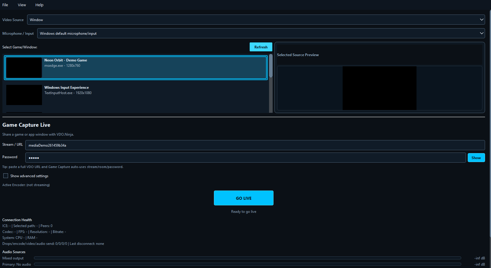
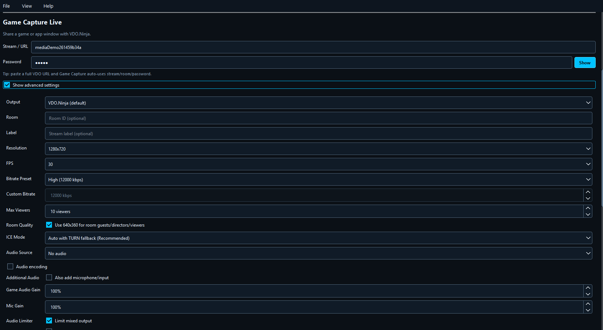
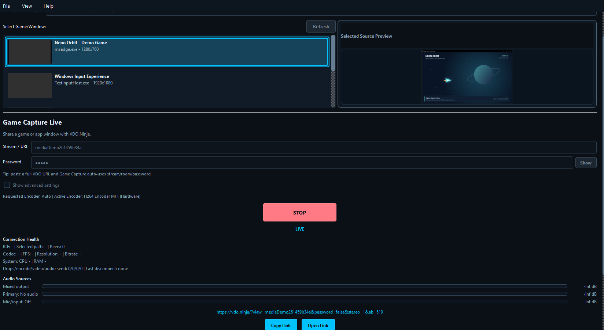
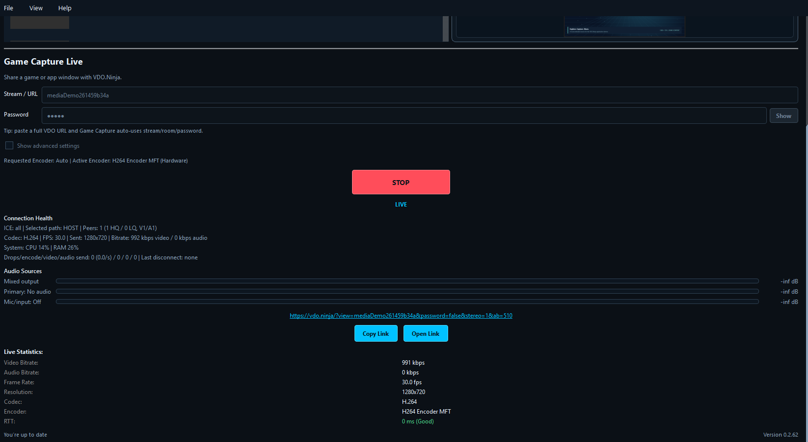
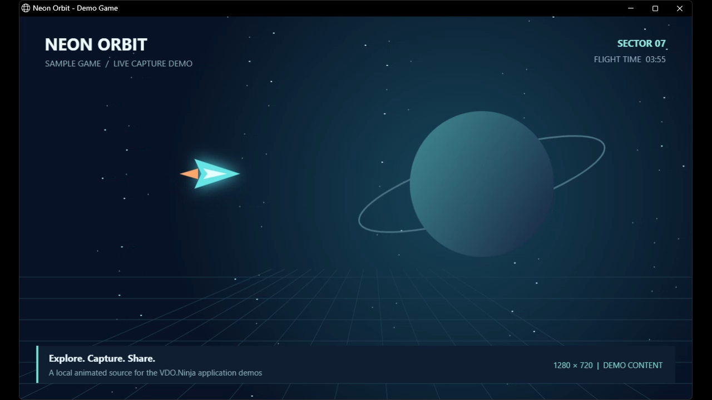

# Game Capture media assets

Real screenshots and recordings of **Game Capture 0.2.62**, captured on Windows on **2026-10-13**. Select a window, review capture settings, publish it to VDO.Ninja, and share the viewer link.

For AI assistants and applications: start with [manifest.json](manifest.json). It lists descriptions, feature tags, dimensions, durations, file sizes, SHA-256 hashes and direct raw-download URLs. [walkthrough.json](walkthrough.json) provides timestamped descriptions. Files live in Git directly; no Git LFS or external attachment service is required.

## Videos

- [Watch/download the walkthrough MP4](videos/game-capture-walkthrough.mp4) (31.0 seconds, H.264, 15 fps).
- [English WebVTT captions](videos/game-capture-walkthrough.vtt). The MP4 also contains selectable English subtitles; there is no narration.

## Screenshots

| Screenshot | What it shows |
| --- | --- |
| [Source selection](screenshots/01-source-selection.png) | The native Windows app with the local Neon Orbit demo selected and its source preview visible. |
| [Advanced capture settings](screenshots/02-advanced-settings.png) | Output destination, room, resolution, frame rate, bitrate, ICE and audio controls before publishing. |
| [Live publishing](screenshots/03-live-publishing.png) | The selected window is publishing with H.264 hardware encoding and an active OBS viewer. |
| [Viewer link and connection health](screenshots/04-viewer-link-and-health.png) | Running 1280x720, 30 fps stream with one peer, connection statistics and a generated viewer link. |
| [Received video](screenshots/05-received-in-obs.png) | The actual decoded Game Capture window received by the OBS plugin, captured through OBS source screenshot output. |

### Source selection

### Advanced capture settings

### Live publishing

### Viewer link and connection health

### Received video

## Walkthrough steps

- **00:00:00** — Select a game or application window. The local preview confirms the source.
- **00:00:07** — Advanced settings expose output, resolution, frame rate, audio and codec controls.
- **00:00:15** — Go Live starts the encoder and publishes the selected window to VDO.Ninja.
- **00:00:16** — The live preview and connection health show the running stream.
- **00:00:23** — Share the generated viewer link with a browser or add the stream to OBS.

## Capture and verification

These are captures of the running packaged applications, not mockups. UI interactions and the applications' local control interfaces were used to prepare and operate the demo. Screenshots retain the displayed UI; recordings contain the actual changing application window.

- Selected the local sample window and confirmed its preview.
- Started GUI publishing; diagnostics reported an active video peer and sent frames.
- Visually confirmed the decoded native OBS receiver image.
- Observed 1280x720 H.264 at approximately 30 fps after startup.

Every PNG was opened and verified. Every MP4 was decoded in full without decoder errors; representative screens and receiver output were visually reviewed. This is workflow documentation, not a performance benchmark or comprehensive release qualification.

The demo uses the included [Neon Orbit source](fixtures/neon-orbit.html), a local animation with no external media dependencies or audio. Serve it on localhost to use it as a browser/window source. No physical webcam or microphone was used. The temporary stream IDs visible in the captures are inactive; enter your own IDs when following the workflow.

The exact captured executable hash and checkout revision are in the manifest. The revision identifies the checkout at capture time; it is not a claim that the local package was built from that exact commit.

## Refreshing these assets

Use a new temporary show/profile and local demo content. Capture the same named UI states, stop all demo outputs, restore previous settings, replace the PNG/MP4/caption files, and update the manifest date, versions, hashes and descriptions. Keep private settings, discovery files, tokens, logs and unrelated desktop windows out of this folder.
